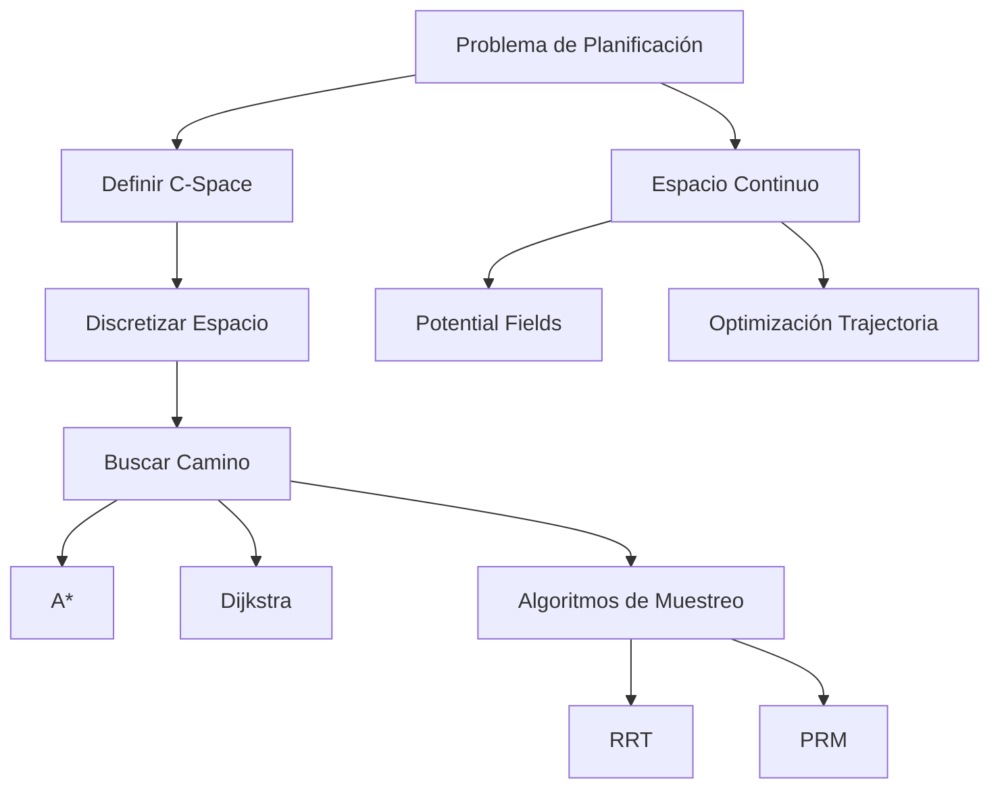
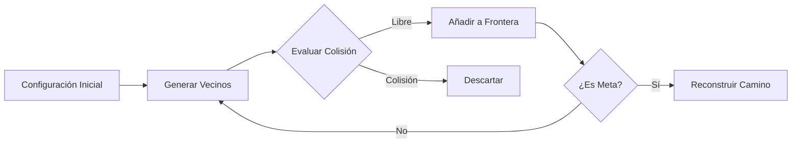

# Inteligencia Artificial - Búsqueda

## 2.1 Robótica, búsqueda básica y planificación de movimiento.

---

La planificación de movimiento es un problema fundamental en robótica que consiste en encontrar una secuencia de movimientos válidos que lleven al robot desde su configuración inicial hasta su configuración objetivo, evitando colisiones con obstáculos. Este problema se puede formular como un problema de búsqueda en el espacio de configuraciones del robot.

#### Espacio de Configuraciones (C-Space)

El espacio de configuraciones representa todas las posibles posiciones y orientaciones que puede adoptar un robot. Para un robot con n grados de libertad, su C-space es un espacio n-dimensional donde cada punto representa una configuración completa.

$$C = \{q \in \mathbb{R}^n | q \text{ es una configuración válida}\}$$

Donde $q$ es un vector que representa los valores de todas las articulaciones del robot.

#### Obstáculos en el C-Space

Los obstáculos en el espacio físico se mapean a regiones prohibidas en el C-space:

$$C_{obs} = \{q \in C | R(q) \cap O \neq \emptyset\}$$

Donde:

- $R(q)$ es el volumen ocupado por el robot en la configuración $q$
- $O$ es el conjunto de obstáculos en el espacio de trabajo
- $C_{free} = C \setminus C_{obs}$ es el espacio libre de colisiones

```python
# Ejemplo de verificación de colisión en espacio 2D
def esta_en_colision(configuracion, obstaculos):
    x, y = configuracion
    for obstaculo in obstaculos:
        if obstaculo.contiene_punto(x, y):
            return True
    return False
```

#### Algoritmos de Búsqueda para Planificación de Movimiento

##### Búsqueda en Espacio de Estados

Los algoritmos de búsqueda clásicos se aplican al espacio de configuraciones discretizado:

**Función de costo típica:**
$$f(n) = g(n) + h(n)$$

Donde:

- $g(n)$ = costo desde el inicio hasta el nodo n
- $h(n)$ = heurística estimada desde n hasta el objetivo

##### Algoritmo A* para Planificación de Movimiento

```python
def a_estrella(inicio, objetivo, espacio_configuraciones):
    abierta = PriorityQueue()
    abierta.put((0, inicio))
    procedencia = {}
    costo_g = {inicio: 0}
    costo_f = {inicio: heuristica(inicio, objetivo)}

    while not abierta.empty():
        actual = abierta.get()[1]

        if actual == objetivo:
            return reconstruir_camino(procedencia, actual)

        for vecino in obtener_vecinos(actual, espacio_configuraciones):
            costo_tentativo_g = costo_g[actual] + distancia(actual, vecino)

            if vecino not in costo_g or costo_tentativo_g < costo_g[vecino]:
                procedencia[vecino] = actual
                costo_g[vecino] = costo_tentativo_g
                costo_f[vecino] = costo_g[vecino] + heuristica(vecino, objetivo)
                abierta.put((costo_f[vecino], vecino))

    return None  # No se encontró camino
```

#### Heurísticas Commones

**Distancia Euclidiana:**

$$h(q, q_{goal}) = \|q - q_{goal}\|_2$$

**Distancia Manhattan:**

$$h(q, q_{goal}) = \sum_{i=1}^{n} |q_i - q_{goal_i}|$$

**Distancia de Chebyshev:**

$$h(q, q_{goal}) = \max_{i} |q_i - q_{goal_i}|$$

#### Planificación de Movimiento Continuo

##### Potential Field Planning

Cada obstáculo crea un campo repulsivo y la meta crea un campo atractivo:

$$U(q) = U_{attr}(q) + U_{rep}(q)$$

**Campo atractivo:**

$$U_{attr}(q) = \frac{1}{2} k_{attr} \|q - q_{goal}\|^2$$

**Campo repulsivo:**

$$ U_{rep}(q) = \begin{cases} \frac{1}{2} k_{rep} \left(\frac{1}{\rho(q)} - \frac{1}{\rho_0}\right)^2 & \text{si } \rho(q) \leq \rho_0 \\\ 0 & \text{si } \rho(q) > \rho_0 \end{cases}$$

Donde $\rho(q)$ es la distancia al obstáculo más cercano.

#### Roadmap Methods

##### Diagrama de Voronoi
Crea un roadmap donde los caminos maximizan la distancia a los obstáculos.

##### Visibility Graph
Conecta vértices de obstáculos que son mutuamente visibles.

#### Algoritmos de Muestreo Probabilístico

##### Rapidly-exploring Random Tree (RRT)

```python
def rrt(inicio, objetivo, espacio_configuraciones, max_iter=1000):
    arbol = {inicio: None}

    for _ in range(max_iter):
        q_rand = muestra_aleatoria(espacio_configuraciones)
        q_cercano = encuentra_mas_cercano(arbol, q_rand)
        q_nuevo = extende(q_cercano, q_rand, paso)

        if no_colision(q_cercano, q_nuevo):
            arbol[q_nuevo] = q_cercano

            if distancia(q_nuevo, objetivo) < umbral:
                return reconstruir_camino(arbol, q_nuevo)

    return None
```

#### Planificación con Restricciones Cinemáticas y Dinámicas

Para robots con restricciones no holonómicas, se deben considerar modelos dinámicos más complejos:

$$\dot{q} = f(q, u)$$

Donde $u$ representa los controles aplicados al robot.

### Diagramas





### Ejemplos y Ejercicios

#### Ejemplo 1: Planificación en Grid 2D

Problema: Un robot móvil en un grid 10x10 debe ir desde (1,1) hasta (10,10) evitando obstáculos.

**Grid:**
```
S . . . # . . . . .
. # . . . . # . . .
. . # . . . . . . .
. . . # . . . # . .
. . . . # . . . . .
. # . . . # . . . .
. . . # . . . . . .
. . . . . . # . . .
. . # . . . . # . .
. . . . . . . . . G
```

S = Start (1,1), G = Goal (10,10), # = Obstáculo

#### Ejercicios Propuestos

1. **Ejercicio de A*:**
   - Implementa A* para el grid anterior
   - Compara con Dijkstra en términos de nodos expandidos
   - Prueba diferentes heurísticas (Manhattan, Euclidiana, Chebyshev)

2. **Ejercicio de RRT:**
   - Simula un RRT en un espacio 2D continuo con obstáculos circulares
   - Visualiza el árbol y el camino encontrado
   - Analiza cómo afecta el tamaño del paso al rendimiento

3. **Ejercicio de Campos Potenciales:**
   - Implementa un campo potencial para un robot punto
   - Simula el descenso por gradiente
   - Identifica y propone soluciones para mínimos locales

4. **Ejercicio de Espacio de Configuraciones:**
   - Para un brazo robótico de 2 articulaciones con eslabones de longitud L1=1, L2=1
   - Define el C-space y sus obstáculos para un obstáculo circular en (0.5, 0.5) con radio 0.3
   - Visualiza C-free y C-obs

### Referencias

#### Bibliografía Básica
1. Russell, S. & Norvig, P. (2009). *Artificial Intelligence: A Modern Approach*. 3rd Edition. Prentice Hall. (Capítulos 3, 4, 25)
2. Marsland, S. (2009). *Machine Learning: An Algorithmic Perspective*. Chapman y Hall.

#### Bibliografía Complementaria
1. LaValle, S. M. (2006). *Planning Algorithms*. Cambridge University Press.
2. Choset, H., Lynch, K. M., Hutchinson, S., Kantor, G., Burgard, W., Kavraki, L. E., & Thrun, S. (2005). *Principles of Robot Motion: Theory, Algorithms, and Implementations*. MIT Press.
3. Latombe, J.-C. (1991). *Robot Motion Planning*. Kluwer Academic Publishers.

#### Recursos Adicionales
- Open Motion Planning Library (OMPL)
- ROS Navigation Stack
- Python libraries: PyGame, Matplotlib para visualización

### Implementación de Ejemplo

```python
# Ejemplo simplificado de A* para grid 2D
import heapq
import numpy as np

class Nodo:
    def __init__(self, posicion, padre=None, g=0, h=0):
        self.posicion = posicion
        self.padre = padre
        self.g = g  # costo desde inicio
        self.h = h  # heurística a objetivo
        self.f = g + h  # costo total

    def __lt__(self, otro):
        return self.f < otro.f

def a_estrella_grid(grid, inicio, objetivo):
    """Implementación de A* para un grid 2D"""
    movimientos = [(0,1), (1,0), (0,-1), (-1,0), (1,1), (-1,1), (1,-1), (-1,-1)]
    filas, columnas = grid.shape

    # Inicializar conjuntos abierto y cerrado
    abierto = []
    cerrado = set()

    # Crear nodo inicial
    nodo_inicio = Nodo(inicio, None, 0, heuristica(inicio, objetivo))
    heapq.heappush(abierto, nodo_inicio)

    while abierto:
        actual = heapq.heappop(abierto)

        if actual.posicion == objetivo:
            return reconstruir_camino(actual)

        cerrado.add(actual.posicion)

        for movimiento in movimientos:
            nueva_pos = (actual.posicion[0] + movimiento[0],
                         actual.posicion[1] + movimiento[1])

            # Verificar validez de la nueva posición
            if (0 <= nueva_pos[0] < filas and 0 <= nueva_pos[1] < columnas and
                grid[nueva_pos] == 0 and nueva_pos not in cerrado):

                nuevo_g = actual.g + distancia(actual.posicion, nueva_pos)
                nuevo_nodo = Nodo(nueva_pos, actual, nuevo_g,
                                 heuristica(nueva_pos, objetivo))

                # Verificar si ya está en abierto con mejor costo
                en_abierto = None
                for nodo in abierto:
                    if nodo.posicion == nueva_pos:
                        en_abierto = nodo
                        break

                if en_abierto is None or nuevo_g < en_abierto.g:
                    if en_abierto:
                        abierto.remove(en_abierto)
                    heapq.heappush(abierto, nuevo_nodo)

    return None  # No se encontró camino

def heuristica(a, b):
    """Distancia Euclidiana"""
    return np.sqrt((a[0]-b[0])**2 + (a[1]-b[1])**2)

def distancia(a, b):
    """Costo entre dos posiciones adyacentes"""
    dx, dy = abs(a[0]-b[0]), abs(a[1]-b[1])
    return 1 if dx + dy == 1 else 1.414  # 1 para ortogonal, √2 para diagonal
```
