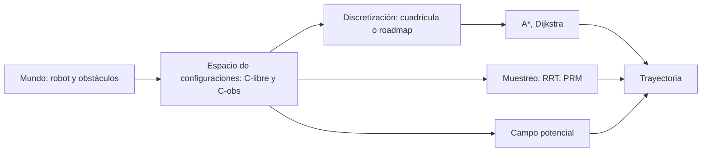

# Inteligencia Artificial - Búsqueda

## 2.1 Robótica, búsqueda básica y planificación de movimiento.

---

Un robot que debe ir de un lugar a otro sin chocar resuelve un problema de **planificación de movimiento**: encontrar una trayectoria continua, libre de colisiones, desde una configuración inicial hasta una final. Es un problema de búsqueda, pero en un espacio continuo y a menudo de muchas dimensiones. Este tema presenta el **espacio de configuraciones**, que reduce el robot a un punto; la búsqueda en grafos sobre una discretización, con A* y Dijkstra; los métodos de muestreo, como RRT, que escalan a muchas dimensiones; y los campos potenciales, rápidos pero con mínimos locales.

### Espacio de configuraciones

Una **configuración** $q$ es el conjunto de parámetros que fija la posición de cada punto del robot: para un robot móvil en el plano, $(x, y, \theta);$ para un brazo de $n$ articulaciones, los $n$ ángulos. El **espacio de configuraciones** $\mathcal{C}$ es el conjunto de todas ellas, y su dimensión son los **grados de libertad**. Los obstáculos del mundo se transforman en $\mathcal{C}_{\text{obs}},$ las configuraciones en las que alguna parte del robot toca un obstáculo, y el resto es $\mathcal{C}_{\text{libre}}.$ Planificar es buscar un camino en $\mathcal{C}_{\text{libre}},$ donde el robot es un punto. Para un brazo de dos articulaciones, $\mathcal{C}$ es un toro, porque cada ángulo es periódico, y un obstáculo circular pequeño en el mundo puede ocupar una franja completa de $\mathcal{C}:$ todas las configuraciones en que el primer eslabón lo atraviesa, sin importar el segundo ángulo.

### Búsqueda en una discretización

Si se discretiza el espacio en una **cuadrícula** o un **grafo de caminos** (*roadmap*), como el de visibilidad o el diagrama de Voronoi, el problema se vuelve una búsqueda en un grafo:

- **Dijkstra** expande los nodos en orden de su costo desde el inicio, $g(n),$ y encuentra el camino de costo mínimo.
- **A*** expande en orden de $f(n) = g(n) + h(n),$ donde la **heurística** $h(n)$ estima el costo restante. Si $h$ es **admisible**, nunca sobrestima, A* también encuentra el óptimo, y expande menos nodos cuanto más se acerca $h$ al costo real (tema 2.2).

La heurística debe corresponder a la **vecindad**. Con movimientos en 4 direcciones de costo 1, la distancia Manhattan es admisible y la más informada; con 8 direcciones, con diagonales de costo $\sqrt{2},$ la Manhattan **sobrestima** y deja de ser admisible, y la correcta es la distancia **octil**, $\max(\Delta x, \Delta y) + (\sqrt{2} - 1)\min(\Delta x, \Delta y).$ La euclidiana y la de Chebyshev son admisibles en ambos casos, pero menos informadas.

La discretización tiene un costo que crece **exponencialmente** con la dimensión: una cuadrícula de 100 valores por eje tiene $100^d$ celdas, inmanejable para un brazo de 6 o 7 articulaciones.

### Muestreo: RRT

Los métodos de **muestreo** evitan construir el espacio completo. El **árbol de exploración rápida** (RRT, LaValle, 1998) crece desde el inicio: en cada iteración toma un punto aleatorio $q_{\text{rand}},$ encuentra el nodo más cercano del árbol, avanza hacia $q_{\text{rand}}$ un **paso** fijo y, si el segmento no choca, agrega el nodo. Con una pequeña probabilidad, el punto aleatorio es la meta, lo que sesga el crecimiento hacia ella. RRT es **probabilísticamente completo**: si existe un camino, la probabilidad de encontrarlo tiende a 1. Pero sus caminos no son óptimos; **RRT*** (Karaman y Frazzoli, 2011) reconecta el árbol para converger al óptimo (tema 2.3). La hoja de ruta probabilística (PRM) es la variante para consultas múltiples en el mismo entorno.

### Campos potenciales

Khatib (1986) propuso mover el robot como una partícula en un **campo potencial**: la meta lo **atrae** con un potencial $U_{\text{atr}} = \tfrac{1}{2} k_a \lVert q - q_{\text{meta}} \rVert^2,$ y los obstáculos lo **repelen** con un potencial que crece al acercarse a ellos dentro de una distancia $\rho_0.$ El robot sigue el gradiente negativo. Es rápido y reactivo, útil para evitar obstáculos en tiempo real, pero puede quedar atrapado en un **mínimo local**, un punto donde atracción y repulsión se cancelan; por ejemplo, con un obstáculo justo en la línea entre el robot y la meta. Las soluciones son perturbaciones aleatorias para escapar, funciones de navegación sin mínimos locales, o combinar el campo con un planificador global.



### Implementación en Python

El programa resuelve los cuatro ejercicios. Compara Dijkstra y A* con cinco heurísticas en la cuadrícula del ejemplo, con vecindad de 4 y de 8; ejecuta RRT con cuatro tamaños de paso y 20 semillas cada uno; simula el descenso por un campo potencial con un obstáculo que produce un mínimo local y lo escapa con perturbaciones; y calcula el espacio de configuraciones de un brazo de dos eslabones, dibujándolo con caracteres.

```python
import heapq, math, random

# ---------- Ejercicio 1: A* frente a Dijkstra en la cuadrícula del ejemplo ----------
MAPA = """S...#.....
.#....#...
..#.......
...#...#..
....#.....
.#...#....
...#......
......#...
..#....#..
.........G""".split()
N = 10
libre = lambda f, c: 0 <= f < N and 0 <= c < N and MAPA[f][c] != "#"
def busca(h, vecindad):
    inicio, meta = (0, 0), (N - 1, N - 1)
    g, abierta, padre, expandidos = {inicio: 0.0}, [(h(inicio, meta), 0.0, inicio)], {inicio: None}, 0
    cerrados = set()
    while abierta:
        _, gc, n = heapq.heappop(abierta)
        if n in cerrados: continue
        cerrados.add(n); expandidos += 1
        if n == meta:
            camino = []
            while n: camino.append(n); n = padre[n]
            return gc, expandidos, camino[::-1]
        for df, dc in vecindad:
            m = (n[0] + df, n[1] + dc)
            if not libre(*m): continue
            if df and dc and not (libre(n[0] + df, n[1]) and libre(n[0], n[1] + dc)): continue   # sin cortar esquinas
            ng = gc + math.hypot(df, dc)
            if ng < g.get(m, math.inf): g[m] = ng; padre[m] = n; heapq.heappush(abierta, (ng + h(m, meta), ng, m))
    return math.inf, expandidos, []
heuristicas = {"Dijkstra (h = 0)": lambda a, b: 0, "Manhattan": lambda a, b: abs(a[0] - b[0]) + abs(a[1] - b[1]),
               "Euclidiana": lambda a, b: math.dist(a, b), "Chebyshev": lambda a, b: max(abs(a[0] - b[0]), abs(a[1] - b[1])),
               "octil": lambda a, b: (lambda dx, dy: max(dx, dy) + (math.sqrt(2) - 1) * min(dx, dy))(abs(a[0] - b[0]), abs(a[1] - b[1]))}
V4 = [(0, 1), (1, 0), (0, -1), (-1, 0)]; V8 = V4 + [(1, 1), (1, -1), (-1, 1), (-1, -1)]
for nombre_v, v in (("4 vecinos", V4), ("8 vecinos", V8)):
    print(f"ejercicio 1, {nombre_v}:")
    for nombre, h in heuristicas.items():
        costo, exp, camino = busca(h, v)
        print(f"   {nombre:17} costo {costo:6.3f} | nodos expandidos {exp:3} | longitud del camino {len(camino)}")

# ---------- Ejercicio 2: RRT en el plano con obstáculos circulares ----------
OBST = [((3, 3), 1.2), ((6, 6), 1.5), ((7, 2), 1.0), ((2.5, 7), 1.0)]
def choca(p, q, pasos=10):
    return any(math.dist((p[0] + (q[0] - p[0]) * t / pasos, p[1] + (q[1] - p[1]) * t / pasos), c) <= r for t in range(pasos + 1) for c, r in OBST)
def rrt(paso, semilla, inicio=(0.5, 0.5), meta=(9.5, 9.5), max_iter=5000, sesgo=0.05):
    rng = random.Random(semilla); nodos, padre = [inicio], {0: None}
    for it in range(1, max_iter + 1):
        q = meta if rng.random() < sesgo else (rng.uniform(0, 10), rng.uniform(0, 10))
        i = min(range(len(nodos)), key=lambda k: math.dist(nodos[k], q))
        d = math.dist(nodos[i], q)
        nuevo = q if d <= paso else (nodos[i][0] + (q[0] - nodos[i][0]) * paso / d, nodos[i][1] + (q[1] - nodos[i][1]) * paso / d)
        if choca(nodos[i], nuevo): continue
        nodos.append(nuevo); padre[len(nodos) - 1] = i
        if math.dist(nuevo, meta) <= paso and not choca(nuevo, meta):
            k, largo = len(nodos) - 1, math.dist(nuevo, meta)
            while padre[k] is not None: largo += math.dist(nodos[k], nodos[padre[k]]); k = padre[k]
            return it, len(nodos), largo
    return None, len(nodos), None
print(f"ejercicio 2: RRT, recta inicio-meta {math.dist((0.5, 0.5), (9.5, 9.5)):.2f}; promedio de 20 semillas")
for paso in (0.25, 0.5, 1.0, 2.0):
    res = [rrt(paso, s) for s in range(20)]; ok = [r for r in res if r[0]]
    print(f"   paso {paso:4}: éxito {len(ok)}/20 | iteraciones {sum(r[0] for r in ok) / len(ok):7.1f} | nodos {sum(r[1] for r in ok) / len(ok):6.1f} | largo del camino {sum(r[2] for r in ok) / len(ok):5.2f}")

# ---------- Ejercicio 3: campo potencial y mínimos locales ----------
def gradiente(p, meta, obst, ka=1.0, kr=3.0, rho0=1.5):
    gx, gy = ka * (p[0] - meta[0]), ka * (p[1] - meta[1])                # atracción cuadrática
    for c, r in obst:
        d = math.dist(p, c) - r
        if 0 < d < rho0:                                                 # repulsión de Khatib
            f = kr * (1 / d - 1 / rho0) / d ** 2
            gx -= f * (p[0] - c[0]) / math.dist(p, c); gy -= f * (p[1] - c[1]) / math.dist(p, c)
    return gx, gy
def desciende(inicio, meta, obst, eta=0.01, iters=5000, perturbacion=False, rng=random.Random(2)):
    p, quietos = inicio, 0
    for _ in range(iters):
        gx, gy = gradiente(p, meta, obst); norma = math.hypot(gx, gy)
        if math.dist(p, meta) < 0.05: return "meta", p
        if norma < 1e-3:
            if not perturbacion: return "mínimo local", p
            p = (p[0] + rng.uniform(-1, 1), p[1] + rng.uniform(-1, 1)); continue       # caminata aleatoria para escapar
        paso = min(eta * norma, 0.1)
        p = (p[0] - paso * gx / norma, p[1] - paso * gy / norma)
    return "sin llegar", p
for nombre, obst in (("obstáculo lateral", [((5, 6.2), 1.0)]), ("obstáculo en la línea recta", [((5, 5), 1.0)])):
    for pert in (False, True):
        r, p = desciende((1, 1), (9, 9), obst, perturbacion=pert)
        print(f"ejercicio 3: {nombre:28} {'con perturbación' if pert else 'sin perturbación':17} → {r} en ({p[0]:.2f}, {p[1]:.2f})")

# ---------- Ejercicio 4: espacio de configuraciones de un brazo de 2 eslabones ----------
L1 = L2 = 1.0; C, R = (0.5, 0.5), 0.3
def colisiona(t1, t2, n=20):
    codo = (L1 * math.cos(t1), L1 * math.sin(t1))
    mano = (codo[0] + L2 * math.cos(t1 + t2), codo[1] + L2 * math.sin(t1 + t2))
    puntos = [(codo[0] * k / n, codo[1] * k / n) for k in range(n + 1)] + \
             [(codo[0] + (mano[0] - codo[0]) * k / n, codo[1] + (mano[1] - codo[1]) * k / n) for k in range(n + 1)]
    return any(math.dist(p, C) <= R for p in puntos)
M = 72; celdas = [[colisiona(2 * math.pi * i / M, 2 * math.pi * j / M) for j in range(M)] for i in range(M)]
fraccion = sum(map(sum, celdas)) / M ** 2
print(f"ejercicio 4: C-espacio discretizado en {M}×{M}: C-obs = {fraccion:.1%}, C-libre = {1 - fraccion:.1%}")
paso = 6
for i in range(0, M, paso):
    print("   " + "".join("█" if celdas[i][j] else "·" for j in range(0, M, paso // 2)), f"θ1 = {360 * i // M:3}°")
```

Salida:

```text
ejercicio 1, 4 vecinos:
   Dijkstra (h = 0)  costo 18.000 | nodos expandidos  87 | longitud del camino 19
   Manhattan         costo 18.000 | nodos expandidos  79 | longitud del camino 19
   Euclidiana        costo 18.000 | nodos expandidos  81 | longitud del camino 19
   Chebyshev         costo 18.000 | nodos expandidos  83 | longitud del camino 19
   octil             costo 18.000 | nodos expandidos  80 | longitud del camino 19
ejercicio 1, 8 vecinos:
   Dijkstra (h = 0)  costo 13.899 | nodos expandidos  87 | longitud del camino 12
   Manhattan         costo 13.899 | nodos expandidos  13 | longitud del camino 12
   Euclidiana        costo 13.899 | nodos expandidos  37 | longitud del camino 12
   Chebyshev         costo 13.899 | nodos expandidos  46 | longitud del camino 12
   octil             costo 13.899 | nodos expandidos  31 | longitud del camino 12
ejercicio 2: RRT, recta inicio-meta 12.73; promedio de 20 semillas
   paso 0.25: éxito 20/20 | iteraciones   343.1 | nodos  270.8 | largo del camino 16.17
   paso  0.5: éxito 20/20 | iteraciones   171.1 | nodos  128.9 | largo del camino 16.71
   paso  1.0: éxito 20/20 | iteraciones    75.5 | nodos   55.4 | largo del camino 17.33
   paso  2.0: éxito 20/20 | iteraciones    39.8 | nodos   27.6 | largo del camino 16.58
ejercicio 3: obstáculo lateral            sin perturbación  → meta en (8.98, 8.96)
ejercicio 3: obstáculo lateral            con perturbación  → meta en (8.98, 8.96)
ejercicio 3: obstáculo en la línea recta  sin perturbación  → mínimo local en (3.85, 3.85)
ejercicio 3: obstáculo en la línea recta  con perturbación  → meta en (8.97, 8.96)
ejercicio 4: C-espacio discretizado en 72×72: C-obs = 19.7%, C-libre = 80.3%
   ········███············· θ1 =   0°
   ████████████████████████ θ1 =  30°
   ████████████████████████ θ1 =  60°
   ··············███······· θ1 =  90°
   ··············██········ θ1 = 120°
   ························ θ1 = 150°
   ························ θ1 = 180°
   ························ θ1 = 210°
   ························ θ1 = 240°
   ························ θ1 = 270°
   ························ θ1 = 300°
   ·········██············· θ1 = 330°
```

### Ejercicios Propuestos

1. **A\*.** En la cuadrícula de 10x10 del programa, implementa A*, compáralo con Dijkstra en nodos expandidos y prueba las heurísticas Manhattan, euclidiana y de Chebyshev.

2. **RRT.** Simula RRT en el plano con obstáculos circulares y analiza cómo afecta el tamaño del paso al rendimiento.

3. **Campos potenciales.** Implementa un campo potencial para un robot puntual, simula el descenso por gradiente, e identifica y resuelve los mínimos locales.

4. **Espacio de configuraciones.** Para un brazo de 2 articulaciones con eslabones de longitud $L_1 = L_2 = 1,$ define el espacio de configuraciones y sus obstáculos para un obstáculo circular en $(0.5, 0.5)$ de radio 0.3, y muestra $\mathcal{C}_{\text{libre}}$ y $\mathcal{C}_{\text{obs}}.$

### Soluciones

**Ejercicio 1.** Con 4 vecinos, todos encuentran el mismo camino óptimo de costo 18, y A* con Manhattan expande 79 nodos frente a 87 de Dijkstra; el ahorro es pequeño porque los obstáculos obligan a rodeos y casi todo el mapa es alcanzable con costo menor que 18. Con 8 vecinos y diagonales sin cortar esquinas, el óptimo cuesta 13.899. Las heurísticas admisibles expanden entre 31, la octil, la más informada, y 46, la de Chebyshev, frente a 87 de Dijkstra. Manhattan expande solo 13 y aquí encuentra el óptimo, pero por suerte: con 8 vecinos **no es admisible**, y en otro mapa puede devolver un camino más caro. La lección es que una heurística que sobrestima acelera la búsqueda a costa de la garantía de optimalidad.

**Ejercicio 2.** Con 20 semillas por tamaño de paso, RRT encuentra un camino en todos los casos. Un paso mayor reduce mucho las iteraciones y los nodos, de 343 iteraciones con paso 0.25 a 40 con paso 2, porque cada extensión avanza más. Pero un paso grande choca más a menudo cerca de los obstáculos y pasa peor por pasajes estrechos, que en este mapa no hay. La longitud de los caminos, entre 16.2 y 17.3 frente a 12.7 de la línea recta, muestra que RRT no optimiza: los caminos son quebrados, y en la práctica se suavizan con un posprocesamiento o se usa RRT*.

**Ejercicio 3.** Con un obstáculo a un lado de la línea recta, el robot lo rodea y llega a la meta. Con el obstáculo justo **sobre** la línea, la repulsión empuja en la dirección exactamente opuesta a la atracción, por simetría, y el robot se detiene en un **mínimo local** frente al obstáculo, en $(3.85, 3.85).$ Una perturbación aleatoria cuando el gradiente se anula rompe la simetría, y el robot rodea el obstáculo y llega. Otras soluciones son la planificación global con A* o RRT que da puntos intermedios al campo, y las funciones de navegación, como las de Rimon y Koditschek, construidas para no tener mínimos locales.

**Ejercicio 4.** $\mathcal{C} = [0, 2\pi) \times [0, 2\pi),$ un toro. Una configuración está en $\mathcal{C}_{\text{obs}}$ si algún punto de alguno de los dos eslabones está dentro del círculo. El programa lo calcula en una rejilla de 72 x 72 configuraciones y obtiene un 19.7 % de $\mathcal{C}_{\text{obs}}.$ El dibujo, con $\theta_1$ en las filas y $\theta_2$ en las columnas, muestra dos tipos de obstáculo: las **franjas completas** para $\theta_1$ entre unos 20° y 70°, donde el primer eslabón, que pasa por el origen, atraviesa el círculo sin importar $\theta_2,$ porque el centro del obstáculo está a 45° y a distancia $0.71;$ y **manchas** para otros valores de $\theta_1,$ donde solo el segundo eslabón choca con ciertos valores de $\theta_2.$ Un camino en el mundo que parece sencillo puede requerir rodear las franjas por el otro lado del toro, girando el brazo en sentido contrario.

### Referencias

1. LaValle, S. M., _Planning Algorithms_. Cambridge University Press, 2006.
2. Choset, H., et al., _Principles of Robot Motion: Theory, Algorithms, and Implementations_. MIT Press, 2005.
3. Russell, S., and Norvig, P., _Artificial Intelligence: A Modern Approach_. Pearson, 2021. Capítulos 3 y 26.
4. Khatib, O., Real-time obstacle avoidance for manipulators and mobile robots. _International Journal of Robotics Research_ 5(1), 1986.
5. Karaman, S., and Frazzoli, E., Sampling-based algorithms for optimal motion planning. _International Journal of Robotics Research_ 30(7), 2011.
