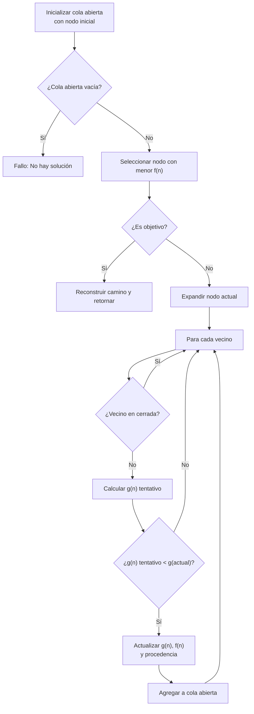

# Inteligencia Artificial - Búsqueda

## 2.2 Búsqueda heurística A*.

---

El algoritmo A* (A-star) es un algoritmo de búsqueda en grafos que encuentra el camino de menor costo desde un nodo inicial hasta un nodo objetivo. Combina las ventajas de la búsqueda informada (uso de heurísticas) con la garantía de optimalidad de la búsqueda de costo uniforme.

### Fundamentos Matemáticos

#### Función de Evaluación

La función de evaluación en A* se define como:

$$f(n) = g(n) + h(n)$$

Donde:

- $g(n)$ = costo real desde el nodo inicial hasta el nodo n
- $h(n)$ = costo heurístico estimado desde el nodo n hasta el nodo objetivo
- $f(n)$ = costo total estimado del camino a través del nodo n

#### Propiedades de la Heurística

**Admisibilidad:**
Una heurística $h(n)$ es admisible si nunca sobreestima el costo real para alcanzar el objetivo:

$$0 \leq h(n) \leq h^*(n)$$

Donde $h^*(n)$ es el costo real óptimo desde n al objetivo.

**Consistencia (Monotonicidad):**
Una heurística es consistente si para cada nodo n y cada sucesor n' de n, se cumple:

$$h(n) \leq c(n, n') + h(n')$$

Donde $c(n, n')$ es el costo del paso de n a n'.

### Algoritmo A* - Pseudocódigo

```
function A*(inicio, objetivo)
    abierta = PriorityQueue()  // Cola de prioridad por f(n)
    cerrada = Set()

    g_score = {inicio: 0}
    f_score = {inicio: h(inicio)}
    abierta.put(inicio, f_score[inicio])
    procedencia = {}

    while not abierta.empty():
        actual = abierta.get()

        if actual == objetivo:
            return reconstruir_camino(procedencia, actual)

        cerrada.add(actual)

        for cada vecino de actual:
            if vecino in cerrada:
                continue

            tentative_g = g_score[actual] + costo(actual, vecino)

            if vecino not in abierta or tentative_g < g_score[vecino]:
                procedencia[vecino] = actual
                g_score[vecino] = tentative_g
                f_score[vecino] = g_score[vecino] + h(vecino)

                if vecino not in abierta:
                    abierta.put(vecino, f_score[vecino])

    return fallo  // No se encontró camino
```

### Implementación en Python

```python
import heapq
from collections import defaultdict

class Nodo:
    def __init__(self, estado, padre=None, g=0, h=0):
        self.estado = estado
        self.padre = padre
        self.g = g  # Costo real desde inicio
        self.h = h  # Heurística estimada
        self.f = g + h  # Costo total estimado

    def __lt__(self, otro):
        return self.f < otro.f

def a_estrella(inicio, objetivo, obtener_vecinos, heuristica, costo):
    """
    Implementación del algoritmo A*

    Args:
        inicio: estado inicial
        objetivo: estado objetivo
        obtener_vecinos: función que devuelve los vecinos de un estado
        heuristica: función heurística h(n)
        costo: función de costo entre dos estados

    Returns:
        Camino óptimo o None si no existe
    """
    # Inicializar estructuras de datos
    abierta = []
    cerrada = set()
    g_scores = defaultdict(lambda: float('inf'))
    procedencia = {}

    # Crear nodo inicial
    g_scores[inicio] = 0
    h_inicio = heuristica(inicio, objetivo)
    nodo_inicio = Nodo(inicio, None, 0, h_inicio)
    heapq.heappush(abierta, (nodo_inicio.f, inicio, nodo_inicio))

    while abierta:
        # Obtener nodo con menor f(n)
        _, estado_actual, nodo_actual = heapq.heappop(abierta)

        if estado_actual in cerrada:
            continue

        if estado_actual == objetivo:
            return reconstruir_camino(procedencia, estado_actual)

        cerrada.add(estado_actual)

        # Expandir nodos vecinos
        for vecino in obtener_vecinos(estado_actual):
            if vecino in cerrada:
                continue

            # Calcular nuevo costo g
            nuevo_g = g_scores[estado_actual] + costo(estado_actual, vecino)

            if nuevo_g < g_scores[vecino]:
                # Este camino es mejor que cualquier anterior
                procedencia[vecino] = estado_actual
                g_scores[vecino] = nuevo_g
                h_vecino = heuristica(vecino, objetivo)
                f_vecino = nuevo_g + h_vecino

                # Agregar a cola abierta
                nodo_vecino = Nodo(vecino, estado_actual, nuevo_g, h_vecino)
                heapq.heappush(abierta, (f_vecino, vecino, nodo_vecino))

    return None

def reconstruir_camino(procedencia, actual):
    """Reconstruye el camino desde el objetivo hasta el inicio"""
    camino = [actual]
    while actual in procedencia:
        actual = procedencia[actual]
        camino.append(actual)
    return camino[::-1]
```

### Heurísticas Comunes

#### Para Problemas en Grid 2D

**Distancia Manhattan:**
$$h(n) = |x_n - x_{objetivo}| + |y_n - y_{objetivo}|$$

**Distancia Euclidiana:**
$$h(n) = \sqrt{(x_n - x_{objetivo})^2 + (y_n - y_{objetivo})^2}$$

**Distancia Chebyshev:**
$$h(n) = \max(|x_n - x_{objetivo}|, |y_n - y_{objetivo}|)$$

### Ejemplo: Problema del 8-Puzzle

```python
def heuristica_8_puzzle(estado, objetivo):
    """Heurística de distancia Manhattan para 8-puzzle"""
    distancia = 0
    for i in range(3):
        for j in range(3):
            valor = estado[i][j]
            if valor != 0:  # Ignorar casilla vacía
                # Encontrar posición objetivo del valor
                for x in range(3):
                    for y in range(3):
                        if objetivo[x][y] == valor:
                            distancia += abs(i - x) + abs(j - y)
                            break
    return distancia

def obtener_vecinos_8_puzzle(estado):
    """Genera estados vecinos para 8-puzzle"""
    vecinos = []
    # Encontrar posición del espacio vacío (0)
    for i in range(3):
        for j in range(3):
            if estado[i][j] == 0:
                x, y = i, j
                break

    # Movimientos posibles
    movimientos = [(0,1), (1,0), (0,-1), (-1,0)]
    for dx, dy in movimientos:
        nx, ny = x + dx, y + dy
        if 0 <= nx < 3 and 0 <= ny < 3:
            # Crear nuevo estado
            nuevo_estado = [list(fila) for fila in estado]
            nuevo_estado[x][y], nuevo_estado[nx][ny] = nuevo_estado[nx][ny], nuevo_estado[x][y]
            vecinos.append(tuple(tuple(fila) for fila in nuevo_estado))

    return vecinos
```

### Diagrama de Flujo del Algoritmo A*



### Ejercicios Propuestos

#### Ejercicio 1: Implementación Básica

Implementa A* para un grid 2D con obstáculos. Considera:

- Grid de 10x10 con obstáculos aleatorios
- Heurísticas Manhattan y Euclidiana
- Compara el número de nodos expandidos

#### Ejercicio 2: Análisis de Optimalidad

Dado el siguiente grafo:

```
Nodos: A, B, C, D, E (Objetivo: E)
Aristas:
A-B: 1, A-C: 3
B-D: 2, C-D: 1
D-E: 3
Heurísticas: h(A)=5, h(B)=4, h(C)=2, h(D)=3, h(E)=0
```

1. ¿Es la heurística admisible?
2. Ejecuta A* paso a paso
3. Encuentra el camino óptimo

#### Ejercicio 3: 8-Puzzle

Implementa A* para resolver el 8-puzzle usando:

- Heurística de fichas mal colocadas
- Heurística de distancia Manhattan
- Compara la eficiencia de ambas

#### Ejercicio 4: Análisis de Complejidad

Para un grid de tamaño N×N:

1. ¿Cuál es la complejidad espacial en el peor caso?
2. ¿Cuál es la complejidad temporal en el peor caso?
3. ¿Cómo afecta la calidad de la heurística al rendimiento?

### Propiedades y Teoremas

#### Teorema de Optimalidad

Si $h(n)$ es admisible, entonces A* es óptimo, es decir, encuentra el camino de menor costo.

#### Complejidad Computacional

- Complejidad temporal: $O(b^d)$ en el peor caso, donde b es el factor de ramificación y d es la profundidad de la solución
- Complejidad espacial: $O(b^d)$ (mantiene todos los nodos en memoria)

#### Eficiencia de la Heurística

La eficiencia de A* depende de la calidad de la heurística. Una heurística más informada (más cercana a h*) expande menos nodos:

$$ h\_2 (n) \geq h\_1 (n) \leq h ^ * (n) \Rightarrow \text{A* con } h\_2 \text{ expande menos nodos que con } h\_1 $$

### Optimizaciones Prácticas

#### Iterative Deepening A* (IDA*)

Combina A* con depth-first search con límite de costo incremental.

#### Memory-Bounded A*

Variantes que limitan el uso de memoria:

- Simplified Memory-Bounded A* (SMA*)
- Recursive Best-First Search (RBFS)

### Referencias Bibliográficas

#### Bibliografía Básica

1. Russell, S. & Norvig, P. (2009). _Artificial Intelligence: A Modern Approach_. 3rd Edition. Prentice Hall. (Capítulo 3: Solving Problems by Searching)
2. Marsland, S. (2009). _Machine Learning: An Algorithmic Perspective_. Chapman y Hall. (Capítulo 4: Search Methods)

#### Bibliografía Complementaria

1. Hart, P. E., Nilsson, N. J., & Raphael, B. (1968). _A Formal Basis for the Heuristic Determination of Minimum Cost Paths_. IEEE Transactions on Systems Science and Cybernetics.
2. Pearl, J. (1984). _Heuristics: Intelligent Search Strategies for Computer Problem Solving_. Addison-Wesley.

#### Recursos Adicionales

- [A* Search Algorithm - Wikipedia](https://en.wikipedia.org/wiki/A*_search_algorithm)
- [Red Blob Games - Pathfinding](https://www.redblobgames.com/pathfinding/a-star/introduction.html)
- [Stanford CS221 - A* Search](https://stanford-cs221.github.io/autumn2019/extra/a-star.html)

### Caso de Estudio: Sistema de Navegación

```python
# Ejemplo de aplicación en navegación
def navegacion_a_estrella(mapa, inicio, destino):
    """Sistema de navegación usando A*"""

    def heuristica_nav(pos_actual, pos_destino):
        # Distancia Euclidiana para navegación
        lat1, lon1 = pos_actual
        lat2, lon2 = pos_destino
        return ((lat2-lat1)**2 + (lon2-lon1)**2)**0.5

    def obtener_vecinos_nav(posicion):
        # Obtener posiciones vecinas navegables
        vecinos = []
        for movimiento in [(0.001,0), (0,0.001), (-0.001,0), (0,-0.001)]:
            nueva_pos = (posicion[0] + movimiento[0], posicion[1] + movimiento[1])
            if es_navegable(nueva_pos, mapa):
                vecinos.append(nueva_pos)
        return vecinos

    return a_estrella(inicio, destino, obtener_vecinos_nav, heuristica_nav, distancia_geografica)
```
