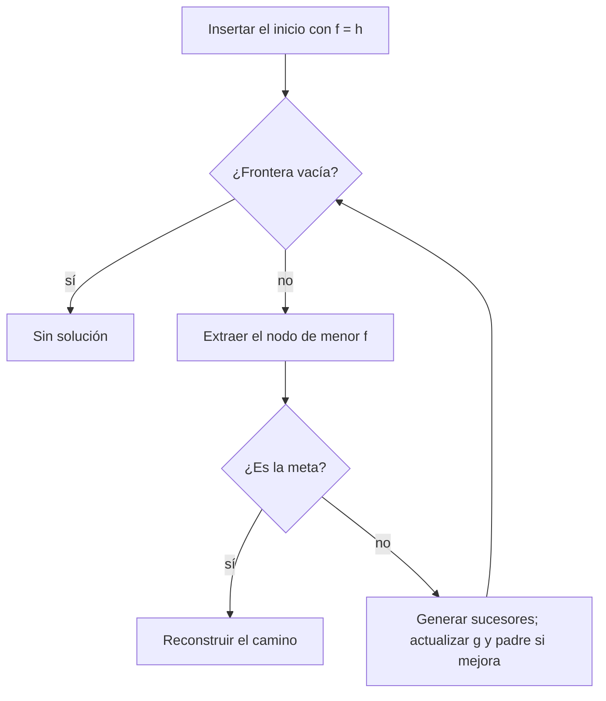

# Inteligencia Artificial - Búsqueda

## 2.2 Búsqueda heurística A*.

---

Las búsquedas no informadas, como la búsqueda en anchura o la de costo uniforme de Dijkstra, exploran en todas direcciones porque no saben dónde está la meta. Una **heurística** es una estimación del costo que falta para llegar, y permite explorar primero lo que parece prometedor. **A*** (Hart, Nilsson y Raphael, 1968) combina el costo recorrido con la estimación del que falta, y tiene una propiedad notable: con una heurística que nunca sobrestima, encuentra el camino óptimo, y lo hace expandiendo menos nodos que cualquier otro algoritmo con la misma información. Este tema presenta el algoritmo, las condiciones de admisibilidad y consistencia con sus demostraciones, el diseño de heurísticas y su efecto en la eficiencia.

### El algoritmo

Para cada nodo $n,$ $g(n)$ es el costo del mejor camino conocido desde el inicio, $h(n)$ la estimación del costo hasta la meta, y

$$f(n) = g(n) + h(n)$$

la estimación del costo de la mejor solución que pasa por $n.$ A* mantiene una **frontera** ordenada por $f;$ en cada paso extrae el nodo de menor $f,$ termina si es la meta y, si no, genera sus sucesores, actualizando $g$ y el padre de cada uno cuando encuentra un camino mejor. Con $h = 0$ es el algoritmo de Dijkstra, y con $g$ ignorado es la búsqueda voraz, que es rápida pero no óptima.

### Admisibilidad y consistencia

Sea $h^*(n)$ el costo real mínimo de $n$ a la meta.

- $h$ es **admisible** si $h(n) \le h^*(n)$ para todo $n:$ nunca sobrestima.
- $h$ es **consistente**, o monótona, si para todo nodo $n$ y sucesor $n'$ con costo $c(n, n'),$ $h(n) \le c(n, n') + h(n'),$ y $h(\text{meta}) = 0:$ una desigualdad triangular.

**Teorema.** Toda heurística consistente es admisible. Por inducción sobre el número de pasos del camino óptimo de $n$ a la meta: si es 0, $h(n) = 0 = h^*(n);$ si el camino óptimo pasa primero por $n',$ entonces $h(n) \le c(n, n') + h(n') \le c(n, n') + h^*(n') = h^*(n).$ $\blacksquare$

**Teorema.** Con una heurística consistente, A* en búsqueda de grafos es óptimo. Primero, los valores de $f$ a lo largo de cualquier camino no decrecen: $f(n') = g(n) + c(n, n') + h(n') \ge g(n) + h(n) = f(n).$ Por eso, cuando A* extrae un nodo, ya encontró el mejor camino hacia él, y la primera vez que extrae la meta, su $g$ es el costo óptimo. $\blacksquare$ Con una heurística solo admisible, A* también es óptimo si se permite reabrir nodos ya cerrados.

A* es además **óptimamente eficiente**: entre los algoritmos que extienden caminos desde el inicio con la misma heurística consistente, ninguno garantiza expandir menos nodos, porque todos deben expandir los nodos con $f(n) \lt C^*,$ el costo óptimo.

### Diseño de heurísticas

Una heurística admisible se obtiene como el costo exacto de un **problema relajado**, con menos restricciones. En el 8-puzzle, si una ficha pudiera moverse a cualquier casilla, el costo sería el número de **fichas mal colocadas**; si pudiera moverse a una casilla vecina aunque esté ocupada, sería la suma de las **distancias Manhattan** de cada ficha a su lugar. Una heurística **domina** a otra si es mayor o igual en todos los estados y ambas son admisibles, y entonces A* con la dominante nunca expande más nodos: la Manhattan domina a la de fichas mal colocadas. El máximo de varias heurísticas admisibles es admisible y domina a cada una. Las **bases de datos de patrones** guardan el costo exacto de resolver subconjuntos de fichas y dan heurísticas mucho más fuertes.

### Complejidad

En el peor caso, A* expande todos los nodos con $f \lt C^*,$ y guarda todos los generados: en una cuadrícula de $N \times N,$ tiempo $O(N^2 \log N),$ por la cola de prioridad, y espacio $O(N^2).$ En un árbol de búsqueda con factor de ramificación $b$ y profundidad $d,$ ambos son $O(b^d)$ en el peor caso, y el número de nodos expandidos depende del **error** de la heurística: con un error absoluto constante, crece exponencialmente en $d;$ la heurística perfecta, $h = h^*,$ solo expande el camino. La memoria suele agotarse antes que el tiempo, lo que motiva las variantes con memoria acotada, como IDA* y SMA* (tema 2.3).



### Implementación en Python

El programa implementa A* genérico, con la frontera en un montículo y desempates a favor del mayor $g.$ Para el ejercicio 2 calcula $h^*$ con Dijkstra desde cada nodo, comprueba la admisibilidad y la consistencia, y muestra la traza de A*. Para el ejercicio 1 compara tres heurísticas en 50 cuadrículas aleatorias, y para el ejercicio 3 resuelve 15 instancias del 8-puzzle con las dos heurísticas.

```python
import heapq, math, random

def a_estrella(inicio, es_meta, vecinos, h, traza=None):
    abierta, g, padre, cerrados, expandidos, cuenta = [(h(inicio), 0, 0, inicio)], {inicio: 0}, {inicio: None}, set(), 0, 1
    while abierta:
        f, _, _, n = heapq.heappop(abierta)
        if n in cerrados: continue
        cerrados.add(n); expandidos += 1
        if traza is not None: traza.append(f"expande {n} (g = {g[n]}, h = {h(n)}, f = {f})")
        if es_meta(n):
            camino = []
            while n is not None: camino.append(n); n = padre[n]
            return camino[::-1], g[camino[0]], expandidos
        for m, c in vecinos(n):
            if g[n] + c < g.get(m, math.inf):
                g[m] = g[n] + c; padre[m] = n; cuenta += 1
                heapq.heappush(abierta, (g[m] + h(m), -g[m], cuenta, m))   # empates: preferir mayor g
    return None, math.inf, expandidos

# ---------- Ejercicio 2: el grafo del enunciado ----------
aristas = {("A", "B"): 1, ("A", "C"): 3, ("B", "D"): 2, ("C", "D"): 1, ("D", "E"): 3}
grafo = {}
for (u, v), c in aristas.items(): grafo.setdefault(u, []).append((v, c)); grafo.setdefault(v, []).append((u, c))
H = {"A": 5, "B": 4, "C": 2, "D": 3, "E": 0}
def costo_real(n):                                             # Dijkstra desde cada nodo a E
    return a_estrella(n, lambda x: x == "E", lambda x: grafo[x], lambda x: 0)[1]
hstar = {n: costo_real(n) for n in H}
print("ejercicio 2: h* =", hstar, "| admisible:", all(H[n] <= hstar[n] for n in H),
      "| consistente:", all(H[u] <= c + H[v] for u in grafo for v, c in grafo[u]))
traza = []; camino, costo, exp = a_estrella("A", lambda x: x == "E", lambda x: grafo[x], H.get, traza)
for t in traza: print("   ", t)
print(f"   camino {' → '.join(camino)}, costo {costo}")

# ---------- Ejercicio 1: cuadrícula de 10x10 con obstáculos aleatorios ----------
def cuadricula(semilla, p=0.25, n=10):
    rng = random.Random(semilla)
    while True:
        bloqueado = {(i, j) for i in range(n) for j in range(n) if rng.random() < p} - {(0, 0), (n - 1, n - 1)}
        vec = lambda c: [((c[0] + a, c[1] + b), 1) for a, b in ((0, 1), (1, 0), (0, -1), (-1, 0))
                         if 0 <= c[0] + a < n and 0 <= c[1] + b < n and (c[0] + a, c[1] + b) not in bloqueado]
        if a_estrella((0, 0), lambda x: x == (n - 1, n - 1), vec, lambda x: 0)[0]: return vec
tot = {"h = 0": 0, "euclidiana": 0, "Manhattan": 0}
for s in range(50):
    vec = cuadricula(s); meta = (9, 9)
    for nombre, h in (("h = 0", lambda x: 0), ("euclidiana", lambda x: math.dist(x, meta)), ("Manhattan", lambda x: abs(x[0] - 9) + abs(x[1] - 9))):
        tot[nombre] += a_estrella((0, 0), lambda x: x == meta, vec, h)[2]
print("ejercicio 1: nodos expandidos en promedio, 50 cuadrículas de 10x10 con 25 % de obstáculos:", {k: v / 50 for k, v in tot.items()})

# ---------- Ejercicio 3: el 8-puzzle con dos heurísticas ----------
META = (1, 2, 3, 4, 5, 6, 7, 8, 0)
def vecinos8(s):
    i = s.index(0); f, c = divmod(i, 3); res = []
    for df, dc in ((0, 1), (1, 0), (0, -1), (-1, 0)):
        if 0 <= f + df < 3 and 0 <= c + dc < 3:
            j = (f + df) * 3 + c + dc; t = list(s); t[i], t[j] = t[j], t[i]; res.append((tuple(t), 1))
    return res
mal = lambda s: sum(1 for k, v in enumerate(s) if v and v != META[k])
manh = lambda s: sum(abs(k // 3 - (v - 1) // 3) + abs(k % 3 - (v - 1) % 3) for k, v in enumerate(s) if v)
rng = random.Random(5); res = {"mal colocadas": [], "Manhattan": []}
for _ in range(15):
    s = META
    for _ in range(40): s = rng.choice(vecinos8(s))[0]          # estados alcanzables: siempre resolubles
    for nombre, h in (("mal colocadas", mal), ("Manhattan", manh)):
        cam, costo, exp = a_estrella(s, lambda x: x == META, vecinos8, h); res[nombre].append((costo, exp))
print("ejercicio 3: 15 instancias; los costos coinciden:", [a[0] for a in res["mal colocadas"]] == [b[0] for b in res["Manhattan"]])
for nombre, r in res.items():
    print(f"   {nombre:13} nodos expandidos: media {sum(e for _, e in r) / len(r):7.1f}, máximo {max(e for _, e in r)}")
print("   profundidades de las soluciones:", sorted(c for c, _ in res["Manhattan"]))
```

Salida:

```text
ejercicio 2: h* = {'A': 6, 'B': 5, 'C': 4, 'D': 3, 'E': 0} | admisible: True | consistente: True
    expande A (g = 0, h = 5, f = 5)
    expande C (g = 3, h = 2, f = 5)
    expande B (g = 1, h = 4, f = 5)
    expande D (g = 3, h = 3, f = 6)
    expande E (g = 6, h = 0, f = 6)
   camino A → B → D → E, costo 6
ejercicio 1: nodos expandidos en promedio, 50 cuadrículas de 10x10 con 25 % de obstáculos: {'h = 0': 69.18, 'euclidiana': 50.92, 'Manhattan': 26.22}
ejercicio 3: 15 instancias; los costos coinciden: True
   mal colocadas nodos expandidos: media   645.4, máximo 5044
   Manhattan     nodos expandidos: media    69.3, máximo 484
   profundidades de las soluciones: [6, 6, 10, 10, 10, 10, 12, 12, 14, 14, 16, 16, 16, 20, 22]
```

### Ejercicios Propuestos

1. **Cuadrícula.** Implementa A* en una cuadrícula de 10x10 con obstáculos aleatorios, con las heurísticas Manhattan y euclidiana, y compara el número de nodos expandidos.

2. **Optimalidad.** En el grafo con aristas A-B de costo 1, A-C de 3, B-D de 2, C-D de 1 y D-E de 3, meta E y heurística $h(A) = 5,$ $h(B) = 4,$ $h(C) = 2,$ $h(D) = 3,$ $h(E) = 0:$ ¿es admisible la heurística? Ejecuta A* paso a paso y encuentra el camino óptimo.

3. **8-puzzle.** Resuelve el 8-puzzle con A* usando la heurística de fichas mal colocadas y la de distancia Manhattan, y compara su eficiencia.

4. **Complejidad.** Para una cuadrícula de $N \times N,$ ¿cuál es la complejidad espacial y temporal de A* en el peor caso? ¿Cómo afecta la calidad de la heurística?

### Soluciones

**Ejercicio 1.** Con movimientos en 4 direcciones, en promedio sobre 50 cuadrículas con 25 % de obstáculos, Dijkstra expande 69.2 nodos, A* con la euclidiana 50.9 y con la Manhattan 26.2. Las dos heurísticas son admisibles para esta vecindad, y la Manhattan domina a la euclidiana, porque $|\Delta x| + |\Delta y| \ge \sqrt{\Delta x^2 + \Delta y^2},$ lo que explica que expanda menos. Las tres encuentran el mismo costo óptimo.

**Ejercicio 2.** Los costos reales a E son $h^*(A) = 6,$ por A-B-D-E; $h^*(B) = 5;$ $h^*(C) = 4;$ $h^*(D) = 3.$ Como $h(n) \le h^*(n)$ en todos, la heurística es **admisible**, y también **consistente**: por ejemplo, $h(D) = 3 \le c(D, C) + h(C) = 1 + 2.$ La traza de A*:

1. Expande A, con $f = 0 + 5 = 5;$ genera B con $f = 1 + 4 = 5$ y C con $f = 3 + 2 = 5.$
2. Expande C, con $f = 5,$ y genera D con $g = 4,$ $f = 7.$
3. Expande B, con $f = 5,$ y encuentra un camino mejor a D, con $g = 3,$ $f = 6.$
4. Expande D, con $f = 6,$ y genera E con $g = 6,$ $f = 6.$
5. Expande E: es la meta.

El camino óptimo es **A → B → D → E**, de costo 6. El paso 3 muestra por qué hay que actualizar $g$ al encontrar un camino mejor a un nodo que ya está en la frontera.

**Ejercicio 3.** En 15 instancias de profundidad 6 a 22, ambas heurísticas encuentran soluciones del mismo costo, porque son admisibles. Pero con la de fichas mal colocadas, A* expande en promedio 645 nodos y hasta 5 044, y con la Manhattan 69 y hasta 484: unas diez veces menos. Es el efecto de la **dominancia**: la Manhattan está más cerca del costo real, y la diferencia crece exponencialmente con la profundidad. En instancias difíciles del 8-puzzle, de profundidad cercana a 31, la máxima, la diferencia es de varios órdenes de magnitud.

**Ejercicio 4.** En el peor caso, A* expande cada una de las $N^2$ celdas una vez, con una cola de prioridad de hasta $O(N^2)$ elementos, de modo que el **tiempo** es $O(N^2 \log N)$ y el **espacio** $O(N^2),$ para la frontera, los costos y los padres. Ese peor caso se alcanza con $h = 0,$ es decir, Dijkstra, o con un laberinto que obliga a recorrer casi todo. Una heurística mejor no cambia la cota del peor caso, pero reduce el número de nodos con $f \lt C^*,$ que son los que A* debe expandir: con la heurística perfecta, A* expande solo los nodos del camino óptimo, $O(N),$ y con una heurística no admisible puede expandir aún menos, pero pierde la garantía de optimalidad.

### Referencias

1. Hart, P. E., Nilsson, N. J., and Raphael, B., A formal basis for the heuristic determination of minimum cost paths. _IEEE Transactions on Systems Science and Cybernetics_ 4(2), 1968.
2. Russell, S., and Norvig, P., _Artificial Intelligence: A Modern Approach_. Pearson, 2021. Capítulo 3.
3. Pearl, J., _Heuristics: Intelligent Search Strategies for Computer Problem Solving_. Addison-Wesley, 1984.
4. Dechter, R., and Pearl, J., Generalized best-first search strategies and the optimality of A*. _Journal of the ACM_ 32(3), 1985.
5. Culberson, J. C., and Schaeffer, J., Pattern databases. _Computational Intelligence_ 14(3), 1998.
