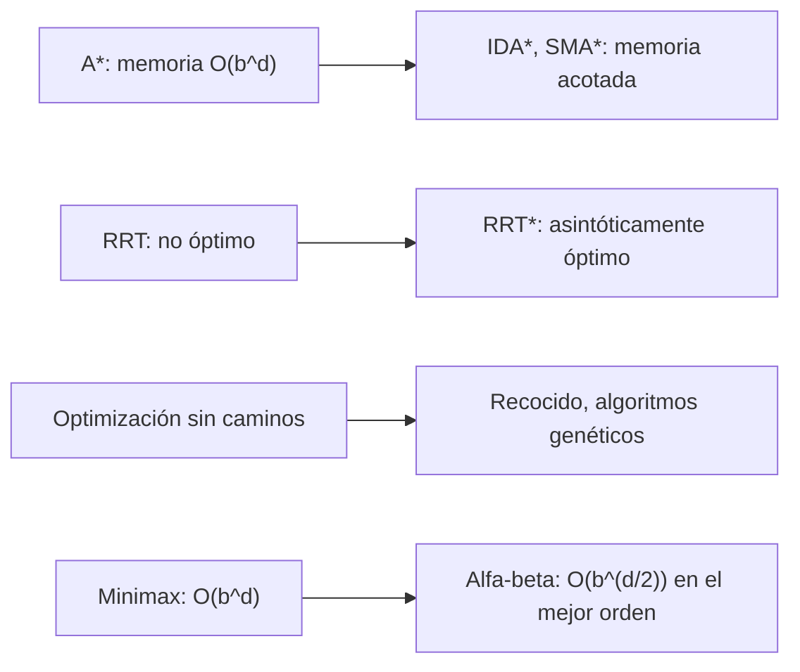

# Inteligencia Artificial - Búsqueda

## 2.3 Búsqueda optimizada.

---

A* es óptimo y eficiente, pero tiene límites: guarda en memoria todos los nodos que genera, solo sirve para encontrar caminos en grafos explícitos, y supone un único agente. Este tema presenta las técnicas que superan esos límites: las variantes de A* con **memoria acotada**; los métodos de muestreo **asintóticamente óptimos** para espacios continuos, como RRT*; la **búsqueda local** y los **algoritmos genéticos**, que optimizan una función sin construir caminos; y la **búsqueda adversarial** con poda alfa-beta, para juegos de dos jugadores.

### Memoria acotada

- **IDA*** (Korf, 1985): búsqueda en profundidad con un límite de $f$ que crece en cada iteración al menor $f$ que lo excedió. Usa memoria lineal en la profundidad y es óptimo con una heurística admisible; repite trabajo en cada iteración, pero en árboles con ramificación grande el costo total queda dominado por la última iteración. Es el método clásico para el 15-puzzle.
- **SMA*** (Russell, 1992): A* que, cuando se llena la memoria, olvida el nodo hoja de mayor $f$ y guarda su valor en el padre, para regenerarlo si hace falta.
- **Búsqueda de haz:** conserva solo los $k$ mejores nodos de cada nivel; no es completa ni óptima, pero se usa mucho en la práctica, por ejemplo para generar texto con modelos de lenguaje.

### RRT*

RRT (tema 2.1) encuentra caminos pero no los mejora: con más iteraciones, el costo no converge al óptimo. **RRT*** de Karaman y Frazzoli (2011) agrega dos pasos al insertar cada nodo: **elige el mejor padre** entre los nodos dentro de un radio, el que da el menor costo desde el inicio, y **reconecta** a los vecinos cuyo costo mejora pasando por el nodo nuevo. Con un radio que decrece como $\gamma\,(\log n / n)^{1/d},$ con $n$ los nodos y $d$ la dimensión, el costo converge casi seguramente al óptimo. El precio es buscar vecinos y verificar más colisiones en cada iteración.

### Búsqueda local y algoritmos genéticos

Cuando lo que importa es el **estado final** y no el camino, como en la optimización de una función o en la asignación de recursos, la **búsqueda local** mantiene una o unas pocas soluciones y las mejora con cambios pequeños:

- **ascenso de colinas:** se mueve al mejor vecino; se queda en máximos locales;
- **recocido simulado:** acepta movimientos peores con probabilidad $e^{-\Delta/T},$ con una temperatura $T$ que decrece; con un enfriamiento suficientemente lento, converge al óptimo global;
- **algoritmos genéticos** (Holland, 1975): una **población** de soluciones evoluciona por **selección** de las más aptas, por ejemplo con torneos; **cruza**, que combina dos padres, y **mutación**, que introduce variación. El **elitismo** conserva siempre al mejor individuo. Son útiles en espacios grandes, discontinuos o sin gradiente, a cambio de muchas evaluaciones y de no garantizar el óptimo.

### Búsqueda adversarial

En un juego de dos jugadores de suma cero con información perfecta, **minimax** calcula el valor de cada posición suponiendo que ambos juegan de forma óptima: el jugador MAX elige el máximo de los valores de sus sucesores, y MIN el mínimo. La **poda alfa-beta** mantiene $\alpha,$ el mejor valor que MAX ya puede asegurar, y $\beta,$ el mejor para MIN, y deja de explorar una rama en cuanto $\alpha \ge \beta,$ porque el oponente nunca permitiría llegar a ella. El resultado es **exactamente** el de minimax. Con el mejor orden posible de las jugadas, alfa-beta examina $O(b^{d/2})$ nodos en lugar de $O(b^d),$ lo que permite buscar al doble de profundidad con el mismo esfuerzo. En juegos grandes se combina con una profundidad límite y una función de evaluación, y en juegos como Go, con la búsqueda de árbol Monte Carlo.



### Implementación en Python

El programa resuelve los tres ejercicios. Compara el costo de los caminos de RRT y RRT*, con dos radios y dos números de iteraciones, en un mapa con obstáculos, con 10 semillas por configuración. Minimiza la función del ejercicio 2 con un algoritmo genético con tres operadores de cruza y dos tasas de mutación, y lo compara con la búsqueda exhaustiva. Y cuenta los nodos que evalúan minimax y alfa-beta en el gato a varias profundidades.

```python
import math, random

# ---------- Ejercicio 1: RRT frente a RRT* ----------
OBST = [((5, 5), 2.0), ((2, 7.5), 1.0), ((7.5, 2), 1.0)]
INI, META = (1.0, 1.0), (9.0, 9.0)
def libre_seg(p, q, k=10): return all(math.dist((p[0] + (q[0] - p[0]) * t / k, p[1] + (q[1] - p[1]) * t / k), c) > r for t in range(k + 1) for c, r in OBST)
def planifica(estrella, iters, radio, semilla, paso=0.7):
    rng = random.Random(semilla); V, padre, costo = [INI], {0: None}, {0: 0.0}; mejor = math.inf
    for _ in range(iters):
        q = (rng.uniform(0, 10), rng.uniform(0, 10))
        i = min(range(len(V)), key=lambda k: math.dist(V[k], q)); d = math.dist(V[i], q)
        nuevo = q if d <= paso else (V[i][0] + (q[0] - V[i][0]) * paso / d, V[i][1] + (q[1] - V[i][1]) * paso / d)
        if not libre_seg(V[i], nuevo): continue
        mejor_p, mejor_c = i, costo[i] + math.dist(V[i], nuevo)
        cerca = [k for k in range(len(V)) if math.dist(V[k], nuevo) <= radio] if estrella else []
        for k in cerca:                                                       # elegir el mejor padre cercano
            c = costo[k] + math.dist(V[k], nuevo)
            if c < mejor_c and libre_seg(V[k], nuevo): mejor_p, mejor_c = k, c
        V.append(nuevo); j = len(V) - 1; padre[j], costo[j] = mejor_p, mejor_c
        for k in cerca:                                                       # reconectar a los vecinos por el nodo nuevo
            c = mejor_c + math.dist(nuevo, V[k])
            if c < costo[k] and libre_seg(nuevo, V[k]): padre[k], costo[k] = j, c
        if math.dist(nuevo, META) <= paso and libre_seg(nuevo, META): mejor = min(mejor, costo[j] + math.dist(nuevo, META))
    # con RRT* los costos de los nodos ya conectados a la meta pudieron mejorar: se recalcula
    cand = [costo[k] + math.dist(V[k], META) for k in range(len(V)) if math.dist(V[k], META) <= paso and libre_seg(V[k], META)]
    return min(cand, default=math.inf)
print("ejercicio 1: costo del camino (media de 10 semillas); la recta inicio-meta mide 11.31 pero atraviesa el obstáculo")
for iters in (500, 1500):
    rrt = [planifica(False, iters, 0, s) for s in range(10)]
    linea = f"   {iters:4} iteraciones: RRT {sum(rrt) / len(rrt):6.2f}"
    for radio in (1.0, 2.0):
        st = [planifica(True, iters, radio, s) for s in range(10)]; linea += f" | RRT* radio {radio}: {sum(st) / len(st):6.2f}"
    print(linea)

# ---------- Ejercicio 2: algoritmo genético para f(x) = x² − 4x + 4 ----------
f = lambda x: x * x - 4 * x + 4
def genetico(cruza, p_mut, semilla, pob=30, gens=40, lo=-10.0, hi=10.0):
    rng = random.Random(semilla); P = [rng.uniform(lo, hi) for _ in range(pob)]; evaluaciones = pob
    for _ in range(gens):
        torneo = lambda: min(rng.sample(P, 3), key=f)
        hijos = [min(P, key=f)]                                               # elitismo: conserva al mejor
        while len(hijos) < pob:
            a, b = torneo(), torneo()
            h = (a + b) / 2 if cruza == "aritmética" else (a if rng.random() < 0.5 else b) if cruza == "uniforme" else a + rng.uniform(-0.25, 1.25) * (b - a)
            if rng.random() < p_mut: h += rng.gauss(0, 1.0)
            hijos.append(min(max(h, lo), hi)); evaluaciones += 1
        P = hijos
    x = min(P, key=f); return x, f(x), evaluaciones
for cruza in ("aritmética", "uniforme", "BLX-α"):
    for p in (0.05, 0.3):
        r = [genetico(cruza, p, s) for s in range(10)]
        print(f"ejercicio 2: cruza {cruza:10} mutación {p:4}: x medio {sum(x for x, _, _ in r) / 10:.5f}, f media {sum(v for _, v, _ in r) / 10:.2e}, {r[0][2]} evaluaciones")
rejilla = [-10 + 20 * k / 1000 for k in range(1001)]
x = min(rejilla, key=f); print(f"   búsqueda exhaustiva en 1001 puntos: x = {x:.2f}, f = {f(x):.2e}; derivada: f'(x) = 2x − 4 = 0 → x = 2")

# ---------- Ejercicio 3: minimax con y sin poda alfa-beta en el gato ----------
LINEAS = [(0, 1, 2), (3, 4, 5), (6, 7, 8), (0, 3, 6), (1, 4, 7), (2, 5, 8), (0, 4, 8), (2, 4, 6)]
def ganador(t):
    for a, b, c in LINEAS:
        if t[a] != " " and t[a] == t[b] == t[c]: return t[a]
    return None
def minimax(t, turno, alfa, beta, poda, prof, cont):
    cont[0] += 1
    g = ganador(t)
    if g: return 1 if g == "X" else -1
    if " " not in t or prof == 0: return 0
    mejor = -2 if turno == "X" else 2
    for i in range(9):
        if t[i] != " ": continue
        t[i] = turno; v = minimax(t, "O" if turno == "X" else "X", alfa, beta, poda, prof - 1, cont); t[i] = " "
        if turno == "X": mejor = max(mejor, v); alfa = max(alfa, v)
        else: mejor = min(mejor, v); beta = min(beta, v)
        if poda and alfa >= beta: break
    return mejor
for prof in (2, 4, 6, 9):
    c1, c2 = [0], [0]
    v1 = minimax([" "] * 9, "X", -2, 2, False, prof, c1); v2 = minimax([" "] * 9, "X", -2, 2, True, prof, c2)
    print(f"ejercicio 3: profundidad {prof}: minimax {c1[0]:7} nodos | alfa-beta {c2[0]:6} nodos ({c2[0] / c1[0]:.1%}) | valor {v1} = {v2}")
```

Salida:

```text
ejercicio 1: costo del camino (media de 10 semillas); la recta inicio-meta mide 11.31 pero atraviesa el obstáculo
    500 iteraciones: RRT  15.82 | RRT* radio 1.0:  13.45 | RRT* radio 2.0:  12.27
   1500 iteraciones: RRT  15.47 | RRT* radio 1.0:  12.30 | RRT* radio 2.0:  12.09
ejercicio 2: cruza aritmética mutación 0.05: x medio 2.00003, f media 6.57e-09, 1190 evaluaciones
ejercicio 2: cruza aritmética mutación  0.3: x medio 1.99999, f media 4.59e-09, 1190 evaluaciones
ejercicio 2: cruza uniforme   mutación 0.05: x medio 2.00510, f media 3.47e-04, 1190 evaluaciones
ejercicio 2: cruza uniforme   mutación  0.3: x medio 1.99877, f media 4.18e-05, 1190 evaluaciones
ejercicio 2: cruza BLX-α      mutación 0.05: x medio 2.00000, f media 0.00e+00, 1190 evaluaciones
ejercicio 2: cruza BLX-α      mutación  0.3: x medio 2.00000, f media 1.33e-15, 1190 evaluaciones
   búsqueda exhaustiva en 1001 puntos: x = 2.00, f = 0.00e+00; derivada: f'(x) = 2x − 4 = 0 → x = 2
ejercicio 3: profundidad 2: minimax      82 nodos | alfa-beta     26 nodos (31.7%) | valor 0 = 0
ejercicio 3: profundidad 4: minimax    3610 nodos | alfa-beta    206 nodos (5.7%) | valor 0 = 0
ejercicio 3: profundidad 6: minimax   73450 nodos | alfa-beta   1886 nodos (2.6%) | valor 0 = 0
ejercicio 3: profundidad 9: minimax  549946 nodos | alfa-beta  18297 nodos (3.3%) | valor 0 = 0
```

### Ejercicios Propuestos

1. **RRT\*.** En un espacio de configuración 2D, implementa RRT* y compáralo con RRT, varía el radio de búsqueda y mide la convergencia al camino óptimo.

2. **Algoritmos genéticos.** Implementa un algoritmo genético para encontrar el mínimo de $f(x) = x^2 - 4x + 4,$ experimenta con distintos operadores de cruza y mutación, y compáralo con la búsqueda exhaustiva.

3. **Alfa-beta.** Para un juego de tablero simple, implementa minimax con y sin poda alfa-beta, compara el número de nodos evaluados y analiza el efecto de la profundidad.

### Soluciones

**Ejercicio 1.** Con 500 iteraciones, el camino de RRT cuesta en promedio 15.82, y no mejora con más iteraciones, 15.47 con 1 500: RRT conserva el primer camino que encuentra a cada nodo. RRT* con radio 1 baja a 13.45 y luego a 12.30; con radio 2, a 12.27 y 12.09. La línea recta mide 11.31 pero atraviesa el obstáculo central, así que el óptimo, que lo rodea, es un poco mayor; RRT* se acerca a él conforme crecen las iteraciones. Un radio mayor converge más rápido porque cada nodo considera más padres posibles, a cambio de examinar más vecinos y verificar más colisiones en cada iteración.

**Ejercicio 2.** $f(x) = (x - 2)^2,$ con mínimo en $x = 2,$ $f = 0;$ se ve sin computadora completando el cuadrado o con $f'(x) = 2x - 4 = 0.$ El algoritmo genético, con población de 30, 40 generaciones, selección por torneo y elitismo, llega a $x \approx 2$ con todos los operadores, pero con distinta precisión: la cruza **uniforme**, que copia el gen de uno de los padres, solo combina valores existentes y depende de la mutación para refinar, con errores del orden de $10^{-4};$ la **aritmética**, el promedio de los padres, y la **BLX-α**, que muestrea en un intervalo algo mayor que el de los padres, refinan continuamente y llegan a errores de $10^{-9}$ o menos. Una mutación más alta ayuda a la cruza uniforme y apenas cambia a las demás. La búsqueda exhaustiva en 1 001 puntos encuentra $x = 2$ con menos evaluaciones, 1 001 frente a 1 190, porque el problema es de una dimensión y unimodal: el algoritmo genético solo tiene sentido en problemas grandes, multimodales o sin estructura conocida, donde la exhaustiva es imposible.

**Ejercicio 3.** En el gato, el árbol completo de minimax desde el tablero vacío tiene 549 946 nodos, y alfa-beta, con el orden natural de las casillas, evalúa 18 297, el 3.3 %. A profundidad 2 la poda deja el 31.7 % y a profundidad 4 el 5.7 %: la ventaja crece con la profundidad, porque cada poda elimina subárboles más grandes. Los dos algoritmos dan el mismo valor, 0, un empate, que es el resultado del gato con juego perfecto. Ordenar las jugadas para examinar primero las mejores, por ejemplo el centro y las esquinas, acerca la poda a su cota de $O(b^{d/2}).$

### Referencias

1. Russell, S., and Norvig, P., _Artificial Intelligence: A Modern Approach_. Pearson, 2021. Capítulos 3 a 5.
2. Korf, R. E., Depth-first iterative-deepening: an optimal admissible tree search. _Artificial Intelligence_ 27(1), 1985.
3. Karaman, S., and Frazzoli, E., Sampling-based algorithms for optimal motion planning. _International Journal of Robotics Research_ 30(7), 2011.
4. Knuth, D. E., and Moore, R. W., An analysis of alpha-beta pruning. _Artificial Intelligence_ 6(4), 1975.
5. Holland, J. H., _Adaptation in Natural and Artificial Systems_. University of Michigan Press, 1975.
6. Kirkpatrick, S., Gelatt, C. D., and Vecchi, M. P., Optimization by simulated annealing. _Science_ 220(4598), 1983.
