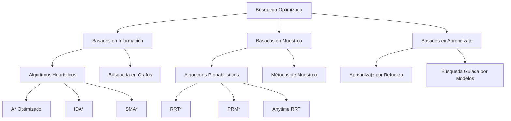
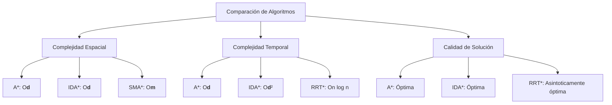

# Inteligencia Artificial - Búsqueda

## 2.3 Búsqueda optimizada.

---

La búsqueda optimizada se refiere a técnicas y algoritmos que mejoran la eficiencia de los métodos de búsqueda clásicos mediante la reducción del espacio de búsqueda, el uso de heurísticas avanzadas y la aplicación de estrategias de poda y optimización.

### Clasificación de Algoritmos de Búsqueda Optimizada



### Algoritmos de Búsqueda Heurística Optimizada

#### Iterative Deepening A* (IDA*)

IDA* combina la búsqueda en profundidad iterativa con la evaluación heurística de A*.

**Algoritmo:**

```python
def ida_star(inicio, objetivo, heuristica, obtener_vecinos, costo):
    umbral = heuristica(inicio, objetivo)
    camino = [inicio]

    while True:
        resultado, nuevo_umbral = busqueda_limite(camino, 0, umbral, objetivo,
                                                 heuristica, obtener_vecinos, costo)
        if resultado == "encontrado":
            return camino
        if nuevo_umbral == float('inf'):
            return None
        umbral = nuevo_umbral

def busqueda_limite(camino, g, umbral, objetivo, heuristica, obtener_vecinos, costo):
    actual = camino[-1]
    f = g + heuristica(actual, objetivo)

    if f > umbral:
        return "prune", f
    if actual == objetivo:
        return "encontrado", umbral

    min_limite = float('inf')
    for vecino in obtener_vecinos(actual):
        if vecino not in camino:
            camino.append(vecino)
            resultado, nuevo_umbral = busqueda_limite(camino, g + costo(actual, vecino),
                                                     umbral, objetivo, heuristica,
                                                     obtener_vecinos, costo)
            if resultado == "encontrado":
                return "encontrado", umbral
            if nuevo_umbral < min_limite:
                min_limite = nuevo_umbral
            camino.pop()

    return "prune", min_limite
```

#### Simplified Memory-Bounded A* (SMA*)

SMA* es una variante de A* con límite de memoria.

**Fórmula de evaluación:**

$$f(n) = g(n) + h(n)$$

**Estrategia de gestión de memoria:**

- Mantiene un número fijo de nodos
- Elimina nodos con peor f(n) cuando se llena la memoria

### Algoritmos de Muestreo Probabilístico Optimizados

#### RRT* (Rapidly-exploring Random Tree Star)

RRT* mejora RRT mediante la rewire de nodos para optimizar el camino.

**Algoritmo:**

```python
def rrt_star(inicio, objetivo, espacio_config, max_iter=1000, radio=1.0):
    arbol = {inicio: {'padre': None, 'costo': 0}}
    mejor_camino = None

    for _ in range(max_iter):
        q_rand = muestra_aleatoria(espacio_config)
        q_cercano = encuentra_mas_cercano(arbol, q_rand)
        q_nuevo = steer(q_cercano, q_rand, paso_max)

        if no_colision(q_cercano, q_nuevo):
            # Encontrar vecinos en radio
            vecinos = encontrar_vecinos_radio(arbol, q_nuevo, radio)

            # Elegir mejor padre
            q_mejor = q_cercano
            costo_mejor = arbol[q_cercano]['costo'] + distancia(q_cercano, q_nuevo)

            for q_vecino in vecinos:
                costo_tentativo = arbol[q_vecino]['costo'] + distancia(q_vecino, q_nuevo)
                if costo_tentativo < costo_mejor and no_colision(q_vecino, q_nuevo):
                    costo_mejor = costo_tentativo
                    q_mejor = q_vecino

            # Agregar nuevo nodo
            arbol[q_nuevo] = {'padre': q_mejor, 'costo': costo_mejor}

            # Rewire vecinos
            for q_vecino in vecinos:
                if q_vecino != q_mejor:
                    costo_rewire = costo_mejor + distancia(q_nuevo, q_vecino)
                    if costo_rewire < arbol[q_vecino]['costo'] and no_colision(q_nuevo, q_vecino):
                        arbol[q_vecino]['padre'] = q_nuevo
                        arbol[q_vecino]['costo'] = costo_rewire
                        actualizar_costos_descendientes(arbol, q_vecino)

            # Verificar si alcanza el objetivo
            if distancia(q_nuevo, objetivo) < umbral:
                camino = reconstruir_camino(arbol, q_nuevo)
                if mejor_camino is None or arbol[q_nuevo]['costo'] < mejor_camino['costo']:
                    mejor_camino = camino

    return mejor_camino
```

#### Fórmulas de Optimización para RRT*

**Función de steer:**

$$q_{new} = q_{near} + \min\left(1, \frac{\eta}{\|q_{rand} - q_{near}\|}\right)(q_{rand} - q_{near})$$

**Radio de búsqueda:**

$$\gamma = \left(\frac{\eta(1 + \frac{1}{d})\mu(C_{free})}{\zeta_d}\right)^{\frac{1}{d}}$$

Donde:

- $\eta$: distancia máxima por paso
- $d$: dimensión del espacio
- $\mu(C_{free})$: volumen del espacio libre
- $\zeta_d$: volumen de la esfera unitaria d-dimensional

### Algoritmos de Búsqueda Local Optimizada

#### Simulated Annealing para Búsqueda

**Función de aceptación:**

$$ P(aceptar) = \begin{cases} 1 & \text{si } \Delta E < 0 \\\ e^{-\Delta E / T} & \text{si } \Delta E \geq 0 \end{cases}$$

**Esquema de enfriamiento:**

$$T_{k+1} = \alpha T_k$$

donde $\alpha \in (0, 1)$ es la tasa de enfriamiento.

### Algoritmos Genéticos para Búsqueda Optimizada

```python
def algoritmo_genetico(poblacion, funcion_aptitud, generaciones=100):
    for generacion in range(generaciones):
        # Evaluar aptitud
        aptitudes = [funcion_aptitud(ind) for ind in poblacion]

        # Selección
        padres = seleccion_torneo(poblacion, aptitudes)

        # Cruzamiento
        descendencia = []
        for i in range(0, len(padres), 2):
            hijo1, hijo2 = cruzamiento(padres[i], padres[i+1])
            descendencia.extend([hijo1, hijo2])

        # Mutación
        for i in range(len(descendencia)):
            if random.random() < tasa_mutacion:
                descendencia[i] = mutacion(descendencia[i])

        # Reemplazo
        poblacion = reemplazo_elitista(poblacion, descendencia, aptitudes)

    return mejor_solucion(poblacion, funcion_aptitud)
```

### Técnicas de Poda y Optimización

#### Poda Alfa-Beta para Búsqueda Adversarial

**Algoritmo:**
```python
def alfa_beta(nodo, profundidad, alfa, beta, maximizando):
    if profundidad == 0 or es_terminal(nodo):
        return valor_heurístico(nodo)

    if maximizando:
        valor = -float('inf')
        for hijo in obtener_hijos(nodo):
            valor = max(valor, alfa_beta(hijo, profundidad-1, alfa, beta, False))
            alfa = max(alfa, valor)
            if alfa >= beta:
                break  # Poda beta
        return valor
    else:
        valor = float('inf')
        for hijo in obtener_hijos(nodo):
            valor = min(valor, alfa_beta(hijo, profundidad-1, alfa, beta, True))
            beta = min(beta, valor)
            if alfa >= beta:
                break  # Poda alfa
        return valor
```

### Optimizaciones para Búsqueda en Grafos Grandes

#### Hash de Estados para Detección de Duplicados

```python
def hash_estado(estado):
    """Función de hash para estados complejos"""
    if isinstance(estado, np.ndarray):
        return hash(estado.tobytes())
    elif isinstance(estado, tuple):
        return hash(estado)
    else:
        return hash(str(estado))

class TablaTransposicion:
    def __init__(self):
        self.tabla = {}

    def almacenar(self, estado, valor, profundidad):
        hash_val = hash_estado(estado)
        if hash_val not in self.tabla or self.tabla[hash_val]['profundidad'] < profundidad:
            self.tabla[hash_val] = {'valor': valor, 'profundidad': profundidad}

    def obtener(self, estado):
        return self.tabla.get(hash_estado(estado), None)
```

### Ejemplos y Ejercicios

#### Ejemplo 1: IDA* para 8-Puzzle

```python
# Heurística para 8-puzzle (distancia Manhattan)
def heuristica_8puzzle(estado, objetivo):
    distancia = 0
    for i in range(3):
        for j in range(3):
            valor = estado[i][j]
            if valor != 0:
                pos_objetivo = encontrar_posicion(objetivo, valor)
                distancia += abs(i - pos_objetivo[0]) + abs(j - pos_objetivo[1])
    return distancia

# Implementación IDA* para 8-puzzle
def resolver_8puzzle(inicio, objetivo):
    return ida_star(inicio, objetivo, heuristica_8puzzle,
                   obtener_vecinos_8puzzle, costo_uniforme)
```

#### Ejercicio 1: Optimización de RRT*
Para un espacio de configuración 2D:
1. Implementa RRT* y compara con RRT básico
2. Varía el radio de búsqueda y analiza el impacto
3. Mide la convergencia al camino óptimo

#### Ejercicio 2: Algoritmos Genéticos
Dada la función:

$$f(x) = x^2 - 4x + 4$$

1. Implementa un algoritmo genético para encontrar el mínimo
2. Experimenta con diferentes operadores de cruza y mutación
3. Compara con búsqueda exhaustiva

#### Ejercicio 3: Poda Alfa-Beta
Para un juego de tablero simple:
1. Implementa minimax con y sin poda alfa-beta
2. Compara el número de nodos evaluados
3. Analiza el impacto de la profundidad de búsqueda

### Diagramas de Comparación



### Referencias Bibliográficas

#### Bibliografía Básica
1. Russell, S. & Norvig, P. (2009). *Artificial Intelligence: A Modern Approach*. 3rd Edition. Prentice Hall. (Capítulos 3, 4, 5)
2. Marsland, S. (2009). *Machine Learning: An Algorithmic Perspective*. Chapman y Hall. (Capítulo 4)

#### Bibliografía Complementaria
1. Karaman, S., & Frazzoli, E. (2011). *Sampling-based algorithms for optimal motion planning*. The International Journal of Robotics Research.
2. Hart, P. E., Nilsson, N. J., & Raphael, B. (1968). *A Formal Basis for the Heuristic Determination of Minimum Cost Paths*. IEEE Transactions on Systems Science and Cybernetics.
3. LaValle, S. M. (2006). *Planning Algorithms*. Cambridge University Press.

#### Artículos Clave
1. *RRT*: Asymptotically optimal single-query sampling-based motion planning* - Karaman & Frazzoli
2. *Iterative-Deepening-A*: An optimal admissible tree search* - Korf
3. *Simplified Memory-Bounded A** - Russell

### Casos de Estudio y Aplicaciones

#### Navegación de Robots Móviles
```python
def navegacion_optimizada(mapa, inicio, destino):
    """Sistema de navegación usando RRT*"""
    # Preprocesamiento del mapa
    espacio_config = definir_espacio_configuracion(mapa)

    # Búsqueda optimizada
    camino = rrt_star(inicio, destino, espacio_config,
                     radio_busqueda=calcular_radio_optimo(mapa))

    # Suavizado de camino
    camino_suave = suavizar_camino(camino, mapa)

    return camino_suave
```

#### Optimización de Rutas Logísticas
```python
def optimizar_rutas(pedidos, vehiculos, almacenes):
    """Optimización de rutas usando algoritmos genéticos"""

    def funcion_aptitud(ruta):
        costo = calcular_costo_total(ruta, pedidos, vehiculos)
        return 1.0 / (costo + 1)  # Maximizar inverso del costo

    poblacion_inicial = generar_poblacion_inicial(pedidos, vehiculos)
    mejor_ruta = algoritmo_genetico(poblacion_inicial, funcion_aptitud)

    return mejor_ruta
```

### Métricas de Evaluación

**Para algoritmos de búsqueda:**
- Tasa de éxito: $\frac{\text{éxitos}}{\text{total ejecuciones}}$
- Costo promedio del camino: $\frac{1}{N}\sum_{i=1}^N C_i$
- Tiempo de computación promedio

**Para algoritmos de muestreo:**
- Convergencia asintótica: $\lim_{n \to \infty} P(C_n = C^*) = 1$
- Tasa de convergencia: $\frac{C\_n - C ^ *}{C ^ *}$
