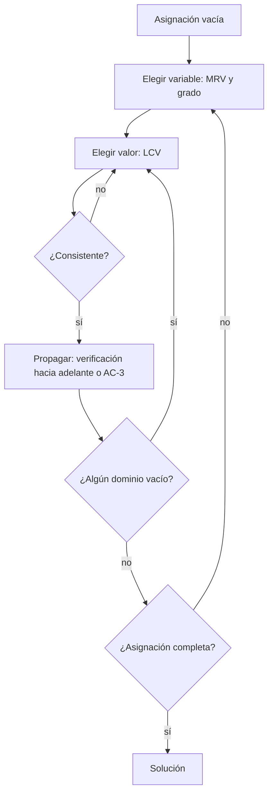

# Inteligencia Artificial - Búsqueda

## 2.4 Problemas de satisfacción con restricciones.

---

Muchos problemas no piden un camino sino una **asignación**: dar a cada variable un valor de modo que se cumplan ciertas restricciones. Programar exámenes sin choques, colorear un mapa, resolver un Sudoku, asignar frecuencias a antenas o configurar un producto son ejemplos. Un **problema de satisfacción de restricciones** (CSP) los representa con una estructura común, y esa estructura permite técnicas mucho más eficientes que la búsqueda genérica: propagar las restricciones para reducir los dominios antes y durante la búsqueda, y elegir con heurísticas qué variable y qué valor probar. Este tema presenta la formulación, el backtracking, la propagación con verificación hacia adelante y consistencia de arcos, y las heurísticas de ordenamiento.

### Formulación

Un CSP es una terna $(X, D, C):$ un conjunto de **variables** $X = \{X_1, \dots, X_n\},$ un **dominio** $D_i$ de valores posibles para cada una, y un conjunto de **restricciones** $C,$ cada una sobre un subconjunto de variables, que especifica las combinaciones de valores permitidas. Una **solución** es una asignación completa y consistente. Las restricciones binarias, entre dos variables, se representan con un **grafo de restricciones**; las de más variables, como "todas distintas", pueden reducirse a binarias o tratarse con algoritmos propios. Resolver un CSP con dominios finitos es NP-completo en general, porque incluye a SAT.

### Backtracking

La búsqueda con **retroceso** asigna una variable a la vez, comprueba que la asignación parcial sea consistente, y si no hay valor válido para la variable actual, retrocede. Es una búsqueda en profundidad que aprovecha que el orden de asignación no importa. Su eficiencia depende de tres decisiones.

### Heurísticas de ordenamiento

- **Qué variable:** la de **mínimos valores restantes** (MRV), la más restringida, porque si va a fallar, falla pronto. Para desempatar, la heurística de **grado**: la que participa en más restricciones con variables sin asignar.
- **Qué valor:** el **menos restrictivo** (LCV), el que elimina menos valores de los dominios de los vecinos, porque deja más opciones para el resto. Es útil cuando se busca una sola solución.

MRV elige la variable que más probablemente falle, y LCV el valor que más probablemente funcione: "falla primero en las variables, acierta primero en los valores".

### Propagación de restricciones

- **Verificación hacia adelante** (*forward checking*): al asignar una variable, elimina de los dominios de sus vecinos los valores inconsistentes; si un dominio queda vacío, retrocede de inmediato, sin esperar a llegar a esa variable.
- **Consistencia de arcos:** un arco $X \to Y$ es consistente si para cada valor de $X$ hay algún valor compatible de $Y.$ El algoritmo **AC-3** (Mackworth, 1977) mantiene una cola de arcos; al revisar $X \to Y$ elimina de $D_X$ los valores sin apoyo, y si elimina alguno, vuelve a encolar los arcos $Z \to X.$ Su complejidad es $O(e\,d^3),$ con $e$ las restricciones y $d$ el tamaño de los dominios. Puede usarse como preprocesamiento o en cada paso de la búsqueda, el método MAC.

La consistencia de arcos no siempre basta para resolver un problema, pero reduce mucho la búsqueda; para problemas con estructura de árbol, garantiza una solución sin retroceso en tiempo lineal.



### Implementación en Python

El programa implementa un resolvedor de CSP binarios con backtracking, verificación hacia adelante y las heurísticas MRV, grado y LCV, y lo aplica a los cuatro ejercicios: compara las combinaciones de técnicas en las N reinas para N = 8, 12 y 16; resuelve el horario; aplica AC-3 al problema del ejercicio 3 mostrando cada eliminación, y resuelve el Sudoku.

```python
from collections import deque
from itertools import product

# ---------- Un resolvedor de CSP binarios con backtracking, heurísticas y verificación hacia adelante ----------
class CSP:
    def __init__(self, variables, dominios, restricciones):
        self.V, self.D = variables, {v: list(dominios[v]) for v in variables}
        self.R = restricciones                                  # {(x, y): función(a, b) → bool}, en ambos sentidos
        self.vecinos = {v: [y for (x, y) in self.R if x == v] for v in variables}
    def consistente(self, x, a, asig):
        return all(self.R[(x, y)](a, asig[y]) for y in self.vecinos[x] if y in asig)
    def resuelve(self, mrv=False, grado=False, lcv=False, fc=False):
        self.asignaciones = 0
        return self._bt({}, {v: list(d) for v, d in self.D.items()}, mrv, grado, lcv, fc)
    def _bt(self, asig, dom, mrv, grado, lcv, fc):
        if len(asig) == len(self.V): return dict(asig)
        libres = [v for v in self.V if v not in asig]
        if mrv: libres.sort(key=lambda v: (len(dom[v]), -sum(1 for y in self.vecinos[v] if y not in asig) if grado else 0))
        elif grado: libres.sort(key=lambda v: -sum(1 for y in self.vecinos[v] if y not in asig))
        x = libres[0]
        valores = dom[x]
        if lcv:
            valores = sorted(valores, key=lambda a: sum(1 for y in self.vecinos[x] if y not in asig for b in dom[y] if not self.R[(x, y)](a, b)))
        for a in valores:
            if not self.consistente(x, a, asig): continue
            self.asignaciones += 1; asig[x] = a
            nuevo = dom
            if fc:                                              # verificación hacia adelante: poda los dominios de los vecinos
                nuevo = {v: list(d) for v, d in dom.items()}; nuevo[x] = [a]
                for y in self.vecinos[x]:
                    if y not in asig: nuevo[y] = [b for b in nuevo[y] if self.R[(x, y)](a, b)]
                if any(not nuevo[y] for y in self.vecinos[x] if y not in asig): del asig[x]; continue
            r = self._bt(asig, nuevo, mrv, grado, lcv, fc)
            if r: return r
            del asig[x]
        return None

# ---------- Ejercicio 1: N reinas ----------
def reinas(n):
    V = list(range(n)); R = {}
    for i in V:
        for j in V:
            if i != j: R[(i, j)] = (lambda i, j: lambda a, b: a != b and abs(a - b) != abs(i - j))(i, j)
    return CSP(V, {v: range(n) for v in V}, R)
print("ejercicio 1: asignaciones hasta la primera solución de N reinas")
for n in (8, 12, 16):
    fila = []
    for nombre, kw in (("backtracking", {}), ("FC", {"fc": True}), ("FC+MRV+grado", {"fc": True, "mrv": True, "grado": True}),
                       ("FC+MRV+grado+LCV", {"fc": True, "mrv": True, "grado": True, "lcv": True})):
        c = reinas(n); s = c.resuelve(**kw); fila.append(f"{nombre} {c.asignaciones}")
        assert all(c.R[(i, j)](s[i], s[j]) for (i, j) in c.R)
    print(f"   N = {n:2}: " + " | ".join(fila))

# ---------- Ejercicio 2: horario ----------
cursos = ["Matemáticas", "Física", "Química", "Historia"]
valores = list(product(["A1", "A2", "A3"], ["9:00", "11:00", "14:00"]))
dom = {c: [(a, h) for a, h in valores if not (a == "A1" and h == "14:00")] for c in cursos}       # A1 solo en la mañana
dom["Química"] = [(a, h) for a, h in dom["Química"] if h == "14:00"]                               # después de las 12:00
R = {}
for x in cursos:
    for y in cursos:
        if x != y:
            R[(x, y)] = (lambda x, y: lambda a, b: a != b and not ({x, y} == {"Matemáticas", "Física"} and a[1] == b[1]))(x, y)
h = CSP(cursos, dom, R); sol = h.resuelve(fc=True, mrv=True)
print("ejercicio 2:", {c: f"{a} {t}" for c, (a, t) in sol.items()})

# ---------- Ejercicio 3: AC-3 ----------
def ac3(D, R, traza):
    D = {v: set(d) for v, d in D.items()}; cola = deque(R)
    while cola:
        x, y = cola.popleft()
        quitar = {a for a in D[x] if not any(R[(x, y)](a, b) for b in D[y])}
        if quitar:
            D[x] -= quitar; traza.append(f"arco {x}→{y}: elimina {sorted(quitar)} de {x}")
            cola.extend((z, x) for (z, w) in R if w == x and z != y)
    return D
R3 = {("A", "B"): lambda a, b: a != b, ("B", "A"): lambda a, b: a != b, ("B", "C"): lambda a, b: a != b, ("C", "B"): lambda a, b: a != b,
      ("A", "C"): lambda a, c: a > c, ("C", "A"): lambda c, a: a > c}
traza = []; D3 = ac3({v: {1, 2, 3} for v in "ABC"}, R3, traza)
print("ejercicio 3:", traza, "→ dominios", {v: sorted(d) for v, d in D3.items()})
c3 = CSP(list("ABC"), {v: sorted(d) for v, d in D3.items()}, R3); s3 = c3.resuelve()
todas = [s for s in product([1, 2, 3], repeat=3) if s[0] != s[1] and s[1] != s[2] and s[0] > s[2]]
print("   soluciones (A, B, C):", todas)

# ---------- Ejercicio 4: Sudoku con verificación hacia adelante ----------
S = ("530070000600195000098000060800060003400803001700020006060000280000419005000080079")
celdas = [(f, c) for f in range(9) for c in range(9)]
def mismos(p, q): return p != q and (p[0] == q[0] or p[1] == q[1] or (p[0] // 3, p[1] // 3) == (q[0] // 3, q[1] // 3))
Rs = {(p, q): (lambda a, b: a != b) for p in celdas for q in celdas if mismos(p, q)}
Ds = {(f, c): [int(S[f * 9 + c])] if S[f * 9 + c] != "0" else list(range(1, 10)) for f, c in celdas}
for nombre, kw in (("FC", {"fc": True}), ("FC + MRV", {"fc": True, "mrv": True})):   # sin FC: más de 14 millones
    sd = CSP(celdas, Ds, Rs); sol = sd.resuelve(**kw)
    print(f"ejercicio 4: {nombre:12} {sd.asignaciones:6} asignaciones")
for f in range(9): print("   " + " ".join(str(sol[(f, c)]) + (" |" if c in (2, 5) else "") for c in range(9)))
```

Salida:

```text
ejercicio 1: asignaciones hasta la primera solución de N reinas
   N =  8: backtracking 113 | FC 88 | FC+MRV+grado 75 | FC+MRV+grado+LCV 39
   N = 12: backtracking 261 | FC 193 | FC+MRV+grado 153 | FC+MRV+grado+LCV 32
   N = 16: backtracking 10052 | FC 7560 | FC+MRV+grado 44 | FC+MRV+grado+LCV 332
ejercicio 2: {'Química': 'A2 14:00', 'Matemáticas': 'A1 9:00', 'Física': 'A1 11:00', 'Historia': 'A2 9:00'}
ejercicio 3: ['arco A→C: elimina [1] de A', 'arco C→A: elimina [3] de C'] → dominios {'A': [2, 3], 'B': [1, 2, 3], 'C': [1, 2]}
   soluciones (A, B, C): [(2, 3, 1), (3, 1, 2), (3, 2, 1)]
ejercicio 4: FC            11400 asignaciones
ejercicio 4: FC + MRV         81 asignaciones
   5 3 4 | 6 7 8 | 9 1 2
   6 7 2 | 1 9 5 | 3 4 8
   1 9 8 | 3 4 2 | 5 6 7
   8 5 9 | 7 6 1 | 4 2 3
   4 2 6 | 8 5 3 | 7 9 1
   7 1 3 | 9 2 4 | 8 5 6
   9 6 1 | 5 3 7 | 2 8 4
   2 8 7 | 4 1 9 | 6 3 5
   3 4 5 | 2 8 6 | 1 7 9
```

### Ejercicios Propuestos

1. **Backtracking.** Implementa backtracking con las heurísticas MRV, de grado y LCV, y compara su rendimiento en las N reinas para N = 8, 12 y 16.

2. **Horario.** Con los cursos Matemáticas, Física, Química e Historia, las aulas A1, A2 y A3, y los horarios 9:00, 11:00 y 14:00, y las restricciones: Matemáticas y Física no pueden ser a la misma hora; Química debe ser después de las 12:00; A1 solo está disponible en la mañana. Modela el problema como CSP y encuentra una solución.

3. **AC-3.** Aplica AC-3 a las variables A, B y C con dominios $\{1, 2, 3\}$ y las restricciones $A \ne B,$ $B \ne C$ y $A \gt C.$

4. **Sudoku.** Resuelve con verificación hacia adelante el Sudoku:

    ```text
    5 3 0 | 0 7 0 | 0 0 0
    6 0 0 | 1 9 5 | 0 0 0
    0 9 8 | 0 0 0 | 0 6 0
    ------+-------+------
    8 0 0 | 0 6 0 | 0 0 3
    4 0 0 | 8 0 3 | 0 0 1
    7 0 0 | 0 2 0 | 0 0 6
    ------+-------+------
    0 6 0 | 0 0 0 | 2 8 0
    0 0 0 | 4 1 9 | 0 0 5
    0 0 0 | 0 8 0 | 0 7 9
    ```

### Soluciones

**Ejercicio 1.** Cada variable es una columna y su valor la fila de su reina; las restricciones prohíben la misma fila y la misma diagonal. Las asignaciones necesarias hasta la primera solución:

| N  | Backtracking | FC    | FC + MRV + grado | FC + MRV + grado + LCV |
| -- | ------------ | ----- | ---------------- | ---------------------- |
| 8  | 113          | 88    | 75               | 39                     |
| 12 | 261          | 193   | 153              | 32                     |
| 16 | 10 052       | 7 560 | 44               | 332                    |

La verificación hacia adelante reduce las asignaciones en todos los casos, y MRV produce el salto mayor para N = 16, de 7 560 a 44. LCV ayuda en 8 y 12 pero empeora en 16: las heurísticas reducen la búsqueda **en promedio**, no en cada instancia, y el número exacto depende del orden de los desempates. Para N grande, las N reinas se resuelven mejor con búsqueda local, como el algoritmo de conflictos mínimos, que resuelve un millón de reinas en pocos pasos.

**Ejercicio 2.** Cada curso es una variable cuyo valor es un par (aula, horario), 9 valores. Las restricciones unarias reducen los dominios: A1 pierde las 14:00 y Química solo conserva las 14:00 en A2 o A3. Las binarias son que dos cursos no ocupen el mismo par, y que Matemáticas y Física no compartan horario. Con verificación hacia adelante y MRV, el resolvedor empieza por Química, la más restringida, y encuentra **Química en A2 a las 14:00, Matemáticas en A1 a las 9:00, Física en A1 a las 11:00 e Historia en A2 a las 9:00**. Hay muchas otras soluciones; para elegir una, se agrega una función de costo, como minimizar los cambios de aula de los profesores, y el problema se vuelve de optimización con restricciones.

**Ejercicio 3.** AC-3 revisa cada arco:

1. $A \to C$ con $A \gt C:$ $A = 1$ no tiene apoyo, porque ningún $C$ es menor que 1; se elimina, $D_A = \{2, 3\}.$
2. $C \to A:$ $C = 3$ no tiene apoyo, porque ningún $A$ es mayor que 3; se elimina, $D_C = \{1, 2\}.$
3. Los arcos de $\ne$ no eliminan nada: con dominios de al menos dos valores, siempre hay un valor distinto que sirve de apoyo.

Los dominios finales son $D_A = \{2, 3\},$ $D_B = \{1, 2, 3\},$ $D_C = \{1, 2\}.$ AC-3 no resolvió el problema, pero redujo el espacio de 27 combinaciones a 12, y las soluciones son tres: $(A, B, C) = (2, 3, 1),$ $(3, 1, 2)$ y $(3, 2, 1).$ La consistencia de arcos no detecta que $B$ tampoco puede tomar cualquier valor en cada combinación: eso requiere consistencia de caminos o búsqueda.

**Ejercicio 4.** Cada celda es una variable, con dominio $\{1, \dots, 9\}$ o el valor dado, y las restricciones son de desigualdad entre las celdas de la misma fila, columna o caja. Con verificación hacia adelante en orden de lectura, la búsqueda hace 11 400 asignaciones; agregando MRV, solo 81, una por celda, sin un solo retroceso: el Sudoku se resuelve por pura propagación con la variable más restringida. Sin propagación, el backtracking simple necesitó más de 14 millones de asignaciones en una prueba aparte, y por eso el programa no lo incluye. La solución es la del programa.

### Referencias

1. Russell, S., and Norvig, P., _Artificial Intelligence: A Modern Approach_. Pearson, 2021. Capítulo 6.
2. Mackworth, A. K., Consistency in networks of relations. _Artificial Intelligence_ 8(1), 1977.
3. Haralick, R. M., and Elliott, G. L., Increasing tree search efficiency for constraint satisfaction problems. _Artificial Intelligence_ 14(3), 1980.
4. Minton, S., Johnston, M. D., Philips, A. B., and Laird, P., Minimizing conflicts: a heuristic repair method for constraint satisfaction and scheduling problems. _Artificial Intelligence_ 58, 1992.
5. Dechter, R., _Constraint Processing_. Morgan Kaufmann, 2003.
