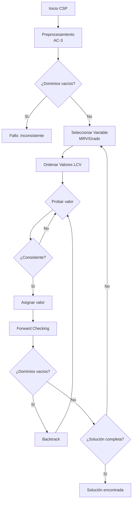

# Inteligencia Artificial - Búsqueda

## 2.4 Problemas de satisfacción con restricciones.

---

### Introducción a los CSP

Un Problema de Satisfacción de Restricciones (CSP, Constraint Satisfaction Problem) es un problema de búsqueda donde el estado se define por variables $X_i$ con valores de dominios $D_i$, y las soluciones deben satisfacer un conjunto de restricciones $C$.

### Definición Formal

Un CSP se define como una tripleta:

$$\text{CSP} = \langle X, D, C \rangle$$

Donde:

- $X = \{X_1, X_2, ..., X_n\}$ es un conjunto de variables
- $D = \{D_1, D_2, ..., D_n\}$ es un conjunto de dominios, donde $D_i$ contiene los valores posibles para $X_i$
- $C = \{C_1, C_2, ..., C_m\}$ es un conjunto de restricciones que especifican combinaciones permitidas de valores

### Tipos de Restricciones

**Restricciones unarias:** Afectan a una sola variable

$$C_i: X_i \in D_i' \subseteq D_i$$

**Restricciones binarias:** Involucran dos variables

$$C_{ij}: (X_i, X_j) \in R_{ij} \subseteq D_i \times D_j$$

**Restricciones n-arias:** Involucran n variables

$$C_{i_1,i_2,...,i_k}: (X_{i_1}, X_{i_2}, ..., X_{i_k}) \in R \subseteq D_{i_1} \times D_{i_2} \times ... \times D_{i_k}$$

### Ejemplo Clásico: Problema de las N-Reinas

```python
class NReinasCSP:
    def __init__(self, n):
        self.n = n
        self.variables = list(range(n))  # Columnas
        self.dominios = {i: list(range(n)) for i in range(n)}  # Filas posibles
        self.restricciones = self._generar_restricciones()

    def _generar_restricciones(self):
        restricciones = []
        for i in range(self.n):
            for j in range(i + 1, self.n):
                # Restricción: no misma fila y no misma diagonal
                restricciones.append((i, j, lambda x, y, i=i, j=j: x != y and abs(i - j) != abs(x - y)))
        return restricciones

    def es_consistente(self, asignacion, variable, valor):
        """Verifica si una asignación es consistente"""
        for var_asignada, val_asignado in asignacion.items():
            if var_asignada == variable:
                continue
            # Verificar restricciones binarias
            for restriccion in self.restricciones:
                if variable in restriccion and var_asignada in restriccion:
                    if not restriccion[2](valor, val_asignado):
                        return False
        return True
```

### Algoritmos de Búsqueda para CSP

#### Backtracking Básico

```python
def backtracking(asignacion, csp):
    """Algoritmo de backtracking recursivo para CSP"""
    if len(asignacion) == len(csp.variables):
        return asignacion  # Solución encontrada

    variable = seleccionar_variable_no_asignada(asignacion, csp)
    for valor in ordenar_valores(variable, asignacion, csp):
        if csp.es_consistente(asignacion, variable, valor):
            asignacion[variable] = valor
            resultado = backtracking(asignacion, csp)
            if resultado is not None:
                return resultado
            del asignacion[variable]  # Backtrack
    return None
```

#### Forward Checking

```python
def forward_checking(asignacion, csp, dominios):
    """Forward checking para mantener consistencia"""
    if len(asignacion) == len(csp.variables):
        return asignacion

    variable = seleccionar_variable_no_asignada(asignacion, csp)
    for valor in ordenar_valores(variable, asignacion, csp):
        if es_consistente(asignacion, variable, valor, csp):
            asignacion[variable] = valor
            dominios_original = dominios.copy()

            # Actualizar dominios de variables vecinas
            for vecino in obtener_vecinos(variable, csp):
                if vecino not in asignacion:
                    dominios[vecino] = [v for v in dominios[vecino]
                                      if es_consistente_pairwise(variable, valor, vecino, v, csp)]
                    if not dominios[vecino]:  # Dominio vacío
                        break

            if all(dominios[v] for v in csp.variables if v not in asignacion):
                resultado = forward_checking(asignacion, csp, dominios)
                if resultado is not None:
                    return resultado

            # Restaurar dominios
            asignacion.pop(variable)
            dominios = dominios_original

    return None
```

### Heurísticas para CSP

#### Selección de Variable (MRV - Minimum Remaining Values)

```python
def seleccionar_variable_mrv(asignacion, csp, dominios):
    """Selecciona la variable con menor número de valores posibles"""
    variables_no_asignadas = [v for v in csp.variables if v not in asignacion]
    return min(variables_no_asignadas, key=lambda v: len(dominios[v]))
```

#### Grado Heurístico

```python
def seleccionar_variable_grado(asignacion, csp):
    """Selecciona la variable con más restricciones con variables no asignadas"""
    variables_no_asignadas = [v for v in csp.variables if v not in asignacion]
    return max(variables_no_asignadas,
              key=lambda v: sum(1 for rest in csp.restricciones
                              if v in rest and any(u not in asignacion for u in rest if u != v)))
```

#### Ordenación de Valores (LCV - Least Constraining Value)

```python
def ordenar_valores_lcv(variable, asignacion, csp, dominios):
    """Ordena valores por cuánto restringen a las variables vecinas"""
    def contar_conflictos(valor):
        conflictos = 0
        for vecino in obtener_vecinos(variable, csp):
            if vecino not in asignacion:
                for valor_vecino in dominios[vecino]:
                    if not es_consistente_pairwise(variable, valor, vecino, valor_vecino, csp):
                        conflictos += 1
        return conflictos

    return sorted(dominios[variable], key=contar_conflictos)
```

### Consistencia de Arcos

#### Algoritmo AC-3

```python
def ac3(csp, dominios):
    """Algoritmo AC-3 para consistencia de arcos"""
    cola = collections.deque()
    for restriccion in csp.restricciones:
        if len(restriccion) == 3:  # Restricción binaria
            i, j, _ = restriccion
            cola.append((i, j))
            cola.append((j, i))

    while cola:
        xi, xj = cola.popleft()
        if revisar_dominio(xi, xj, csp, dominios):
            if not dominios[xi]:
                return False  # Inconsistencia
            for xk in obtener_vecinos(xi, csp):
                if xk != xj:
                    cola.append((xk, xi))
    return True

def revisar_dominio(xi, xj, csp, dominios):
    """Revisa y reduce el dominio de xi basado en restricciones con xj"""
    revisado = False
    for valor_i in list(dominios[xi]):
        # Verificar si existe algún valor_j que satisfaga la restricción
        existe_valor_valido = any(es_consistente_pairwise(xi, valor_i, xj, valor_j, csp)
                                for valor_j in dominios[xj])
        if not existe_valor_valido:
            dominios[xi].remove(valor_i)
            revisado = True
    return revisado
```

### Ejemplos de CSP

#### Problema del Mapa de Colores

```python
class MapColoringCSP:
    def __init__(self, regiones, vecindades, colores):
        self.variables = regiones
        self.dominios = {region: colores.copy() for region in regiones}
        self.restricciones = []

        for region1, region2 in vecindades:
            self.restricciones.append((region1, region2, lambda c1, c2: c1 != c2))

    def es_consistente(self, asignacion, variable, valor):
        for region_vecina in self.obtener_vecinos(variable):
            if region_vecina in asignacion and asignacion[region_vecina] == valor:
                return False
        return True
```

#### Problema de Sudoku

```python
class SudokuCSP:
    def __init__(self, tablero_inicial):
        self.n = 9
        self.variables = [(i, j) for i in range(9) for j in range(9)]
        self.dominios = self._inicializar_dominios(tablero_inicial)
        self.restricciones = self._generar_restricciones()

    def _inicializar_dominios(self, tablero):
        dominios = {}
        for i in range(9):
            for j in range(9):
                if tablero[i][j] != 0:
                    dominios[(i, j)] = [tablero[i][j]]
                else:
                    dominios[(i, j)] = list(range(1, 10))
        return dominios

    def _generar_restricciones(self):
        restricciones = []
        # Restricciones de fila
        for i in range(9):
            for j1 in range(9):
                for j2 in range(j1 + 1, 9):
                    restricciones.append(((i, j1), (i, j2), lambda x, y: x != y))

        # Restricciones de columna
        for j in range(9):
            for i1 in range(9):
                for i2 in range(i1 + 1, 9):
                    restricciones.append(((i1, j), (i2, j), lambda x, y: x != y))

        # Restricciones de caja 3x3
        for box_i in range(3):
            for box_j in range(3):
                celdas = [(3*box_i + i, 3*box_j + j) for i in range(3) for j in range(3)]
                for idx1 in range(len(celdas)):
                    for idx2 in range(idx1 + 1, len(celdas)):
                        restricciones.append((celdas[idx1], celdas[idx2], lambda x, y: x != y))

        return restricciones
```

### Diagramas de Flujo



### Ejercicios Propuestos

#### Ejercicio 1: Implementación de Backtracking

Implementa el algoritmo de backtracking con las siguientes heurísticas:

1. MRV (Minimum Remaining Values)
2. Grado heurístico
3. LCV (Least Constraining Value)

Compara el rendimiento en el problema de las N-Reinas para N=8, 12, 16.

#### Ejercicio 2: Problema del Horario

Dado:

- 4 cursos: Matemáticas, Física, Química, Historia
- 3 aulas: A1, A2, A3
- 3 horarios: 9:00, 11:00, 14:00

Restricciones:

1. Matemáticas y Física no pueden ser a la misma hora
2. Química debe ser después de las 12:00
3. A1 solo disponible en horario de mañana

Modela como CSP y encuentra una solución.

#### Ejercicio 3: Optimización con AC-3

Implementa el algoritmo AC-3 y demuestra cómo reduce los dominios para el problema:

Variables: A, B, C
Dominios: {1,2,3} para todas
Restricciones:

- A ≠ B
- B ≠ C
- A > C

#### Ejercicio 4: Sudoku con Forward Checking

Resuelve el siguiente Sudoku usando forward checking:

```
5 3 0 | 0 7 0 | 0 0 0
6 0 0 | 1 9 5 | 0 0 0
0 9 8 | 0 0 0 | 0 6 0
------+-------+------
8 0 0 | 0 6 0 | 0 0 3
4 0 0 | 8 0 3 | 0 0 1
7 0 0 | 0 2 0 | 0 0 6
------+-------+------
0 6 0 | 0 0 0 | 2 8 0
0 0 0 | 4 1 9 | 0 0 5
0 0 0 | 0 8 0 | 0 7 9
```

### Referencias Bibliográficas

#### Bibliografía Básica

1. Russell, S. & Norvig, P. (2009). _Artificial Intelligence: A Modern Approach_. 3rd Edition. Prentice Hall. (Capítulo 6: Constraint Satisfaction Problems)
2. Marsland, S. (2009). _Machine Learning: An Algorithmic Perspective_. Chapman y Hall. (Capítulo 4: Search Methods)

#### Bibliografía Complementaria

1. Dechter, R. (2003). _Constraint Processing_. Morgan Kaufmann.
2. Apt, K. R. (2003). _Principles of Constraint Programming_. Cambridge University Press.
3. Tsang, E. (1993). _Foundations of Constraint Satisfaction_. Academic Press.

#### Artículos Fundamentales

1. Mackworth, A. K. (1977). _Consistency in networks of relations_. Artificial Intelligence.
2. Haralick, R. M., & Elliott, G. L. (1980). _Increasing tree search efficiency for constraint satisfaction problems_. Artificial Intelligence.

### Aplicaciones Prácticas

#### Planificación de Horarios Universitarios

```python
class UniversitySchedulingCSP:
    def __init__(self, cursos, profesores, aulas, horarios):
        self.variables = cursos
        self.dominios = {curso: [(aula, horario, profesor)
                               for aula in aulas
                               for horario in horarios
                               for profesor in profesores
                               if self._es_compatible(curso, profesor, aula, horario)]
                        for curso in cursos}
        self.restricciones = self._generar_restricciones()

    def _es_compatible(self, curso, profesor, aula, horario):
        # Verificar compatibilidad básica
        return (profesor in curso.profesores_habiles and
                aula.capacidad >= curso.estudiantes and
                horario in curso.horarios_posibles)
```

#### Asignación de Recursos en Cloud Computing

```python
class CloudResourceCSP:
    def __init__(self, tareas, servidores, recursos):
        self.variables = tareas
        self.dominios = {tarea: [servidor for servidor in servidores
                               if servidor.recursos >= tarea.requerimientos]
                        for tarea in tareas}
        self.restricciones = [
            # Restricción: no sobrepasar capacidad del servidor
            (tarea1, tarea2, lambda s1, s2: s1 != s2 or
                                         s1.recursos_disponibles(tarea1, tarea2))
        ]
```
