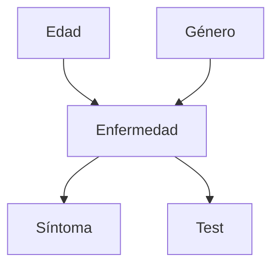

# Inteligencia Artificial - Modelos probabilísticos

## 3.1 Redes Bayesianas.

---

### Introducción a los Modelos Probabilísticos

Los modelos probabilísticos son representaciones matemáticas que utilizan la teoría de probabilidades para modelar la incertidumbre en el conocimiento. En inteligencia artificial, estos modelos permiten realizar razonamiento bajo incertidumbre, donde no tenemos información completa sobre el estado del mundo.

### Definición de Redes Bayesianas

Una red bayesiana es una estructura de datos que representa:

- Un conjunto de variables aleatorias y sus dependencias probabilísticas mediante un grafo acíclico dirigido (DAG)
- Una distribución de probabilidad conjunta compacta sobre estas variables

**Definición formal**: Una red bayesiana es un par $(G, Θ)$ donde:

- $G = (V, E)$ es un grafo acíclico dirigido
- $V$ es un conjunto de nodos que representan variables aleatorias
- $E$ es un conjunto de aristas que representan dependencias probabilísticas
- $Θ$ contiene parámetros $\theta_{x_i|\pi_i} = P_B(x_i|\pi_i)$ para cada valor $x_i$ de $X_i$ dada la configuración $\pi_i$ de los padres $\Pi_i$

### Representación de Conocimiento

Las redes bayesianas representan la distribución de probabilidad conjunta de manera factorizada:

$$P(X_1, X_2, ..., X_n) = \prod_{i=1}^n P(X_i | Padres(X_i))$$

Esta factorización permite representar distribuciones conjuntas complejas de manera compacta.

### Construcción de una Red Bayesiana

#### Identificación de Variables

Seleccionar las variables relevantes para el dominio modelado.

#### Estructura de Dependencias

Establecer las relaciones de dependencia condicional entre variables.

#### Probabilidades Condicionales

Especificar las tablas de probabilidad condicional (CPTs) para cada variable.

### Ejemplo: Diagnóstico Médico



**Tabla de probabilidad condicional para Enfermedad**:

| Edad   | Género | P(Enfermedad=Si) | P(Enfermedad=No) |
| ------ | ------ | ---------------- | ---------------- |
| Joven  | Hombre | 0.1              | 0.9              |
| Joven  | Mujer  | 0.05             | 0.95             |
| Adulto | Hombre | 0.2              | 0.8              |
| Adulto | Mujer  | 0.15             | 0.85             |
| Mayor  | Hombre | 0.4              | 0.6              |
| Mayor  | Mujer  | 0.3              | 0.7              |

### Inferencia en Redes Bayesianas

#### Inferencia por Enumeração

$$P(X|e) = αP(X, e) = α\sum_y P(X, e, y)$$

Donde $α$ es una constante de normalización.

#### Algoritmo de Eliminación de Variables

Eficiente para calcular probabilidades posteriores sin enumerar todas las posibilidades.

### Independencia Condicional

Las redes bayesianas capturan relaciones de independencia condicional:

$$X \perp Y | Z \iff P(X, Y|Z) = P(X|Z)P(Y|Z)$$

**D-separación**: Criterio para determinar independencias condicionales en la estructura del grafo.

### Tipos de Inferencia

1. **Diagnóstica**: De efectos a causas
2. **Predictiva**: De causas a efectos
3. **Intercausal**: Entre causas de un efecto común

### Implementación en Python

```python
import numpy as np
from pgmpy.models import BayesianNetwork
from pgmpy.factors.discrete import TabularCPD
from pgmpy.inference import VariableElimination

# Definir la estructura de la red
model = BayesianNetwork([('Edad', 'Enfermedad'),
                        ('Genero', 'Enfermedad'),
                        ('Enfermedad', 'Sintoma'),
                        ('Enfermedad', 'Test')])

# Definir las tablas de probabilidad condicional
cpd_edad = TabularCPD(variable='Edad', variable_card=3,
                     values=[[0.3], [0.5], [0.2]])

cpd_genero = TabularCPD(variable='Genero', variable_card=2,
                       values=[[0.5], [0.5]])

cpd_enfermedad = TabularCPD(variable='Enfermedad', variable_card=2,
                           values=[[0.9, 0.95, 0.8, 0.85, 0.6, 0.7],
                                  [0.1, 0.05, 0.2, 0.15, 0.4, 0.3]],
                           evidence=['Edad', 'Genero'],
                           evidence_card=[3, 2])

# Añadir las CPDs al modelo
model.add_cpds(cpd_edad, cpd_genero, cpd_enfermedad)

# Verificar la validez del modelo
print(model.check_model())

# Realizar inferencia
inference = VariableElimination(model)
result = inference.query(variables=['Enfermedad'],
                        evidence={'Sintoma': 1})
print(result)
```

### Aprendizaje de Redes Bayesianas

#### Aprendizaje de Parámetros

Dada la estructura, estimar las probabilidades condicionales a partir de datos.

#### Aprendizaje de Estructura

Descubrir la topología de la red a partir de datos.

### Ejercicios Propuestos

#### Ejercicio 1: Construcción de Red

Diseña una red bayesiana para predecir si un estudiante aprobará un examen basándose en:

- Asistencia a clases
- Tiempo de estudio
- Dificultad del examen
- Inteligencia del estudiante

#### Ejercicio 2: Cálculo de Probabilidades

Dada la siguiente red:

```
Lluvia → CéspedMojado
RiegoAutomatico → CéspedMojado
```

Con probabilidades:

- P(Lluvia) = 0.3
- P(RiegoAutomatico) = 0.4
- P(CéspedMojado|Lluvia, Riego) = 0.99
- P(CéspedMojado|Lluvia, NoRiego) = 0.9
- P(CéspedMojado|NoLluvia, Riego) = 0.8
- P(CéspedMojado|NoLluvia, NoRiego) = 0.1

Calcula:

1. P(CéspedMojado)
2. P(Lluvia|CéspedMojado)

#### Ejercicio 3: Implementación

Implementa en Python la red del ejercicio 2 y verifica tus cálculos.

### Aplicaciones de las Redes Bayesianas

1. **Diagnóstico médico**: Síntomas → Enfermedades
2. **Filtrado de spam**: Palabras → Spam/No spam
3. **Sistemas de recomendación**: Preferencias → Productos recomendados
4. **Procesamiento de lenguaje natural**: Palabras → Significado

### Limitaciones y Consideraciones

- Complejidad computacional en redes grandes
- Necesidad de datos suficientes para estimar parámetros
- Dificultad para representar relaciones temporales

### Referencias

#### Bibliografía Básica

1. Russell, S. & Norvig, P. (2009). _Artificial Intelligence: A Modern Approach_. 3rd Edition. Prentice Hall. (Capítulo 14)
2. Marsland, S. (2009). _Machine Learning: An Algorithmic Perspective_. Chapman y Hall. (Capítulo 3)

#### Bibliografía Complementaria

1. Alpaydin, E. (2010). _Introduction to Machine Learning_. 2nd Edition. The MIT Press.
2. Hastie, T., Tibshirani, R., & Friedman, J. (2009). _The Elements of Statistical Learning_. 2nd Edition. Springer.
3. Davis, E. (1990). _Representations of Commonsense Knowledge_. Morgan Kaufmann.

### Recursos Adicionales

- Herramientas para trabajar con redes bayesianas: pgmpy, BayesNet, Netica
- Conjuntos de datos para práctica: UCI Machine Learning Repository
- Tutoriales online: Coursera, edX sobre probabilistic graphical models
