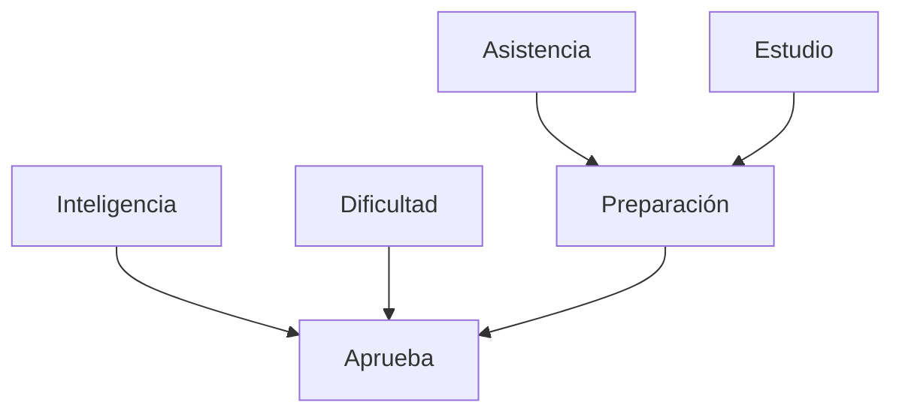

# Inteligencia Artificial - Modelos probabilísticos

## 3.1 Redes Bayesianas.

---

Un agente casi nunca conoce con certeza el estado del mundo: un síntoma puede deberse a varias enfermedades, un sensor puede fallar, un correo con la palabra "oferta" puede no ser spam. La **teoría de la probabilidad** es el lenguaje para razonar con esa incertidumbre, pero describir una distribución conjunta sobre $n$ variables booleanas requiere $2^n - 1$ números, imposible de especificar o de aprender para $n$ moderado. Una **red bayesiana** (Pearl, 1988) resuelve el problema aprovechando que cada variable depende directamente de pocas otras: representa la distribución con un grafo dirigido y una tabla pequeña por nodo. Este tema presenta su definición, la factorización de la conjunta, las independencias que codifica el grafo, los tipos de razonamiento que permite y la inferencia por enumeración.

### Probabilidad condicional y regla de Bayes

La probabilidad condicional es $P(A \mid B) = P(A, B) / P(B).$ De ella salen la **regla del producto**, $P(A, B) = P(A \mid B)\,P(B),$ y la **regla de Bayes**:

$$P(\text{causa} \mid \text{efecto}) = \frac{P(\text{efecto} \mid \text{causa})\,P(\text{causa})}{P(\text{efecto})}$$

que permite razonar en sentido diagnóstico a partir de conocimiento causal, que suele ser más fácil de obtener y más estable. Dos variables son **independientes** si $P(X, Y) = P(X)\,P(Y),$ y **condicionalmente independientes** dado $Z,$ escrito $X \perp Y \mid Z,$ si $P(X, Y \mid Z) = P(X \mid Z)\,P(Y \mid Z).$

### Definición

Una red bayesiana es un par $(G, \Theta):$ $G$ es un **grafo acíclico dirigido** cuyos nodos son variables aleatorias $X_1, \dots, X_n,$ y $\Theta$ contiene, para cada nodo, una **tabla de probabilidad condicional** (CPT) $P(X_i \mid \text{Padres}(X_i)).$ La red define la distribución conjunta

$$P(X_1, \dots, X_n) = \prod_{i=1}^{n} P(X_i \mid \text{Padres}(X_i))$$

Esta factorización equivale a una propiedad local: **cada variable es condicionalmente independiente de sus no descendientes, dados sus padres**. Se obtiene aplicando la regla de la cadena, $P(X_1, \dots, X_n) = \prod_i P(X_i \mid X_1, \dots, X_{i-1}),$ en un orden topológico y eliminando de cada condición las variables que no son padres. Con variables booleanas y a lo más $k$ padres por nodo, la red necesita $O(n\,2^k)$ números en lugar de $2^n - 1.$

### Construcción

1. **Variables:** se eligen las relevantes y sus valores posibles.
2. **Estructura:** se ordenan, de preferencia de causas a efectos, y para cada variable se eligen como padres el mínimo conjunto de las anteriores del que depende directamente. Un orden causal produce redes más compactas y tablas más fáciles de estimar; un orden de efectos a causas produce más aristas.
3. **Tablas:** se especifica cada CPT, a partir de expertos, de datos (tema 3.3) o de modelos como el **OR ruidoso**, que describe un efecto con varias causas independientes con un solo parámetro por causa.

### Independencias en el grafo: d-separación

Tres estructuras básicas determinan cuándo una variable transmite información entre otras dos:

| Estructura | Forma | Sin evidencia en B | Con evidencia en B |
| ---------- | ----- | ------------------ | ------------------ |
| Cadena | A → B → C | A y C dependientes | independientes |
| Causa común | A ← B → C | A y C dependientes | independientes |
| Efecto común, o v-estructura | A → B ← C | A y C **independientes** | **dependientes** |

En la v-estructura, observar el efecto, o alguno de sus descendientes, vuelve dependientes a las causas: si el césped está mojado y se sabe que llovió, el riego se vuelve menos probable. Es la **explicación alternativa**, o *explaining away*. Un camino está **bloqueado** si contiene una cadena o causa común con el nodo central observado, o una v-estructura en la que ni el nodo central ni sus descendientes están observados. $X$ e $Y$ están **d-separados** por $Z$ si todos los caminos entre ellos están bloqueados, y entonces $X \perp Y \mid Z$ en toda distribución que factorice según el grafo.

### Tipos de razonamiento

- **Predictivo**, de causas a efectos: ¿qué probabilidad hay de aprobar si el estudiante asiste y estudia?
- **Diagnóstico**, de efectos a causas: si aprobó, ¿qué tan probable es que sea muy inteligente?
- **Intercausal**, entre causas de un efecto común: si reprobó y es muy inteligente, ¿qué tan probable es que el examen fuera difícil?

### Inferencia por enumeración

Para una consulta $X$ con evidencia $e$ y variables ocultas $Y,$

$$P(X \mid e) = \alpha\,P(X, e) = \alpha \sum_{y} P(X, e, y)$$

donde $\alpha$ normaliza para que la distribución sume 1, y cada término de la suma se calcula con la factorización. Es exacta pero cuesta $O(n\,2^n)$ en el peor caso; el tema 3.2 presenta la eliminación de variables y los métodos aproximados.



### Implementación en Python

El programa define una red bayesiana booleana con inferencia por enumeración y muestreo hacia adelante, sin bibliotecas externas. Construye la red del estudiante del diagrama para el ejercicio 1 y hace consultas de los tres tipos; calcula las probabilidades del ejercicio 2, incluida la explicación alternativa, y, para el ejercicio 3, las verifica por enumeración y por muestreo.

```python
import random
from itertools import product

# ---------- Una red bayesiana de variables booleanas, con inferencia por enumeración ----------
class Red:
    def __init__(self):
        self.vars, self.padres, self.cpt = [], {}, {}
    def agrega(self, v, padres, tabla):                 # tabla: {valores de los padres: P(v = verdadero)}
        self.vars.append(v); self.padres[v] = padres
        self.cpt[v] = tabla if padres else {(): tabla}
    def p(self, v, valor, asig):
        q = self.cpt[v][tuple(asig[u] for u in self.padres[v])]
        return q if valor else 1 - q
    def conjunta(self, asig):
        r = 1.0
        for v in self.vars: r *= self.p(v, asig[v], asig)
        return r
    def prob(self, consulta, evidencia={}):             # P(consulta | evidencia), sumando sobre las ocultas
        libres = [v for v in self.vars if v not in evidencia]
        num = den = 0.0
        for valores in product([True, False], repeat=len(libres)):
            a = dict(evidencia, **dict(zip(libres, valores))); pa = self.conjunta(a)
            den += pa
            if all(a[k] == x for k, x in consulta.items()): num += pa
        return num / den
    def muestra(self, rng):                             # muestreo hacia adelante, en orden topológico
        a = {}
        for v in self.vars: a[v] = rng.random() < self.p(v, True, a)
        return a
    def parametros(self): return sum(len(t) for t in self.cpt.values())

# ---------- Ejercicio 1: ¿aprobará el estudiante? ----------
est = Red()
est.agrega("Inteligencia", [], 0.3)
est.agrega("Dificultad", [], 0.4)
est.agrega("Asistencia", [], 0.7)
est.agrega("Estudio", [], 0.5)
est.agrega("Preparación", ["Asistencia", "Estudio"], {(True, True): 0.9, (True, False): 0.6, (False, True): 0.5, (False, False): 0.1})
est.agrega("Aprueba", ["Preparación", "Inteligencia", "Dificultad"],
           {(True, True, True): 0.85, (True, True, False): 0.97, (True, False, True): 0.6, (True, False, False): 0.85,
            (False, True, True): 0.4, (False, True, False): 0.7, (False, False, True): 0.1, (False, False, False): 0.3})
print(f"ejercicio 1: {est.parametros()} parámetros, frente a {2 ** len(est.vars) - 1} de la tabla conjunta completa")
print(f"   P(aprueba) = {est.prob({'Aprueba': True}):.4f}")
print(f"   predictiva: P(aprueba | asiste, estudia) = {est.prob({'Aprueba': True}, {'Asistencia': True, 'Estudio': True}):.4f}")
print(f"   predictiva: P(aprueba | no asiste, no estudia) = {est.prob({'Aprueba': True}, {'Asistencia': False, 'Estudio': False}):.4f}")
print(f"   diagnóstica: P(inteligencia alta | aprobó) = {est.prob({'Inteligencia': True}, {'Aprueba': True}):.4f}  (a priori 0.3)")
print(f"   diagnóstica: P(examen difícil | reprobó) = {est.prob({'Dificultad': True}, {'Aprueba': False}):.4f}  (a priori 0.4)")
print(f"   intercausal: P(examen difícil | reprobó, inteligencia alta) = {est.prob({'Dificultad': True}, {'Aprueba': False, 'Inteligencia': True}):.4f}")

# ---------- Ejercicios 2 y 3: lluvia, riego y césped mojado ----------
red = Red()
red.agrega("Lluvia", [], 0.3)
red.agrega("Riego", [], 0.4)
red.agrega("Césped", ["Lluvia", "Riego"], {(True, True): 0.99, (True, False): 0.9, (False, True): 0.8, (False, False): 0.1})
pc = red.prob({"Césped": True}); plc = red.prob({"Lluvia": True}, {"Césped": True})
print("ejercicio 2:")
for l, r in product([True, False], repeat=2):
    print(f"   lluvia={l!s:5} riego={r!s:5}: P = {red.conjunta({'Lluvia': l, 'Riego': r, 'Césped': True}):.4f}")
print(f"   P(césped mojado) = {pc:.4f}")
print(f"   P(lluvia | césped mojado) = {plc:.4f}")
print(f"   P(riego | césped mojado) = {red.prob({'Riego': True}, {'Césped': True}):.4f}")
print(f"   P(riego | césped mojado, lluvia) = {red.prob({'Riego': True}, {'Césped': True, 'Lluvia': True}):.4f}  (la lluvia explica el césped)")
print(f"   independencia: P(lluvia | riego) = {red.prob({'Lluvia': True}, {'Riego': True}):.4f}; "
      f"P(lluvia | riego, césped) = {red.prob({'Lluvia': True}, {'Riego': True, 'Césped': True}):.4f}")
rng = random.Random(1)
for n in (1000, 10000, 100000):
    m = [red.muestra(rng) for _ in range(n)]; mojado = [a for a in m if a["Césped"]]
    print(f"ejercicio 3: {n:6} muestras: P(césped) ≈ {len(mojado) / n:.4f}, P(lluvia | césped) ≈ {sum(a['Lluvia'] for a in mojado) / len(mojado):.4f}")
```

Salida:

```text
ejercicio 1: 16 parámetros, frente a 63 de la tabla conjunta completa
   P(aprueba) = 0.6193
   predictiva: P(aprueba | asiste, estudia) = 0.7542
   predictiva: P(aprueba | no asiste, no estudia) = 0.3754
   diagnóstica: P(inteligencia alta | aprobó) = 0.3829  (a priori 0.3)
   diagnóstica: P(examen difícil | reprobó) = 0.5376  (a priori 0.4)
   intercausal: P(examen difícil | reprobó, inteligencia alta) = 0.6167
ejercicio 2:
   lluvia=True  riego=True : P = 0.1188
   lluvia=True  riego=False: P = 0.1620
   lluvia=False riego=True : P = 0.2240
   lluvia=False riego=False: P = 0.0420
   P(césped mojado) = 0.5468
   P(lluvia | césped mojado) = 0.5135
   P(riego | césped mojado) = 0.6269
   P(riego | césped mojado, lluvia) = 0.4231  (la lluvia explica el césped)
   independencia: P(lluvia | riego) = 0.3000; P(lluvia | riego, césped) = 0.3466
ejercicio 3:   1000 muestras: P(césped) ≈ 0.5460, P(lluvia | césped) ≈ 0.4762
ejercicio 3:  10000 muestras: P(césped) ≈ 0.5457, P(lluvia | césped) ≈ 0.5175
ejercicio 3: 100000 muestras: P(césped) ≈ 0.5468, P(lluvia | césped) ≈ 0.5150
```

### Ejercicios Propuestos

1. **Construcción de una red.** Diseña una red bayesiana para predecir si un estudiante aprobará un examen a partir de la asistencia a clases, el tiempo de estudio, la dificultad del examen y la inteligencia del estudiante.

2. **Cálculo de probabilidades.** En la red Lluvia → CéspedMojado ← Riego, con $P(\text{Lluvia}) = 0.3,$ $P(\text{Riego}) = 0.4$ y

    | Lluvia | Riego | P(CéspedMojado) |
    | ------ | ----- | --------------- |
    | sí     | sí    | 0.99            |
    | sí     | no    | 0.9             |
    | no     | sí    | 0.8             |
    | no     | no    | 0.1             |

    calcula $P(\text{CéspedMojado})$ y $P(\text{Lluvia} \mid \text{CéspedMojado}).$

3. **Implementación.** Implementa en Python la red del ejercicio 2 y verifica tus cálculos.

### Soluciones

**Ejercicio 1.** La red del diagrama agrega una variable intermedia, **Preparación**, que resume el efecto de la asistencia y el estudio; así, Aprueba tiene tres padres en lugar de cuatro, y su tabla 8 filas en lugar de 16. Las tablas usadas están en el programa. La red tiene 16 parámetros, frente a 63 de la conjunta de seis variables booleanas. Las consultas muestran los tres tipos de razonamiento:

- **Predictivo:** la probabilidad de aprobar es 0.619 en general, 0.754 si el estudiante asiste y estudia y 0.375 si no hace ninguna de las dos cosas.
- **Diagnóstico:** saber que aprobó sube la probabilidad de inteligencia alta de 0.3 a 0.383, y saber que reprobó sube la de un examen difícil de 0.4 a 0.538.
- **Intercausal:** si reprobó y además es muy inteligente, la probabilidad de un examen difícil sube a 0.617, porque la inteligencia baja deja de ser una explicación disponible.

La estructura supone, por ejemplo, que la inteligencia no influye en el tiempo de estudio; si se cree que sí, se agrega la arista Inteligencia → Estudio y la red sigue siendo acíclica.

**Ejercicio 2.** Por la factorización, $P(L, R, C) = P(L)\,P(R)\,P(C \mid L, R),$ y la marginal suma los cuatro casos:

$$P(C) = 0.3 \cdot 0.4 \cdot 0.99 + 0.3 \cdot 0.6 \cdot 0.9 + 0.7 \cdot 0.4 \cdot 0.8 + 0.7 \cdot 0.6 \cdot 0.1 = 0.1188 + 0.162 + 0.224 + 0.042 = 0.5468$$

Con la regla de Bayes, el numerador son los dos casos con lluvia:

$$P(L \mid C) = \frac{0.1188 + 0.162}{0.5468} = \frac{0.2808}{0.5468} \approx 0.5135$$

Ver el césped mojado sube la probabilidad de lluvia de 0.3 a 0.51. El programa muestra además la explicación alternativa: el riego tiene probabilidad 0.627 dado el césped mojado, pero solo 0.423 si además se sabe que llovió. Lluvia y Riego son independientes a priori, $P(L \mid R) = 0.3,$ pero dependientes dado el césped, como predice la v-estructura.

**Ejercicio 3.** La enumeración del programa reproduce exactamente los valores calculados a mano. El muestreo hacia adelante los aproxima: con 1 000 muestras, $P(L \mid C) \approx 0.476,$ y con 100 000, 0.515. El error decrece como $1/\sqrt{N},$ y la estimación condicional es más ruidosa que la marginal porque solo usa las muestras con el césped mojado, un poco más de la mitad.

### Referencias

1. Russell, S., and Norvig, P., _Artificial Intelligence: A Modern Approach_. Pearson, 2021. Capítulos 12 y 13.
2. Pearl, J., _Probabilistic Reasoning in Intelligent Systems_. Morgan Kaufmann, 1988.
3. Koller, D., and Friedman, N., _Probabilistic Graphical Models: Principles and Techniques_. MIT Press, 2009.
4. Darwiche, A., _Modeling and Reasoning with Bayesian Networks_. Cambridge University Press, 2009.
5. Murphy, K. P., _Probabilistic Machine Learning: An Introduction_. MIT Press, 2022.
