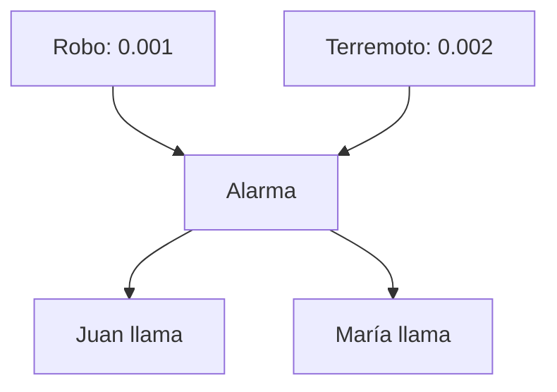

# Inteligencia Artificial - Modelos probabilísticos

## 3.2 Inferencia en redes Bayesianas.

---

Una red bayesiana representa una distribución conjunta de forma compacta; **inferir** es responder preguntas sobre ella: dada la evidencia observada $e,$ calcular la distribución posterior $P(X \mid e)$ de una o varias variables de consulta. La inferencia exacta es NP-difícil en general, incluso para decidir si una probabilidad es mayor que cero, porque una red puede codificar una fórmula de SAT. Por eso hay dos familias de algoritmos: los **exactos**, que aprovechan la estructura del grafo y son eficientes cuando la red tiene poca conectividad, y los **aproximados**, basados en muestreo, que sirven para cualquier red a cambio de un error estadístico. Este tema presenta la enumeración, la eliminación de variables con el efecto del orden, el muestreo por rechazo, la ponderación por verosimilitud y el muestreo de Gibbs.

### Enumeración

Con variables ocultas $Y,$ $P(X \mid e) = \alpha \sum_y P(X, e, y),$ y cada término se calcula con la factorización de la red. Para la red de la alarma,

$$P(R \mid j, m) = \alpha\,P(R) \sum_{t} P(t) \sum_{a} P(a \mid R, t)\,P(j \mid a)\,P(m \mid a)$$

Sacar de las sumas los factores que no dependen de la variable sumada ya ahorra trabajo, pero la enumeración recalcula muchas veces los mismos productos: su costo es $O(2^n).$

### Eliminación de variables

La **eliminación de variables** evalúa la expresión de derecha a izquierda y guarda los resultados intermedios en **factores**, tablas sobre subconjuntos de variables. Para eliminar una variable oculta $Z:$

1. se multiplican todos los factores que contienen a $Z,$ produciendo una tabla sobre la unión de sus variables;
2. se suma $Z$ en esa tabla, y el factor resultante sustituye a los multiplicados.

Al final se multiplican los factores restantes y se normaliza. El costo está dominado por el **factor más grande** que se forma, exponencial en su número de variables, y este depende del **orden de eliminación**. El mínimo, sobre todos los órdenes, del tamaño del mayor factor menos uno es el **ancho de árbol** del grafo moralizado. Encontrar el orden óptimo es NP-difícil, pero heurísticas voraces como **mínimo de vecinos** o **mínimo de aristas de relleno** funcionan bien. En los **poliárboles**, redes sin ciclos en el grafo no dirigido, la inferencia exacta es lineal en el tamaño de la red. Dos optimizaciones adicionales: las variables que no son **ancestros** de la consulta o de la evidencia pueden eliminarse de antemano, porque suman 1; y los factores intermedios pueden guardarse para responder varias consultas, como hace el algoritmo de **árbol de uniones**.

### Muestreo

Cuando el ancho de árbol es grande, se estima la posterior con muestras:

- **Muestreo por rechazo:** genera muestras de la red en orden topológico, descarta las que no coinciden con la evidencia y cuenta en las restantes. Es correcto, pero si la evidencia es poco probable casi todas se descartan: la fracción aceptada es $P(e).$
- **Ponderación por verosimilitud:** fija las variables de evidencia y muestrea solo las demás; cada muestra recibe el peso $w = \prod_{E_i \in e} P(e_i \mid \text{padres}(E_i)),$ y la estimación es la suma ponderada normalizada. No desperdicia muestras, pero si la evidencia está "abajo" de la red y es improbable, pocas muestras concentran casi todo el peso.
- **Muestreo de Gibbs**, un método de **Monte Carlo por cadenas de Markov**: parte de un estado con la evidencia fija y, repetidamente, remuestrea una variable no observada dada su **manta de Markov**, es decir, sus padres, sus hijos y los otros padres de sus hijos. La cadena converge a la posterior; las muestras están correlacionadas y las primeras se descartan como calentamiento.

En todos, el error estándar decrece como $1/\sqrt{N}$ en el número de muestras efectivas.



### La red de la alarma

Las tablas, de Pearl (1988) y Russell y Norvig, son $P(R) = 0.001,$ $P(T) = 0.002;$ $P(A \mid R, T)$ vale 0.95 con robo y terremoto, 0.94 con solo robo, 0.29 con solo terremoto y 0.001 sin ninguno; $P(J \mid A) = 0.90,$ $P(J \mid \neg A) = 0.05,$ $P(M \mid A) = 0.70$ y $P(M \mid \neg A) = 0.01.$ La consulta clásica es $P(R \mid j, m).$

### Implementación en Python

El programa implementa la enumeración para la red de la alarma y responde las consultas del ejercicio 1; compara el muestreo por rechazo con la ponderación por verosimilitud para el ejercicio 2; construye una red de diagnóstico con OR ruidoso para el ejercicio 3, y, para el ejercicio 4, implementa la eliminación de variables con factores de NumPy y cuenta las operaciones de tres órdenes de eliminación en la cadena con dominios de 2, 10 y 50 valores.

```python
import random
from itertools import product
import numpy as np

# ---------- Red de la alarma (Pearl; Russell y Norvig) ----------
PADRES = {"R": [], "T": [], "A": ["R", "T"], "J": ["A"], "M": ["A"]}     # Robo, Terremoto, Alarma, Juan, María
CPT = {"R": {(): 0.001}, "T": {(): 0.002},
       "A": {(True, True): 0.95, (True, False): 0.94, (False, True): 0.29, (False, False): 0.001},
       "J": {(True,): 0.90, (False,): 0.05}, "M": {(True,): 0.70, (False,): 0.01}}
ORDEN = ["R", "T", "A", "J", "M"]
def p(v, x, a):
    q = CPT[v][tuple(a[u] for u in PADRES[v])]; return q if x else 1 - q
def enumera(X, ev):                                       # P(X = verdadero | ev) por enumeración
    libres = [v for v in ORDEN if v not in ev]; num = den = 0.0
    for vals in product([True, False], repeat=len(libres)):
        a = dict(ev, **dict(zip(libres, vals))); pa = 1.0
        for v in ORDEN: pa *= p(v, a[v], a)
        den += pa; num += pa if a[X] else 0
    return num / den
print("ejercicio 1: enumeración exacta")
print(f"   P(R | J) = {enumera('R', {'J': True}):.5f}  (a priori 0.001)")
print(f"   P(R | J, T) = {enumera('R', {'J': True, 'T': True}):.5f}")
print(f"   P(R | J, M) = {enumera('R', {'J': True, 'M': True}):.5f}")
print(f"   P(A | J) = {enumera('A', {'J': True}):.5f};  P(A | J, T) = {enumera('A', {'J': True, 'T': True}):.5f}")

# ---------- Ejercicio 2: muestreo por rechazo y ponderación por verosimilitud ----------
exacto = enumera("R", {"J": True, "M": True})
def muestra(rng, ev=None):
    a, w = {}, 1.0
    for v in ORDEN:
        if ev and v in ev: a[v] = ev[v]; w *= p(v, ev[v], a)       # evidencia: se fija y se pondera
        else: a[v] = rng.random() < p(v, True, a)
    return a, w
print(f"ejercicio 2: P(R | J, M) exacta = {exacto:.4f}")
for n in (10_000, 100_000, 1_000_000):
    rng = random.Random(7); acept = robo = 0
    for _ in range(n):
        a, _ = muestra(rng)
        if a["J"] and a["M"]: acept += 1; robo += a["R"]
    est = robo / acept if acept else float("nan")
    rng = random.Random(7); num = den = 0.0
    for _ in range(n // 10):
        a, w = muestra(rng, {"J": True, "M": True}); den += w; num += w * a["R"]
    print(f"   rechazo con {n:9,} muestras: {acept:5} aceptadas, estimación {est:.4f} | ponderación con {n // 10:7,}: {num / den:.4f}")

# ---------- Ejercicio 3: diagnóstico con 5 enfermedades y 10 síntomas, OR ruidoso ----------
ENF = {"gripe": 0.05, "resfriado": 0.15, "alergia": 0.10, "migraña": 0.08, "gastroenteritis": 0.04}
# P(síntoma | solo esa enfermedad); fuga: probabilidad del síntoma sin ninguna de las enfermedades
SINT = {"fiebre":        ({"gripe": 0.9, "gastroenteritis": 0.4, "resfriado": 0.2}, 0.01),
        "tos":           ({"gripe": 0.7, "resfriado": 0.6, "alergia": 0.3}, 0.05),
        "estornudos":    ({"resfriado": 0.7, "alergia": 0.8}, 0.05),
        "congestión":    ({"resfriado": 0.8, "alergia": 0.7, "gripe": 0.4}, 0.05),
        "dolor_cabeza":  ({"migraña": 0.95, "gripe": 0.6, "resfriado": 0.2}, 0.1),
        "náusea":        ({"gastroenteritis": 0.8, "migraña": 0.4}, 0.03),
        "diarrea":       ({"gastroenteritis": 0.9}, 0.02),
        "dolor_muscular":({"gripe": 0.8}, 0.05),
        "ojos_llorosos": ({"alergia": 0.7, "resfriado": 0.2}, 0.03),
        "fotofobia":     ({"migraña": 0.7}, 0.02)}
def p_sintoma(s, presentes):                              # OR ruidoso con fuga
    causas, fuga = SINT[s]; q = 1 - fuga
    for e in presentes:
        if e in causas: q *= 1 - causas[e]
    return 1 - q
def diagnostica(obs):                                     # obs: {síntoma: bool}; los no observados se marginan solos
    post = {e: 0.0 for e in ENF}; total = 0.0
    for vals in product([True, False], repeat=len(ENF)):
        pres = {e for e, x in zip(ENF, vals) if x}
        pa = 1.0
        for e, x in zip(ENF, vals): pa *= ENF[e] if x else 1 - ENF[e]
        for s, x in obs.items(): q = p_sintoma(s, pres); pa *= q if x else 1 - q
        total += pa
        for e in pres: post[e] += pa
    return {e: v / total for e, v in post.items()}
casos = {"fiebre, tos, dolor muscular": {"fiebre": True, "tos": True, "dolor_muscular": True},
         "estornudos, ojos llorosos, sin fiebre": {"estornudos": True, "ojos_llorosos": True, "fiebre": False},
         "dolor de cabeza, fotofobia, náusea": {"dolor_cabeza": True, "fotofobia": True, "náusea": True},
         "náusea y diarrea": {"náusea": True, "diarrea": True}}
n_par = len(ENF) + sum(len(c) + 1 for c, _ in SINT.values())
print(f"ejercicio 3: {n_par} parámetros con OR ruidoso, frente a {sum(2 ** len(c) for c, _ in SINT.values()) + len(ENF)} con tablas completas")
for nombre, obs in casos.items():
    post = diagnostica(obs); top = sorted(post.items(), key=lambda kv: -kv[1])[:3]
    print(f"   {nombre:38}: " + ", ".join(f"{e} {v:.3f}" for e, v in top))

# ---------- Ejercicio 4: orden de eliminación en la cadena A → B → C → D → E ----------
def cadena(k, rng):
    m = lambda: (lambda x: x / x.sum(axis=1, keepdims=True))(rng.random((k, k)) + 0.1)
    pa = rng.random(k) + 0.1
    return {"A": (["A"], pa / pa.sum()), "B": (["A", "B"], m()), "C": (["B", "C"], m()), "D": (["C", "D"], m()), "E": (["D", "E"], m())}
def elimina(factores, orden, ev):
    fs = []
    for vs, t in factores:                                # fija la evidencia
        for v, x in ev.items():
            if v in vs: t = np.take(t, x, axis=vs.index(v)); vs = [u for u in vs if u != v]
        fs.append((vs, t))
    ops, mayor = 0, 0
    for z in orden:
        usa = [f for f in fs if z in f[0]]; fs = [f for f in fs if z not in f[0]]
        vs = sorted(set(u for f in usa for u in f[0])); letras = {u: chr(97 + i) for i, u in enumerate(vs)}
        k = usa[0][1].shape[usa[0][0].index(z)]
        tam = k ** len(vs); ops += tam * len(usa); mayor = max(mayor, len(vs))    # tamaño de la tabla producto
        res = [u for u in vs if u != z]
        t = np.einsum(",".join("".join(letras[u] for u in f[0]) for f in usa) + "->" + "".join(letras[u] for u in res), *[f[1] for f in usa])
        fs.append((res, t))
    vs, t = fs[0][0], fs[0][1]
    for f in fs[1:]: t = t * f[1]
    return t / t.sum(), ops, mayor
print("ejercicio 4: P(A | E = 0) en la cadena; operaciones = suma de los tamaños de las tablas producto")
for k in (2, 10, 50):
    fac = list(cadena(k, np.random.default_rng(0)).values())
    fila = []
    for orden in (["D", "C", "B"], ["B", "C", "D"], ["C", "B", "D"]):
        r, ops, mayor = elimina(fac, orden, {"E": 0}); fila.append((orden, r, ops, mayor))
    assert all(np.allclose(fila[0][1], f[1]) for f in fila)
    print(f"   k = {k:2}: " + " | ".join(f"orden {''.join(o)}: {ops:7} ops, factor mayor de {m} variables" for o, _, ops, m in fila))
print("   P(A | E = 0) con k = 2:", np.round(elimina(list(cadena(2, np.random.default_rng(0)).values()), ["D", "C", "B"], {"E": 0})[0], 4))
```

Salida:

```text
ejercicio 1: enumeración exacta
   P(R | J) = 0.01628  (a priori 0.001)
   P(R | J, T) = 0.00289
   P(R | J, M) = 0.28417
   P(A | J) = 0.04344;  P(A | J, T) = 0.88061
ejercicio 2: P(R | J, M) exacta = 0.2842
   rechazo con    10,000 muestras:    24 aceptadas, estimación 0.3333 | ponderación con   1,000: 0.1727
   rechazo con   100,000 muestras:   194 aceptadas, estimación 0.2784 | ponderación con  10,000: 0.2864
   rechazo con 1,000,000 muestras:  2066 aceptadas, estimación 0.2715 | ponderación con 100,000: 0.2758
ejercicio 3: 36 parámetros con OR ruidoso, frente a 55 con tablas completas
   fiebre, tos, dolor muscular           : gripe 0.962, resfriado 0.209, alergia 0.110
   estornudos, ojos llorosos, sin fiebre : alergia 0.757, resfriado 0.342, migraña 0.080
   dolor de cabeza, fotofobia, náusea    : migraña 0.993, resfriado 0.152, alergia 0.100
   náusea y diarrea                      : gastroenteritis 0.962, resfriado 0.150, migraña 0.105
ejercicio 4: P(A | E = 0) en la cadena; operaciones = suma de los tamaños de las tablas producto
   k =  2: orden DCB:      24 ops, factor mayor de 2 variables | orden BCD:      40 ops, factor mayor de 3 variables | orden CBD:      40 ops, factor mayor de 3 variables
   k = 10: orden DCB:     600 ops, factor mayor de 2 variables | orden BCD:    4200 ops, factor mayor de 3 variables | orden CBD:    4200 ops, factor mayor de 3 variables
   k = 50: orden DCB:   15000 ops, factor mayor de 2 variables | orden BCD:  505000 ops, factor mayor de 3 variables | orden CBD:  505000 ops, factor mayor de 3 variables
   P(A | E = 0) con k = 2: [0.6659 0.3341]
```

### Ejercicios Propuestos

1. **Enumeración.** En la red de la alarma, calcula a mano $P(\text{Robo} \mid \text{JuanLlama})$ y $P(\text{Robo} \mid \text{JuanLlama}, \text{Terremoto}).$

2. **Muestreo.** Implementa el muestreo por rechazo para calcular $P(\text{Robo} \mid \text{JuanLlama}, \text{MaríaLlama}),$ y compara el resultado con el algoritmo exacto.

3. **Diagnóstico médico.** Diseña una red bayesiana con al menos 5 enfermedades y 10 síntomas, con su estructura, sus tablas de probabilidad condicional y un sistema de inferencia que diagnostique enfermedades a partir de los síntomas.

4. **Orden de eliminación.** En la red A → B → C → D → E, ¿cuál es el mejor orden de eliminación para calcular $P(A \mid E)?$ Implementa un orden óptimo y uno no óptimo y compáralos.

### Soluciones

**Ejercicio 1.** Primero, la probabilidad de la alarma: $P(a) = \sum_{r, t} P(r)\,P(t)\,P(a \mid r, t) \approx 0.002516.$ Con ella,

- $P(j) = 0.90 \cdot 0.002516 + 0.05 \cdot 0.997484 \approx 0.05212;$
- $P(a \mid r) = 0.002 \cdot 0.95 + 0.998 \cdot 0.94 = 0.94002,$ de modo que $P(r, j) = 0.001\,(0.94002 \cdot 0.90 + 0.05998 \cdot 0.05) \approx 0.000849;$
- $P(r \mid j) = 0.000849 / 0.05212 \approx 0.0163.$

Una llamada de Juan multiplica por 16 la probabilidad de robo, pero sigue siendo baja, porque Juan llama falsamente el 5 % de las veces y los robos son raros. Con el terremoto como evidencia, $P(a \mid t) = 0.001 \cdot 0.95 + 0.999 \cdot 0.29 \approx 0.2907,$ y

$$P(r \mid j, t) = \frac{0.001\,(0.95 \cdot 0.90 + 0.05 \cdot 0.05)}{0.2907 \cdot 0.90 + 0.7093 \cdot 0.05} = \frac{0.000858}{0.2971} \approx 0.0029$$

La probabilidad de robo **baja** de 0.0163 a 0.0029: el terremoto explica la alarma y, por tanto, la llamada. Es la explicación alternativa de la v-estructura R → A ← T. El programa confirma los dos valores.

**Ejercicio 2.** La posterior exacta es $P(R \mid j, m) \approx 0.284.$ El muestreo por rechazo solo acepta las muestras con las dos llamadas, cuya probabilidad es $P(j, m) \approx 0.002:$ de 10 000 muestras se aceptan 24, y la estimación, 0.333, tiene un error grande; con un millón se aceptan 2 066 y la estimación es 0.272. La ponderación por verosimilitud no descarta muestras y, con diez veces menos, da estimaciones comparables, 0.286 con 10 000 y 0.276 con 100 000; sigue teniendo varianza alta porque la evidencia está en las hojas y el robo, en la raíz, se muestrea sin verla. Con evidencia muy improbable, Gibbs o la inferencia exacta son preferibles.

**Ejercicio 3.** La red es bipartita: cada una de las 5 enfermedades es un nodo raíz con su prevalencia, y cada uno de los 10 síntomas tiene como padres las enfermedades que lo causan. Cada tabla se especifica con un **OR ruidoso con fuga**: cada enfermedad presente causa el síntoma con su propia probabilidad, de forma independiente, y una fuga cubre las causas no modeladas, de modo que $P(s \mid \text{presentes}) = 1 - (1 - \text{fuga}) \prod_{e} (1 - p_{e}).$ Así bastan 36 parámetros en lugar de 55. La inferencia enumera las $2^5$ combinaciones de enfermedades, y los síntomas no observados se marginan solos porque sus tablas suman 1. Fiebre, tos y dolor muscular dan gripe con 0.96; estornudos y ojos llorosos sin fiebre, alergia con 0.76; dolor de cabeza, fotofobia y náusea, migraña con 0.99; náusea y diarrea, gastroenteritis con 0.96. Las probabilidades de las enfermedades no son excluyentes y no suman 1, porque un paciente puede tener varias. Las cifras son ilustrativas; una red clínica real, como QMR-DT, con unas 530 enfermedades y 4 000 hallazgos, usa la misma estructura con parámetros obtenidos de la literatura médica.

**Ejercicio 4.** Con evidencia en E, hay que eliminar B, C y D. El mejor orden empieza por el extremo de la evidencia, **D, C, B**: eliminar D combina $P(D \mid C)$ con $P(e \mid D)$ en un factor sobre C; eliminar C produce uno sobre B, y eliminar B uno sobre A. Ningún factor tiene más de 2 variables. El orden B, C, D, en cambio, combina primero $P(B \mid A)$ y $P(C \mid B),$ formando una tabla sobre A, B y C, de 3 variables, y arrastra a A en cada paso. Con dominios de $k$ valores, el primer orden cuesta $O(k^2)$ y el segundo $O(k^3):$ en el programa, con $k = 50,$ 15 000 operaciones frente a 505 000, 34 veces más, y las dos dan el mismo resultado. En una cadena la diferencia es polinomial; en redes más conectadas, un mal orden puede crear factores exponencialmente más grandes.

El código del material original definía la tabla de la alarma en pgmpy con las columnas en el orden $(\neg r, \neg t), (\neg r, t), (r, \neg t), (r, t),$ pero ponía 0.94 en la segunda y 0.29 en la tercera: la tabla resultante decía que un terremoto solo activa la alarma con probabilidad 0.94 y un robo solo con 0.29, lo contrario de las probabilidades enunciadas en el texto.

### Referencias

1. Russell, S., and Norvig, P., _Artificial Intelligence: A Modern Approach_. Pearson, 2021. Capítulo 13.
2. Pearl, J., _Probabilistic Reasoning in Intelligent Systems_. Morgan Kaufmann, 1988.
3. Koller, D., and Friedman, N., _Probabilistic Graphical Models: Principles and Techniques_. MIT Press, 2009. Capítulos 9 a 12.
4. Zhang, N. L., and Poole, D., A simple approach to Bayesian network computations. _Proceedings of the Canadian Conference on AI_, 1994.
5. Cooper, G. F., The computational complexity of probabilistic inference using Bayesian belief networks. _Artificial Intelligence_ 42, 1990.
6. Shwe, M. A., et al., Probabilistic diagnosis using a reformulation of the INTERNIST-1/QMR knowledge base. _Methods of Information in Medicine_ 30, 1991.
