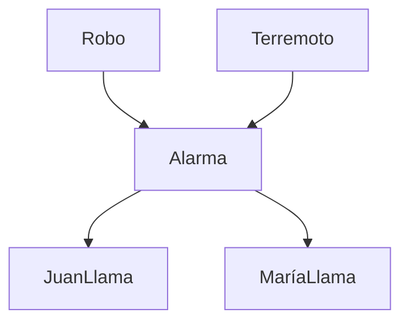

# Inteligencia Artificial - Modelos probabilísticos

## 3.2 Inferencia en redes Bayesianas.

---

### Introducción a la Inferencia Probabilística

La inferencia en redes bayesianas es el proceso de calcular la distribución de probabilidad posterior de un conjunto de variables de consulta dado algún evento observado (evidencia). Formalmente, queremos calcular:

$$P(Q | E = e)$$

Donde:

- $Q$ es el conjunto de variables de consulta
- $E$ es el conjunto de variables de evidencia
- $e$ son los valores observados de las variables de evidencia

### Tipos de Inferencia

#### Inferencia por Enumeración

Método directo que utiliza la definición de probabilidad condicional:

$$P(X | e) = \frac{P(X, e)}{P(e)} = \alpha P(X, e) = \alpha \sum_{y} P(X, e, y)$$

Donde:

- $X$ es la variable de consulta
- $e$ es la evidencia observada
- $y$ son las variables ocultas (no evidenciadas ni consultadas)
- $\alpha$ es el factor de normalización

**Ejemplo**: Para la red A → B → C, calcular P(C|A):

$$P(c|a) = \alpha P(a, c) = \alpha \sum_{b} P(a) P(b|a) P(c|b)$$

#### Eliminación de Variables

Algoritmo más eficiente que evita cálculos redundantes:

```python
def elimination_ask(X, e, bn):
    factors = []
    for var in ORDER(bn.vars):
        factors.append(make_factor(var, e))
        if var in hidden_vars:
            factors = sum_out(var, factors)
    return normalize(pointwise_product(factors))
```

### Algoritmos Exactos de Inferencia

#### Algoritmo de Eliminación de Variables

Pasos del algoritmo:

1. Seleccionar un orden de eliminación de variables
2. Para cada variable no consulta ni evidencia:
   - Combinar todos los factores que contienen la variable
   - Eliminar (marginalizar) la variable
3. Combinar los factores restantes
4. Normalizar la distribución resultante

#### Algoritmo de Encadenamiento hacia Adelante y Atrás

Para redes con estructura de cadena temporal:

**Encadenamiento hacia adelante**:

$$P(X_{t+1} | e_{1:t}) = \sum_{x_t} P(X_{t+1} | x_t) P(x_t | e_{1:t})$$

**Encadenamiento hacia atrás**:

$$P(e_{k+1:t} | X_k) = \sum_{x_{k+1}} P(e_{k+1} | x_{k+1}) P(e_{k+2:t} | x_{k+1}) P(x_{k+1} | X_k)$$

### Algoritmos Aproximados de Inferencia

#### Muestreo por Rechazo

Genera muestras de la distribución prior y rechaza aquellas inconsistentes con la evidencia.

```python
def rejection_sampling(X, e, bn, N):
    counts = {x: 0 for x in X.domain}  # Inicializar contadores
    for j in range(N):
        sample = prior_sample(bn)  # Generar muestra de la distribución prior
        if consistent(sample, e):  # Verificar consistencia con la evidencia
            counts[sample[X]] += 1
    return normalize(counts)
```

#### Muestreo por Pesos de Likelihood

Eficiente cuando la evidencia tiene baja probabilidad:

```python
def likelihood_weighting(X, e, bn, N):
    W = {x: 0 for x in X.domain}  # Inicializar pesos
    for j in range(N):
        sample, weight = weighted_sample(bn, e)
        W[sample[X]] += weight
    return normalize(W)
```

#### Muestreo de Gibbs

Algoritmo MCMC para muestreo de distribuciones de alta dimensión:

```python
def gibbs_ask(X, e, bn, N):
    # Inicializar variables no evidence
    Z = [var for var in bn.variables if var not in e]
    state = dict(e)
    for z in Z:
        state[z] = random_value(z)

    # Ejecutar cadena de Markov
    counts = {x: 0 for x in X.domain}
    for j in range(N):
        for z in Z:
            state[z] = sample_from(P(z | mb(z, state, bn)))
            if z == X:
                counts[state[z]] += 1
    return normalize(counts)
```

### Ejemplo Práctico: Red de Alarma



**Probabilidades condicionales**:

- P(Robo) = 0.001
- P(Terremoto) = 0.002
- P(Alarma|Robo, Terremoto) =
  - (T, T): 0.95
  - (T, F): 0.94
  - (F, T): 0.29
  - (F, F): 0.001
- P(JuanLlama|Alarma) =
  - (T): 0.90
  - (F): 0.05
- P(MaríaLlama|Alarma) =
  - (T): 0.70
  - (F): 0.01

**Consulta**: P(Robo|JuanLlama=True, MaríaLlama=True)

### Implementación en Python

```python
from pgmpy.models import BayesianNetwork
from pgmpy.factors.discrete import TabularCPD
from pgmpy.inference import VariableElimination

# Crear la red
model = BayesianNetwork([
    ('Robo', 'Alarma'),
    ('Terremoto', 'Alarma'),
    ('Alarma', 'JuanLlama'),
    ('Alarma', 'MariaLlama')
])

# Definir las probabilidades condicionales
cpd_robo = TabularCPD(variable='Robo', variable_card=2, values=[[0.999], [0.001]])
cpd_terremoto = TabularCPD(variable='Terremoto', variable_card=2, values=[[0.998], [0.002]])

cpd_alarma = TabularCPD(
    variable='Alarma', variable_card=2,
    values=[[0.999, 0.06, 0.71, 0.05],
            [0.001, 0.94, 0.29, 0.95]],
    evidence=['Robo', 'Terremoto'],
    evidence_card=[2, 2]
)

cpd_juan = TabularCPD(
    variable='JuanLlama', variable_card=2,
    values=[[0.95, 0.1], [0.05, 0.9]],
    evidence=['Alarma'], evidence_card=[2]
)

cpd_maria = TabularCPD(
    variable='MariaLlama', variable_card=2,
    values=[[0.99, 0.3], [0.01, 0.7]],
    evidence=['Alarma'], evidence_card=[2]
)

# Añadir CPDs al modelo
model.add_cpds(cpd_robo, cpd_terremoto, cpd_alarma, cpd_juan, cpd_maria)

# Verificar modelo
assert model.check_model()

# Realizar inferencia
infer = VariableElimination(model)
result = infer.query(variables=['Robo'], evidence={'JuanLlama': 1, 'MariaLlama': 1})
print(result)
```

### Ejercicios Propuestos

#### Ejercicio 1: Inferencia por Enumeración

Para la red de alarma, calcula manualmente:

1. P(Robo | JuanLlama = True)
2. P(Robo | JuanLlama = True, Terremoto = True)

#### Ejercicio 2: Implementación de Muestreo

Implementa el algoritmo de muestreo por rechazo para calcular:
P(Robo | JuanLlama = True, MaríaLlama = True)

Compara los resultados con el algoritmo exacto.

#### Ejercicio 3: Red de Diagnóstico Médico

Diseña una red bayesiana para diagnóstico médico con al menos 5 enfermedades y 10 síntomas. Implementa:

1. La estructura de la red
2. Las tablas de probabilidad condicional
3. Un sistema de inferencia para diagnosticar enfermedades dado síntomas

#### Ejercicio 4: Optimización de Consultas

Dada una red bayesiana con la estructura A → B → C → D → E:

1. ¿Cuál es el mejor orden de eliminación para calcular P(A|E)?
2. Implementa ambos órdenes (óptimo y no óptimo) y compara el tiempo de ejecución

### Técnicas de Optimización

#### Órdenes de Eliminación

La complejidad de la eliminación de variables depende críticamente del orden de eliminación. El problema de encontrar el orden óptimo es NP-duro, pero existen heurísticas efectivas.

#### Podado de Variables

Eliminar variables irrelevantes para la consulta:

- Variables que no son ancestros de variables de consulta o evidencia

#### Caché de Resultados

Almacenar resultados intermedios para reutilizarlos en consultas similares.

### Aplicaciones de la Inferencia en Redes Bayesianas

1. **Diagnóstico médico**: Inferir enfermedades desde síntomas
2. **Filtrado de spam**: Clasificar correos como spam/no spam
3. **Sistemas de recomendación**: Predecir preferencias de usuarios
4. **Procesamiento de lenguaje natural**: Resolución de ambigüedades
5. **Visión por computador**: Reconocimiento de objetos en imágenes

### Referencias

#### Bibliografía Básica

1. Russell, S. & Norvig, P. (2009). _Artificial Intelligence: A Modern Approach_. 3rd Edition. Prentice Hall. (Capítulo 14)
2. Marsland, S. (2009). _Machine Learning: An Algorithmic Perspective_. Chapman y Hall. (Capítulo 3)

#### Bibliografía Complementaria

1. Koller, D. & Friedman, N. (2009). _Probabilistic Graphical Models: Principles and Techniques_. MIT Press.
2. Murphy, K. P. (2012). _Machine Learning: A Probabilistic Perspective_. MIT Press.

### Recursos Adicionales

- **Herramientas**:
  - pgmpy (Python)
  - Stan (Probabilistic programming)
  - Netica (Software comercial)

- **Conjuntos de datos**:
  - UCI Machine Learning Repository
  - Bayesian network repository

- **Tutoriales online**:
  - Coursera: Probabilistic Graphical Models
  - edX: Bayesian Statistics
