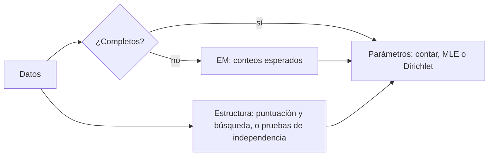

# Inteligencia Artificial - Modelos probabilísticos

## 3.3 Aprendizaje en redes Bayesianas.

---

Especificar a mano las tablas de una red bayesiana, y más aún su estructura, es costoso y propenso a errores; cuando hay datos, ambas pueden **aprenderse**. El problema tiene dos niveles: dado el grafo, estimar los **parámetros**, que con datos completos se reduce a contar; y encontrar el **grafo** mismo, una búsqueda en un espacio que crece de forma superexponencial con el número de variables. Este tema presenta la estimación de máxima verosimilitud y la bayesiana, las funciones de puntuación BIC y BDeu, los algoritmos de búsqueda como K2, la equivalencia de Markov, que limita lo que los datos pueden revelar, y el algoritmo EM para datos incompletos.

### Parámetros: máxima verosimilitud

Con datos completos, la verosimilitud de una red se factoriza en un término por cada variable y cada configuración de sus padres, y cada término se maximiza por separado. Para una variable $X$ con padres $U,$ el estimador de **máxima verosimilitud** (MLE) es la frecuencia relativa:

$$\hat\theta_{x \mid u} = \frac{N_{x,u}}{N_u}$$

donde $N_{x,u}$ es el número de casos con $X = x$ y $U = u,$ y $N_u$ el número con $U = u.$ Su defecto es el **sobreajuste**: una combinación que no aparece en los datos recibe probabilidad 0, y una con pocos casos, una estimación muy variable.

### Parámetros: estimación bayesiana

La estimación bayesiana trata a $\theta$ como variable aleatoria con una distribución **a priori**. La conjugada de la multinomial es la **Dirichlet**, con hiperparámetros $\alpha_k$ que actúan como **pseudoconteos**: la posterior es Dirichlet con $\alpha_k + N_k.$ Se resume con:

- la **media posterior**, $(N_{x,u} + \alpha_{x})/(N_u + \alpha),$ con $\alpha = \sum_x \alpha_x,$ que es la probabilidad predictiva del siguiente caso; con todos los $\alpha_x = 1$ es el **suavizado de Laplace**;
- la **moda posterior** o **MAP**, $(N_{x,u} + \alpha_{x} - 1)/(N_u + \alpha - r),$ con $r$ el número de valores de $X.$

Las dos se confunden a menudo. Con la prior uniforme, $\alpha_x = 1,$ la MAP **coincide con la MLE**, porque una prior plana no cambia dónde está el máximo; el suavizado lo produce la media posterior, o la MAP con $\alpha_x = 2.$

### Estructura: funciones de puntuación

El enfoque más común asigna a cada grafo una **puntuación** y busca el de puntuación máxima. La verosimilitud sola no sirve, porque siempre mejora al agregar aristas. Las puntuaciones usuales penalizan la complejidad:

- **BIC**, el criterio de información bayesiano: $\text{BIC}(G) = \log P(D \mid \hat\Theta_G, G) - \frac{d}{2} \log m,$ con $d$ el número de parámetros libres y $m$ el de casos. Es una aproximación de la verosimilitud marginal y equivale a la longitud de descripción mínima.
- **BD**, la verosimilitud marginal exacta con priors Dirichlet, de Cooper y Herskovits (1992) y Heckerman, Geiger y Chickering (1995):

$$P(D \mid G) = \prod_{i=1}^{n} \prod_{j=1}^{q_i} \frac{\Gamma(\alpha_{ij})}{\Gamma(\alpha_{ij} + N_{ij})} \prod_{k=1}^{r_i} \frac{\Gamma(\alpha_{ijk} + N_{ijk})}{\Gamma(\alpha_{ijk})}$$

con $q_i$ las configuraciones de los padres de $X_i,$ $r_i$ sus valores, y $\alpha_{ij} = \sum_k \alpha_{ijk}.$ Con $\alpha_{ijk} = 1$ es la puntuación **K2**; con $\alpha_{ijk} = \text{ESS}/(q_i r_i),$ para un tamaño de muestra equivalente ESS, es **BDeu**.

Las tres son **descomponibles**, una suma de términos por familia, lo que permite reevaluar solo la familia que cambia en cada paso de la búsqueda. BIC y BDeu son además **equivalentes en puntuación**: dan el mismo valor a grafos equivalentes.

### Estructura: búsqueda

El número de DAG con $n$ nodos etiquetados cumple la recurrencia de Robinson (1973),

$$f(n) = \sum_{i=1}^{n} (-1)^{i+1} \binom{n}{i}\,2^{i(n-i)}\,f(n-i), \quad f(0) = 1$$

que da 25 para $n = 3,$ 543 para $n = 4$ y más de mil millones para $n = 7.$ Encontrar la estructura óptima es NP-difícil (Chickering, 1996), así que se usan búsquedas heurísticas:

- **ascenso de colinas** sobre grafos, con los operadores de agregar, quitar e invertir una arista, y reinicios aleatorios o lista tabú;
- **K2** (Cooper y Herskovits, 1992): supone un **orden** de las variables y, para cada una, agrega de forma voraz como padre la variable anterior que más mejora la puntuación, hasta que ninguna mejora o se alcanza un máximo de padres;
- los algoritmos **basados en restricciones**, como **PC** (Spirtes, Glymour y Scheines): parten del grafo completo, eliminan aristas con pruebas de independencia condicional y orientan las v-estructuras.

### Equivalencia de Markov

Dos DAG son **equivalentes de Markov** si codifican las mismas independencias, lo que ocurre exactamente cuando tienen el mismo esqueleto y las mismas v-estructuras (Verma y Pearl, 1990). Las cadenas A → B → C y A ← B ← C y la causa común A ← B → C son equivalentes, pero la v-estructura A → B ← C no lo es. Con datos observacionales solo puede identificarse la **clase de equivalencia**, no la dirección de todas las aristas; distinguir dentro de ella requiere intervenciones o conocimiento del dominio.

### Datos incompletos: el algoritmo EM

Con valores faltantes, la verosimilitud ya no se factoriza. El algoritmo **EM** (Dempster, Laird y Rubin, 1977) alterna dos pasos: el paso **E** calcula, con los parámetros actuales, los **conteos esperados** de las variables faltantes, y el paso **M** reestima los parámetros como si esos conteos fueran observados. Cada iteración no disminuye la verosimilitud, y el método converge a un máximo local; su velocidad depende de la fracción de información faltante. Supone que los datos faltan **al azar**: si la falta depende del propio valor, las estimaciones se sesgan.



### Implementación en Python

El programa calcula los estimadores del ejercicio 1; implementa las puntuaciones K2, BIC y BDeu y el algoritmo K2, y lo aplica a datos de la red A → B → C ← D con dos órdenes; ejecuta EM para el ejercicio 3, y, para el ejercicio 4, enumera los 25 DAG de tres variables, comprueba la fórmula de Robinson y puntúa todos los DAG con datos de una cadena y de una v-estructura.

```python
from itertools import product
from math import lgamma, log
import numpy as np

# ---------- Ejercicio 1: MLE y MAP para P(A | B) ----------
cuenta = {(0, 0): 10, (0, 1): 20, (1, 0): 15, (1, 1): 5}       # (A, B): número de casos
print("ejercicio 1:")
for b in (0, 1):
    n1, n = cuenta[(1, b)], cuenta[(0, b)] + cuenta[(1, b)]
    mle = n1 / n
    map1 = (n1 + 1 - 1) / (n + 2 - 2)                             # moda de la Beta(n1 + 1, n0 + 1): prior Beta(1, 1)
    map2 = (n1 + 2 - 1) / (n + 4 - 2)                             # prior Beta(2, 2): suavizado de Laplace
    media = (n1 + 1) / (n + 2)                                    # media posterior con prior Beta(1, 1)
    print(f"   P(A=1 | B={b}): MLE {n1}/{n} = {mle:.4f} | MAP con Beta(1,1) {map1:.4f} | MAP con Beta(2,2) {map2:.4f} | media posterior con Beta(1,1) {media:.4f}")
nb1 = cuenta[(0, 1)] + cuenta[(1, 1)]; print(f"   P(B=1): MLE {nb1}/50 = {nb1 / 50:.4f}")

# ---------- Puntuaciones de familia: K2, BIC y BDeu (variables binarias) ----------
def tabla(D, i, pa):
    q = 2 ** len(pa); N = np.zeros((q, 2))
    j = np.zeros(len(D), dtype=int)
    for p in pa: j = 2 * j + D[:, p]
    np.add.at(N, (j, D[:, i]), 1); return N
def k2(D, i, pa):
    N = tabla(D, i, pa); return sum(lgamma(2) - lgamma(N[j].sum() + 2) + sum(lgamma(x + 1) for x in N[j]) for j in range(len(N)))
def bic(D, i, pa):
    N = tabla(D, i, pa); ll = sum(x * log(x / N[j].sum()) for j in range(len(N)) for x in N[j] if x > 0)
    return ll - 0.5 * log(len(D)) * len(N)                        # q (r − 1) = q parámetros libres
def bdeu(D, i, pa, ess=1.0):
    N = tabla(D, i, pa); q = len(N); a, b = ess / q, ess / (2 * q)
    return sum(lgamma(a) - lgamma(a + N[j].sum()) + sum(lgamma(b + x) - lgamma(b) for x in N[j]) for j in range(q))

def genera(red, n, semilla, orden=None):                          # red: lista de (padres, función de P(x=1))
    rng = np.random.default_rng(semilla); D = np.zeros((n, len(red)), dtype=int)
    for i in orden or range(len(red)):                            # orden topológico: los padres antes que los hijos
        pa, f = red[i]
        D[:, i] = rng.random(n) < np.array([f(*row) for row in D[:, pa]]) if pa else rng.random(n) < f()
    return D

# ---------- Ejercicio 2: K2 en datos de A → B → C ← D ----------
NOM = "ABCD"
red = [([], lambda: 0.5), ([0], lambda a: 0.8 if a else 0.2), ([1, 3], lambda b, d: [[0.1, 0.5], [0.6, 0.9]][b][d]), ([], lambda: 0.4)]
D = genera(red, 2000, 1, orden=[0, 1, 3, 2])
def K2(D, orden, max_padres=2):
    padres, evals = {}, 0
    for pos, i in enumerate(orden):
        pa, actual = [], k2(D, i, []); evals += 1
        while len(pa) < max_padres:
            cand = [z for z in orden[:pos] if z not in pa]
            if not cand: break
            puntos = [(k2(D, i, pa + [z]), z) for z in cand]; evals += len(puntos)
            mejor, z = max(puntos)
            if mejor <= actual: break
            pa, actual = pa + [z], mejor
        padres[i] = sorted(pa)
    return padres, evals
for orden in ([0, 1, 3, 2], [2, 3, 1, 0]):
    pa, ev = K2(D, orden)
    aristas = sorted(f"{NOM[p]}→{NOM[i]}" for i in pa for p in pa[i])
    print(f"ejercicio 2: orden {''.join(NOM[i] for i in orden)}: aristas {aristas}, {ev} evaluaciones de la puntuación")

# ---------- Ejercicio 3: EM con datos faltantes ----------
p = 0.3; print("ejercicio 3: iteración 0: P(X=1) = 0.3000")
for it in range(1, 11):
    esperados = 100 * p                                           # paso E: casos X=1 esperados entre los 100 faltantes
    p = (60 + esperados) / 200                                    # paso M
    if it <= 3 or it == 10: print(f"   iteración {it}: E[faltantes con X=1] = {esperados:.2f}, P(X=1) = {p:.4f}, error {0.6 - p:.4f}")

# ---------- Ejercicio 4: puntuar los 25 DAG de 3 variables ----------
pares = [(0, 1), (0, 2), (1, 2)]
def dags():
    for estados in product((0, 1, 2), repeat=3):                   # 0 sin arista, 1 i→j, 2 j→i
        pa = {0: [], 1: [], 2: []}
        for (i, j), s in zip(pares, estados):
            if s == 1: pa[j].append(i)
            if s == 2: pa[i].append(j)
        hijo = lambda v: [w for w in pa if v in pa[w]]
        def ciclico(v, vistos):
            return any(w in vistos or ciclico(w, vistos | {w}) for w in hijo(v))
        if not any(ciclico(v, {v}) for v in pa): yield pa
def texto(pa):
    a = sorted(f"{'ABC'[p]}→{'ABC'[i]}" for i in pa for p in pa[i]); return " ".join(a) if a else "vacío"
from math import comb
def robinson(n, memo={0: 1}):                                     # número de DAG etiquetados con n nodos
    if n not in memo: memo[n] = sum((-1) ** (i + 1) * comb(n, i) * 2 ** (i * (n - i)) * robinson(n - i) for i in range(1, n + 1))
    return memo[n]
L = list(dags()); print(f"ejercicio 4: {len(L)} DAG enumerados con 3 variables; fórmula de Robinson para n = 1..7:", [robinson(n) for n in range(1, 8)])
verdad = {"cadena A→B→C": [([], lambda: 0.5), ([0], lambda a: 0.85 if a else 0.2), ([1], lambda b: 0.8 if b else 0.25)],
          "v-estructura A→B←C": [([], lambda: 0.5), ([0, 2], lambda a, c: [[0.1, 0.7], [0.7, 0.95]][a][c]), ([], lambda: 0.5)]}
for nombre, r in verdad.items():
    D3 = genera(r, 1000, 2, orden=[0, 2, 1] if nombre.startswith("v") else None)
    for nombre_p, f in (("BIC", bic), ("BDeu", bdeu)):
        tot = sorted(((sum(f(D3, i, pa[i]) for i in pa), texto(pa)) for pa in L), reverse=True)
        print(f"   {nombre} | {nombre_p:4}: " + " ; ".join(f"{t} {s:.2f}" for s, t in tot[:4]))
```

Salida:

```text
ejercicio 1:
   P(A=1 | B=0): MLE 15/25 = 0.6000 | MAP con Beta(1,1) 0.6000 | MAP con Beta(2,2) 0.5926 | media posterior con Beta(1,1) 0.5926
   P(A=1 | B=1): MLE 5/25 = 0.2000 | MAP con Beta(1,1) 0.2000 | MAP con Beta(2,2) 0.2222 | media posterior con Beta(1,1) 0.2222
   P(B=1): MLE 25/50 = 0.5000
ejercicio 2: orden ABDC: aristas ['A→B', 'B→C', 'D→C'], 12 evaluaciones de la puntuación
ejercicio 2: orden CDBA: aristas ['B→A', 'C→B', 'C→D', 'D→B'], 13 evaluaciones de la puntuación
ejercicio 3: iteración 0: P(X=1) = 0.3000
   iteración 1: E[faltantes con X=1] = 30.00, P(X=1) = 0.4500, error 0.1500
   iteración 2: E[faltantes con X=1] = 45.00, P(X=1) = 0.5250, error 0.0750
   iteración 3: E[faltantes con X=1] = 52.50, P(X=1) = 0.5625, error 0.0375
   iteración 10: E[faltantes con X=1] = 59.94, P(X=1) = 0.5997, error 0.0003
ejercicio 4: 25 DAG enumerados con 3 variables; fórmula de Robinson para n = 1..7: [1, 3, 25, 543, 29281, 3781503, 1138779265]
   cadena A→B→C | BIC : B→A C→B -1720.47 ; B→A B→C -1720.47 ; A→B B→C -1720.47 ; B→A C→A C→B -1725.54
   cadena A→B→C | BDeu: B→A C→B -1721.82 ; B→A B→C -1721.82 ; A→B B→C -1721.82 ; A→C B→A B→C -1727.72
   v-estructura A→B←C | BIC : A→B C→B -1842.12 ; B→A C→A C→B -1845.44 ; B→A B→C C→A -1845.44 ; A→C B→A B→C -1845.44
   v-estructura A→B←C | BDeu: A→B C→B -1843.82 ; B→A C→A C→B -1847.70 ; B→A B→C C→A -1847.70 ; A→C B→A B→C -1847.70
```

### Ejercicios Propuestos

1. **Estimación de parámetros.** Para una variable binaria A con padre binario B y los datos

    | A | B | Casos |
    | - | - | ----- |
    | 0 | 0 | 10    |
    | 0 | 1 | 20    |
    | 1 | 0 | 15    |
    | 1 | 1 | 5     |

    calcula las probabilidades condicionales con MLE y con MAP con prior uniforme, $\alpha = 1.$

2. **Aprendizaje de estructura.** Implementa el algoritmo K2 para aprender la estructura de una red de cuatro variables A, B, C y D a partir de datos sintéticos generados con la red A → B → C ← D.

3. **EM.** Para una variable binaria X se tienen 60 observaciones con X = 1, 40 con X = 0 y 100 con el valor faltante. Aplica EM para estimar $P(X = 1),$ partiendo de $P^0(X = 1) = 0.3,$ durante 3 iteraciones.

4. **Evaluación de modelos.** Genera datos con las redes A → B → C y A → B ← C, aplica aprendizaje de estructura y compara la estructura recuperada y las puntuaciones BIC y BDe.

### Soluciones

**Ejercicio 1.** Con MLE, $P(A = 1 \mid B = 0) = 15/25 = 0.6$ y $P(A = 1 \mid B = 1) = 5/25 = 0.2,$ y $P(B = 1) = 25/50 = 0.5.$ Con prior uniforme, Beta(1, 1), la posterior es Beta(16, 11) para $B = 0$ y Beta(6, 21) para $B = 1,$ y su **moda**, la MAP, es otra vez 0.6 y 0.2: la prior plana no cambia el máximo. Lo que a menudo se presenta como MAP con prior uniforme es en realidad la **media posterior**, o suavizado de Laplace: $(15 + 1)/(25 + 2) = 16/27 \approx 0.593$ y $(5 + 1)/(25 + 2) = 6/27 \approx 0.222.$ Esa es la fórmula que daba el material original con el nombre de MAP; coincide con la MAP solo con la prior Beta(2, 2). En cualquier caso, el suavizado acerca las estimaciones a 0.5, y su efecto desaparece al crecer los datos.

**Ejercicio 2.** Con 2 000 casos y el orden A, B, D, C, compatible con la red, K2 recupera exactamente las tres aristas A → B, B → C y D → C, con 12 evaluaciones de la puntuación. Con el orden inverso, C, D, B, A, obtiene otra red de cuatro aristas, con C → D y D → B: como C es anterior a D y a B, la dependencia entre B y D dado C, creada por la v-estructura, obliga a agregar la arista D → B. Es una red que representa la distribución pero es más compleja y no causal. K2 es rápido, pero su resultado depende críticamente del orden, que debe venir del conocimiento del dominio, por ejemplo del orden temporal.

**Ejercicio 3.** Si los datos faltan al azar, el paso E asigna a los 100 casos faltantes $100\,p$ casos esperados con X = 1, y el paso M estima $p' = (60 + 100\,p)/200:$

| Iteración | Esperados con X = 1 | $P(X = 1)$ |
| --------- | ------------------- | ---------- |
| 0         |                     | 0.3        |
| 1         | 30                  | 0.45       |
| 2         | 45                  | 0.525      |
| 3         | 52.5                | 0.5625     |

El punto fijo cumple $p = (60 + 100\,p)/200,$ es decir, $p = 0.6,$ que es la MLE con solo los 100 casos observados: si los datos faltan al azar, no aportan información sobre $p.$ El error se reduce a la mitad en cada iteración, porque la mitad de los datos falta; a la décima iteración es 0.0003. Esa convergencia lineal, con razón igual a la fracción de información faltante, es típica de EM.

**Ejercicio 4.** Con 1 000 casos de la **cadena**, BIC y BDeu dan exactamente la misma puntuación máxima a tres grafos, A → B → C, A ← B ← C y A ← B → C, que forman su clase de equivalencia: los datos no pueden distinguir la dirección de las aristas, y la estructura se recupera solo hasta la clase. El siguiente grafo, con una arista de más, queda entre 5 y 6 puntos abajo. Con datos de la **v-estructura**, ambas puntuaciones eligen sin empate A → B ← C, porque su clase tiene un solo miembro: la independencia marginal de A y C, que se rompe al condicionar en B, fija la orientación. BIC y BDeu eligen los mismos grafos; difieren en la penalización, que en BDeu depende del ESS. La búsqueda exhaustiva evalúa los 25 grafos, posible solo para muy pocas variables.

### Referencias

1. Koller, D., and Friedman, N., _Probabilistic Graphical Models: Principles and Techniques_. MIT Press, 2009. Capítulos 17 a 19.
2. Cooper, G. F., and Herskovits, E., A Bayesian method for the induction of probabilistic networks from data. _Machine Learning_ 9, 1992.
3. Heckerman, D., Geiger, D., and Chickering, D. M., Learning Bayesian networks: the combination of knowledge and statistical data. _Machine Learning_ 20, 1995.
4. Dempster, A. P., Laird, N. M., and Rubin, D. B., Maximum likelihood from incomplete data via the EM algorithm. _Journal of the Royal Statistical Society B_ 39(1), 1977.
5. Spirtes, P., Glymour, C., and Scheines, R., _Causation, Prediction, and Search_. MIT Press, 2000.
6. Verma, T., and Pearl, J., Equivalence and synthesis of causal models. _Proceedings of UAI_, 1990.
7. Robinson, R. W., Counting labeled acyclic digraphs. En _New Directions in the Theory of Graphs_, Academic Press, 1973.
