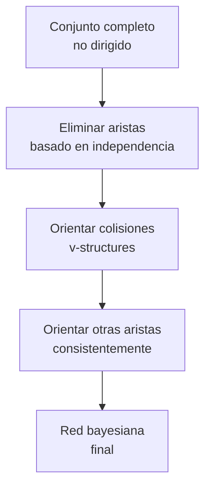
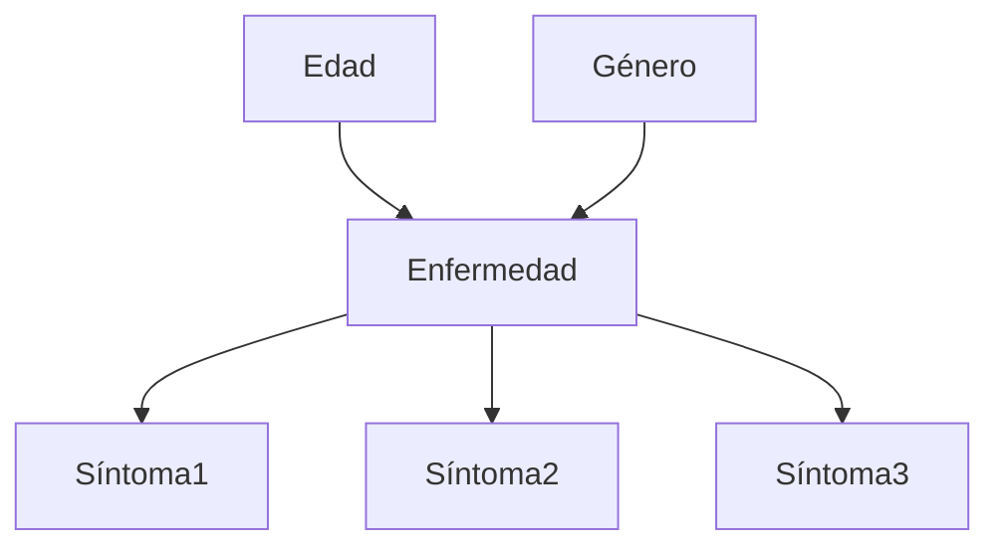

# Inteligencia Artificial - Modelos probabilísticos

## 3.3 Aprendizaje en redes Bayesianas.

---

El aprendizaje en redes bayesianas consiste en determinar tanto la estructura como los parámetros de una red a partir de datos. Existen tres enfoques principales:

1. **Aprendizaje de parámetros**: Estructura conocida, estimar las CPTs
2. **Aprendizaje de estructura**: Estructura desconocida, aprenderla junto con parámetros
3. **Aprendizaje completo**: Ambos desconocidos

Formalmente, dado un conjunto de datos $D = \{d_1, d_2, ..., d_m\}$, queremos encontrar la red $G$ y los parámetros $\Theta$ que mejor explican los datos.

### Aprendizaje de Parámetros

#### Estimación de Máxima Verosimilitud (MLE)

Para una variable $X$ con padres $U$, la estimación ML es:

$$\theta_{x|u} = \frac{N_{x,u}}{N_u}$$

Donde:

- $N_{x,u}$: Número de instancias donde $X=x$ y $U=u$
- $N_u$: Número de instancias donde $U=u$

**Ejemplo**: Para una CPT $P(X|Y,Z)$:

$$\theta_{x|y,z} = \frac{count(X=x, Y=y, Z=z)}{count(Y=y, Z=z)}$$

#### Estimación Bayesiana (MAP)

Incorpora priors para evitar sobreajuste con datos escasos:

$$\theta_{x|u} = \frac{N_{x,u} + \alpha_{x,u}}{N_u + \alpha_u}$$

Donde $\alpha_{x,u}$ son parámetros de prior (pseudo-counts).

### Aprendizaje de Estructura

#### Búsqueda en el Espacio de Estructuras

El espacio de posibles estructuras es superexponencial. Para $n$ variables, hay:

$$f(n) = \sum_{i=1}^n (-1)^{i+1} \binom{n}{i} 2^{i(n-i)} f(n-i)$$

estructuras posibles.

#### Algoritmo de Búsqueda

```python
def structure_learning(data, scoring_function):
    current = initial_structure()
    best_score = scoring_function(current, data)

    while not converged:
        neighbors = generate_neighbors(current)
        next_structure = None
        next_score = -∞

        for neighbor in neighbors:
            score = scoring_function(neighbor, data)
            if score > next_score:
                next_structure = neighbor
                next_score = score

        if next_score > best_score:
            current = next_structure
            best_score = next_score
        else:
            break

    return current
```

### Funciones de Puntuación (Scoring Functions)

#### Puntuación Bayesian Information Criterion (BIC)

$$\text{BIC}(G, D) = \log P(D | \hat{\Theta}_G, G) - \frac{d}{2} \log m$$

Donde:

- $\hat{\Theta}_G$: Parámetros ML para la estructura $G$
- $d$: Número de parámetros
- $m$: Número de instancias de entrenamiento

#### Puntuación Bayesian Dirichlet (BDe)

$$\text{BDe}(G, D) = P(G) \prod_{i=1}^n \prod_{j=1}^{q_i} \frac{\Gamma(\alpha_{ij})}{\Gamma(\alpha_{ij} + N_{ij})} \prod_{k=1}^{r_i} \frac{\Gamma(\alpha_{ijk} + N_{ijk})}{\Gamma(\alpha_{ijk})}$$

Donde:

- $q_i$: Número de configuraciones de padres de $X_i$
- $r_i$: Número de valores de $X_i$
- $\alpha_{ijk}$: Hiperparámetros Dirichlet
- $N_{ijk}$: Counts de datos

### Algoritmos Específicos

#### Algoritmo K2 (Cooper & Herskovits, 1992)

Aprendizaje de estructura con ordenamiento previo de variables:

```python
def K2_algorithm(nodes_ordered, data, max_parents):
    # Inicializar red vacía
    graph = {node: [] for node in nodes_ordered}

    for i, node in enumerate(nodes_ordered):
        parents = []
        old_score = score_node(node, parents, data)

        while len(parents) < max_parents:
            best_new_parent = None
            best_score = -∞

            # Probar padres potenciales (solo nodos anteriores en el orden)
            for candidate in nodes_ordered[:i]:
                if candidate not in parents:
                    new_parents = parents + [candidate]
                    new_score = score_node(node, new_parents, data)

                    if new_score > best_score:
                        best_score = new_score
                        best_new_parent = candidate

            if best_score > old_score:
                parents.append(best_new_parent)
                old_score = best_score
            else:
                break

        graph[node] = parents

    return graph
```

#### Algoritmo PC (Peter-Clark)

Para aprendizaje de estructura en redes con variables continuas:



### Aprendizaje con Datos Incompletos

#### Algoritmo EM (Expectation-Maximization)

Para datos con valores faltantes:

**Paso E (Expectation)**:

$$Q(\Theta | \Theta^t) = E_{Z|X,\Theta^t}[\log P(X, Z | \Theta)]$$

**Paso M (Maximization)**:

$$\Theta^{t+1} = \arg\max_{\Theta} Q(\Theta | \Theta^t)$$

```python
def EM_algorithm(data, initial_params, tolerance=1e-6):
    params = initial_params
    prev_log_likelihood = -float('inf')

    while True:
        # Paso E: Calcular expectanzas de valores faltantes
        expected_counts = e_step(data, params)

        # Paso M: Reestimar parámetros
        params = m_step(expected_counts)

        # Verificar convergencia
        log_likelihood = calculate_log_likelihood(data, params)
        if abs(log_likelihood - prev_log_likelihood) < tolerance:
            break

        prev_log_likelihood = log_likelihood

    return params
```

### Ejemplo Práctico: Aprendizaje de Red de Diagnóstico



**Datos de entrenamiento**:

| Edad   | Género | Enfermedad | Síntoma1 | Síntoma2 | Síntoma3 |
| ------ | ------ | ---------- | -------- | -------- | -------- |
| Joven  | M      | A          | 1        | 0        | 1        |
| Adulto | F      | B          | 0        | 1        | 0        |
| Mayor  | M      | A          | 1        | 1        | 1        |
| ...    | ...    | ...        | ...      | ...      | ...      |

### Implementación en Python

```python
import numpy as np
import pandas as pd
from pgmpy.models import BayesianNetwork
from pgmpy.estimators import MaximumLikelihoodEstimator, BayesianEstimator
from pgmpy.estimators import K2Score, BicScore, HillClimbSearch

# Generar datos sintéticos o cargar datos reales
data = pd.DataFrame(data={
    'Edad': np.random.choice(['Joven', 'Adulto', 'Mayor'], 1000),
    'Genero': np.random.choice(['M', 'F'], 1000),
    'Enfermedad': np.random.choice(['A', 'B', 'C'], 1000),
    'Sintoma1': np.random.randint(0, 2, 1000),
    'Sintoma2': np.random.randint(0, 2, 1000),
    'Sintoma3': np.random.randint(0, 2, 1000)
})

# Aprendizaje de estructura con Hill Climbing
scoring_method = BicScore(data)
hc = HillClimbSearch(data)
best_model = hc.estimate(scoring_method=scoring_method)

print("Estructura aprendida:", best_model.edges())

# Aprendizaje de parámetros con estimación ML
model = BayesianNetwork(best_model.edges())
model.fit(data, estimator=MaximumLikelihoodEstimator)

# Para datos con valores faltantes, usar EM
from pgmpy.estimators import ExpectationMaximization

# Datos con valores faltantes
data_incomplete = data.copy()
data_incomplete.loc[::10, 'Sintoma1'] = np.nan

# Estimación con EM
em = ExpectationMaximization(model)
em.fit(data_incomplete, convergence_threshold=1e-6)

# Obtener las CPTs aprendidas
for cpd in model.get_cpds():
    print(f"\nCPD for {cpd.variable}:")
    print(cpd)
```

### Ejercicios Propuestos

#### Ejercicio 1: Estimación de Parámetros

Dado el siguiente dataset para la variable Binaria A con padre Binario B:

| A   | B   | Count |
| --- | --- | ----- |
| 0   | 0   | 10    |
| 0   | 1   | 20    |
| 1   | 0   | 15    |
| 1   | 1   | 5     |

Calcula:

1. Las probabilidades condicionales usando MLE
2. Las probabilidades condicionales usando MAP con prior uniforme $\alpha = 1$

#### Ejercicio 2: Aprendizaje de Estructura

Implementa el algoritmo K2 para aprender la estructura de una red con 4 variables (A, B, C, D) a partir de datos sintéticos generados de la red real A → B → C ← D.

#### Ejercicio 3: Algoritmo EM

Datos con valores faltantes para una variable binaria X:

- 60 observaciones: X=1
- 40 observaciones: X=0
- 100 observaciones: Valor faltante

Aplica el algoritmo EM para estimar P(X=1), comenzando con P⁰(X=1)=0.3. Realiza 3 iteraciones.

#### Ejercicio 4: Evaluación de Modelos

Genera datos de dos redes diferentes:

1. A → B → C
2. A → B ← C

Aplica algoritmos de aprendizaje de estructura y compara:

- Precisión de la estructura recuperada
- Puntuaciones BIC y BDe
- Tiempo de computación

### Técnicas Avanzadas

#### Aprendizaje de Redes Dinámicas Bayesianas

Extensión para series temporales:

$$P(X_{0:T}) = P(X_0) \prod_{t=1}^T P(X_t | X_{t-1})$$

#### Aprendizaje con Variables Latentes

Métodos para descubrir variables no observadas:

```python
def learn_latent_variables(data, n_latent):
    # Inicializar modelo con variables latentes
    model = initialize_model_with_latent(data.columns, n_latent)

    # Aplicar EM variacional
    for iteration in range(max_iterations):
        # Paso E: Inferir distribuciones de variables latentes
        latent_distributions = variational_e_step(data, model)

        # Paso M: Actualizar parámetros
        model = variational_m_step(data, latent_distributions)

    return model
```

### Aplicaciones del Aprendizaje en Redes Bayesianas

1. **Diagnóstico médico**: Aprender relaciones entre síntomas y enfermedades
2. **Bioinformática**: Descubrir relaciones entre genes y enfermedades
3. **Procesamiento de lenguaje natural**: Modelar dependencias gramaticales
4. **Visión por computador**: Reconocer objetos y sus relaciones
5. **Sistemas de recomendación**: Modelar preferencias de usuarios

### Referencias

#### Bibliografía Básica

1. Russell, S. & Norvig, P. (2009). _Artificial Intelligence: A Modern Approach_. 3rd Edition. Prentice Hall. (Capítulo 20)
2. Marsland, S. (2009). _Machine Learning: An Algorithmic Perspective_. Chapman y Hall. (Capítulo 3, 9)

#### Bibliografía Complementaria

1. Koller, D. & Friedman, N. (2009). _Probabilistic Graphical Models: Principles and Techniques_. MIT Press.
2. Murphy, K. P. (2012). _Machine Learning: A Probabilistic Perspective_. MIT Press.
3. Neapolitan, R. E. (2003). _Learning Bayesian Networks_. Prentice Hall.

### Recursos Adicionales

- **Librerías Python**:
  - pgmpy: Librería completa para redes bayesianas
  - bnlearn: Especializada en aprendizaje de redes
  - pomegranate: Implementaciones eficientes

- **Conjuntos de datos**:
  - Bayesian network repository: Repositorio de redes benchmark
  - UCI Machine Learning Repository: Datos para práctica

- **Herramientas visuales**:
  - GeNIe: Entorno de desarrollo para redes bayesianas
  - SamIam: Herramienta de análisis y modelado
