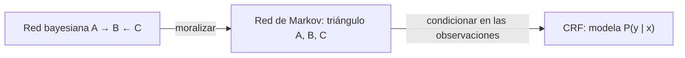

# Inteligencia Artificial - Modelos probabilísticos

## 3.4 Modelos probabilísticos sin dirección.

---

En muchos dominios las interacciones entre variables no tienen una dirección natural: dos píxeles vecinos de una imagen tienden a tener el mismo color, dos átomos vecinos de un material magnético tienden a alinear su espín, y las etiquetas de palabras consecutivas en una oración se condicionan mutuamente. Los **modelos no dirigidos**, también llamados **redes de Markov** o **campos aleatorios de Markov** (MRF), representan esas interacciones con un grafo sin flechas y funciones de compatibilidad sobre grupos de variables. Este tema presenta su factorización, las propiedades de Markov, la relación con las redes bayesianas, la inferencia, el aprendizaje con verosimilitud y pseudoverosimilitud, y los **campos aleatorios condicionales** (CRF), su versión discriminativa.

### Definición

Un MRF sobre las variables $X = (X_1, \dots, X_n)$ consiste en un grafo no dirigido $G,$ con un nodo por variable, y un conjunto de **potenciales** o **factores** $\phi_k \ge 0,$ cada uno definido sobre un **clique** $D_k$ del grafo, un conjunto de nodos conectados todos entre sí. La distribución es

$$P(x) = \frac{1}{Z} \prod_{k} \phi_k(x_{D_k}), \quad Z = \sum_{x} \prod_{k} \phi_k(x_{D_k})$$

donde $Z$ es la **función de partición**. Los potenciales no son probabilidades: solo importa su valor relativo, y una configuración con potencial mayor es más probable. Calcular $Z$ requiere sumar sobre todas las configuraciones, y es en general #P-difícil; es la principal dificultad de estos modelos.

En la forma **log-lineal**, $\phi_k = \exp(\theta_k\,f_k(x_{D_k})),$ con rasgos $f_k$ y pesos $\theta_k,$ o, en términos de **energía**, $P(x) = e^{-E(x)}/Z.$ El **modelo de Ising** de la física estadística es el ejemplo clásico: espines $x_i \in \{-1, +1\}$ en una cuadrícula con

$$P(x) = \frac{1}{Z} \exp\Big(J \sum_{(i,j) \in E} x_i x_j + h \sum_i x_i\Big)$$

donde $J \gt 0$ favorece que los vecinos coincidan y $h$ es un campo externo que favorece un valor.

### Propiedades de Markov

- **Global:** si todo camino entre los conjuntos $A$ y $B$ pasa por $S,$ entonces $A \perp B \mid S.$ La separación en el grafo reemplaza a la d-separación, y es más simple: no hay v-estructuras.
- **Local:** cada variable es independiente de todas las demás dados sus **vecinos**, que forman su manta de Markov.
- **Por pares:** dos variables no adyacentes son independientes dadas todas las demás.

Para distribuciones estrictamente positivas, las tres son equivalentes, y el **teorema de Hammersley y Clifford** asegura que una distribución positiva satisface las propiedades de Markov de $G$ si y solo si se factoriza sobre los cliques de $G.$

### Relación con las redes bayesianas

Una red bayesiana se convierte en un MRF por **moralización**: se unen los padres de cada nodo, "se casan", se quitan las direcciones, y cada CPT $P(X_i \mid \text{Padres}(X_i))$ se convierte en un potencial sobre el clique formado por $X_i$ y sus padres, con $Z = 1.$ La distribución no cambia, pero el grafo moral puede perder independencias: las de las v-estructuras. A la inversa, un ciclo de cuatro nodos sin cuerdas, como la cuadrícula de 2x2, tiene independencias que ninguna red bayesiana puede representar exactamente. Ninguno de los dos lenguajes es más expresivo que el otro.

| Aspecto | Red bayesiana | Red de Markov |
| ------- | ------------- | ------------- |
| Grafo | dirigido y acíclico | no dirigido |
| Factores | probabilidades condicionales locales | potenciales no negativos |
| Normalización | automática | requiere $Z$ |
| Independencias | d-separación | separación en el grafo |
| Muestreo | directo, en orden topológico | requiere MCMC |
| Uso típico | relaciones causales | interacciones simétricas, imágenes, secuencias |

### Inferencia

Los algoritmos del tema 3.2 se aplican sin cambios a los factores de un MRF: la **eliminación de variables** y, en árboles, la **propagación de creencias** o algoritmo de suma y producto, que pasa mensajes entre vecinos y calcula todas las marginales en dos pasadas. En grafos con ciclos, la misma propagación aplicada iterativamente, *loopy belief propagation*, da aproximaciones a menudo buenas, y el muestreo de Gibbs es especialmente simple, porque cada variable depende solo de sus vecinos.

### Aprendizaje

Para un modelo log-lineal, la log-verosimilitud promedio es cóncava, y su gradiente es

$$\frac{\partial \ell}{\partial \theta_k} = \mathbb{E}_{\text{datos}}[f_k] - \mathbb{E}_{\theta}[f_k]$$

la diferencia entre el valor esperado de cada **rasgo** en los datos y bajo el modelo; en el óptimo, coinciden. El segundo término requiere inferencia, y por eso cada paso del gradiente es costoso. La **pseudoverosimilitud** de Besag (1975) reemplaza la verosimilitud por

$$\text{PL}(\theta) = \sum_{m} \sum_{i} \log P(x_i^{(m)} \mid x_{\text{vec}(i)}^{(m)}; \theta)$$

cuyas condicionales locales solo requieren normalizar sobre los valores de una variable. Es un estimador **consistente**: con suficientes datos converge a los parámetros verdaderos, aunque con algo más de varianza.

### Campos aleatorios condicionales

Un **CRF** (Lafferty, McCallum y Pereira, 2001) modela directamente la distribución condicional de las etiquetas $y$ dadas las observaciones $x:$

$$P(y \mid x) = \frac{1}{Z(x)} \exp\Big(\sum_{t} \sum_{k} \theta_k\,f_k(y_{t-1}, y_t, x, t)\Big)$$

En la versión de **cadena lineal**, los rasgos combinan la etiqueta actual con cualquier propiedad de la entrada, como la palabra, sus prefijos y sufijos o las palabras vecinas, y la transición entre etiquetas consecutivas. A diferencia de un modelo oculto de Markov, que es generativo y modela $P(x, y),$ un CRF no necesita modelar la distribución de las palabras, y puede usar rasgos solapados y dependientes. $Z(x)$ y las marginales se calculan con el algoritmo de **avance y retroceso**, y la mejor secuencia con **Viterbi**, ambos en $O(T K^2)$ para $T$ posiciones y $K$ etiquetas.



### Implementación en Python

El programa verifica numéricamente la moralización del ejercicio 1; calcula $Z$ y las probabilidades del ejercicio 2 por enumeración; implementa un CRF de cadena lineal con avance y retroceso, gradiente exacto, L-BFGS y Viterbi, y lo entrena con un pequeño corpus etiquetado para el ejercicio 3; y estima los parámetros del modelo de Ising de 2x2 del ejercicio 4 por pseudoverosimilitud y por verosimilitud exacta.

```python
from itertools import product
import numpy as np
from scipy.optimize import minimize
from scipy.special import logsumexp

# ---------- Ejercicio 1: de A → B ← C a una red de Markov ----------
pA, pC = 0.3, 0.6
pB = {(0, 0): 0.05, (0, 1): 0.6, (1, 0): 0.7, (1, 1): 0.95}          # P(B = 1 | A, C)
psi = {(a, b, c): (pA if a else 1 - pA) * (pC if c else 1 - pC) * (pB[(a, c)] if b else 1 - pB[(a, c)])
       for a, b, c in product((0, 1), repeat=3)}                       # potencial del clique {A, B, C}
P = lambda **f: sum(v for (a, b, c), v in psi.items() if all({"a": a, "b": b, "c": c}[k] == x for k, x in f.items()))
print("ejercicio 1: moralización: se agrega la arista A–C; único clique maximal {A, B, C}, Z =", round(sum(psi.values()), 10))
print(f"   P(A=1, C=1) = {P(a=1, c=1):.4f} = P(A=1) P(C=1) = {P(a=1) * P(c=1):.4f}   → A ⊥ C se cumple")
for b in (0, 1):
    cond = P(a=1, c=1, b=b) / P(b=b); prod_ = P(a=1, b=b) / P(b=b) * P(c=1, b=b) / P(b=b)
    print(f"   dado B={b}: P(A=1, C=1 | B) = {cond:.4f} frente a P(A=1 | B) P(C=1 | B) = {prod_:.4f}   → dependientes")

# ---------- Ejercicio 2: MRF en triángulo ----------
fAB = {(0, 0): 2, (0, 1): 1, (1, 0): 1, (1, 1): 3}
fBC = {(0, 0): 1, (0, 1): 2, (1, 0): 3, (1, 1): 1}
fAC = {(0, 0): 3, (0, 1): 1, (1, 0): 1, (1, 1): 2}
sin_norm = {(a, b, c): fAB[(a, b)] * fBC[(b, c)] * fAC[(a, c)] for a, b, c in product((0, 1), repeat=3)}
Z = sum(sin_norm.values())
print("ejercicio 2: productos de potenciales:", {"".join(map(str, k)): v for k, v in sin_norm.items()}, "Z =", Z)
print(f"   P(A=1, B=1, C=1) = {sin_norm[(1, 1, 1)]}/{Z} = {sin_norm[(1, 1, 1)] / Z:.4f}")
num, den = sin_norm[(1, 0, 0)], sin_norm[(0, 0, 0)] + sin_norm[(1, 0, 0)]
print(f"   P(A=1 | B=0, C=0) = {num}/{den} = {num / den:.4f}")
print(f"   marginales: P(A=1) = {sum(v for k, v in sin_norm.items() if k[0]) / Z:.4f}, "
      f"P(B=1) = {sum(v for k, v in sin_norm.items() if k[1]) / Z:.4f}, P(C=1) = {sum(v for k, v in sin_norm.items() if k[2]) / Z:.4f}")

# ---------- Ejercicio 3: CRF de cadena lineal para etiquetado gramatical ----------
ETQ = ["DET", "SUST", "ADJ", "VERB", "PREP"]
DET, PREP = {"el", "la", "los", "las", "un", "una", "mi"}, {"en", "por"}
def etiqueta(frase, patron):                                          # patron: cadena con una letra por palabra
    m = {"d": "DET", "s": "SUST", "a": "ADJ", "v": "VERB", "p": "PREP"}
    return list(zip(frase.split(), [m[c] for c in patron]))
ENTRENA = [etiqueta(*x) for x in [
    ("el gato negro come pescado", "dsavs"), ("la niña alta lee un libro", "dsavds"),
    ("un perro pequeño corre en el parque", "dsavpds"), ("los niños juegan en la calle", "dsvpds"),
    ("la casa blanca tiene un jardín grande", "dsavdsa"), ("el profesor explica la lección", "dsvds"),
    ("una mujer joven camina por la playa", "dsavpds"), ("el sol brilla en el cielo azul", "dsvpdsa"),
    ("los pájaros cantan en el árbol", "dsvpds"), ("mi hermano compra pan fresco", "dsvsa"),
    ("la profesora escribe en la pizarra", "dsvpds"), ("el coche rojo pasa por la avenida", "dsavpds"),
    ("un estudiante nuevo pregunta en la clase", "dsavpds"), ("las flores amarillas crecen en el campo", "dsavpds")]]
PRUEBA = [etiqueta(*x) for x in [
    ("el caballo blanco corre por el campo", "dsavpds"), ("una niña pequeña canta en la escuela", "dsavpds"),
    ("los perros grandes comen carne fresca", "dsavsa"), ("la doctora joven trabaja en el hospital", "dsavpds")]]
def rasgos(pal, t):
    w = pal[t]; f = ["sesgo", "w=" + w, "suf2=" + w[-2:], "suf3=" + w[-3:], "pre2=" + w[:2]]
    f.append("prev=" + (pal[t - 1] if t else "<i>")); f.append("sig=" + (pal[t + 1] if t + 1 < len(pal) else "<f>"))
    return f
IDX = {}
for fr in ENTRENA:
    pal = [w for w, _ in fr]
    for t in range(len(pal)):
        for f in rasgos(pal, t): IDX.setdefault(f, len(IDX))
K, F = len(ETQ), len(IDX)
def matriz(pal):                                                       # índices de los rasgos conocidos de cada posición
    return [[IDX[f] for f in rasgos(pal, t) if f in IDX] for t in range(len(pal))]
def desempaca(th): return th[:F * K].reshape(F, K), th[F * K:F * K + K * K].reshape(K, K), th[F * K + K * K:]
def emisiones(W, X): return np.array([W[ix].sum(axis=0) for ix in X])
def menos_logver(th, datos, l2=0.1):
    W, T, S = desempaca(th); gW, gT, gS = np.zeros_like(W), np.zeros_like(T), np.zeros_like(S); nll = 0.0
    for X, y in datos:
        E = emisiones(W, X); n = len(y)
        a = np.zeros((n, K)); b = np.zeros((n, K)); a[0] = S + E[0]
        for t in range(1, n): a[t] = E[t] + logsumexp(a[t - 1][:, None] + T, axis=0)
        for t in range(n - 2, -1, -1): b[t] = logsumexp(T + (E[t + 1] + b[t + 1])[None, :], axis=1)
        logZ = logsumexp(a[-1])
        nll -= S[y[0]] + sum(E[t, y[t]] for t in range(n)) + sum(T[y[t - 1], y[t]] for t in range(1, n)) - logZ
        marg = np.exp(a + b - logZ)                                    # P(y_t = k | x)
        gS[y[0]] -= 1; gS += marg[0]
        for t in range(n):
            for i in X[t]: gW[i, y[t]] -= 1; gW[i] += marg[t]
        for t in range(1, n):
            gT[y[t - 1], y[t]] -= 1
            gT += np.exp(a[t - 1][:, None] + T + (E[t] + b[t])[None, :] - logZ)   # P(y_{t-1}, y_t | x)
    nll += l2 / 2 * th @ th
    return nll, np.concatenate([gW.ravel(), gT.ravel(), gS]) + l2 * th
def viterbi(th, X):
    W, T, S = desempaca(th); E = emisiones(W, X); d = S + E[0]; atras = []
    for t in range(1, len(X)):
        c = d[:, None] + T; atras.append(c.argmax(axis=0)); d = c.max(axis=0) + E[t]
    y = [int(d.argmax())]
    for bp in reversed(atras): y.append(int(bp[y[-1]]))
    return y[::-1]
datos = [(matriz([w for w, _ in fr]), [ETQ.index(e) for _, e in fr]) for fr in ENTRENA]
r = minimize(menos_logver, np.zeros(F * K + K * K + K), args=(datos,), jac=True, method="L-BFGS-B")
frec = {}
for fr in ENTRENA:
    for w, e in fr: frec.setdefault(w, {}).setdefault(e, 0); frec[w][e] += 1
base = lambda w: max(frec[w], key=frec[w].get) if w in frec else "SUST"
aciertos_crf = aciertos_base = total = 0
print(f"ejercicio 3: {F} rasgos, {F * K + K * K + K} parámetros; entrenamiento: -log verosimilitud {r.fun:.2f}")
for fr in PRUEBA:
    pal = [w for w, _ in fr]; pred = [ETQ[k] for k in viterbi(r.x, matriz(pal))]
    aciertos_crf += sum(p == e for p, (_, e) in zip(pred, fr)); aciertos_base += sum(base(w) == e for w, e in fr); total += len(fr)
    print("   " + " ".join(f"{w}/{p}" + ("" if p == e else f"(≠{e})") for (w, e), p in zip(fr, pred)))
print(f"   exactitud en prueba: CRF {aciertos_crf}/{total} = {aciertos_crf / total:.1%}; línea base por palabra {aciertos_base}/{total} = {aciertos_base / total:.1%}")

# ---------- Ejercicio 4: Ising 2x2 con pseudoverosimilitud ----------
ARISTAS = [(0, 1), (1, 3), (3, 2), (2, 0)]                             # cuadrícula 2x2: un ciclo de 4 sitios
VEC = {i: [j for a, b in ARISTAS for j in ((b,) if a == i else (a,) if b == i else ())] for i in range(4)}
ESTADOS = np.array(list(product((-1, 1), repeat=4)))
def suf(X): return np.array([sum(X[:, i] * X[:, j] for i, j in ARISTAS), X.sum(axis=1)]).T   # (Σ x_i x_j, Σ x_i)
def menos_lv(th, X):                                                   # verosimilitud exacta, con Z por enumeración
    J, h = th; s = suf(X).mean(axis=0); e = suf(ESTADOS) @ th; logZ = logsumexp(e); p = np.exp(e - logZ)
    return -(s @ th - logZ), -(s - p @ suf(ESTADOS))
def menos_pl(th, X):                                                   # pseudoverosimilitud: Σ_i log P(x_i | vecinos)
    J, h = th; v = 0.0; g = np.zeros(2)
    for i in range(4):
        nb = X[:, VEC[i]].sum(axis=1); m = 2 * X[:, i] * (J * nb + h)  # P(x_i | vecinos) = σ(m)
        v -= np.mean(-np.logaddexp(0, -m)); w = 1 / (1 + np.exp(m))    # derivada de log σ(m) = 1 − σ(m)
        g -= np.array([np.mean(w * 2 * X[:, i] * nb), np.mean(w * 2 * X[:, i])])
    return v, g
VERDAD = np.array([0.5, 0.2])
p = np.exp(suf(ESTADOS) @ VERDAD); p /= p.sum()
print(f"ejercicio 4: modelo verdadero J = {VERDAD[0]}, h = {VERDAD[1]}; Z = {np.exp(suf(ESTADOS) @ VERDAD).sum():.4f}")
for n in (200, 2000, 20000):
    X = ESTADOS[np.random.default_rng(3).choice(16, size=n, p=p)]
    pl = minimize(menos_pl, np.zeros(2), args=(X,), jac=True).x; lv = minimize(menos_lv, np.zeros(2), args=(X,), jac=True).x
    print(f"   N = {n:5}: pseudoverosimilitud J = {pl[0]:.3f}, h = {pl[1]:.3f} | verosimilitud exacta J = {lv[0]:.3f}, h = {lv[1]:.3f}")
```

Salida:

```text
ejercicio 1: moralización: se agrega la arista A–C; único clique maximal {A, B, C}, Z = 1.0
   P(A=1, C=1) = 0.1800 = P(A=1) P(C=1) = 0.1800   → A ⊥ C se cumple
   dado B=0: P(A=1, C=1 | B) = 0.0188 frente a P(A=1 | B) P(C=1 | B) = 0.0347   → dependientes
   dado B=1: P(A=1, C=1 | B) = 0.3282 frente a P(A=1 | B) P(C=1 | B) = 0.3974   → dependientes
ejercicio 2: productos de potenciales: {'000': 6, '001': 4, '010': 9, '011': 1, '100': 1, '101': 4, '110': 9, '111': 6} Z = 40
   P(A=1, B=1, C=1) = 6/40 = 0.1500
   P(A=1 | B=0, C=0) = 1/7 = 0.1429
   marginales: P(A=1) = 0.5000, P(B=1) = 0.6250, P(C=1) = 0.3750
ejercicio 3: 319 rasgos, 1625 parámetros; entrenamiento: -log verosimilitud 3.94
   el/DET caballo/SUST blanco/ADJ corre/VERB por/PREP el/DET campo/SUST
   una/DET niña/SUST pequeña/ADJ canta/VERB en/PREP la/DET escuela/SUST
   los/DET perros/SUST grandes/ADJ comen/VERB carne/DET(≠SUST) fresca/SUST(≠ADJ)
   la/DET doctora/SUST joven/ADJ trabaja/VERB en/PREP el/DET hospital/SUST
   exactitud en prueba: CRF 25/27 = 92.6%; línea base por palabra 20/27 = 74.1%
ejercicio 4: modelo verdadero J = 0.5, h = 0.2; Z = 32.6840
   N =   200: pseudoverosimilitud J = 0.469, h = 0.233 | verosimilitud exacta J = 0.465, h = 0.236
   N =  2000: pseudoverosimilitud J = 0.512, h = 0.187 | verosimilitud exacta J = 0.511, h = 0.187
   N = 20000: pseudoverosimilitud J = 0.507, h = 0.195 | verosimilitud exacta J = 0.504, h = 0.197
```

### Ejercicios Propuestos

1. **Conversión entre modelos.** Convierte la red bayesiana A → B ← C a una red de Markov no dirigida, especifica sus cliques y potenciales, y verifica las independencias en ambos modelos.

2. **Inferencia en un MRF.** Tres variables binarias A, B y C forman un triángulo con los potenciales

    | $x, y$ | $\phi_{AB}$ | $\phi_{BC}$ | $\phi_{AC}$ |
    | ------ | ----------- | ----------- | ----------- |
    | 0, 0   | 2           | 1           | 3           |
    | 0, 1   | 1           | 2           | 1           |
    | 1, 0   | 1           | 3           | 1           |
    | 1, 1   | 3           | 1           | 2           |

    Calcula $P(A = 1, B = 1, C = 1)$ y $P(A = 1 \mid B = 0, C = 0).$

3. **CRF.** Implementa un CRF para etiquetar secuencias con categorías gramaticales, como sustantivo, verbo y adjetivo, con rasgos de las palabras anterior y siguiente, prefijos y sufijos.

4. **Pseudoverosimilitud.** Para el modelo de Ising en una cuadrícula de 2x2, implementa la estimación por máxima pseudoverosimilitud de los parámetros $J$ y $h$ a partir de datos sintéticos.

### Soluciones

**Ejercicio 1.** La moralización une a los padres A y C, que comparten el hijo B, y el grafo no dirigido es el triángulo A–B–C, con un único clique maximal $\{A, B, C\}$ y el potencial $\psi(a, b, c) = P(a)\,P(c)\,P(b \mid a, c),$ con $Z = 1.$ La distribución es la misma, pero las independencias no: en la red bayesiana, A y C son **marginalmente independientes**, y el programa lo confirma con $P(A = 1, C = 1) = 0.18 = 0.3 \cdot 0.6;$ en el triángulo no hay ningún par separado, así que el grafo no dirigido no expresa esa independencia. Dado B, A y C son dependientes en los dos modelos, por ejemplo $0.0188 \ne 0.0347$ con $B = 0.$ La moralización es correcta, porque no afirma independencias falsas, pero pierde la de la v-estructura.

**Ejercicio 2.** Los productos de los tres potenciales para las 8 configuraciones, en el orden $ABC = 000, 001, \dots, 111,$ son 6, 4, 9, 1, 1, 4, 9 y 6, y $Z = 40.$ Entonces

$$P(A = 1, B = 1, C = 1) = \frac{\phi_{AB}(1,1)\,\phi_{BC}(1,1)\,\phi_{AC}(1,1)}{Z} = \frac{3 \cdot 1 \cdot 2}{40} = 0.15$$

Para la condicional no hace falta $Z,$ y el factor $\phi_{BC}(0, 0)$ se cancela:

$$P(A = 1 \mid B = 0, C = 0) = \frac{\phi_{AB}(1,0)\,\phi_{AC}(1,0)}{\phi_{AB}(0,0)\,\phi_{AC}(0,0) + \phi_{AB}(1,0)\,\phi_{AC}(1,0)} = \frac{1}{6 + 1} = \frac{1}{7} \approx 0.143$$

Es un ejemplo de la propiedad local: la condicional de A solo depende de los potenciales que contienen a A.

**Ejercicio 3.** El CRF del programa usa como rasgos la palabra, sus sufijos de 2 y 3 letras, su prefijo de 2, la palabra anterior y la siguiente, y un sesgo, cada uno combinado con cada una de las 5 etiquetas, más una matriz de transiciones: 1 625 parámetros. Se entrena con 14 oraciones maximizando la log-verosimilitud condicional con regularización L2, con el gradiente exacto calculado por avance y retroceso. En 4 oraciones de prueba con palabras nuevas, como caballo, doctora o escuela, acierta 25 de 27 etiquetas, el 92.6 %, frente al 74.1 % de asignar a cada palabra su etiqueta más frecuente en el entrenamiento, que falla en todas las palabras desconocidas. Los sufijos y el contexto permiten generalizar: después de un determinante viene un sustantivo, y "-a" o "-e" tras un adjetivo sugieren un verbo. Sus dos errores, en "comen carne fresca", muestran el límite de un corpus de 14 oraciones: la secuencia verbo, sustantivo, adjetivo solo aparece una vez en el entrenamiento, y el modelo etiqueta "carne" como determinante. Un etiquetador real se entrena con cientos de miles de palabras, como las del corpus AnCora para el español, y alcanza exactitudes cercanas al 97 %.

**Ejercicio 4.** En la cuadrícula de 2x2, cada sitio tiene dos vecinos y las 4 aristas forman un ciclo. La condicional de cada espín es logística:

$$P(x_i \mid x_{\text{vec}(i)}) = \sigma\Big(2\,x_i\,\big(J \sum_{j \in \text{vec}(i)} x_j + h\big)\Big)$$

y la pseudoverosimilitud es la suma de sus logaritmos sobre los sitios y los datos, que se maximiza sin calcular $Z.$ Con datos muestreados exactamente del modelo con $J = 0.5$ y $h = 0.2,$ la pseudoverosimilitud estima $J = 0.469,$ $h = 0.233$ con 200 muestras, y $J = 0.507,$ $h = 0.195$ con 20 000. Como el modelo tiene solo 16 estados, se puede comparar con la verosimilitud exacta: sus estimaciones casi coinciden, 0.504 y 0.197 con 20 000 muestras. En una cuadrícula grande, donde $Z$ tiene $2^n$ términos, solo la pseudoverosimilitud es práctica.

El material original escribía el gradiente de la verosimilitud como la diferencia de las esperanzas de los **potenciales** $\phi_k;$ en un modelo log-lineal es la diferencia de las esperanzas de los **rasgos** $f_k,$ como arriba.

### Referencias

1. Koller, D., and Friedman, N., _Probabilistic Graphical Models: Principles and Techniques_. MIT Press, 2009. Capítulos 4 y 20.
2. Besag, J., Statistical analysis of non-lattice data. _The Statistician_ 24(3), 1975.
3. Lafferty, J., McCallum, A., and Pereira, F., Conditional random fields: probabilistic models for segmenting and labeling sequence data. _Proceedings of ICML_, 2001.
4. Sutton, C., and McCallum, A., An introduction to conditional random fields. _Foundations and Trends in Machine Learning_ 4(4), 2012.
5. Murphy, K. P., _Machine Learning: A Probabilistic Perspective_. MIT Press, 2012. Capítulo 19.
6. Clifford, P., Markov random fields in statistics. En _Disorder in Physical Systems_, Oxford University Press, 1990.
