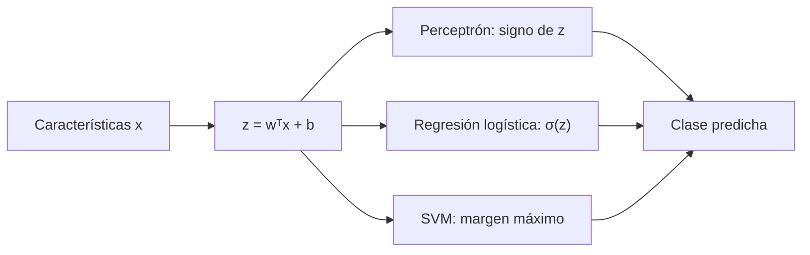

# Inteligencia Artificial - Aprendizaje automático

## 4.1 Aprendizaje supervisado y clasificadores lineales.

---

Un programa aprende, según la definición de Tom Mitchell (1997), si su desempeño P en una tarea T mejora con la experiencia E. En el **aprendizaje supervisado**, la experiencia es un conjunto de ejemplos etiquetados, pares de entrada y salida correcta, y la tarea es predecir la salida de entradas nuevas: clasificar un correo como spam, diagnosticar un tumor a partir de mediciones, reconocer una especie de flor. Los **clasificadores lineales** son el punto de partida: deciden según una combinación lineal de las características, son rápidos, interpretables y la base de las redes neuronales. Este tema presenta la formulación del aprendizaje supervisado, el perceptrón con su teorema de convergencia, la regresión logística con la derivación de su gradiente, las máquinas de vectores de soporte, la regularización y el límite de los modelos lineales.

### Formulación

Dado un conjunto de entrenamiento $D = \{(x_i, y_i)\}_{i=1}^{N},$ con $x_i \in \mathbb{R}^d$ y etiquetas $y_i,$ se busca una hipótesis $h$ en una clase $\mathcal{H}$ que minimice el **riesgo empírico regularizado**:

$$\min_{h \in \mathcal{H}} \frac{1}{N} \sum_{i=1}^{N} L(y_i, h(x_i)) + \lambda\,R(h)$$

donde $L$ es una función de pérdida y $R$ penaliza la complejidad. Lo que importa no es el error en el entrenamiento sino el de **generalización**, en datos nuevos de la misma distribución, y por eso se evalúa con datos de prueba separados o con validación cruzada. Una hipótesis demasiado simple **subajusta** y una demasiado flexible **sobreajusta**: memoriza el ruido de los datos.

### Clasificadores lineales

Para dos clases, $y \in \{-1, +1\},$ un clasificador lineal predice

$$h(x) = \operatorname{signo}(w^\top x + b)$$

La **frontera de decisión** $w^\top x + b = 0$ es un hiperplano, $w$ es perpendicular a él, y $|w^\top x + b| / \|w\|$ es la distancia de $x$ a la frontera. Los métodos difieren en la pérdida que minimizan.

### El perceptrón

El perceptrón de Rosenblatt (1958) recorre los ejemplos y, cada vez que clasifica mal uno, $y_i (w^\top x_i + b) \le 0,$ corrige $w \leftarrow w + y_i x_i$ y $b \leftarrow b + y_i.$ Cada corrección acerca la frontera al lado correcto de ese ejemplo.

**Teorema de convergencia** (Novikoff, 1962). Si los datos son linealmente separables con margen $\gamma \gt 0,$ es decir, existe $u$ con $\|u\| = 1$ y $y_i\,u^\top x_i \ge \gamma$ para todo $i,$ y $\|x_i\| \le R,$ entonces el perceptrón hace a lo más $(R/\gamma)^2$ correcciones. Con el sesgo incluido en $w$ y un 1 agregado a cada $x:$ tras $k$ correcciones, desde $w_0 = 0,$

- $w_k^\top u = w_{k-1}^\top u + y_i\,x_i^\top u \ge w_{k-1}^\top u + \gamma,$ de modo que $w_k^\top u \ge k\gamma;$
- $\|w_k\|^2 = \|w_{k-1}\|^2 + 2 y_i\,w_{k-1}^\top x_i + \|x_i\|^2 \le \|w_{k-1}\|^2 + R^2,$ porque el ejemplo estaba mal clasificado, de modo que $\|w_k\|^2 \le k R^2.$

Por Cauchy-Schwarz, $k\gamma \le w_k^\top u \le \|w_k\| \le \sqrt{k}\,R,$ y entonces $k \le (R/\gamma)^2.$ $\blacksquare$ Si los datos no son separables, el perceptrón no converge: cicla indefinidamente.

### Regresión logística

La regresión logística modela la probabilidad de la clase positiva, ahora con $y \in \{0, 1\},$ como $P(y = 1 \mid x) = \sigma(w^\top x + b),$ con la **sigmoide** $\sigma(z) = 1/(1 + e^{-z}),$ y estima $w$ por máxima verosimilitud, que equivale a minimizar la **pérdida logística** o entropía cruzada:

$$J(w, b) = -\frac{1}{N} \sum_{i=1}^{N} \big[y_i \log p_i + (1 - y_i) \log(1 - p_i)\big], \quad p_i = \sigma(w^\top x_i + b)$$

$J$ es convexa, así que el descenso de gradiente converge al mínimo global. La sigmoide cumple $\sigma'(z) = \sigma(z)(1 - \sigma(z)),$ y con ella, por la regla de la cadena,

$$\frac{\partial}{\partial z_i}\big[-y_i \log \sigma(z_i) - (1 - y_i) \log(1 - \sigma(z_i))\big] = -y_i (1 - p_i) + (1 - y_i)\,p_i = p_i - y_i$$

y como $\partial z_i / \partial w = x_i,$

$$\nabla_w J = \frac{1}{N} \sum_{i=1}^{N} (p_i - y_i)\,x_i, \qquad \frac{\partial J}{\partial b} = \frac{1}{N} \sum_{i=1}^{N} (p_i - y_i)$$

El gradiente es el error de predicción ponderado por la entrada, la misma forma que en la regresión lineal. Con datos separables, la verosimilitud no tiene máximo finito, y $\|w\|$ crece sin límite: la regularización lo evita.

### Máquinas de vectores de soporte

Entre todos los hiperplanos que separan los datos, la SVM (Cortes y Vapnik, 1995) elige el de **margen máximo**. Escalando $w$ y $b$ para que los puntos más cercanos cumplan $y_i (w^\top x_i + b) = 1,$ el margen es $2/\|w\|,$ y maximizarlo equivale a

$$\min_{w, b} \frac{1}{2}\|w\|^2 \quad \text{sujeto a} \quad y_i (w^\top x_i + b) \ge 1$$

Con datos no separables, el **margen suave** agrega holguras $\xi_i \ge 0:$ minimiza $\frac{1}{2}\|w\|^2 + C \sum_i \xi_i$ sujeto a $y_i (w^\top x_i + b) \ge 1 - \xi_i,$ lo que equivale a minimizar la **pérdida bisagra** $\max(0, 1 - y_i (w^\top x_i + b))$ con regularización L2. La solución depende solo de los **vectores de soporte**, los puntos sobre el margen o dentro de él. El parámetro $C$ regula el compromiso: un $C$ pequeño tolera errores y da márgenes anchos; uno grande penaliza cada error y da márgenes estrechos.

### Regularización

- **L2**, o *ridge*: $R(w) = \|w\|_2^2.$ Encoge todos los pesos de manera continua, es diferenciable y conserva todas las variables; con variables correlacionadas, reparte el peso entre ellas. Equivale a una prior gaussiana sobre $w.$
- **L1**, o *lasso*: $R(w) = \|w\|_1.$ Lleva pesos exactamente a cero, porque la penalización tiene un vértice en el origen, y realiza **selección de variables**; con variables correlacionadas, tiende a elegir una arbitrariamente. Equivale a una prior de Laplace.
- **Red elástica:** combina las dos.

El margen y la regularización comparten una idea: un hiperplano con margen grande, o con pesos pequeños, es menos sensible a perturbaciones de los datos, y generaliza mejor; la teoría del aprendizaje estadístico acota el error de generalización en términos de esa capacidad.

### El límite lineal: XOR

Ninguna recta separa XOR. Si $h(x) = \operatorname{signo}(w_1 x_1 + w_2 x_2 + b)$ lo clasificara bien, se tendría $b \lt 0$ por (0, 0); $w_1 + b \ge 0$ y $w_2 + b \ge 0$ por (1, 0) y (0, 1), y $w_1 + w_2 + b \lt 0$ por (1, 1). Sumando las dos del medio, $w_1 + w_2 + 2b \ge 0,$ y entonces $w_1 + w_2 + b \ge -b \gt 0,$ una contradicción. $\blacksquare$ Minsky y Papert (1969) usaron este ejemplo para mostrar los límites del perceptrón de una capa; la solución es combinar varios clasificadores lineales en capas, que es una red neuronal, o transformar las entradas, por ejemplo con el producto $x_1 x_2$ o con un *kernel*.



### Implementación en Python

El programa entrena un perceptrón propio en dos clases de Iris, con las medidas del sépalo y del pétalo, calcula la cota de Novikoff y dibuja la frontera en texto; implementa la regresión logística con descenso de gradiente y regularización L2 y la compara con scikit-learn en el conjunto de cáncer de mama de Wisconsin; compara L1 y L2; explora el parámetro $C$ de una SVM lineal, y verifica que ninguna recta resuelve XOR y que dos sí.

```python
import numpy as np
from sklearn.datasets import load_iris, load_breast_cancer
from sklearn.linear_model import LogisticRegression
from sklearn.model_selection import train_test_split
from sklearn.preprocessing import StandardScaler
from sklearn.svm import SVC

# ---------- Ejercicio 1: perceptrón en Iris, setosa frente a versicolor ----------
iris = load_iris(); m = iris.target < 2
X = iris.data[m][:, :2]; y = np.where(iris.target[m] == 0, -1, 1)          # largo y ancho del sépalo
def perceptron(X, y, max_epocas=1000):
    w, b, errores = np.zeros(X.shape[1]), 0.0, 0
    for epoca in range(1, max_epocas + 1):
        cambios = 0
        for xi, yi in zip(X, y):
            if yi * (w @ xi + b) <= 0: w, b = w + yi * xi, b + yi; cambios += 1
        errores += cambios
        if cambios == 0: return w, b, epoca, errores
    return w, b, None, errores
w, b, epocas, act = perceptron(X, y)
print(f"ejercicio 1: converge en {epocas} épocas con {act} actualizaciones: w = {np.round(w, 2)}, b = {b:.1f}")
print(f"   frontera: {w[0]:.1f}·largo {w[1]:+.1f}·ancho {b:+.1f} = 0; exactitud en entrenamiento {np.mean(np.sign(X @ w + b) == y):.0%}")
Xp = iris.data[m][:, 2:]                                                     # largo y ancho del pétalo
wp, bp, ep_p, act_p = perceptron(Xp, y)
print(f"   con el pétalo: converge en {ep_p} épocas con {act_p} actualizaciones")
svm = SVC(kernel="linear", C=1e6).fit(X, y)                                  # margen máximo, para la cota de Novikoff
R = np.max(np.linalg.norm(np.c_[X, np.ones(len(X))], axis=1)); gamma = 1 / np.linalg.norm(np.r_[svm.coef_[0], svm.intercept_])
print(f"   cota de Novikoff con el sépalo: (R/γ)² = ({R:.2f}/{gamma:.4f})² ≈ {(R / gamma) ** 2:.0f} actualizaciones como máximo")
print("   frontera en el plano (s = setosa, v = versicolor, · y + = región de cada clase):")
for ancho in np.arange(4.4, 1.9, -0.3):
    fila = ""
    for largo in np.arange(4.2, 7.2, 0.1):
        cerca = [(abs(a - largo) < 0.05 and abs(c - ancho) < 0.15, t) for (a, c), t in zip(X, y)]
        hay = [t for ok, t in cerca if ok]
        fila += ("s" if hay[0] < 0 else "v") if hay else ("·" if w @ [largo, ancho] + b < 0 else "+")
    print(f"   {ancho:3.1f} {fila}")

# ---------- Ejercicios 2 y 5: regresión logística con descenso de gradiente y regularización L2 ----------
cancer = load_breast_cancer()
Xtr, Xte, ytr, yte = train_test_split(cancer.data, cancer.target, test_size=0.3, random_state=0, stratify=cancer.target)
esc = StandardScaler().fit(Xtr); Xtr, Xte = esc.transform(Xtr), esc.transform(Xte)
sig = lambda z: 1 / (1 + np.exp(-z))
def logistica(X, y, lam, lr=0.5, iters=5000):
    w, b = np.zeros(X.shape[1]), 0.0
    for _ in range(iters):
        r = sig(X @ w + b) - y                                               # gradiente de la pérdida logística promedio
        w -= lr * (X.T @ r / len(y) + lam * w); b -= lr * r.mean()
    return w, b
for lam in (0.01, 0.1):
    w, b = logistica(Xtr, ytr, lam)
    sk = LogisticRegression(C=1 / (lam * len(ytr)), max_iter=10000).fit(Xtr, ytr)  # misma función objetivo
    print(f"ejercicio 2: λ = {lam}: exactitud de prueba propia {np.mean((sig(Xte @ w + b) > 0.5) == yte):.4f}, sklearn {sk.score(Xte, yte):.4f}; "
          f"máx |w − w_sklearn| = {np.max(np.abs(w - sk.coef_[0])):.1e}; ‖w‖ = {np.linalg.norm(w):.2f}")
for C in (0.01, 0.1, 1.0):
    l1 = LogisticRegression(l1_ratio=1, C=C, solver="liblinear", random_state=0).fit(Xtr, ytr)
    l2 = LogisticRegression(l1_ratio=0, C=C, solver="liblinear", random_state=0).fit(Xtr, ytr)
    print(f"ejercicio 5: C = {C:4}: L1 {np.sum(l1.coef_ != 0):2} de 30 pesos distintos de cero, exactitud {l1.score(Xte, yte):.4f} | "
          f"L2 {np.sum(l2.coef_ != 0):2} de 30, exactitud {l2.score(Xte, yte):.4f}")

# ---------- Ejercicio 3: SVM lineal y el parámetro C ----------
rng = np.random.default_rng(0)
Xs = np.r_[rng.normal([0, 0], 1.0, (100, 2)), rng.normal([2.5, 2.5], 1.0, (100, 2))]; ys = np.r_[-np.ones(100), np.ones(100)]
Xa, Xb, ya, yb = train_test_split(Xs, ys, test_size=0.5, random_state=1, stratify=ys)
for C in (0.001, 0.01, 0.1, 1, 100):
    s = SVC(kernel="linear", C=C).fit(Xa, ya); wn = np.linalg.norm(s.coef_[0])
    print(f"ejercicio 3: C = {C:6}: margen 2/‖w‖ = {2 / wn:5.2f}, {s.n_support_.sum():3} vectores de soporte, "
          f"exactitud entrenamiento {s.score(Xa, ya):.2f}, prueba {s.score(Xb, yb):.2f}")

# ---------- Ejercicio 4: XOR ----------
Xx = np.array([[0, 0], [0, 1], [1, 0], [1, 1]]); yx = np.array([-1, 1, 1, -1])
w, b, ep, act = perceptron(Xx, yx, max_epocas=100)
print(f"ejercicio 4: perceptrón en XOR tras 100 épocas: converge = {ep is not None}, exactitud final {np.mean(np.sign(Xx @ w + b) == yx):.0%}")
mejor = max(np.mean(np.where(Xx @ np.array([a, c]) + d >= 0, 1, -1) == yx)
            for a in np.linspace(-2, 2, 21) for c in np.linspace(-2, 2, 21) for d in np.linspace(-2, 2, 21))
print(f"   mejor exactitud de cualquier recta en una rejilla de 9 261 rectas: {mejor:.0%}")
h1 = np.where(Xx @ [1, 1] - 0.5 >= 0, 1, -1)                                  # OR
h2 = np.where(Xx @ [-1, -1] + 1.5 >= 0, 1, -1)                                # NAND
salida = np.where(h1 + h2 - 1.5 >= 0, 1, -1)                                  # AND de las dos
print("   dos rectas y una compuerta AND:", [f"({x[0]}, {x[1]})→{s:+d}" for x, s in zip(Xx.tolist(), salida.tolist())], "correcto:", bool(np.all(salida == yx)))
```

Salida:

```text
ejercicio 1: converge en 721 épocas con 1562 actualizaciones: w = [  79.8 -101.4], b = -126.0
   frontera: 79.8·largo -101.4·ancho -126.0 = 0; exactitud en entrenamiento 100%
   con el pétalo: converge en 3 épocas con 4 actualizaciones
   cota de Novikoff con el sépalo: (R/γ)² = (7.76/0.0522)² ≈ 22148 actualizaciones como máximo
   frontera en el plano (s = setosa, v = versicolor, · y + = región de cada clase):
   4.4 ···············s··············
   4.1 ··········s··s··s·········++++
   3.8 ·········s·ss··s·······+++++++
   3.5 ····s·sssss·ss····v+++++++++++
   3.2 ··s·ssssss·····++v+++vv++v+vv+
   2.9 ·ss···sss··+v+vv+vvvv+vvvvv+++
   2.6 ·······++vv++vvvv+v++v++++++++
   2.3 ···s+++vv++++v++++v+vv++++++++
   2.0 ++++++++v+++++++++++++++++++++
ejercicio 2: λ = 0.01: exactitud de prueba propia 0.9591, sklearn 0.9591; máx |w − w_sklearn| = 3.4e-03; ‖w‖ = 2.29
ejercicio 2: λ = 0.1: exactitud de prueba propia 0.9474, sklearn 0.9474; máx |w − w_sklearn| = 3.3e-04; ‖w‖ = 1.11
ejercicio 5: C = 0.01: L1  2 de 30 pesos distintos de cero, exactitud 0.8947 | L2 30 de 30, exactitud 0.9357
ejercicio 5: C =  0.1: L1  7 de 30 pesos distintos de cero, exactitud 0.9415 | L2 30 de 30, exactitud 0.9649
ejercicio 5: C =  1.0: L1 13 de 30 pesos distintos de cero, exactitud 0.9591 | L2 30 de 30, exactitud 0.9591
ejercicio 3: C =  0.001: margen 2/‖w‖ = 11.85, 100 vectores de soporte, exactitud entrenamiento 0.95, prueba 0.94
ejercicio 3: C =   0.01: margen 2/‖w‖ =  3.57,  56 vectores de soporte, exactitud entrenamiento 0.95, prueba 0.95
ejercicio 3: C =    0.1: margen 2/‖w‖ =  2.00,  25 vectores de soporte, exactitud entrenamiento 0.95, prueba 0.94
ejercicio 3: C =      1: margen 2/‖w‖ =  1.35,  15 vectores de soporte, exactitud entrenamiento 0.94, prueba 0.94
ejercicio 3: C =    100: margen 2/‖w‖ =  1.10,  12 vectores de soporte, exactitud entrenamiento 0.95, prueba 0.94
ejercicio 4: perceptrón en XOR tras 100 épocas: converge = False, exactitud final 0%
   mejor exactitud de cualquier recta en una rejilla de 9 261 rectas: 75%
   dos rectas y una compuerta AND: ['(0, 0)→-1', '(0, 1)→+1', '(1, 0)→+1', '(1, 1)→-1'] correcto: True
```

### Ejercicios Propuestos

1. **Perceptrón.** Implementa el perceptrón desde cero, pruébalo con el conjunto Iris, solo con las clases setosa y versicolor, y visualiza la frontera de decisión.

2. **Regresión logística.** Deriva el gradiente de la pérdida de la regresión logística, impleméntala con descenso de gradiente y compara los resultados con scikit-learn.

3. **SVM.** Explica por qué las SVM maximizan el margen entre las clases, implementa una SVM lineal con scikit-learn y observa el efecto de distintos valores del parámetro C.

4. **XOR.** Explica por qué un perceptrón simple no resuelve XOR y propón una solución con varios clasificadores lineales.

5. **Regularización.** Explica la regularización L1 y L2, implementa la regresión logística con L2 y discute las ventajas y desventajas de cada una.

### Soluciones

**Ejercicio 1.** Setosa y versicolor son linealmente separables, y el perceptrón converge en los dos casos, pero a ritmos muy distintos. Con las medidas del pétalo, las clases están muy separadas y basta con 4 correcciones en 3 épocas. Con las del sépalo, el margen es pequeño, unas pocas flores están casi en la frontera, y hacen falta 1 562 correcciones en 721 épocas; la cota de Novikoff, con el margen de la SVM, que es menor o igual que el mejor margen posible, da como máximo unas 22 000. El dibujo muestra la frontera entre las regiones de cada clase, con las flores de setosa, s, a un lado y las de versicolor, v, al otro. La frontera del perceptrón es una de muchas que separan los datos, y depende del orden de los ejemplos: no busca la mejor.

**Ejercicio 2.** El gradiente se deriva arriba: $\nabla_w J = \frac{1}{N} \sum_i (p_i - y_i)\,x_i.$ La implementación con descenso de gradiente y L2 minimiza $J + \frac{\lambda}{2}\|w\|^2;$ para que scikit-learn optimice la misma función, que escribe como $\frac{1}{2}\|w\|^2 + C \sum_i \ell_i,$ hay que usar $C = 1/(\lambda N).$ Con eso, en el conjunto de cáncer de mama, con 30 variables estandarizadas, los pesos coinciden hasta $3 \times 10^{-3}$ y las exactitudes de prueba son idénticas, 95.9 % con $\lambda = 0.01.$ Estandarizar las variables es esencial: sin ello, las escalas distintas hacen que el descenso de gradiente converja muy lento.

**Ejercicio 3.** La SVM maximiza el margen porque, entre los separadores, el de margen máximo es el más robusto: tolera la mayor perturbación de los datos sin cambiar de clase, y la teoría de Vapnik acota su error de generalización en función del margen, no de la dimensión. En dos nubes gaussianas que se traslapan, al aumentar $C$ de 0.001 a 100 el margen se reduce de 11.85 a 1.10 y los vectores de soporte de 100, todos los puntos de entrenamiento, a 12. La exactitud de prueba apenas cambia, entre 0.94 y 0.95, porque el traslape de las clases fija un error mínimo. $C$ se elige con validación cruzada; con datos ruidosos, un $C$ grande sobreajusta.

**Ejercicio 4.** La demostración está arriba: las cuatro desigualdades de XOR son incompatibles. El perceptrón no converge: tras 100 épocas sigue corrigiendo, y sus pesos finales clasifican mal los cuatro puntos; ninguna de las 9 261 rectas probadas acierta más de 3 de 4. La solución con dos clasificadores lineales: $h_1 = \operatorname{signo}(x_1 + x_2 - 0.5),$ que es OR, y $h_2 = \operatorname{signo}(-x_1 - x_2 + 1.5),$ que es NAND, y una tercera unidad que calcula el AND de ambas, $\operatorname{signo}(h_1 + h_2 - 1.5).$ XOR es exactamente "OR y no AND". Es una red de dos capas, el perceptrón multicapa, y sus pesos pueden aprenderse con retropropagación, como en el tema 1.1.

**Ejercicio 5.** Con regresión logística en el conjunto de cáncer de mama, la penalización L1 con $C = 0.01$ deja solo 2 de las 30 variables con peso distinto de cero y una exactitud de 89.5 %, y con $C = 1,$ 13 variables y 95.9 %; L2 conserva siempre las 30. L1 conviene cuando se sospecha que pocas variables importan, o cuando un modelo con pocas variables es más fácil de explicar y más barato de medir; L2 es preferible con muchas variables correlacionadas, como estas, que son medidas geométricas de las mismas células, y produce un problema suave, más fácil de optimizar. La red elástica combina la selección de L1 con la estabilidad de L2.

El material original atribuía la definición de aprendizaje con T, P y E a Russell y Norvig; es de Mitchell, _Machine Learning_, 1997. Además, el ejercicio 3 del original pide distintos valores de C sin datos; aquí se usan dos nubes gaussianas que se traslapan, porque con datos separables el efecto de C es mucho menor.

### Referencias

1. Mitchell, T. M., _Machine Learning_. McGraw-Hill, 1997.
2. Rosenblatt, F., The perceptron: a probabilistic model for information storage and organization in the brain. _Psychological Review_ 65(6), 1958.
3. Novikoff, A. B. J., On convergence proofs on perceptrons. _Symposium on the Mathematical Theory of Automata_, 1962.
4. Cortes, C., and Vapnik, V., Support-vector networks. _Machine Learning_ 20, 1995.
5. Tibshirani, R., Regression shrinkage and selection via the lasso. _Journal of the Royal Statistical Society B_ 58(1), 1996.
6. Hastie, T., Tibshirani, R., and Friedman, J., _The Elements of Statistical Learning_. Springer, 2009.
7. Minsky, M., and Papert, S., _Perceptrons_. MIT Press, 1969.
