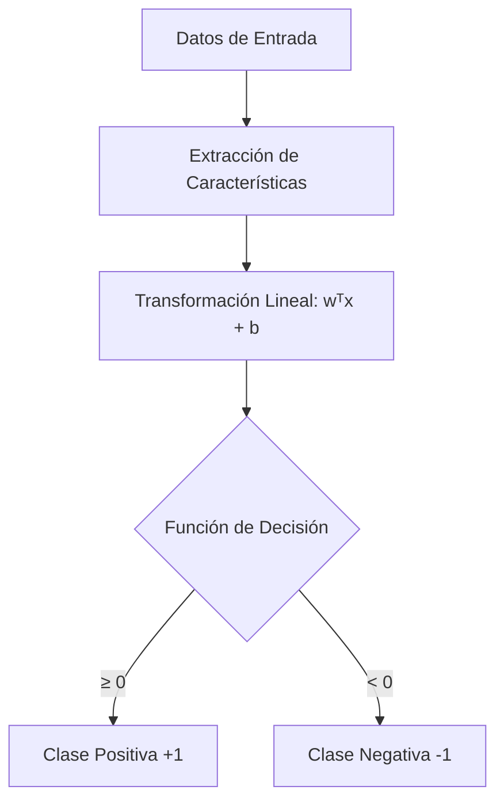

# Inteligencia Artificial - Aprendizaje automático

## 4.1 Aprendizaje supervisado y clasificadores lineales.

---

El aprendizaje automático (machine learning) es un subcampo de la inteligencia artificial que se centra en el desarrollo de sistemas que pueden aprender de los datos. Según Russell y Norvig (2009), "El aprendizaje automático es el estudio de algoritmos que mejoran su desempeño P en alguna tarea T con la experiencia E".

### Aprendizaje Supervisado

El aprendizaje supervisado es un tipo de aprendizaje automático donde el algoritmo aprende a partir de datos etiquetados. Dado un conjunto de entrenamiento de N ejemplos de entrada-salida ${(x₁, y₁), (x₂, y₂), ..., (x_N, y_N)}$, el objetivo es aprender una función $f: X → Y$ que mapee entradas x a salidas y.

#### Formulación Matemática

Dado un conjunto de datos de entrenamiento:

$$D = \{(x_i, y_i)\}_{i=1}^N$$

donde:

- $x_i ∈ ℝ^d$ es el vector de características (atributos)
- $y_i$ es la etiqueta o valor objetivo

Buscamos una función $h(x)$ (hipótesis) que minimice el error de predicción:

$$\min_h \sum_{i=1}^N L(y_i, h(x_i)) + λR(h)$$

donde $L$ es una función de pérdida y $R$ es un término de regularización.

### Clasificadores Lineales

Los clasificadores lineales son modelos que realizan clasificación basándose en una combinación lineal de las características de entrada. La frontera de decisión es un hiperplano en el espacio de características.

#### Modelo Lineal Básico

Para un problema de clasificación binaria $(y ∈ \{-1, +1\})$, el clasificador lineal toma la forma:

$$f(x) = sign(w^T x + b)$$

donde:

- $w ∈ ℝ^d$ es el vector de pesos
- $b ∈ ℝ$ es el sesgo (bias)
- $x ∈ ℝ^d$ es el vector de características

#### Función de Decisión

La función de decisión es:

$$ h(x) = \begin{cases} +1 & \text{si } w^T x + b \geq 0 \\\ -1 & \text{si } w^T x + b < 0 \end{cases} $$

### Perceptrón

El perceptrón es uno de los algoritmos más simples para clasificación lineal, desarrollado por Frank Rosenblatt en 1958.

#### Algoritmo del Perceptrón

```python
import numpy as np

class Perceptron:
    def __init__(self, learning_rate=0.01, n_iters=1000):
        self.lr = learning_rate
        self.n_iters = n_iters
        self.weights = None
        self.bias = None

    def fit(self, X, y):
        n_samples, n_features = X.shape

        # Inicializar parámetros
        self.weights = np.zeros(n_features)
        self.bias = 0

        # Asegurar que las etiquetas sean -1 o 1
        y_ = np.where(y <= 0, -1, 1)

        # Entrenamiento
        for _ in range(self.n_iters):
            for idx, x_i in enumerate(X):
                condition = y_[idx] * (np.dot(x_i, self.weights) + self.bias) >= 0
                if not condition:
                    self.weights += self.lr * y_[idx] * x_i
                    self.bias += self.lr * y_[idx]

    def predict(self, X):
        linear_output = np.dot(X, self.weights) + self.bias
        return np.sign(linear_output)
```

#### Ejemplo de Uso del Perceptrón

```python
# Ejemplo con datos sintéticos
from sklearn.datasets import make_classification
from sklearn.model_selection import train_test_split

# Generar datos
X, y = make_classification(n_samples=100, n_features=2, n_redundant=0,
                          n_informative=2, random_state=42, n_clusters_per_class=1)
y = np.where(y == 0, -1, 1)  # Convertir a -1 y 1

# Dividir datos
X_train, X_test, y_train, y_test = train_test_split(X, y, test_size=0.2, random_state=42)

# Entrenar perceptrón
perceptron = Perceptron(learning_rate=0.01, n_iters=1000)
perceptron.fit(X_train, y_train)

# Predecir
predictions = perceptron.predict(X_test)
accuracy = np.mean(predictions == y_test)
print(f"Precisión: {accuracy:.2f}")
```

### Regresión Logística

Aunque su nombre sugiere regresión, la regresión logística es un clasificador lineal ampliamente utilizado para problemas de clasificación binaria.

#### Función Sigmoide

La regresión logística utiliza la función sigmoide para mapear valores reales al rango [0, 1]:

$$\sigma(z) = \frac{1}{1 + e^{-z}}$$

donde $z = w^T x + b$

#### Función de Pérdida

La función de pérdida para regresión logística es la pérdida logística:

$$L(y, \hat{y}) = -[y \log(\hat{y}) + (1 - y) \log(1 - \hat{y})]$$

Para todo el conjunto de datos:

$$J(w) = -\frac{1}{N} \sum_{i=1}^N [y_i \log(\sigma(w^T x_i + b)) + (1 - y_i) \log(1 - \sigma(w^T x_i + b))]$$

#### Implementación de Regresión Logística

```python
class LogisticRegression:
    def __init__(self, learning_rate=0.01, n_iters=1000):
        self.lr = learning_rate
        self.n_iters = n_iters
        self.weights = None
        self.bias = None

    def sigmoid(self, z):
        return 1 / (1 + np.exp(-z))

    def fit(self, X, y):
        n_samples, n_features = X.shape

        # Inicializar parámetros
        self.weights = np.zeros(n_features)
        self.bias = 0

        # Descenso de gradiente
        for _ in range(self.n_iters):
            # Calcular predicciones
            linear_model = np.dot(X, self.weights) + self.bias
            y_pred = self.sigmoid(linear_model)

            # Calcular gradientes
            dw = (1 / n_samples) * np.dot(X.T, (y_pred - y))
            db = (1 / n_samples) * np.sum(y_pred - y)

            # Actualizar parámetros
            self.weights -= self.lr * dw
            self.bias -= self.lr * db

    def predict(self, X, threshold=0.5):
        linear_model = np.dot(X, self.weights) + self.bias
        y_pred = self.sigmoid(linear_model)
        return (y_pred >= threshold).astype(int)
```

### Máquinas de Vectores de Soporte (SVM) Lineales

Las SVM buscan el hiperplano que maximiza el margen entre las clases.

#### Formulación del Problema de Optimización

$$\min_{w,b} \frac{1}{2} \|w\|^2$$

sujeto a:

$$y_i(w^T x_i + b) \geq 1 \quad \forall i = 1, ..., N$$

#### SVM con Margen Suave

Para datos no linealmente separables, introducimos variables de holgura (slack variables):

$$\min_{w,b,\xi} \frac{1}{2} \|w\|^2 + C \sum_{i=1}^N \xi_i$$

sujeto a:

$$y_i(w^T x_i + b) \geq 1 - \xi_i \quad \text{y} \quad \xi_i \geq 0 \quad \forall i$$

### Diagrama de Clasificador Lineal



### Ejercicios Propuestos

1. **Implementación del Perceptrón**:
   - Implementa el algoritmo del perceptrón desde cero usando Python.
   - Prueba con el conjunto de datos Iris (solo las clases setosa y versicolor).
   - Visualiza la frontera de decisión.

2. **Regresión Logística**:
   - Deriva matemáticamente el gradiente de la función de pérdida de regresión logística.
   - Implementa regresión logística con descenso de gradiente.
   - Compara los resultados con la implementación de sklearn.

3. **Análisis de SVM**:
   - Explica por qué las SVM maximizan el margen entre clases.
   - Implementa una SVM lineal usando la librería scikit-learn.
   - Experimenta con diferentes valores del parámetro C y observa su efecto.

4. **Problema de XOR**:
   - ¿Por qué el problema XOR no puede ser resuelto por un perceptrón simple?
   - Propón una solución usando múltiples clasificadores lineales.

5. **Regularización**:
   - Explica los conceptos de regularización L1 (Lasso) y L2 (Ridge).
   - Implementa regresión logística con regularización L2.
   - Discute las ventajas y desventajas de cada tipo de regularización.

### Referencias

#### Bibliografía Básica
1. Russell, S., & Norvig, P. (2009). Artificial Intelligence: A Modern Approach (3rd ed.). Prentice Hall. (Capítulos 18 y 20)
2. Marsland, S. (2009). Machine Learning: An Algorithmic Perspective. Chapman and Hall. (Capítulos 3 y 4)

#### Bibliografía Complementaria
1. Alpaydin, E. (2010). Introduction to Machine Learning (2nd ed.). The MIT Press.
2. Hastie, T., Tibshirani, R., & Friedman, J. (2009). The Elements of Statistical Learning: Data Mining, Inference, and Prediction (2nd ed.). Springer.
3. Marsland, S. (2009). Machine Learning: An Algorithmic Perspective. Chapman and Hall.
4. Davis, E. (1990). Representations of Commonsense Knowledge. Morgan Kaufmann.

#### Recursos Adicionales
- [Scikit-learn: Clasificación Lineal](https://scikit-learn.org/stable/modules/linear_model.html)
- [TensorFlow Playground: Visualización de Clasificadores](https://playground.tensorflow.org/)
- [Stanford CS229: Machine Learning Course Notes](http://cs229.stanford.edu/syllabus.html)

### Consejos para el Estudio

1. **Fundamentos Matemáticos**: Asegúrate de comprender álgebra lineal, cálculo y probabilidad, ya que son esenciales para entender los clasificadores lineales.

2. **Implementación Práctica**: Implementa los algoritmos desde cero para solidificar tu comprensión.

3. **Visualización**: Utiliza herramientas de visualización para entender cómo funcionan las fronteras de decisión.

4. **Experimentación**: Prueba con diferentes conjuntos de datos y parámetros para observar el comportamiento de los algoritmos.

5. **Comprensión de Límites**: Entiende las limitaciones de los clasificadores lineales y cuándo son apropiados.
