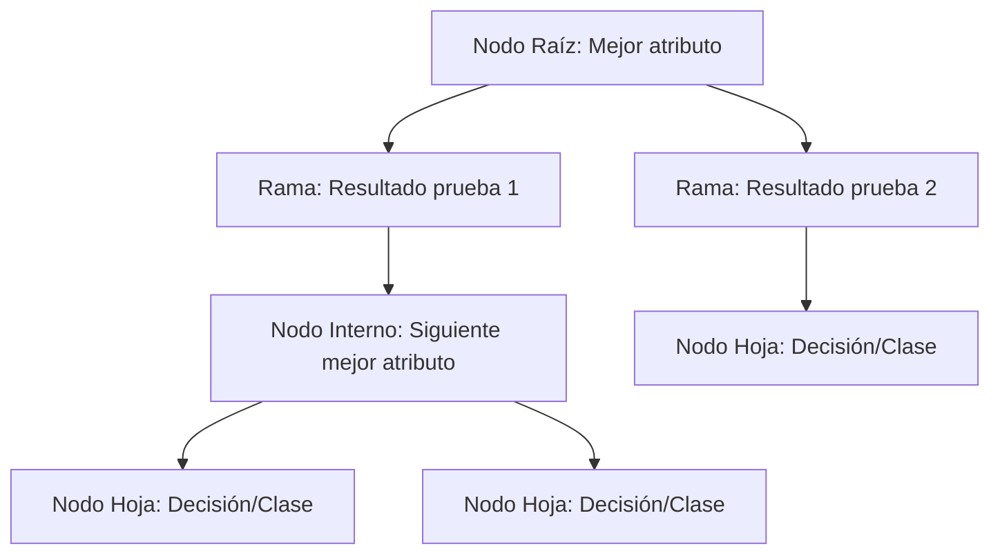

# Inteligencia Artificial - Aprendizaje automático

## 4.2 Árboles de decisión.

---

Los árboles de decisión son uno de los algoritmos más intuitivos y ampliamente utilizados en aprendizaje automático. Según Russell y Norvig (2009), "un árbol de decisión representa una función que toma como entrada un vector de valores atributos y devuelve una 'decisión' - un valor de salida único".

### Conceptos Fundamentales

#### Definición Formal

Un árbol de decisión es una estructura de árbol donde:

- Cada **nodo interno** representa una prueba sobre un atributo
- Cada **rama** representa el resultado de la prueba
- Cada **nodo hoja** representa una etiqueta de clase

#### Componentes de un Árbol de Decisión



### Construcción de Árboles de Decisión

#### Algoritmo ID3 (Iterative Dichotomiser 3)

El algoritmo ID3 utiliza la ganancia de información para seleccionar los mejores atributos en cada paso.

##### Entropía

La entropía mide la impureza de un conjunto de datos:

$$H(S) = -\sum_{i=1}^{c} p_i \log_2 p_i$$

donde:

- $S$ es el conjunto de datos
- $c$ es el número de clases
- $p_i$ es la proporción de ejemplos de la clase $i$

##### Ganancia de Información

La ganancia de información mide la reducción en la entropía:

$$IG(S, A) = H(S) - \sum_{v \in Valores(A)} \frac{|S_v|}{|S|} H(S_v)$$

donde:

- $A$ es el atributo
- $S_v$ es el subconjunto de $S$ donde $A$ tiene valor $v$

#### Implementación del Algoritmo ID3

```python
import numpy as np
import pandas as pd
from math import log2

class NodoDecision:
    def __init__(self, atributo=None, valor=None, resultado=None):
        self.atributo = atributo  # Atributo para dividir
        self.valor = valor        # Valor del atributo para esta rama
        self.hijos = {}           # Diccionario de hijos {valor: nodo}
        self.resultado = resultado  # Resultado si es nodo hoja

class ArbolDecisionID3:
    def __init__(self):
        self.raiz = None

    def calcular_entropia(self, y):
        """Calcula la entropía de un conjunto de etiquetas"""
        if len(y) == 0:
            return 0

        conteo_clases = {}
        for clase in y:
            conteo_clases[clase] = conteo_clases.get(clase, 0) + 1

        entropia = 0
        for clase in conteo_clases:
            probabilidad = conteo_clases[clase] / len(y)
            entropia -= probabilidad * log2(probabilidad)

        return entropia

    def calcular_ganancia_informacion(self, X, y, atributo):
        """Calcula la ganancia de información para un atributo"""
        entropia_total = self.calcular_entropia(y)
        valores = set(X[atributo])

        entropia_atributo = 0
        for valor in valores:
            mascara = X[atributo] == valor
            y_subconjunto = y[mascara]
            peso = len(y_subconjunto) / len(y)
            entropia_atributo += peso * self.calcular_entropia(y_subconjunto)

        return entropia_total - entropia_atributo

    def encontrar_mejor_atributo(self, X, y, atributos):
        """Encuentra el atributo con mayor ganancia de información"""
        mejor_ganancia = -1
        mejor_atributo = None

        for atributo in atributos:
            ganancia = self.calcular_ganancia_informacion(X, y, atributo)
            if ganancia > mejor_ganancia:
                mejor_ganancia = ganancia
                mejor_atributo = atributo

        return mejor_atributo

    def construir_arbol(self, X, y, atributos, profundidad=0, max_profundidad=10):
        """Construye recursivamente el árbol de decisión"""
        # Caso base 1: Todos los ejemplos son de la misma clase
        if len(set(y)) == 1:
            return NodoDecision(resultado=y.iloc[0])

        # Caso base 2: No hay más atributos o máxima profundidad alcanzada
        if len(atributos) == 0 or profundidad >= max_profundidad:
            # Devolver el nodo con la clase más frecuente
            clase_mas_frecuente = y.mode()[0]
            return NodoDecision(resultado=clase_mas_frecuente)

        # Encontrar el mejor atributo para dividir
        mejor_atributo = self.encontrar_mejor_atributo(X, y, atributos)

        # Crear el nodo actual
        nodo = NodoDecision(atributo=mejor_atributo)

        # Obtener los valores únicos del mejor atributo
        valores = set(X[mejor_atributo])

        # Eliminar el atributo actual de la lista de atributos disponibles
        nuevos_atributos = [a for a in atributos if a != mejor_atributo]

        # Construir recursivamente los subárboles
        for valor in valores:
            mascara = X[mejor_atributo] == valor
            X_subconjunto = X[mascara]
            y_subconjunto = y[mascara]

            if len(X_subconjunto) == 0:
                # Si no hay ejemplos, usar la clase más frecuente del padre
                clase_mas_frecuente = y.mode()[0]
                nodo.hijos[valor] = NodoDecision(resultado=clase_mas_frecuente)
            else:
                # Construir el subárbol recursivamente
                nodo.hijos[valor] = self.construir_arbol(
                    X_subconjunto, y_subconjunto, nuevos_atributos, profundidad + 1, max_profundidad
                )

        return nodo

    def entrenar(self, X, y, max_profundidad=10):
        """Entrena el árbol de decisión"""
        atributos = list(X.columns)
        self.raiz = self.construir_arbol(X, y, atributos, max_profundidad=max_profundidad)

    def predecir_ejemplo(self, x, nodo):
        """Predice la clase para un solo ejemplo"""
        if nodo.resultado is not None:
            return nodo.resultado

        valor_atributo = x[nodo.atributo]
        if valor_atributo in nodo.hijos:
            return self.predecir_ejemplo(x, nodo.hijos[valor_atributo])
        else:
            # Manejar valores no vistos durante el entrenamiento
            return "Desconocido"

    def predecir(self, X):
        """Predice las clases para un conjunto de ejemplos"""
        return [self.predecir_ejemplo(x, self.raiz) for _, x in X.iterrows()]
```

### Ejemplo Práctico: Clasificación de Animales

#### Conjunto de Datos de Ejemplo

```python
# Crear dataset de ejemplo: clasificación de animales
datos = {
    'pelaje': ['si', 'si', 'no', 'si', 'no', 'no', 'si', 'no'],
    'plumas': ['no', 'no', 'no', 'no', 'si', 'si', 'no', 'no'],
    'vuela': ['no', 'no', 'si', 'si', 'si', 'no', 'no', 'si'],
    'pone_huevos': ['no', 'no', 'si', 'si', 'si', 'si', 'no', 'si'],
    'clase': ['mamifero', 'mamifero', 'ave', 'ave', 'ave', 'reptil', 'mamifero', 'anfibio']
}

df = pd.DataFrame(datos)
X = df.drop('clase', axis=1)
y = df['clase']

# Entrenar el árbol
arbol = ArbolDecisionID3()
arbol.entrenar(X, y)

# Hacer una predicción
ejemplo = {'pelaje': 'no', 'plumas': 'si', 'vuela': 'si', 'pone_huevos': 'si'}
prediccion = arbol.predecir_ejemplo(ejemplo, arbol.raiz)
print(f"Predicción: {prediccion}")  # Debería predecir "ave"
```

### Medidas Alternativas de División

#### Índice Gini

El índice Gini mide la impureza de un conjunto:

$$Gini(S) = 1 - \sum_{i=1}^{c} p_i^2$$

#### Ganancia de Gini

$$Gini_{ganancia}(S, A) = Gini(S) - \sum_{v \in Valores(A)} \frac{|S_v|}{|S|} Gini(S_v)$$

#### Error de Clasificación

$$Error(S) = 1 - \max(p_i)$$

### Poda de Árboles (Pruning)

La poda ayuda a prevenir el sobreajuste eliminando ramas que tienen poco poder predictivo.

#### Poda por Error Reducido

```python
def podar_arbol(nodo, X_validacion, y_validacion):
    """Podar el árbol basado en un conjunto de validación"""
    if nodo.resultado is not None:
        return nodo

    # Podar recursivamente los hijos
    for valor, hijo in nodo.hijos.items():
        nodo.hijos[valor] = podar_arbol(hijo, X_validacion, y_validacion)

    # Calcular error sin podar
    error_sin_podar = calcular_error(nodo, X_validacion, y_validacion)

    # Calcular error si convirtiéramos este nodo en hoja
    clase_mas_frecuente = encontrar_clase_mas_frecuente(nodo)
    error_podado = calcular_error_hoja(clase_mas_frecuente, X_validacion, y_validacion)

    # Podar si el error no aumenta significativamente
    if error_podado <= error_sin_podar:
        return NodoDecision(resultado=clase_mas_frecuente)

    return nodo
```

### Árboles de Decisión con Scikit-Learn

```python
from sklearn.tree import DecisionTreeClassifier, plot_tree
from sklearn.datasets import load_iris
from sklearn.model_selection import train_test_split
import matplotlib.pyplot as plt

# Cargar datos
iris = load_iris()
X, y = iris.data, iris.target

# Dividir datos
X_train, X_test, y_train, y_test = train_test_split(X, y, test_size=0.2, random_state=42)

# Crear y entrenar árbol
clf = DecisionTreeClassifier(criterion='entropy', max_depth=3, random_state=42)
clf.fit(X_train, y_train)

# Evaluar
precision = clf.score(X_test, y_test)
print(f"Precisión: {precision:.2f}")

# Visualizar árbol
plt.figure(figsize=(12, 8))
plot_tree(clf, feature_names=iris.feature_names,
          class_names=iris.target_names, filled=True)
plt.show()
```

### Ventajas y Desventajas

#### Ventajas

- Fáciles de entender e interpretar
- Pueden manejar tanto datos numéricos como categóricos
- Requieren poco preprocesamiento de datos
- Pueden modelar relaciones no lineales

#### Desventajas

- Propensos al sobreajuste (overfitting)
- Pueden ser inestables con pequeños cambios en los datos
- Sesgados hacia atributos con muchos niveles

### Ejercicios Propuestos

1. **Implementación desde Cero**:
   - Extiende la implementación del ID3 para que maneje atributos numéricos usando puntos de corte.
   - Implementa el criterio de Gini como alternativa a la ganancia de información.

2. **Análisis de Complejidad**:
   - Calcula la complejidad computacional del algoritmo ID3.
   - Compara con otros algoritmos de clasificación.

3. **Experimentación con Datasets**:
   - Prueba el algoritmo con el dataset de Titanic para predecir supervivencia.
   - Experimenta con diferentes parámetros de poda.

4. **Árboles de Regresión**:
   - Investiga y implementa árboles de decisión para problemas de regresión.
   - Compara los resultados con modelos de regresión lineal.

5. **Optimizaciones**:
   - Implementa la técnica de "poda por coste-complejidad".
   - Añade soporte para valores faltantes en los datos.

### Referencias

#### Bibliografía Básica

1. Russell, S., & Norvig, P. (2009). Artificial Intelligence: A Modern Approach (3rd ed.). Prentice Hall. (Capítulo 18)
2. Marsland, S. (2009). Machine Learning: An Algorithmic Perspective. Chapman and Hall. (Capítulo 4)

#### Bibliografía Complementaria

1. Alpaydin, E. (2010). Introduction to Machine Learning (2nd ed.). The MIT Press. (Capítulo 9)
2. Hastie, T., Tibshirani, R., & Friedman, J. (2009). The Elements of Statistical Learning. Springer. (Capítulo 9)
3. Quinlan, J. R. (1986). Induction of Decision Trees. Machine Learning, 1(1), 81-106.

#### Recursos Adicionales

- [Scikit-learn: Árboles de Decisión](https://scikit-learn.org/stable/modules/tree.html)
- [Visualización Interactiva de Árboles de Decisión](https://www.r2d3.us/visual-intro-to-machine-learning-part-1/)
- [UCI Machine Learning Repository](https://archive.ics.uci.edu/ml/index.php) - Para practicar con datasets reales

### Consejos para el Estudio

1. **Entiende los Fundamentos**: Asegúrate de comprender bien los conceptos de entropía y ganancia de información antes de profundizar en implementaciones.

2. **Practica con Diferentes Datasets**: Experimenta con diversos conjuntos de datos para entender cómo se comportan los árboles en diferentes escenarios.

3. **Visualiza los Resultados**: Utiliza herramientas de visualización para entender cómo se toman las decisiones en el árbol.

4. **Compara con Otros Algoritmos**: Implementa otros clasificadores y compara sus resultados con los árboles de decisión.

5. **Prevención de Overfitting**: Presta especial atención a las técnicas de poda y regularización para evitar sobreajuste.
