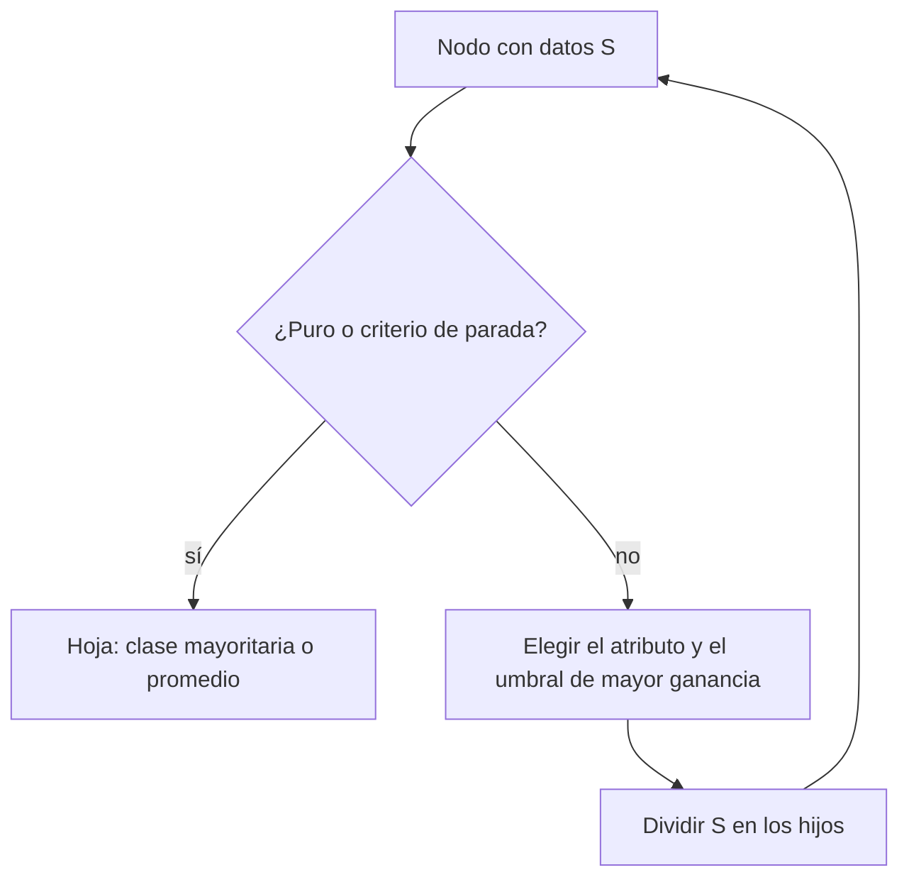

# Inteligencia Artificial - Aprendizaje automático

## 4.2 Árboles de decisión.

---

Un **árbol de decisión** clasifica un ejemplo con una serie de preguntas sobre sus atributos: ¿el pétalo mide más de 2.35 cm? ¿el pasajero viajaba en tercera clase? Cada nodo interno pregunta por un atributo, cada rama corresponde a una respuesta, y cada hoja da una predicción. Son uno de los modelos más usados porque se leen como reglas, aceptan atributos numéricos y categóricos sin preprocesamiento y capturan interacciones no lineales; además, son la base de los bosques aleatorios y del *gradient boosting*, que dominan en datos tabulares. Este tema presenta la construcción voraz con entropía y Gini, los atributos numéricos, la complejidad, la poda, los árboles de regresión y el manejo de valores faltantes.

### Construcción: dividir y conquistar

Encontrar el árbol más pequeño consistente con los datos es NP-completo (Hyafil y Rivest, 1976), así que los algoritmos lo construyen de forma **voraz**, de arriba abajo: en cada nodo eligen la mejor pregunta según una medida de impureza, dividen los datos y repiten en cada hijo, hasta que el nodo es puro o se cumple un criterio de parada. **ID3** (Quinlan, 1986) usa la ganancia de información y divide un atributo categórico en una rama por valor; **C4.5** agrega atributos numéricos, poda y valores faltantes; **CART** (Breiman y otros, 1984) hace divisiones binarias con Gini y sirve también para regresión. Scikit-learn implementa una versión optimizada de CART.

### Medidas de impureza

Para un conjunto $S$ con proporciones $p_1, \dots, p_c$ de las clases:

- **entropía:** $H(S) = -\sum_{i} p_i \log_2 p_i,$ entre 0, conjunto puro, y $\log_2 c,$ clases equiprobables;
- **índice de Gini:** $G(S) = 1 - \sum_i p_i^2,$ la probabilidad de clasificar mal un ejemplo elegido al azar si se le asigna una clase al azar según las proporciones;
- **error de clasificación:** $1 - \max_i p_i,$ poco sensible, y por eso se usa para podar, no para dividir.

La **ganancia** de dividir $S$ con el atributo $A$ es la reducción de impureza ponderada por el tamaño de los hijos:

$$\text{IG}(S, A) = H(S) - \sum_{v \in \text{Valores}(A)} \frac{|S_v|}{|S|}\,H(S_v)$$

Por la concavidad de la entropía, la ganancia nunca es negativa. Favorece a los atributos con muchos valores, como un identificador, que da hojas puras sin generalizar; C4.5 corrige ese sesgo con la **razón de ganancia**, que divide entre la entropía de la propia partición. Entropía y Gini suelen producir árboles muy parecidos.

### Atributos numéricos

Para un atributo numérico se consideran divisiones binarias $x \le u.$ Basta probar los umbrales en los puntos medios entre valores consecutivos distintos: tras ordenar los ejemplos por el atributo, un recorrido actualiza los conteos de cada lado de forma incremental y evalúa cada umbral en tiempo constante.

### Complejidad

Con $n$ ejemplos y $m$ atributos, elegir la división de un nodo cuesta $O(m\,n \log n)$ por el ordenamiento, u $O(m\,n)$ si los órdenes se calculan una vez al inicio y se mantienen. Los nodos de un mismo nivel particionan los datos, así que cada nivel cuesta en total lo mismo, y un árbol de profundidad $d$ cuesta $O(m\,n \log n \cdot d);$ en un árbol balanceado, $d = O(\log n).$ Predecir cuesta $O(d).$ A modo de comparación, el vecino más cercano no entrena pero predice en $O(m\,n),$ y una regresión logística entrena en $O(m\,n)$ por iteración y predice en $O(m).$

### Sobreajuste y poda

Un árbol que crece hasta hojas puras memoriza el ruido. Hay dos remedios:

- **prepoda:** detener el crecimiento con una profundidad máxima, un mínimo de ejemplos por hoja o una ganancia mínima. Es simple, pero puede detenerse antes de una división útil que solo se ve un nivel después, como en XOR;
- **pospoda:** crecer el árbol completo y luego podarlo. La **poda por error reducido** reemplaza un subárbol por una hoja si eso no empeora el error en un conjunto de validación. La **poda por costo-complejidad** de CART minimiza $R_\alpha(T) = R(T) + \alpha\,|T|,$ el error más una penalización por hoja; al crecer $\alpha$ se obtiene una sucesión anidada de árboles podados, y $\alpha$ se elige por validación cruzada.

### Árboles de regresión

Si la salida es numérica, cada hoja predice el **promedio** de sus ejemplos, y la división elegida es la que más reduce la suma de los errores cuadráticos, es decir, la varianza dentro de los hijos. El resultado es una función escalonada: aproxima bien relaciones no lineales y con umbrales, pero mal una tendencia lineal suave, que necesita muchos escalones.

### Valores faltantes

C4.5 reparte un ejemplo con un valor faltante entre las ramas, con pesos proporcionales a sus tamaños; CART usa **divisiones sustitutas**, otros atributos que imitan la división original. Scikit-learn, desde la versión 1.3, aprende en cada división hacia qué lado enviar los valores faltantes. La alternativa general es **imputar**, por ejemplo con la mediana, antes de entrenar.



### Implementación en Python

El programa implementa un árbol propio con atributos categóricos y numéricos y los criterios de entropía y Gini, y lo prueba con el ejemplo de los animales del material original y, para el ejercicio 1, con Iris, comparado con scikit-learn. Cuenta los umbrales evaluados para distintos tamaños, para el ejercicio 2; construye el árbol del Titanic con la tabla de 2 201 personas a bordo y compara parámetros de poda; implementa un árbol de regresión y lo compara con la regresión lineal, y aplica la poda por costo-complejidad y el manejo de valores faltantes en el conjunto de cáncer de mama.

```python
from collections import Counter
from math import log2
import numpy as np
from sklearn.datasets import load_iris, load_breast_cancer
from sklearn.impute import SimpleImputer
from sklearn.linear_model import LinearRegression
from sklearn.model_selection import cross_val_score, train_test_split, StratifiedKFold
from sklearn.pipeline import make_pipeline
from sklearn.tree import DecisionTreeClassifier

# ---------- Un árbol de decisión propio: atributos categóricos y numéricos, entropía o Gini ----------
def entropia(y): n = len(y); return -sum(c / n * log2(c / n) for c in Counter(y).values())
def gini(y): n = len(y); return 1 - sum((c / n) ** 2 for c in Counter(y).values())
class Arbol:
    def __init__(self, criterio=entropia, prof_max=None, min_hoja=1):
        self.imp, self.prof_max, self.min_hoja, self.evaluaciones = criterio, prof_max, min_hoja, 0
    def ajusta(self, X, y, numericos):
        self.num = numericos; self.raiz = self._crece(X, list(y), 0); return self
    def _mejor(self, X, y):
        base, mejor = self.imp(y), (0.0, None)
        for a in range(len(X[0])):
            if self.num[a]:                                       # numérico: umbrales en puntos medios, con orden
                orden = sorted(range(len(y)), key=lambda i: X[i][a]); izq, der = Counter(), Counter(y)
                for k in range(len(orden) - 1):
                    i = orden[k]; izq[y[i]] += 1; der[y[i]] -= 1
                    if X[i][a] == X[orden[k + 1]][a] or k + 1 < self.min_hoja or len(y) - k - 1 < self.min_hoja: continue
                    self.evaluaciones += 1
                    imp = lambda c, n: (-sum(v / n * log2(v / n) for v in c.values() if v) if self.imp is entropia
                                        else 1 - sum((v / n) ** 2 for v in c.values()))
                    g = base - ((k + 1) * imp(izq, k + 1) + (len(y) - k - 1) * imp(der, len(y) - k - 1)) / len(y)
                    if g > mejor[0] + 1e-12: mejor = (g, (a, (X[i][a] + X[orden[k + 1]][a]) / 2))
            else:                                                 # categórico: una rama por valor
                grupos = {}
                for xi, yi in zip(X, y): grupos.setdefault(xi[a], []).append(yi)
                if len(grupos) < 2 or min(map(len, grupos.values())) < self.min_hoja: continue
                self.evaluaciones += 1
                g = base - sum(len(s) / len(y) * self.imp(s) for s in grupos.values())
                if g > mejor[0] + 1e-12: mejor = (g, (a, None))
        return mejor
    def _crece(self, X, y, prof):
        hoja = {"clase": Counter(y).most_common(1)[0][0], "n": len(y), "dist": dict(Counter(y))}
        if len(set(y)) == 1 or (self.prof_max is not None and prof >= self.prof_max): return hoja
        g, regla = self._mejor(X, y)
        if regla is None: return hoja
        a, u = regla; hoja.update(atributo=a, umbral=u, hijos={})
        if u is None: claves = sorted(set(x[a] for x in X)); f = lambda x: x[a]
        else: claves = ["≤", ">"]; f = lambda x: "≤" if x[a] <= u else ">"
        for c in claves:
            idx = [i for i, x in enumerate(X) if f(x) == c]
            hoja["hijos"][c] = self._crece([X[i] for i in idx], [y[i] for i in idx], prof + 1)
        return hoja
    def predice_uno(self, x, n=None):
        n = n or self.raiz
        while "hijos" in n:
            a, u = n["atributo"], n["umbral"]
            c = x[a] if u is None else ("≤" if x[a] <= u else ">")
            if c not in n["hijos"]: break                         # valor no visto: la clase mayoritaria del nodo
            n = n["hijos"][c]
        return n["clase"]
    def predice(self, X): return [self.predice_uno(x) for x in X]
    def hojas(self, n=None):
        n = n or self.raiz; return 1 if "hijos" not in n else sum(self.hojas(h) for h in n["hijos"].values())
    def imprime(self, nombres, n=None, sangria="   "):
        n = n or self.raiz
        if "hijos" not in n: return
        for c, h in n["hijos"].items():
            cond = f"{nombres[n['atributo']]} = {c}" if n["umbral"] is None else f"{nombres[n['atributo']]} {c} {n['umbral']:.2f}"
            fin = "" if "hijos" in h else f" → {h['clase']}  {h['dist']}"
            print(f"{sangria}{cond}{fin}"); self.imprime(nombres, h, sangria + "   ")

# Ejemplo de los animales del material original
animales = [("si", "no", "no", "no", "mamífero"), ("si", "no", "no", "no", "mamífero"), ("no", "no", "si", "si", "ave"),
            ("si", "no", "si", "si", "ave"), ("no", "si", "si", "si", "ave"), ("no", "si", "no", "si", "reptil"),
            ("si", "no", "no", "no", "mamífero"), ("no", "no", "si", "si", "anfibio")]
t = Arbol().ajusta([a[:4] for a in animales], [a[4] for a in animales], [False] * 4)
print(f"animales: exactitud en entrenamiento {np.mean(np.array(t.predice([a[:4] for a in animales])) == [a[4] for a in animales]):.3f}; filas 3 y 8 idénticas con clases distintas")

# ---------- Ejercicio 1: atributos numéricos y Gini, en Iris ----------
iris = load_iris(); Xtr, Xte, ytr, yte = train_test_split(iris.data, iris.target, test_size=0.3, random_state=0, stratify=iris.target)
for nombre, crit, sk in (("entropía", entropia, "entropy"), ("Gini", gini, "gini")):
    a = Arbol(crit).ajusta(Xtr.tolist(), ytr.tolist(), [True] * 4)
    s = DecisionTreeClassifier(criterion=sk, random_state=0).fit(Xtr, ytr)
    print(f"ejercicio 1: {nombre:8}: propio {a.hojas()} hojas, prueba {np.mean(np.array(a.predice(Xte.tolist())) == yte):.3f} | "
          f"sklearn {s.get_n_leaves()} hojas, prueba {s.score(Xte, yte):.3f}")
a = Arbol(gini, prof_max=2).ajusta(Xtr.tolist(), ytr.tolist(), [True] * 4); print("   árbol de Iris con Gini y profundidad 2:")
a.imprime([n.replace(" (cm)", "") for n in iris.feature_names])

# ---------- Ejercicio 2: complejidad, contando umbrales evaluados ----------
rng = np.random.default_rng(0)
for n in (200, 400, 800, 1600):
    X = rng.random((n, 5)); y = (X[:, 0] + X[:, 1] + 0.3 * rng.standard_normal(n) > 1).astype(int)
    a = Arbol(gini, prof_max=4).ajusta(X.tolist(), y.tolist(), [True] * 5)
    print(f"ejercicio 2: n = {n:4}, m = 5, profundidad 4: {a.evaluaciones:6} umbrales evaluados ({a.evaluaciones / n:.1f} por ejemplo)")

# ---------- Ejercicio 3: Titanic (tabla Titanic de R: 2 201 personas a bordo) ----------
FREC = {("1a", "H", "menor"): (0, 5), ("2a", "H", "menor"): (0, 11), ("3a", "H", "menor"): (35, 13), ("trip", "H", "menor"): (0, 0),
        ("1a", "M", "menor"): (0, 1), ("2a", "M", "menor"): (0, 13), ("3a", "M", "menor"): (17, 14), ("trip", "M", "menor"): (0, 0),
        ("1a", "H", "adulto"): (118, 57), ("2a", "H", "adulto"): (154, 14), ("3a", "H", "adulto"): (387, 75), ("trip", "H", "adulto"): (670, 192),
        ("1a", "M", "adulto"): (4, 140), ("2a", "M", "adulto"): (13, 80), ("3a", "M", "adulto"): (89, 76), ("trip", "M", "adulto"): (3, 20)}
XT, YT = [], []
for k, (no, si) in FREC.items(): XT += [list(k)] * (no + si); YT += ["murió"] * no + ["sobrevivió"] * si
print(f"ejercicio 3: {len(YT)} personas, sobrevivió el {YT.count('sobrevivió') / len(YT):.1%}")
a = Arbol(entropia).ajusta(XT, YT, [False] * 3); print(f"   árbol completo con entropía: {a.hojas()} hojas"); a.imprime(["clase", "sexo", "edad"])
cod = {"1a": 0, "2a": 1, "3a": 2, "trip": 3, "H": 0, "M": 1, "menor": 0, "adulto": 1}
Xn = np.array([[cod[v] for v in x] for x in XT]); Yn = np.array([y == "sobrevivió" for y in YT])
Xoh = np.c_[np.eye(4)[Xn[:, 0]], Xn[:, 1:]]                       # la clase como 4 indicadores
cv = StratifiedKFold(5, shuffle=True, random_state=0)
for prof in (1, 2, 3, 4, None):
    for hoja in (1, 50):
        acc = cross_val_score(DecisionTreeClassifier(max_depth=prof, min_samples_leaf=hoja, random_state=0), Xoh, Yn, cv=cv).mean()
        print(f"   sklearn, profundidad {str(prof):4}, mín. por hoja {hoja:2}: exactitud CV {acc:.4f}")

# ---------- Ejercicio 4: árboles de regresión frente a regresión lineal ----------
class ArbolReg:
    def __init__(self, prof_max): self.p = prof_max
    def ajusta(self, x, y, prof=0):
        if prof == self.p or len(x) < 4: return {"v": float(np.mean(y))}
        o = np.argsort(x); xs, ys = x[o], y[o]; c1, c2 = np.cumsum(ys), np.cumsum(ys ** 2); n = len(ys); mejor = (np.inf, None)
        for k in range(1, n):
            if xs[k] == xs[k - 1]: continue
            sse = (c2[k - 1] - c1[k - 1] ** 2 / k) + (c2[-1] - c2[k - 1] - (c1[-1] - c1[k - 1]) ** 2 / (n - k))   # suma de varianzas
            if sse < mejor[0]: mejor = (sse, (xs[k - 1] + xs[k]) / 2)
        u = mejor[1]; m = x <= u
        return {"u": u, "i": self.ajusta(x[m], y[m], prof + 1), "d": self.ajusta(x[~m], y[~m], prof + 1)}
    def predice(self, n, x): return n["v"] if "v" in n else self.predice(n["i"] if x <= n["u"] else n["d"], x)
rng = np.random.default_rng(1)
for nombre, f in (("y = sen(2x)", lambda x: np.sin(2 * x)), ("y = 0.5x + 1", lambda x: 0.5 * x + 1)):
    x = rng.uniform(0, 6, 300); y = f(x) + 0.2 * rng.standard_normal(300); xt = rng.uniform(0, 6, 300); yt = f(xt) + 0.2 * rng.standard_normal(300)
    lin = LinearRegression().fit(x[:, None], y); ecm_lin = np.mean((lin.predict(xt[:, None]) - yt) ** 2)
    fila = []
    for p in (2, 4, 8):
        r = ArbolReg(p); raiz = r.ajusta(x, y); fila.append(f"árbol prof. {p}: {np.mean([(r.predice(raiz, v) - w) ** 2 for v, w in zip(xt, yt)]):.4f}")
    print(f"ejercicio 4: {nombre:13}: ECM de prueba: lineal {ecm_lin:.4f} | " + " | ".join(fila))

# ---------- Ejercicio 5: poda por costo-complejidad y valores faltantes ----------
c = load_breast_cancer(); Xtr, Xte, ytr, yte = train_test_split(c.data, c.target, test_size=0.3, random_state=0, stratify=c.target)
ruta = DecisionTreeClassifier(random_state=0).cost_complexity_pruning_path(Xtr, ytr)
alfas = ruta.ccp_alphas[:-1]
cvs = [cross_val_score(DecisionTreeClassifier(ccp_alpha=al, random_state=0), Xtr, ytr, cv=StratifiedKFold(5, shuffle=True, random_state=0)).mean() for al in alfas]
mejor = alfas[int(np.argmax(cvs))]
for al in (0.0, mejor, alfas[-1]):
    t = DecisionTreeClassifier(ccp_alpha=al, random_state=0).fit(Xtr, ytr)
    print(f"ejercicio 5: α = {al:.4f}: {t.get_n_leaves():2} hojas, entrenamiento {t.score(Xtr, ytr):.3f}, prueba {t.score(Xte, yte):.3f}"
          + ("  ← elegido por validación cruzada" if al == mejor else ""))
for frac in (0.1, 0.3):
    m = np.random.default_rng(2).random(Xtr.shape) < frac; Xf = Xtr.copy(); Xf[m] = np.nan
    mt = np.random.default_rng(3).random(Xte.shape) < frac; Xtf = Xte.copy(); Xtf[mt] = np.nan
    nativo = DecisionTreeClassifier(ccp_alpha=mejor, random_state=0).fit(Xf, ytr).score(Xtf, yte)
    imput = make_pipeline(SimpleImputer(strategy="median"), DecisionTreeClassifier(ccp_alpha=mejor, random_state=0)).fit(Xf, ytr).score(Xtf, yte)
    print(f"   {frac:.0%} de valores faltantes: manejo nativo de NaN {nativo:.3f} | imputación por mediana {imput:.3f}")
```

Salida:

```text
animales: exactitud en entrenamiento 0.875; filas 3 y 8 idénticas con clases distintas
ejercicio 1: entropía: propio 10 hojas, prueba 0.889 | sklearn 10 hojas, prueba 0.956
ejercicio 1: Gini    : propio 8 hojas, prueba 0.956 | sklearn 8 hojas, prueba 0.978
   árbol de Iris con Gini y profundidad 2:
   petal length ≤ 2.35 → 0  {0: 35}
   petal length > 2.35
      petal width ≤ 1.75 → 1  {1: 34, 2: 3}
      petal width > 1.75 → 2  {2: 32, 1: 1}
ejercicio 2: n =  200, m = 5, profundidad 4:   3905 umbrales evaluados (19.5 por ejemplo)
ejercicio 2: n =  400, m = 5, profundidad 4:   7925 umbrales evaluados (19.8 por ejemplo)
ejercicio 2: n =  800, m = 5, profundidad 4:  15925 umbrales evaluados (19.9 por ejemplo)
ejercicio 2: n = 1600, m = 5, profundidad 4:  31925 umbrales evaluados (20.0 por ejemplo)
ejercicio 3: 2201 personas, sobrevivió el 32.3%
   árbol completo con entropía: 14 hojas
   sexo = H
      clase = 1a
         edad = adulto → murió  {'murió': 118, 'sobrevivió': 57}
         edad = menor → sobrevivió  {'sobrevivió': 5}
      clase = 2a
         edad = adulto → murió  {'murió': 154, 'sobrevivió': 14}
         edad = menor → sobrevivió  {'sobrevivió': 11}
      clase = 3a
         edad = adulto → murió  {'murió': 387, 'sobrevivió': 75}
         edad = menor → murió  {'murió': 35, 'sobrevivió': 13}
      clase = trip → murió  {'murió': 670, 'sobrevivió': 192}
   sexo = M
      clase = 1a
         edad = adulto → sobrevivió  {'murió': 4, 'sobrevivió': 140}
         edad = menor → sobrevivió  {'sobrevivió': 1}
      clase = 2a
         edad = adulto → sobrevivió  {'murió': 13, 'sobrevivió': 80}
         edad = menor → sobrevivió  {'sobrevivió': 13}
      clase = 3a
         edad = adulto → murió  {'murió': 89, 'sobrevivió': 76}
         edad = menor → murió  {'murió': 17, 'sobrevivió': 14}
      clase = trip → sobrevivió  {'murió': 3, 'sobrevivió': 20}
   sklearn, profundidad 1   , mín. por hoja  1: exactitud CV 0.7760
   sklearn, profundidad 1   , mín. por hoja 50: exactitud CV 0.7760
   sklearn, profundidad 2   , mín. por hoja  1: exactitud CV 0.7833
   sklearn, profundidad 2   , mín. por hoja 50: exactitud CV 0.7833
   sklearn, profundidad 3   , mín. por hoja  1: exactitud CV 0.7851
   sklearn, profundidad 3   , mín. por hoja 50: exactitud CV 0.7833
   sklearn, profundidad 4   , mín. por hoja  1: exactitud CV 0.7865
   sklearn, profundidad 4   , mín. por hoja 50: exactitud CV 0.7833
   sklearn, profundidad None, mín. por hoja  1: exactitud CV 0.7865
   sklearn, profundidad None, mín. por hoja 50: exactitud CV 0.7833
ejercicio 4: y = sen(2x)  : ECM de prueba: lineal 0.4866 | árbol prof. 2: 0.3130 | árbol prof. 4: 0.0847 | árbol prof. 8: 0.0648
ejercicio 4: y = 0.5x + 1 : ECM de prueba: lineal 0.0404 | árbol prof. 2: 0.0903 | árbol prof. 4: 0.0477 | árbol prof. 8: 0.0609
ejercicio 5: α = 0.0000: 16 hojas, entrenamiento 1.000, prueba 0.906
ejercicio 5: α = 0.0196:  4 hojas, entrenamiento 0.962, prueba 0.901  ← elegido por validación cruzada
ejercicio 5: α = 0.0265:  2 hojas, entrenamiento 0.932, prueba 0.889
   10% de valores faltantes: manejo nativo de NaN 0.912 | imputación por mediana 0.924
   30% de valores faltantes: manejo nativo de NaN 0.895 | imputación por mediana 0.895
```

### Ejercicios Propuestos

1. **Implementación.** Extiende el ID3 para manejar atributos numéricos con puntos de corte, e implementa el criterio de Gini como alternativa a la ganancia de información.

2. **Complejidad.** Calcula la complejidad computacional del algoritmo y compárala con la de otros clasificadores.

3. **Titanic.** Prueba el algoritmo con los datos del Titanic para predecir la supervivencia, y experimenta con distintos parámetros de poda.

4. **Árboles de regresión.** Implementa árboles de decisión para regresión y compara sus resultados con los de la regresión lineal.

5. **Optimizaciones.** Implementa la poda por costo-complejidad y agrega soporte para valores faltantes.

### Soluciones

**Ejercicio 1.** Los atributos numéricos se tratan con divisiones binarias en los puntos medios, evaluadas en un solo recorrido ordenado, y el criterio es un parámetro del árbol. En Iris, el árbol propio y el de scikit-learn tienen el mismo número de hojas con cada criterio, 10 con entropía y 8 con Gini, y la misma raíz, el largo del pétalo en 2.35 cm, que separa a setosa sin error; el de profundidad 2 ya clasifica bien 101 de 105 flores de entrenamiento. Las exactitudes de prueba difieren, entre 0.889 y 0.978, porque cuando dos divisiones empatan en ganancia cada implementación elige una distinta, y con 45 flores de prueba una diferencia de 0.022 es una sola flor. El ejemplo de los animales del original tiene una inconsistencia: las filas 3 y 8 tienen los mismos atributos, sin pelaje, sin plumas, vuela y pone huevos, pero una dice ave y la otra anfibio, de modo que ningún árbol puede clasificar las 8 filas, y el mejor acierta 7.

**Ejercicio 2.** Cada nivel del árbol evalúa como máximo $m\,(n - 1)$ umbrales, porque los nodos del nivel particionan los datos. En el programa, con $m = 5$ y profundidad 4, el número de umbrales evaluados es casi exactamente $20\,n = m \cdot d \cdot n,$ y crece linealmente con $n;$ el ordenamiento agrega el factor $\log n,$ y el total es $O(m\,n \log n \cdot d).$ Entrenar un árbol es mucho más barato que una SVM con kernel, que cuesta entre $O(n^2)$ y $O(n^3),$ y comparable con unas pocas iteraciones de la regresión logística; predecir, en $O(d),$ es más barato que con cualquier clasificador lineal de muchas variables o con el vecino más cercano.

**Ejercicio 3.** Como el conjunto de Kaggle no está disponible sin conexión, se usa la tabla Titanic de R, con la clase, el sexo, la edad y la supervivencia de las 2 201 personas a bordo, incluida la tripulación; sobrevivió el 32.3 %. El árbol completo, con 14 hojas, empieza por el **sexo**, el atributo de mayor ganancia, y después la clase: sobrevivieron casi todas las mujeres de primera y segunda clase y casi ninguno de los hombres adultos de segunda, mientras que las mujeres de tercera murieron en su mayoría. Es la regla de "mujeres y niños primero", aplicada de forma desigual según la clase. Con validación cruzada, la exactitud es 0.776 con un solo nivel, la regla "las mujeres sobreviven", y 0.787 con el árbol completo: con solo 3 atributos categóricos hay 14 combinaciones posibles, y el árbol completo no puede sobreajustar mucho. Un mínimo de 50 ejemplos por hoja elimina las hojas de los menores, con pocos casos, y cuesta muy poco.

**Ejercicio 4.** El árbol de regresión elige el umbral que minimiza la suma de los errores cuadráticos de los hijos, calculada en un recorrido con sumas acumuladas. Con datos de $\sin(2x)$ más ruido, la regresión lineal tiene un error cuadrático medio de prueba de 0.487, porque no puede representar la curva, y el árbol de profundidad 8, de 0.065, cerca del ruido, 0.04. Con datos lineales, $0.5x + 1,$ la regresión lineal gana, 0.040, frente a 0.048 del mejor árbol: el árbol aproxima la recta con escalones y sobreajusta al crecer, 0.061 con profundidad 8. Cada modelo gana cuando su sesgo inductivo coincide con la forma de los datos.

**Ejercicio 5.** En el conjunto de cáncer de mama, el árbol completo tiene 16 hojas y clasifica perfecto el entrenamiento, con 0.906 en prueba. La ruta de costo-complejidad da los valores de $\alpha$ en que cambia el árbol podado, y la validación cruzada elige $\alpha = 0.0196,$ con 4 hojas y 0.901 en prueba: un árbol cuatro veces más pequeño, igual de bueno dentro del error de medición, porque 0.005 es menos de un ejemplo de los 171 de prueba. Para los valores faltantes, con 10 % de los datos borrados al azar, el manejo nativo de scikit-learn da 0.912 y la imputación por mediana 0.924; con 30 %, ambos 0.895. Cuando los datos faltan al azar, las dos estrategias son comparables; si la falta misma es informativa, el manejo nativo puede aprovecharla.

### Referencias

1. Quinlan, J. R., Induction of decision trees. _Machine Learning_ 1, 1986.
2. Quinlan, J. R., _C4.5: Programs for Machine Learning_. Morgan Kaufmann, 1993.
3. Breiman, L., Friedman, J., Olshen, R., and Stone, C., _Classification and Regression Trees_. Wadsworth, 1984.
4. Hyafil, L., and Rivest, R. L., Constructing optimal binary decision trees is NP-complete. _Information Processing Letters_ 5(1), 1976.
5. Hastie, T., Tibshirani, R., and Friedman, J., _The Elements of Statistical Learning_. Springer, 2009. Capítulo 9.
6. Dawson, R. J. M., The "unusual episode" data revisited. _Journal of Statistics Education_ 3(3), 1995.
