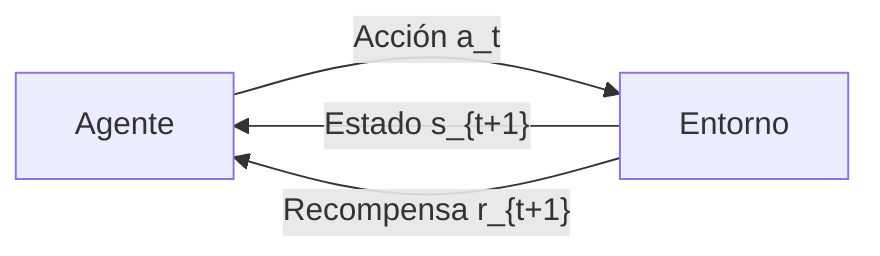

# Inteligencia Artificial - Aprendizaje automático

## 4.3 Aprendizaje reforzado.

---

El aprendizaje por refuerzo (Reinforcement Learning - RL) es un paradigma de aprendizaje automático donde un agente aprende a tomar decisiones mediante la interacción con un entorno. Según Sutton y Barto (2018), "el aprendizaje por refuerzo es aprender qué hacer—cómo mapear situaciones a acciones—para maximizar una recompensa numérica".

### Conceptos Fundamentales

#### Elementos Básicos del AR

- **Agente**: Entidad que toma decisiones y aprende
- **Entorno**: Mundo con el que interactúa el agente
- **Acción (a)**: Movimiento que realiza el agente
- **Estado (s)**: Situación actual del entorno
- **Recompensa (r)**: Feedback numérico del entorno
- **Política (π)**: Estrategia que sigue el agente para elegir acciones

#### Diagrama de Interacción Agente-Entorno



### Formalización Matemática

#### Proceso de Decisión Markoviano (MDP)

Un MDP se define por la tupla $(S, A, P, R, γ)$ donde:

- $S$: Conjunto de estados
- $A$: Conjunto de acciones
- $P$: Función de transición $P(s'|s, a)$
- $R$: Función de recompensa $R(s, a, s')$
- $γ$: Factor de descuento $0 ≤ γ ≤ 1$

#### Función de Valor

**Función de Valor de Estado** (bajo política π):

$$ V ^ π(s) = E\_π [∑\_{ k=0 } ^ ∞ γ ^ k r\_{ t + k + 1 } | s\_t = s] $$

**Función de Valor de Acción** (Q-función):

$$ Q ^ π ( s, a ) = E\_π[∑\_{ k=0 } ^ ∞ γ ^ k r\_{ t + k + 1 } | s\_t = s, a\_t = a] $$

#### Ecuación de Optimalidad de Bellman

Para la función valor óptima:

$$ V ^ * (s) = \max_a ∑\_{ s' } P( s'| s, a ) [ R(s, a, s') + γV ^ * (s')] $$

Para la Q-función óptima:

$$ Q ^ * (s, a) = ∑\_{ s' } P( s'|s, a ) [ R( s, a, s' ) + γ \max_{a'} Q ^ * (s', a') ] $$

### Algoritmos Principales

#### Q-Learning

Algoritmo de diferencia temporal fuera de política:

$$Q(s_t, a_t) ← Q(s_t, a_t) + α[r_{t+1} + γ \max_a Q(s_{t+1}, a) - Q(s_t, a_t)]$$

##### Implementación de Q-Learning

```python
import numpy as np
import gym

class QLearningAgent:
    def __init__(self, env, learning_rate=0.1, discount_factor=0.99,
                 exploration_rate=1.0, exploration_decay=0.995, min_exploration=0.01):
        self.env = env
        self.lr = learning_rate
        self.gamma = discount_factor
        self.epsilon = exploration_rate
        self.epsilon_decay = exploration_decay
        self.min_epsilon = min_exploration

        # Inicializar tabla Q
        self.n_actions = env.action_space.n
        self.n_states = env.observation_space.n
        self.Q = np.zeros((self.n_states, self.n_actions))

    def choose_action(self, state):
        """Epsilon-greedy policy"""
        if np.random.random() < self.epsilon:
            return self.env.action_space.sample()  # Exploración
        else:
            return np.argmax(self.Q[state, :])  # Explotación

    def update(self, state, action, reward, next_state, done):
        """Actualizar tabla Q"""
        if done:
            target = reward
        else:
            target = reward + self.gamma * np.max(self.Q[next_state, :])

        self.Q[state, action] += self.lr * (target - self.Q[state, action])

        # Decaimiento de epsilon
        if done:
            self.epsilon = max(self.min_epsilon, self.epsilon * self.epsilon_decay)

    def train(self, episodes=1000):
        """Entrenar el agente"""
        rewards = []

        for episode in range(episodes):
            state = self.env.reset()
            total_reward = 0
            done = False

            while not done:
                action = self.choose_action(state)
                next_state, reward, done, _ = self.env.step(action)
                self.update(state, action, reward, next_state, done)
                state = next_state
                total_reward += reward

            rewards.append(total_reward)

            if episode % 100 == 0:
                print(f"Episodio: {episode}, Recompensa: {total_reward}, Epsilon: {self.epsilon:.3f}")

        return rewards

# Ejemplo de uso con FrozenLake
env = gym.make('FrozenLake-v1', is_slippery=True)
agent = QLearningAgent(env)
rewards = agent.train(episodes=10000)
```

#### SARSA (State-Action-Reward-State-Action)

Algoritmo en política:

$$Q(s_t, a_t) ← Q(s_t, a_t) + α[r_{t+1} + γ Q(s_{t+1}, a_{t+1}) - Q(s_t, a_t)]$$

#### DQN (Deep Q-Network)

Extensión de Q-Learning con redes neuronales:

```python
import torch
import torch.nn as nn
import torch.optim as optim
import random
from collections import deque

class DQN(nn.Module):
    def __init__(self, state_size, action_size):
        super(DQN, self).__init__()
        self.fc1 = nn.Linear(state_size, 24)
        self.fc2 = nn.Linear(24, 24)
        self.fc3 = nn.Linear(24, action_size)
        self.relu = nn.ReLU()

    def forward(self, x):
        x = self.relu(self.fc1(x))
        x = self.relu(self.fc2(x))
        return self.fc3(x)

class ReplayBuffer:
    def __init__(self, capacity=10000):
        self.buffer = deque(maxlen=capacity)

    def add(self, state, action, reward, next_state, done):
        self.buffer.append((state, action, reward, next_state, done))

    def sample(self, batch_size):
        return random.sample(self.buffer, batch_size)

    def __len__(self):
        return len(self.buffer)

class DQNAgent:
    def __init__(self, state_size, action_size):
        self.state_size = state_size
        self.action_size = action_size
        self.memory = ReplayBuffer()
        self.gamma = 0.99
        self.epsilon = 1.0
        self.epsilon_min = 0.01
        self.epsilon_decay = 0.995
        self.batch_size = 64
        self.model = DQN(state_size, action_size)
        self.target_model = DQN(state_size, action_size)
        self.optimizer = optim.Adam(self.model.parameters(), lr=0.001)
        self.update_target_network()

    def update_target_network(self):
        self.target_model.load_state_dict(self.model.state_dict())

    def choose_action(self, state):
        if np.random.rand() <= self.epsilon:
            return random.randrange(self.action_size)
        state = torch.FloatTensor(state).unsqueeze(0)
        q_values = self.model(state)
        return torch.argmax(q_values).item()

    def remember(self, state, action, reward, next_state, done):
        self.memory.add(state, action, reward, next_state, done)

    def replay(self):
        if len(self.memory) < self.batch_size:
            return

        minibatch = self.memory.sample(self.batch_size)
        states, actions, rewards, next_states, dones = zip(*minibatch)

        states = torch.FloatTensor(states)
        actions = torch.LongTensor(actions)
        rewards = torch.FloatTensor(rewards)
        next_states = torch.FloatTensor(next_states)
        dones = torch.BoolTensor(dones)

        current_q = self.model(states).gather(1, actions.unsqueeze(1))
        next_q = self.target_model(next_states).max(1)[0].detach()
        target_q = rewards + (self.gamma * next_q * ~dones)

        loss = nn.MSELoss()(current_q.squeeze(), target_q)

        self.optimizer.zero_grad()
        loss.backward()
        self.optimizer.step()

        if self.epsilon > self.epsilon_min:
            self.epsilon *= self.epsilon_decay
```

### Policy Gradient Methods

#### REINFORCE Algorithm

$$ ∇\_θ J(θ) ≈ ∑\_{ t=0 } ^ {T-1} ∇\_θ \log π\_θ (a\_t|s\_t ) G\_t $$

donde $ G\_t = ∑\_{ k=t } ^ T γ ^ {k-t} r\_{k + 1} $ es el retorno descontado.

#### Actor-Critic Methods

Combinan value-based y policy-based methods:

```python
class ActorCritic(nn.Module):
    def __init__(self, state_size, action_size):
        super(ActorCritic, self).__init__()
        self.fc1 = nn.Linear(state_size, 128)
        self.actor = nn.Linear(128, action_size)
        self.critic = nn.Linear(128, 1)
        self.dropout = nn.Dropout(p=0.6)

    def forward(self, x):
        x = torch.relu(self.fc1(x))
        x = self.dropout(x)
        policy = F.softmax(self.actor(x), dim=-1)
        value = self.critic(x)
        return policy, value
```

### Aplicaciones Prácticas

#### Ejemplo: CartPole Problem

```python
def train_cartpole():
    env = gym.make('CartPole-v1')
    state_size = env.observation_space.shape[0]
    action_size = env.action_space.n

    agent = DQNAgent(state_size, action_size)
    episodes = 1000
    scores = []

    for e in range(episodes):
        state = env.reset()
        state = np.reshape(state, [1, state_size])
        score = 0

        for time in range(500):
            action = agent.choose_action(state)
            next_state, reward, done, _ = env.step(action)
            next_state = np.reshape(next_state, [1, state_size])
            agent.remember(state, action, reward, next_state, done)
            state = next_state
            agent.replay()
            score += reward
            if done:
                break

        scores.append(score)
        if e % 50 == 0:
            print(f"Episodio: {e}, Puntuación: {score}, Epsilon: {agent.epsilon:.3f}")

    return scores
```

### Ejercicios Propuestos

1. **Implementación de Q-Learning**:
   - Implementa Q-Learning para el entorno FrozenLake de OpenAI Gym.
   - Experimenta con diferentes valores de γ y α.
   - Visualiza la política aprendida.

2. **Análisis de Convergencia**:
   - Demuestra matemáticamente por qué Q-Learning converge al óptimo.
   - Compara la velocidad de convergencia con SARSA.

3. **DQN para Atari**:
   - Adapta el código DQN para jugar Pong o Breakout.
   - Implementa experience replay y target network.
   - Experimenta con diferentes arquitecturas de red.

4. **Policy Gradient**:
   - Implementa REINFORCE para CartPole.
   - Compara el rendimiento con métodos value-based.
   - Analiza la varianza de las estimaciones del gradiente.

5. **Proyecto Final**:
   - Diseña un agente que aprenda a jugar un juego simple.
   - Implementa múltiples algoritmos y compara su rendimiento.
   - Evalúa la transferencia de aprendizaje entre entornos similares.

### Referencias

#### Bibliografía Básica

1. Russell, S., & Norvig, P. (2009). Artificial Intelligence: A Modern Approach (3rd ed.). Prentice Hall. (Capítulo 21)
2. Marsland, S. (2009). Machine Learning: An Algorithmic Perspective. Chapman and Hall. (Capítulo 14)

#### Bibliografía Complementaria

1. Sutton, R. S., & Barto, A. G. (2018). Reinforcement Learning: An Introduction (2nd ed.). MIT Press.
2. Szepesvári, C. (2010). Algorithms for Reinforcement Learning. Morgan & Claypool.
3. Alpaydin, E. (2010). Introduction to Machine Learning (2nd ed.). The MIT Press. (Capítulo 18)

#### Recursos Adicionales

- [OpenAI Gym](https://gym.openai.com/) - Entornos para testing
- [Stable Baselines3](https://stable-baselines3.readthedocs.io/) - Implementaciones de RL
- [Spinning Up](https://spinningup.openai.com/) - Recursos educativos de OpenAI

### Consejos para el Estudio

1. **Comienza con lo Básico**: Entiende bien los MDPs antes de pasar a algoritmos complejos.

2. **Implementa desde Cero**: Escribe tus propias implementaciones de Q-Learning y Policy Gradient.

3. **Visualiza el Aprendizaje**: Usa herramientas como TensorBoard para monitorizar el entrenamiento.

4. **Experimenta con Hiperparámetros**: Aprende cómo γ, α y ε afectan el aprendizaje.

5. **Lee Papers Fundamentales**: Estudia los papers originales de DQN, A3C, PPO, etc.

6. **Únete a la Comunidad**: Participa en foros como Reddit's r/reinforcementlearning.

El aprendizaje por refuerzo es un campo en rápido crecimiento con aplicaciones fascinantes en robótica, juegos, y sistemas de recomendación. ¡Disfruta del proceso de aprendizaje!
