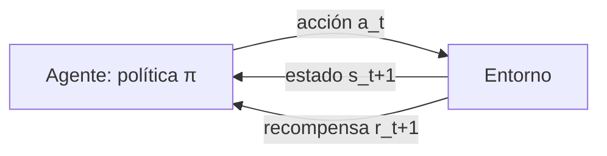

# Inteligencia Artificial - Aprendizaje automático

## 4.3 Aprendizaje reforzado.

---

En el aprendizaje supervisado alguien dice cuál era la respuesta correcta; en el **aprendizaje por refuerzo** (RL) nadie lo dice. Un agente actúa en un entorno, recibe **recompensas** numéricas, a menudo retrasadas, y debe descubrir por ensayo y error qué acciones maximizan la recompensa acumulada. Sutton y Barto (2018) lo definen como aprender qué hacer, cómo asociar situaciones con acciones, para maximizar una señal numérica de recompensa. Es el enfoque detrás de los programas que dominan el Go y los videojuegos de Atari, del control de robots y del ajuste de los modelos de lenguaje con retroalimentación humana. Este tema presenta los procesos de decisión de Markov, las ecuaciones de Bellman, la programación dinámica, el aprendizaje por diferencias temporales con Q-learning y SARSA, la aproximación de funciones con DQN y los métodos de gradiente de política.

### Procesos de decisión de Markov

El entorno se modela como un **proceso de decisión de Markov** (MDP), una tupla $(S, A, P, R, \gamma):$ estados $S,$ acciones $A,$ probabilidades de transición $P(s' \mid s, a),$ recompensas $R(s, a, s')$ y un **factor de descuento** $0 \le \gamma \lt 1$ en tareas continuas, o $\gamma \le 1$ en tareas que terminan. La propiedad de Markov dice que el siguiente estado depende solo del actual y de la acción. Una **política** $\pi(a \mid s)$ da la probabilidad de cada acción en cada estado, y el objetivo es maximizar el **retorno** esperado

$$G_t = \sum_{k=0}^{\infty} \gamma^k\,r_{t+k+1}$$

El descuento hace finita la suma y expresa preferencia por las recompensas cercanas; con $\gamma$ cerca de 0 el agente es miope, y cerca de 1, previsor.

### Funciones de valor y ecuaciones de Bellman

El **valor** de un estado bajo $\pi$ es $V^\pi(s) = \mathbb{E}_\pi[G_t \mid s_t = s],$ y el de un par estado-acción, $Q^\pi(s, a) = \mathbb{E}_\pi[G_t \mid s_t = s, a_t = a].$ Separando la primera recompensa del resto se obtienen las **ecuaciones de Bellman**; para los valores óptimos,

$$V^*(s) = \max_a \sum_{s'} P(s' \mid s, a)\,\big[R(s, a, s') + \gamma\,V^*(s')\big]$$

$$Q^*(s, a) = \sum_{s'} P(s' \mid s, a)\,\big[R(s, a, s') + \gamma \max_{a'} Q^*(s', a')\big]$$

y la política **codiciosa** respecto de $Q^*,$ $\pi^*(s) = \arg\max_a Q^*(s, a),$ es óptima. Si el modelo es conocido, la **iteración de valor** aplica repetidamente el lado derecho como una actualización.

**Teorema.** El operador de Bellman óptimo $(\mathcal{T}Q)(s, a) = \sum_{s'} P(s' \mid s, a)\,[R + \gamma \max_{a'} Q(s', a')]$ es una contracción de razón $\gamma$ en la norma del máximo. Para dos funciones $Q_1$ y $Q_2,$ usando $|\max_a f(a) - \max_a g(a)| \le \max_a |f(a) - g(a)|,$

$$|(\mathcal{T}Q_1)(s, a) - (\mathcal{T}Q_2)(s, a)| \le \gamma \sum_{s'} P(s' \mid s, a) \max_{a'} |Q_1(s', a') - Q_2(s', a')| \le \gamma\,\|Q_1 - Q_2\|_\infty$$

Por el teorema de punto fijo de Banach, $\mathcal{T}$ tiene un único punto fijo, $Q^*,$ y la iteración de valor converge a él geométricamente, con error $O(\gamma^k)$ tras $k$ iteraciones. $\blacksquare$

### Diferencias temporales: Q-learning y SARSA

Sin modelo, el agente estima los valores a partir de su propia experiencia. Tras cada transición $(s, a, r, s'),$ **Q-learning** (Watkins, 1989) mueve $Q(s, a)$ hacia un objetivo de un paso:

$$Q(s, a) \leftarrow Q(s, a) + \alpha\,\big[r + \gamma \max_{a'} Q(s', a') - Q(s, a)\big]$$

Es **fuera de política**: aprende los valores de la política codiciosa aunque el agente explore. **SARSA** usa en el objetivo la acción $a'$ que de verdad tomará, $r + \gamma\,Q(s', a'),$ y es **en política**: aprende el valor de la política con la que se comporta, exploración incluida. Ambos necesitan **explorar**; lo usual es la política **ε-codiciosa**, que elige una acción al azar con probabilidad $\varepsilon,$ decreciente con el tiempo.

**Convergencia de Q-learning** (Watkins y Dayan, 1992). Con estados y acciones finitos, si cada par $(s, a)$ se visita infinitas veces y las tasas de aprendizaje cumplen $\sum_t \alpha_t = \infty$ y $\sum_t \alpha_t^2 \lt \infty,$ $Q$ converge a $Q^*$ con probabilidad 1. La idea: la actualización es una versión estocástica de la contracción $\mathcal{T},$ cuyo objetivo muestreado tiene esperanza $(\mathcal{T}Q)(s, a);$ la teoría de la aproximación estocástica de Robbins y Monro asegura que el ruido se promedia con esas tasas, y la contracción lleva al único punto fijo. SARSA converge a $Q^*$ si además la exploración se desvanece, de modo que la política se vuelve codiciosa en el límite.

### Aproximación de funciones: DQN

Con millones de estados, como las imágenes de un videojuego, la tabla es imposible y $Q$ se aproxima con una red neuronal $Q(s, a; \theta).$ Hacerlo ingenuamente es inestable, porque los datos consecutivos están correlacionados y el objetivo cambia con los mismos parámetros que se ajustan. **DQN** (Mnih y otros, 2015) lo estabiliza con dos ideas:

- **repetición de experiencias:** las transiciones se guardan en una memoria y se entrena con minilotes elegidos al azar, lo que rompe la correlación y reutiliza los datos;
- **red objetivo:** el objetivo $r + \gamma \max_{a'} Q(s', a'; \theta^-)$ se calcula con una copia $\theta^-$ que se actualiza solo cada cierto número de pasos.

Para Atari, la red recibe los últimos 4 cuadros en escala de grises de 84x84, con tres capas convolucionales y dos densas, y se entrena con unos 50 millones de cuadros por juego.

### Gradiente de política

En lugar de aprender valores, se puede parametrizar directamente la política $\pi_\theta(a \mid s)$ y ascender por el gradiente del retorno esperado $J(\theta).$ El **teorema del gradiente de política** da

$$\nabla_\theta J(\theta) = \mathbb{E}_\pi\Big[\sum_{t} \nabla_\theta \log \pi_\theta(a_t \mid s_t)\,\big(G_t - b(s_t)\big)\Big]$$

con cualquier **línea base** $b(s_t)$ que no dependa de la acción, porque $\mathbb{E}_{a \sim \pi}[\nabla_\theta \log \pi_\theta(a \mid s)] = \nabla_\theta \sum_a \pi_\theta(a \mid s) = \nabla_\theta 1 = 0.$ **REINFORCE** (Williams, 1992) estima el gradiente con episodios completos. Es insesgado pero de varianza alta; la línea base, por ejemplo una estimación de $V(s_t),$ la reduce sin introducir sesgo. Los métodos **actor-crítico** aprenden esa estimación al mismo tiempo, y los modernos, como PPO, limitan el tamaño de cada cambio de política. Los métodos de política manejan acciones continuas y políticas estocásticas con naturalidad.



### Implementación en Python

El programa implementa los entornos sin bibliotecas de RL: el FrozenLake de 4x4 resbaladizo, con las mismas dinámicas que Gymnasium; el acantilado de Sutton y Barto, y CartPole con sus ecuaciones de movimiento. Para el ejercicio 1, compara Q-learning con distintos $\alpha$ y $\gamma$ contra la política óptima de la iteración de valor, midiendo la probabilidad exacta de éxito de cada política. Para el ejercicio 2, mide la distancia a $Q^*$ y compara Q-learning y SARSA en el acantilado. Implementa DQN con una red neuronal en NumPy, con y sin red objetivo, para el ejercicio 3; REINFORCE con política lineal, con y sin línea base, para el ejercicio 4, y un experimento de transferencia entre dos lagos para el ejercicio 5. Tarda alrededor de un minuto.

```python
import math
import random
import numpy as np

# ---------- FrozenLake 4x4 resbaladizo, como en Gymnasium ----------
MAPA = ["SFFF", "FHFH", "FFFH", "HFFG"]
N = 4; IZQ, ABA, DER, ARR = 0, 1, 2, 3; FLECHA = "←↓→↑"
def mueve(s, a, n=N):
    f, c = divmod(s, n)
    if a == IZQ: c = max(c - 1, 0)
    elif a == ABA: f = min(f + 1, n - 1)
    elif a == DER: c = min(c + 1, n - 1)
    else: f = max(f - 1, 0)
    return f * n + c
def modelo(mapa):                                       # P[s][a] = [(prob, s', recompensa, terminal)]
    n = len(mapa); celdas = "".join(mapa); P = {}
    for s in range(n * n):
        P[s] = {}
        for a in range(4):
            if celdas[s] in "HG": P[s][a] = [(1.0, s, 0.0, True)]; continue
            P[s][a] = []
            for b in ((a - 1) % 4, a, (a + 1) % 4):     # la dirección deseada y las dos perpendiculares, 1/3 cada una
                t = mueve(s, b, n); P[s][a].append((1 / 3, t, float(celdas[t] == "G"), celdas[t] in "HG"))
    return P
def iteracion_valor(P, gamma, tol=1e-10):
    V = np.zeros(len(P))
    while True:
        Q = np.array([[sum(p * (r + gamma * V[t] * (not d)) for p, t, r, d in P[s][a]) for a in range(4)] for s in P])
        if np.max(np.abs(Q.max(1) - V)) < tol: return Q
        V = Q.max(1)
def exito(P, politica, gamma=1.0):                       # probabilidad exacta de llegar a la meta con una política fija
    n = len(P); A = np.eye(n); b = np.zeros(n)
    for s in P:
        for p, t, r, d in P[s][politica[s]]:
            b[s] += p * r
            if not d: A[s, t] -= gamma * p
    return np.linalg.solve(A, b)[0]
def aprende(P, metodo, alfa, gamma, episodios, semilla, eps0=1.0, eps_min=0.01, Q0=None):
    rng = random.Random(semilla); Q = [[0.0] * 4 for _ in P] if Q0 is None else [list(f) for f in Q0]
    def elige(s, e):
        if rng.random() < e: return rng.randrange(4)
        m = max(Q[s]); return rng.choice([a for a in range(4) if Q[s][a] == m])     # desempate al azar
    for ep in range(episodios):
        e = max(eps_min, eps0 * (1 - ep / (0.8 * episodios))); s = 0; a = elige(s, e); fin = False
        while not fin:
            _, t, r, fin = P[s][a][rng.randrange(3)]                                # las 3 salidas son equiprobables
            b = elige(t, e)
            if metodo == "Q": objetivo = r + gamma * max(Q[t]) * (not fin)
            else: objetivo = r + gamma * Q[t][b] * (not fin)                         # SARSA: la acción que de verdad se tomará
            Q[s][a] += alfa * (objetivo - Q[s][a]); s, a = t, b
    return np.array(Q)
P = modelo(MAPA)
for gamma in (0.9, 0.99):
    Qs = iteracion_valor(P, gamma); print(f"ejercicio 1: γ = {gamma}: óptimo por iteración de valor: P(éxito) = {exito(P, Qs.argmax(1)):.3f}")
    for alfa in (0.01, 0.1, 0.5):
        r = [exito(P, aprende(P, "Q", alfa, gamma, 10000, s).argmax(1)) for s in range(5)]
        print(f"   Q-learning α = {alfa:4}: P(éxito) de la política aprendida, 5 semillas: media {np.mean(r):.3f}, mínimo {min(r):.3f}")
Qs = iteracion_valor(P, 0.99); pol = aprende(P, "Q", 0.1, 0.99, 10000, 0).argmax(1)
print("   política aprendida (α = 0.1, γ = 0.99) y óptima:")
for f in range(N):
    fila = lambda p: "".join(MAPA[f][c] if MAPA[f][c] in "HG" else FLECHA[p[f * N + c]] for c in range(N))
    print(f"      {fila(pol)}    {fila(Qs.argmax(1))}")

# ---------- Ejercicio 2: convergencia y Q-learning frente a SARSA ----------
Qs = iteracion_valor(P, 0.95)
for metodo in ("Q", "SARSA"):
    err = [np.max(np.abs(aprende(P, metodo, 0.05, 0.95, n, 0, eps0=1.0, eps_min=1.0) - Qs)) for n in (1000, 5000, 20000)]
    print(f"ejercicio 2: {metodo:5} con exploración uniforme: ‖Q − Q*‖∞ tras 1 000, 5 000 y 20 000 episodios: " + ", ".join(f"{e:.3f}" for e in err))
FC, CC = 4, 12                                         # el acantilado de Sutton y Barto, 4x12
def acantilado(metodo, semilla, episodios=500, alfa=0.5, eps=0.1):
    rng = np.random.default_rng(semilla); Q = np.zeros((FC * CC, 4)); sumas = []
    elige = lambda s: int(rng.integers(4)) if rng.random() < eps else int(rng.choice(np.flatnonzero(Q[s] == Q[s].max())))
    for _ in range(episodios):
        s = (FC - 1) * CC; a = elige(s); total = 0
        while True:
            f, c = divmod(s, CC); df, dc = [(0, -1), (1, 0), (0, 1), (-1, 0)][a]
            f, c = min(max(f + df, 0), FC - 1), min(max(c + dc, 0), CC - 1); t = f * CC + c; r = -1
            if f == FC - 1 and 0 < c < CC - 1: r, t = -100, (FC - 1) * CC     # cae y vuelve al inicio
            fin = t == FC * CC - 1; b = elige(t); total += r
            obj = r + (0 if fin else (Q[t].max() if metodo == "Q" else Q[t, b]))
            Q[s, a] += alfa * (obj - Q[s, a]); s, a = t, b
            if fin: break
        sumas.append(total)
    return np.mean(sumas[-100:]), Q
for metodo in ("Q", "SARSA"):
    res = [acantilado(metodo, s) for s in range(10)]
    Q = res[0][1]; s, pasos, camino = (FC - 1) * CC, 0, set()
    while s != FC * CC - 1 and pasos < 50:
        a = int(Q[s].argmax()); f, c = divmod(s, CC); df, dc = [(0, -1), (1, 0), (0, 1), (-1, 0)][a]
        s = min(max(f + df, 0), FC - 1) * CC + min(max(c + dc, 0), CC - 1); pasos += 1; camino.add(s // CC)
    print(f"ejercicio 2: acantilado, {metodo:5}: recompensa media por episodio (últimos 100, 10 semillas) {np.mean([r for r, _ in res]):7.2f}; "
          f"camino codicioso de {pasos} pasos por las filas {sorted(camino)}")

# ---------- CartPole, con las ecuaciones de Gymnasium ----------
class CartPole:
    def __init__(self, rng): self.rng = rng
    def reinicia(self): self.s = self.rng.uniform(-0.05, 0.05, 4); self.t = 0; return self.s.copy()
    def paso(self, a):
        x, v, th, w = self.s; F = 10.0 if a == 1 else -10.0; c, s = math.cos(th), math.sin(th)
        tmp = (F + 0.05 * w * w * s) / 1.1
        alfa = (9.8 * s - c * tmp) / (0.5 * (4 / 3 - 0.1 * c * c / 1.1)); acc = tmp - 0.05 * alfa * c / 1.1
        self.s = np.array([x + 0.02 * v, v + 0.02 * acc, th + 0.02 * w, w + 0.02 * alfa]); self.t += 1
        cae = abs(self.s[0]) > 2.4 or abs(self.s[2]) > 12 * 2 * math.pi / 360
        return self.s.copy(), 1.0, cae, self.t >= 500   # recompensa, terminal, truncado

# ---------- Ejercicio 3: DQN con repetición de experiencias y red objetivo ----------
class Red:
    def __init__(self, tamaños, rng):
        self.W = [rng.normal(0, math.sqrt(2 / a), (a, b)) for a, b in zip(tamaños, tamaños[1:])]; self.b = [np.zeros(b) for b in tamaños[1:]]
        self.m = [np.zeros_like(p) for p in self.W + self.b]; self.v = [np.zeros_like(p) for p in self.W + self.b]; self.k = 0
    def adelante(self, X):
        self.h = [X]
        for i, (W, b) in enumerate(zip(self.W, self.b)):
            X = X @ W + b; X = np.maximum(X, 0) if i < len(self.W) - 1 else X; self.h.append(X)
        return X
    def atras(self, g, lr=1e-3):                       # g = ∂pérdida/∂salida; Adam
        grads = []
        for i in range(len(self.W) - 1, -1, -1):
            grads = [(self.h[i].T @ g, g.sum(0))] + grads; g = g @ self.W[i].T
            if i > 0: g = g * (self.h[i] > 0)
        self.k += 1; ps = self.W + self.b; gs = [a for a, _ in grads] + [b for _, b in grads]
        for j, (p, gr) in enumerate(zip(ps, gs)):
            self.m[j] = 0.9 * self.m[j] + 0.1 * gr; self.v[j] = 0.999 * self.v[j] + 0.001 * gr * gr
            p -= lr * (self.m[j] / (1 - 0.9 ** self.k)) / (np.sqrt(self.v[j] / (1 - 0.999 ** self.k)) + 1e-8)
    def copia(self, otra): self.W = [w.copy() for w in otra.W]; self.b = [b.copy() for b in otra.b]
def dqn(semilla, red_objetivo=True, pasos=30000, gamma=0.99, lr=5e-4, cada=1000):
    rng = np.random.default_rng(semilla); env = CartPole(rng); q = Red([4, 64, 64, 2], rng); obj = Red([4, 64, 64, 2], rng); obj.copia(q)
    memoria = np.zeros((10000, 11)); n_mem = 0; s = env.reinicia(); ret, rets = 0, []
    for t in range(pasos):
        eps = max(0.05, 1 - t / 10000)
        a = int(rng.integers(2)) if rng.random() < eps else int(q.adelante(s[None])[0].argmax())
        s2, r, cae, trunca = env.paso(a); ret += r
        memoria[n_mem % 10000] = np.r_[s, a, r, s2, cae]; n_mem += 1
        s = s2
        if cae or trunca: rets.append(ret); ret = 0; s = env.reinicia()
        if n_mem >= 1000:
            B = memoria[rng.integers(min(n_mem, 10000), size=64)]
            S, A, R, S2, D = B[:, :4], B[:, 4].astype(int), B[:, 5], B[:, 6:10], B[:, 10]
            sig = (obj if red_objetivo else q).adelante(S2).max(1)
            y = R + gamma * sig * (1 - D)
            pred = q.adelante(S); g = np.zeros_like(pred); e = pred[np.arange(64), A] - y
            g[np.arange(64), A] = np.clip(e, -1, 1) / 64                # gradiente de la pérdida de Huber
            q.atras(g, lr)
            if red_objetivo and t % cada == 0: obj.copia(q)
    eval_env = CartPole(np.random.default_rng(100)); largos = []
    for _ in range(10):
        s = eval_env.reinicia(); fin = False
        while not fin:
            s, _, cae, trunca = eval_env.paso(int(q.adelante(s[None])[0].argmax())); fin = cae or trunca
        largos.append(eval_env.t)
    return np.mean(rets[-20:]), np.mean(largos)
for objetivo in (True, False):
    r = [dqn(s, objetivo) for s in range(2)]
    print(f"ejercicio 3: DQN {'con' if objetivo else 'sin'} red objetivo: últimos 20 episodios de entrenamiento " +
          ", ".join(f"{a:.0f}" for a, _ in r) + " | evaluación codiciosa " + ", ".join(f"{b:.0f}" for _, b in r) + " pasos (máximo 500)")

# ---------- Ejercicio 4: REINFORCE con política lineal, con y sin línea base ----------
def episodio(theta, env, rng):                          # política logística: P(empujar a la derecha) = σ(θ·s)
    s = env.reinicia(); X, A, fin = [], [], False
    while not fin:
        p1 = 1 / (1 + math.exp(-np.clip(theta @ s, -30, 30))); a = int(rng.random() < p1)
        X.append(s); A.append(a); s, _, cae, trunca = env.paso(a); fin = cae or trunca
    return np.array(X), np.array(A)
def retornos(T, gamma=0.99): return (1 - gamma ** (T - np.arange(T))) / (1 - gamma)    # G_t con recompensa 1 por paso
def gradiente(theta, lote, con_base):
    Ts = [len(A) for _, A in lote]; Tm = max(Ts); G = np.zeros((len(lote), Tm)); vivos = np.zeros(Tm)
    for i, T in enumerate(Ts): G[i, :T] = retornos(T); vivos[:T] += 1
    b = G.sum(0) / vivos if con_base else np.zeros(Tm)       # línea base: retorno medio del lote en el paso t
    g = []
    for (X, A), T in zip(lote, Ts):
        p1 = 1 / (1 + np.exp(-np.clip(X @ theta, -30, 30)))
        g.append(((A - p1)[:, None] * X * (G[len(g), :T] - b[:T])[:, None]).sum(0))     # ∇ log π(a|s) = (a − p) s
    return np.array(g)
def reinforce(semilla, con_base, iteraciones=60, lote=10, lr=0.05):
    rng = np.random.default_rng(semilla); env = CartPole(rng); theta = np.zeros(4); largos = []
    for _ in range(iteraciones):
        L = [episodio(theta, env, rng) for _ in range(lote)]; largos += [len(A) for _, A in L]
        theta = theta + lr * gradiente(theta, L, con_base).mean(0)
    return largos
for con_base in (False, True):
    res = [reinforce(s, con_base) for s in range(4)]
    print(f"ejercicio 4: REINFORCE {'con' if con_base else 'sin'} línea base: duración media de los últimos 50 episodios, 4 semillas: " +
          ", ".join(f"{np.mean(l[-50:]):.0f}" for l in res))
rng = np.random.default_rng(7); env = CartPole(rng); theta = np.array([0.0, 0.2, 1.0, 0.2])
L = [episodio(theta, env, rng) for _ in range(300)]
for con_base in (False, True):
    g = gradiente(theta, L, con_base)
    print(f"   en θ = {theta.tolist()}: varianza total del gradiente por episodio {'con' if con_base else 'sin'} línea base {g.var(0).sum():9.1f}, "
          f"gradiente medio {np.round(g.mean(0), 1).tolist()}")

# ---------- Ejercicio 5: transferencia entre dos lagos parecidos ----------
MAPA_B = ["SFFF", "FHFF", "FFHF", "HFFG"]              # dos hoyos cambian de lugar
PB = modelo(MAPA_B); optB = exito(PB, iteracion_valor(PB, 0.99).argmax(1))
QA = aprende(P, "Q", 0.1, 0.99, 10000, 0)
print(f"ejercicio 5: lago B, óptimo P(éxito) = {optB:.3f}")
for n in (200, 500, 1000, 2000):
    cero = np.mean([exito(PB, aprende(PB, "Q", 0.1, 0.99, n, s).argmax(1)) for s in range(5)])
    t1 = np.mean([exito(PB, aprende(PB, "Q", 0.1, 0.99, n, s, Q0=QA).argmax(1)) for s in range(5)])
    t3 = np.mean([exito(PB, aprende(PB, "Q", 0.1, 0.99, n, s, eps0=0.3, Q0=QA).argmax(1)) for s in range(5)])
    print(f"   {n:4} episodios en B: desde cero {cero:.3f} | con la Q del lago A: ε inicial 1.0 {t1:.3f}, ε inicial 0.3 {t3:.3f}")
```

Salida:

```text
ejercicio 1: γ = 0.9: óptimo por iteración de valor: P(éxito) = 0.780
   Q-learning α = 0.01: P(éxito) de la política aprendida, 5 semillas: media 0.237, mínimo 0.110
   Q-learning α =  0.1: P(éxito) de la política aprendida, 5 semillas: media 0.643, mínimo 0.523
   Q-learning α =  0.5: P(éxito) de la política aprendida, 5 semillas: media 0.576, mínimo 0.336
ejercicio 1: γ = 0.99: óptimo por iteración de valor: P(éxito) = 0.824
   Q-learning α = 0.01: P(éxito) de la política aprendida, 5 semillas: media 0.168, mínimo 0.114
   Q-learning α =  0.1: P(éxito) de la política aprendida, 5 semillas: media 0.824, mínimo 0.824
   Q-learning α =  0.5: P(éxito) de la política aprendida, 5 semillas: media 0.715, mínimo 0.523
   política aprendida (α = 0.1, γ = 0.99) y óptima:
      ←↑↑↑    ←↑↑↑
      ←H←H    ←H←H
      ↑↓←H    ↑↓←H
      H→↓G    H→↓G
ejercicio 2: Q     con exploración uniforme: ‖Q − Q*‖∞ tras 1 000, 5 000 y 20 000 episodios: 0.611, 0.250, 0.094
ejercicio 2: SARSA con exploración uniforme: ‖Q − Q*‖∞ tras 1 000, 5 000 y 20 000 episodios: 0.634, 0.389, 0.333
ejercicio 2: acantilado, Q    : recompensa media por episodio (últimos 100, 10 semillas)  -52.96; camino codicioso de 13 pasos por las filas [2, 3]
ejercicio 2: acantilado, SARSA: recompensa media por episodio (últimos 100, 10 semillas)  -28.83; camino codicioso de 17 pasos por las filas [0, 1, 2, 3]
ejercicio 3: DQN con red objetivo: últimos 20 episodios de entrenamiento 118, 225 | evaluación codiciosa 113, 133 pasos (máximo 500)
ejercicio 3: DQN sin red objetivo: últimos 20 episodios de entrenamiento 9, 10 | evaluación codiciosa 9, 9 pasos (máximo 500)
ejercicio 4: REINFORCE sin línea base: duración media de los últimos 50 episodios, 4 semillas: 497, 433, 215, 118
ejercicio 4: REINFORCE con línea base: duración media de los últimos 50 episodios, 4 semillas: 449, 500, 302, 500
   en θ = [0.0, 0.2, 1.0, 0.2]: varianza total del gradiente por episodio sin línea base    1280.7, gradiente medio [-0.9, -7.5, 1.5, 12.8]
   en θ = [0.0, 0.2, 1.0, 0.2]: varianza total del gradiente por episodio con línea base     635.6, gradiente medio [-0.9, -7.6, 1.5, 13.3]
ejercicio 5: lago B, óptimo P(éxito) = 1.000
    200 episodios en B: desde cero 0.260 | con la Q del lago A: ε inicial 1.0 0.125, ε inicial 0.3 0.144
    500 episodios en B: desde cero 0.634 | con la Q del lago A: ε inicial 1.0 0.575, ε inicial 0.3 0.348
   1000 episodios en B: desde cero 1.000 | con la Q del lago A: ε inicial 1.0 1.000, ε inicial 0.3 0.820
   2000 episodios en B: desde cero 1.000 | con la Q del lago A: ε inicial 1.0 1.000, ε inicial 0.3 1.000
```

### Ejercicios Propuestos

1. **Q-learning.** Implementa Q-learning para el entorno FrozenLake, experimenta con distintos valores de $\gamma$ y $\alpha,$ y visualiza la política aprendida.

2. **Convergencia.** Explica por qué Q-learning converge al óptimo y compara su velocidad de convergencia con la de SARSA.

3. **DQN.** Adapta DQN a un juego como Pong o Breakout, con repetición de experiencias y red objetivo, y experimenta con distintas arquitecturas de red.

4. **Gradiente de política.** Implementa REINFORCE para CartPole, compara su rendimiento con los métodos basados en valores y analiza la varianza de las estimaciones del gradiente.

5. **Proyecto.** Diseña un agente que aprenda a jugar un juego simple, implementa varios algoritmos, compara su rendimiento y evalúa la transferencia del aprendizaje entre entornos parecidos.

### Soluciones

**Ejercicio 1.** En el FrozenLake resbaladizo, el agente se mueve en la dirección elegida solo un tercio de las veces, y la política óptima, con $\gamma = 0.99,$ llega a la meta con probabilidad 0.824. Su forma es contraintuitiva: en la casilla inicial va a la izquierda, contra la pared, porque así nunca resbala hacia un hoyo, y deja que las perpendiculares lo lleven hacia abajo. Q-learning con $\alpha = 0.1,$ $\gamma = 0.99$ y 10 000 episodios aprende exactamente esa política en las 5 semillas, como muestra el dibujo. Con $\alpha = 0.01$ aprende demasiado lento y queda en 0.17; con $\alpha = 0.5,$ las estimaciones siguen el ruido de cada transición y la política resultante varía entre semillas, entre 0.52 y 0.82. Con $\gamma = 0.9$ la política óptima es más miope, 0.780, y Q-learning la aprende peor, 0.64 de media: las recompensas descontadas de caminos largos son tan pequeñas que el ruido domina las diferencias entre acciones.

**Ejercicio 2.** La convergencia de Q-learning se demuestra arriba: su objetivo es una muestra del operador de Bellman óptimo, una contracción, y con tasas que cumplen las condiciones de Robbins y Monro y exploración de todos los pares, la iteración estocástica converge a $Q^*.$ En el programa, con exploración uniforme, Q-learning reduce $\|Q - Q^*\|_\infty$ de 0.61 a 0.09 entre 1 000 y 20 000 episodios. SARSA se estanca en 0.33, y no por lentitud: con exploración uniforme permanente, SARSA aprende el valor de la política **aleatoria** con la que se comporta, no el de la óptima. Por eso necesita que $\varepsilon$ decrezca. La diferencia se ve también en el acantilado: Q-learning aprende el camino óptimo de 13 pasos, pegado al borde, pero mientras explora con $\varepsilon = 0.1$ se cae a menudo, y obtiene −53 por episodio; SARSA aprende un camino más seguro de 17 pasos, por la fila de arriba, y obtiene −29, porque tiene en cuenta su propia exploración. Q-learning aprende la mejor política; SARSA se comporta mejor mientras aprende.

**Ejercicio 3.** Pong y Breakout requieren el emulador de Atari y decenas de millones de cuadros de entrenamiento, del orden de días en una GPU, así que el programa implementa los mismos componentes de DQN en CartPole: una red de 4 entradas, dos capas ocultas de 64 unidades y 2 salidas, entrenada con Adam y pérdida de Huber, con memoria de 10 000 transiciones, minilotes de 64 y red objetivo actualizada cada 1 000 pasos. Con 30 000 pasos, la política codiciosa resultante sostiene el péndulo 113 y 133 pasos en dos semillas, frente a unos 22 de una política aleatoria. Sin red objetivo, el entrenamiento diverge: los valores crecen sin control y la red termina empujando siempre hacia el mismo lado, 9 pasos. Es la inestabilidad que motivó la red objetivo. DQN es sensible a sus hiperparámetros y en CartPole necesita del orden de $10^5$ pasos para llegar de forma confiable a 500. Para Atari, la arquitectura de Mnih y otros es: 32 filtros de 8x8 con paso 4, 64 de 4x4 con paso 2, 64 de 3x3 con paso 1, una capa densa de 512 y una salida por acción; las variantes posteriores, como Double DQN, la red *dueling* y la repetición priorizada, mejoran mucho la estabilidad.

**Ejercicio 4.** REINFORCE con una política logística lineal, $P(\text{derecha}) = \sigma(\theta^\top s),$ y lotes de 10 episodios, aprende CartPole en 600 episodios: con línea base, dos de cuatro semillas llegan al máximo de 500 pasos y las otras a 449 y 302; sin línea base, los resultados son más dispersos, entre 118 y 497. Con los parámetros fijos, la línea base, el retorno medio del lote en cada paso, reduce la varianza total del estimador del gradiente a la mitad, de 1 281 a 636, sin cambiar su media, que es el gradiente verdadero. Frente a DQN, el gradiente de política fue aquí más eficiente y estable, porque la política óptima de CartPole es casi lineal en el estado y basta con 4 parámetros; DQN debe aprender una función de valor completa con miles. En problemas donde la política es compleja pero los valores son simples, la relación se invierte.

**Ejercicio 5.** El juego simple es el lago congelado, y los algoritmos comparados son la iteración de valor, que necesita el modelo, Q-learning y SARSA. Para la transferencia, se entrena Q-learning en el lago A y se usa su tabla como punto de partida en un lago B con dos hoyos en otros lugares, cuya política óptima llega a la meta siempre. El resultado es una **transferencia negativa**: tras 500 episodios, el agente que parte de cero alcanza 0.63, y el que parte de la tabla de A, 0.58 con exploración inicial completa y 0.35 con exploración reducida. La tabla de A le enseña a evitar casillas que en B son seguras y a confiar en otras que ahora son hoyos, y desaprender cuesta más que aprender. La transferencia ayuda cuando lo que se transfiere es la parte común de los entornos, por ejemplo representaciones de bajo nivel en una red, y no valores que dependen de la ubicación exacta de los peligros.

El código del material original usaba la interfaz antigua de Gym, en la que `reset` devuelve solo el estado y `step` cuatro valores; en Gymnasium, el sucesor mantenido de Gym, `reset` devuelve el estado y un diccionario, y `step` cinco valores, con la terminación y el truncamiento separados.

### Referencias

1. Sutton, R. S., and Barto, A. G., _Reinforcement Learning: An Introduction_. MIT Press, 2018.
2. Watkins, C. J. C. H., and Dayan, P., Q-learning. _Machine Learning_ 8, 1992.
3. Mnih, V., et al., Human-level control through deep reinforcement learning. _Nature_ 518, 2015.
4. Williams, R. J., Simple statistical gradient-following algorithms for connectionist reinforcement learning. _Machine Learning_ 8, 1992.
5. Barto, A. G., Sutton, R. S., and Anderson, C. W., Neuronlike adaptive elements that can solve difficult learning control problems. _IEEE Transactions on Systems, Man, and Cybernetics_ 13(5), 1983.
6. Schulman, J., et al., Proximal policy optimization algorithms. _arXiv:1707.06347_, 2017.
7. Bellman, R., _Dynamic Programming_. Princeton University Press, 1957.
