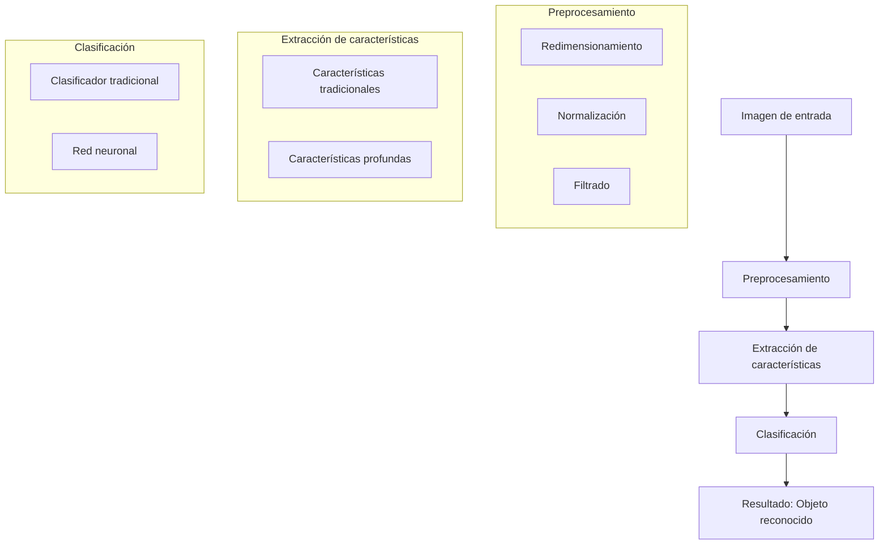

# Inteligencia Artificial - Percepción y conocimiento

## 5.1 Visión: reconocimiento de objetos.

---

El reconocimiento de objetos es una subárea fundamental de la visión por computadora que se enfoca en identificar y localizar objetos en imágenes o videos. Según Russell y Norvig (2009), la percepción implica "la obtención de información sobre objetos y eventos del entorno a través de sensores", siendo la visión el sentido más importante para los sistemas inteligentes.

### Conceptos Fundamentales

#### Definición de Reconocimiento de Objetos

El reconocimiento de objetos es el proceso de detectar y clasificar instancias de objetos categóricos (como personas, edificios o coches) en imágenes digitales. Implica:

- **Detección**: Identificar la presencia y ubicación de objetos en una imagen
- **Clasificación**: Asignar una etiqueta categórica al objeto detectado
- **Localización**: Delimitar precisamente los bordes del objeto (segmentación)

#### Retos Principales

- Variabilidad en apariencia (iluminación, oclusión, deformación)
- Cambios de escala y rotación
- Fondos complejos y múltiples objetos
- Punto de vista variable

### Representación de Características

#### Descriptores de Imágenes

Para reconocer objetos, primero debemos extraer características representativas:

```python
import cv2
import numpy as np

# Ejemplo de extracción de características ORB
orb = cv2.ORB_create(nfeatures=1000)
keypoints, descriptors = orb.detectAndCompute(image, None)
```

#### Histograma de Gradientes Orientados (HOG)

El descriptor HOG captura la forma y apariencia local mediante la distribución de intensidades de gradientes:

$$
\text{HOG}(I) = \left[ \sum_{x,y \in \text{celda}} \|\nabla I(x,y)\| \cdot \delta(\theta(x,y) - \theta_i) \right]_{i=1}^{n}
$$

Donde $\nabla I(x,y)$ es el gradiente en el pixel $(x,y)$ y $\theta(x,y)$ su orientación.

### Enfoques Clásicos

#### Viola-Jones Algorithm

Método en cascada para detección rápida de objetos, especialmente caras:

```python
# Detección de caras con OpenCV
face_cascade = cv2.CascadeClassifier('haarcascade_frontalface_default.xml')
faces = face_cascade.detectMultiScale(image, scaleFactor=1.1, minNeighbors=5)
```

#### Bag of Visual Words (BoVW)

Inspirado en procesamiento de lenguaje natural:

1. Extraer características locales (SIFT, SURF)
2. Crear diccionario visual mediante clustering (K-means)
3. Cuantizar características y crear histogramas
4. Clasificar con SVM u otros métodos

### Aprendizaje Profundo para Visión

#### Redes Neuronales Convolucionales (CNN)

Arquitectura fundamental para visión artificial:

```python
from tensorflow.keras import layers, models

model = models.Sequential([
    layers.Conv2D(32, (3, 3), activation='relu', input_shape=(64, 64, 3)),
    layers.MaxPooling2D((2, 2)),
    layers.Conv2D(64, (3, 3), activation='relu'),
    layers.MaxPooling2D((2, 2)),
    layers.Flatten(),
    layers.Dense(64, activation='relu'),
    layers.Dense(10, activation='softmax')  # Para 10 clases
])
```

#### Arquitecturas Modernas

- **AlexNet** (2012): Primera CNN profunda en ganar ImageNet
- **VGG** (2014): Red muy profunta con convoluciones 3x3
- **ResNet** (2015): Introduce conexiones residuales
- **YOLO** (2016): Detección en tiempo real

### Procesamiento de Imágenes con Diagramas



### Métricas de Evaluación

#### Precisión y Exhaustividad

Para evaluar sistemas de reconocimiento:

$$
\text{Precisión} = \frac{TP}{TP + FP}
$$

$$
\text{Exhaustividad} = \frac{TP}{TP + FN}
$$

Donde:

- TP: Verdaderos positivos
- FP: Falsos positivos
- FN: Falsos negativos

#### Intersection over Union (IoU)

Métrica para evaluar solapamiento entre predicción y verdad:

$$
\text{IoU} = \frac{\text{Área de superposición}}{\text{Área de unión}}
$$

### Ejemplo Práctico: Detección de Objetos con YOLO

```python
import cv2

# Cargar modelo YOLO preentrenado
net = cv2.dnn.readNet("yolov3.weights", "yolov3.cfg")
layer_names = net.getLayerNames()
output_layers = [layer_names[i[0] - 1] for i in net.getUnconnectedOutLayers()]

# Detectar objetos
blob = cv2.dnn.blobFromImage(image, 0.00392, (416, 416), (0, 0, 0), True, crop=False)
net.setInput(blob)
outs = net.forward(output_layers)

# Procesar detecciones
for out in outs:
    for detection in out:
        scores = detection[5:]
        class_id = np.argmax(scores)
        confidence = scores[class_id]
        if confidence > 0.5:  # Umbral de confianza
            # Obtener coordenadas del bounding box
            center_x = int(detection[0] * width)
            center_y = int(detection[1] * height)
            w = int(detection[2] * width)
            h = int(detection[3] * height)

            # Dibujar bounding box y etiqueta
            cv2.rectangle(image, (x, y), (x + w, y + h), (0, 255, 0), 2)
            cv2.putText(image, f"{classes[class_id]} {confidence:.2f}",
                       (x, y - 5), cv2.FONT_HERSHEY_SIMPLEX, 0.5, (0, 255, 0), 2)
```

### Ejercicios Propuestos

#### Ejercicio 1: Análisis de Características

Dada una imagen con múltiples objetos:

1. Extrae características SIFT u ORB
2. Agrupa características usando K-means (k=50)
3. Visualiza los centroides como "palabras visuales"
4. Construye un histograma de palabras visuales

#### Ejercicio 2: Implementación de HOG

Implementa manualmente el descriptor HOG:

1. Calcula gradientes en x e y
2. Calcula magnitud y orientación
3. Agrupa en celdas y bloques
4. Normaliza los histogramas

#### Ejercicio 3: Fine-tuning de CNN

Utiliza transfer learning con una CNN preentrenada:

1. Carga VGG16 preentrenada en ImageNet
2. Reemplaza las capas fully connected finales
3. Entrena solo las últimas capas para tu conjunto de datos
4. Evalúa el rendimiento

#### Ejercicio 4: Evaluación de Modelos

Para un conjunto de datos de detección de coches:

1. Implementa un detector usando HOG + SVM
2. Implementa un detector usando YOLO
3. Compara ambas aproximaciones usando:
   - Precisión y exhaustividad
   - Tiempo de inferencia
   - IoU promedio

### Caso de Estudio: Sistema de Reconocimiento en Tiempo Real

Diseña un sistema que pueda:

1. Capturar video en tiempo real
2. Detectar y clasificar al menos 3 categorías de objetos
3. Mostrar bounding boxes y etiquetas con confianza
4. Medir y mostrar FPS (frames por segundo)

Considera:

- Balance entre precisión y velocidad
- Optimizaciones para diferentes hardware
- Estrategias para falsos positivos/negativos

### Referencias

#### Bibliografía Básica

1. Russell, S. J., & Norvig, P. (2009). _Artificial Intelligence: A Modern Approach_ (3rd ed.). Prentice Hall. (Capítulos 24-25)
2. Marsland, S. (2009). _Machine Learning: An Algorithmic Perspective_. Chapman and Hall. (Capítulo 12)

#### Bibliografía Complementaria

1. Alpaydin, E. (2010). _Introduction to Machine Learning_ (2nd ed.). The MIT Press.
2. Hastie, T., Tibshirani, R., & Friedman, J. (2009). _The Elements of Statistical Learning: Data Mining, Inference, and Prediction_ (2nd ed.). Springer.
3. Davis, E. (1990). _Representations of Commonsense Knowledge_. Morgan Kaufmann.

#### Recursos Adicionales

- Conjuntos de datos: ImageNet, COCO, Pascal VOC
- Frameworks: TensorFlow, PyTorch, OpenCV
- Herramientas: LabelImg para anotación, TensorBoard para visualización

### Conclusiones

El reconocimiento de objetos ha evolucionado desde métodos basados en características hand-crafted hasta redes neuronales profundas que aprenden representaciones jerárquicas. Los desafíos actuales incluyen reconocimiento en condiciones adversas, eficiencia computacional y sistemas que generalizan bien across dominios. La comprensión de ambos enfoques (clásico y deep learning) proporciona una base sólida para desarrollar sistemas robustos de visión artificial.
