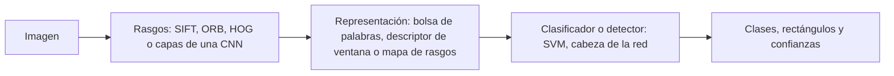

# Inteligencia Artificial - Percepción y conocimiento

## 5.1 Visión: reconocimiento de objetos.

---

Para una persona, reconocer una taza de café en una foto es inmediato; para una computadora, la imagen es una matriz de cientos de miles de números que cambian por completo si la taza se mueve, rota, se ilumina de otro modo o queda parcialmente oculta. El **reconocimiento de objetos** busca representaciones que sean **invariantes** a esas transformaciones y a la vez **discriminativas** entre categorías. La historia del área tiene dos etapas: los **rasgos diseñados a mano**, como SIFT, HOG y la bolsa de palabras visuales, combinados con clasificadores como las SVM; y, desde 2012, las **redes convolucionales**, que aprenden los rasgos directamente de millones de imágenes. Este tema presenta las tareas, los descriptores locales y globales, la bolsa de palabras visuales, las redes convolucionales y la transferencia de aprendizaje, los detectores y las métricas de evaluación.

### Tareas

- **Clasificación:** asignar una etiqueta a la imagen completa.
- **Detección:** encontrar cada instancia de las categorías de interés y delimitarla con un **rectángulo envolvente**, con su clase y su confianza.
- **Segmentación semántica:** asignar una clase a cada píxel; la **segmentación de instancias** separa además los objetos individuales.

Los retos son la variación de punto de vista, escala, iluminación y deformación, la oclusión, el fondo confuso y la variabilidad dentro de cada categoría: hay sillas de formas muy distintas.

### Descriptores locales

Un **detector** de puntos de interés encuentra lugares distintivos y repetibles, como esquinas y manchas, y un **descriptor** resume la apariencia de su vecindad en un vector:

- **SIFT** (Lowe, 2004): busca extremos en una pirámide de diferencias de gaussianas, asigna a cada punto una orientación dominante y describe su vecindad con histogramas de gradientes en una rejilla de 4x4 con 8 orientaciones, 128 valores. Es invariante a escala y rotación, y robusto a cambios de iluminación.
- **ORB** (Rublee y otros, 2011): esquinas FAST con orientación y un descriptor binario BRIEF rotado de 256 bits. Se compara con la distancia de Hamming y es dos órdenes de magnitud más rápido que SIFT.

Los descriptores locales sirven para emparejar vistas del mismo objeto o escena, como en el tema 5.2.

### HOG

El **histograma de gradientes orientados** de Dalal y Triggs (2005) describe la forma de una ventana completa:

1. se calculan los gradientes $g_x$ y $g_y$ con diferencias centradas, su magnitud $\sqrt{g_x^2 + g_y^2}$ y su orientación sin signo, entre 0° y 180°;
2. la ventana se divide en **celdas** de 8x8 píxeles, y en cada una se acumula la magnitud de los gradientes en un histograma de 9 orientaciones;
3. las celdas se agrupan en **bloques** de 2x2 que se solapan, y cada bloque se normaliza, por ejemplo con L2-Hys: norma L2, recorte en 0.2 y renormalización, lo que da robustez a los cambios de contraste;
4. el descriptor es la concatenación de todos los bloques.

Para una ventana de 64x128, el tamaño original para detectar personas, hay 8 × 16 celdas y 7 × 15 bloques, y el descriptor tiene $7 \cdot 15 \cdot 4 \cdot 9 = 3\,780$ valores.

### Bolsa de palabras visuales

Por analogía con la clasificación de textos, la **bolsa de palabras visuales** (Csurka y otros, 2004; Sivic y Zisserman, 2003) representa una imagen por la frecuencia de sus rasgos locales típicos:

1. se extraen descriptores locales de un conjunto de imágenes;
2. se agrupan con k-medias; cada centroide es una **palabra visual** y el conjunto es el **vocabulario**;
3. cada descriptor de una imagen se asigna a su palabra más cercana, y la imagen se representa con el histograma de palabras;
4. los histogramas se comparan o se clasifican, por ejemplo con una SVM.

La representación ignora la posición de los rasgos; la **pirámide espacial** (Lazebnik y otros, 2006) recupera parte de ella calculando histogramas en subregiones.

### Redes convolucionales

Una **red convolucional** (CNN) aplica capas de filtros pequeños que se deslizan sobre la imagen, compartiendo sus pesos en todas las posiciones, seguidos de no linealidades y de **submuestreo**. Las primeras capas aprenden bordes y texturas, y las siguientes, partes y objetos: una jerarquía de rasgos aprendida, no diseñada. AlexNet (Krizhevsky, Sutskever y Hinton, 2012) redujo el error *top-5* en ImageNet de cerca de 26 % a 15 %; VGG (2014) usa solo convoluciones de 3x3 en 16 o 19 capas; ResNet (2015) agrega **conexiones residuales** que permiten entrenar más de 100 capas, y los **transformadores de visión** (2020) dividen la imagen en parches y aplican atención.

Como entrenar una CNN grande requiere millones de imágenes, lo usual es la **transferencia de aprendizaje**: se toma una red preentrenada en ImageNet, se reemplazan sus últimas capas por unas nuevas para las clases de interés y se entrenan solo esas, o se ajusta toda la red con una tasa de aprendizaje pequeña. Las capas iniciales capturan rasgos generales que sirven para casi cualquier imagen natural.

### Detección

Los detectores clásicos aplican un clasificador en una **ventana deslizante** a varias escalas: Viola y Jones (2001) usan rasgos de Haar calculados con la imagen integral y una cascada de clasificadores que descarta rápido las ventanas sin cara, y Dalal y Triggs, HOG con una SVM lineal. Ambos eliminan detecciones duplicadas con **supresión de no máximos**. Los detectores modernos son redes: los de **dos etapas**, como Faster R-CNN, proponen regiones y luego las clasifican; los de **una etapa**, como YOLO (Redmon y otros, 2016) y SSD, predicen en una sola pasada, para una rejilla sobre la imagen, rectángulos, confianzas y clases, y funcionan en tiempo real.

### Métricas

Una detección es un **verdadero positivo** si su intersección sobre unión con un objeto real no detectado aún supera un umbral, usualmente 0.5:

$$\text{IoU}(A, B) = \frac{|A \cap B|}{|A \cup B|}$$

La **precisión** es $\text{VP}/(\text{VP} + \text{FP}),$ la fracción de detecciones correctas, y la **exhaustividad**, $\text{VP}/(\text{VP} + \text{FN}),$ la fracción de objetos encontrados. Variar el umbral de confianza produce una curva de precisión y exhaustividad; su área es la **precisión promedio** (AP), y su media sobre las clases, el **mAP**, la métrica estándar de PASCAL VOC y COCO, que promedia además varios umbrales de IoU.



### Implementación en Python

El programa usa OpenCV, scikit-image y scikit-learn con las imágenes de muestra de scikit-image y el conjunto de dígitos de scikit-learn. Construye una bolsa de palabras visuales con ORB y k-medias y la usa para buscar imágenes transformadas; implementa HOG a mano y lo compara con el de scikit-image; estudia la transferencia de aprendizaje con una red pequeña congelada y una nueva capa final, y compara un detector HOG + SVM con la correlación con una plantilla en escenas sintéticas.

```python
import numpy as np
import cv2
from skimage import data, transform, color
from skimage.feature import hog
from sklearn.cluster import KMeans
from sklearn.datasets import load_digits
from sklearn.linear_model import LogisticRegression
from sklearn.neural_network import MLPClassifier
from sklearn.svm import LinearSVC

def gris(im): return (color.rgb2gray(im) * 255).astype(np.uint8) if im.ndim == 3 else im

# ---------- Ejercicio 1: bolsa de palabras visuales con ORB y k-medias ----------
imgs = {"astronauta": gris(data.astronaut()), "cámara": gris(data.camera()), "café": gris(data.coffee()), "gato": gris(data.chelsea()),
        "cohete": gris(data.rocket()), "monedas": data.coins(), "ladrillo": data.brick(), "pasto": data.grass()}
ast = imgs["astronauta"]; M = cv2.getRotationMatrix2D((256, 256), 30, 0.7)
consultas = {"astronauta rotada 30° y escalada 0.7": cv2.warpAffine(ast, M, (512, 512)), "gato reflejado": imgs["gato"][:, ::-1].copy()}
orb = cv2.ORB_create(nfeatures=300)
def descriptores(im):
    _, d = orb.detectAndCompute(im, None); return np.unpackbits(d, axis=1).astype(float)    # 256 bits por punto
D = {k: descriptores(v) for k, v in imgs.items()}
km = KMeans(n_clusters=50, n_init=3, random_state=0).fit(np.vstack(list(D.values())))
def histograma(d): h = np.bincount(km.predict(d), minlength=50).astype(float); return h / np.linalg.norm(h)
H = {k: histograma(d) for k, d in D.items()}
print("ejercicio 1: puntos ORB por imagen:", {k: len(d) for k, d in D.items()})
print("   palabras más frecuentes: " + "; ".join(f"{k} {np.argsort(-h)[:3].tolist()}" for k, h in list(H.items())[:4]))
for nombre, im in consultas.items():
    h = histograma(descriptores(im)); sim = sorted(((float(h @ v), k) for k, v in H.items()), reverse=True)
    print(f"   consulta {nombre}: " + ", ".join(f"{k} {s:.3f}" for s, k in sim[:3]))

# ---------- Ejercicio 2: HOG implementado a mano frente a skimage ----------
def hog_manual(im, orient=9, celda=8, bloque=2, eps=1e-5):
    im = im.astype(float); gf = np.zeros_like(im); gc = np.zeros_like(im)
    gf[1:-1, :] = im[2:, :] - im[:-2, :]; gc[:, 1:-1] = im[:, 2:] - im[:, :-2]          # diferencias centradas
    mag = np.hypot(gf, gc); ang = np.rad2deg(np.arctan2(gf, gc)) % 180                    # orientación sin signo
    nf, nc = im.shape[0] // celda, im.shape[1] // celda; hist = np.zeros((nf, nc, orient))
    ancho = 180 / orient
    for i in range(orient):                                                             # asignación dura a cada intervalo
        m = np.where((ang >= i * ancho) & (ang < (i + 1) * ancho), mag, 0)
        hist[:, :, i] = m[:nf * celda, :nc * celda].reshape(nf, celda, nc, celda).sum(axis=(1, 3)) / celda ** 2
    bloques = np.zeros((nf - bloque + 1, nc - bloque + 1, bloque, bloque, orient))
    for r in range(nf - bloque + 1):
        for c in range(nc - bloque + 1):
            v = hist[r:r + bloque, c:c + bloque]; v = v / np.sqrt((v ** 2).sum() + eps ** 2)  # L2-Hys
            v = np.minimum(v, 0.2); bloques[r, c] = v / np.sqrt((v ** 2).sum() + eps ** 2)
    return bloques.ravel()
parche = ast[100:228, 200:264]                                                          # 128x64, el tamaño de Dalal y Triggs
h1 = hog_manual(parche); h2 = hog(parche, orientations=9, pixels_per_cell=(8, 8), cells_per_block=(2, 2), block_norm="L2-Hys", feature_vector=True)
print(f"ejercicio 2: descriptor de {h1.size} valores (7 × 15 bloques × 2 × 2 celdas × 9 orientaciones); "
      f"diferencia máxima con skimage {np.max(np.abs(h1 - h2)):.2e}, correlación {np.corrcoef(h1, h2)[0, 1]:.6f}")

# ---------- Ejercicio 3: transferencia de aprendizaje con dígitos ----------
dig = load_digits(); X, y = dig.data / 16, dig.target
def compara(Xf, yf, Xo, yo, titulo):
    red = MLPClassifier(hidden_layer_sizes=(128,), alpha=1e-3, max_iter=3000, random_state=0).fit(Xf, yf)
    rasgos = lambda Z: np.maximum(Z @ red.coefs_[0] + red.intercepts_[0], 0)          # capa oculta congelada
    perm = np.random.default_rng(0).permutation(len(yo)); prueba, resto = perm[:400], perm[400:]
    print(f"ejercicio 3: {titulo}")
    for k in (2, 5, 10, 30):
        idx = np.concatenate([resto[yo[resto] == c][:k] for c in np.unique(yo)])
        crudo = LogisticRegression(max_iter=5000).fit(Xo[idx], yo[idx]).score(Xo[prueba], yo[prueba])
        cero = MLPClassifier(hidden_layer_sizes=(128,), alpha=1e-3, max_iter=3000, random_state=0).fit(Xo[idx], yo[idx]).score(Xo[prueba], yo[prueba])
        trans = LogisticRegression(max_iter=5000).fit(rasgos(Xo[idx]), yo[idx]).score(rasgos(Xo[prueba]), yo[prueba])
        print(f"   {k:2} ejemplos por clase: píxeles + logística {crudo:.3f} | red desde cero {cero:.3f} | capa congelada + nueva logística {trans:.3f}")
perm = np.random.default_rng(0).permutation(len(y)); A, B = perm[:900], perm[900:]
XB = np.clip(1 - X[B] + np.random.default_rng(1).normal(0, 0.15, X[B].shape), 0, 1)   # nuevo dominio: contraste invertido y ruido
compara(X[A], y[A], XB, y[B], "mismas clases, dominio nuevo (contraste invertido y ruido)")
compara(X[y < 5], y[y < 5], X[y >= 5], y[y >= 5], "clases nuevas: red fuente con los dígitos 0 a 4, tarea con los dígitos 5 a 9")

# ---------- Ejercicio 4: detección en escenas sintéticas, HOG + SVM frente a correlación con plantilla ----------
T = 24
def objeto(i): return cv2.resize((X[i].reshape(8, 8) * 255).astype(np.uint8), (T, T), interpolation=cv2.INTER_LINEAR).astype(float)
tres = np.flatnonzero(y == 3); otros = np.flatnonzero(y != 3); rng = np.random.default_rng(1)
entr3, prueba3 = tres[:120], tres[120:]; entr_o, prueba_o = otros[:800], otros[800:]
def escena(rng, n3, n_otros):
    im = rng.normal(40, 15, (128, 128)); cajas = []; ocupado = []
    for k, i in enumerate(list(rng.choice(prueba3, n3)) + list(rng.choice(prueba_o, n_otros))):
        for _ in range(100):
            r, c = rng.integers(0, 128 - T, 2)
            if all(abs(r - a) >= T or abs(c - b) >= T for a, b in ocupado): break
        ocupado.append((r, c)); im[r:r + T, c:c + T] = np.maximum(im[r:r + T, c:c + T], objeto(i))
        if k < n3: cajas.append((r, c))
    return np.clip(im, 0, 255).astype(np.uint8), cajas
fh = lambda p: hog(p, orientations=9, pixels_per_cell=(6, 6), cells_per_block=(2, 2), block_norm="L2-Hys")
pos = [objeto(i) for i in entr3]; neg = [objeto(i) for i in entr_o]
fondo = [rng.normal(40, 15, (T, T)) for _ in range(300)]
for i in entr_o[:300]:                                                                 # recortes desplazados: partes de objetos
    o = np.full((2 * T, 2 * T), 40.0); o[:T, :T] = objeto(i); o[T // 2:T // 2 + T, T // 2:T // 2 + T] = np.maximum(o[T // 2:T // 2 + T, T // 2:T // 2 + T], objeto(entr3[i % 120]))
    neg.append(o[:T, T // 2:T // 2 + T])
Xd = np.array([fh(np.clip(p, 0, 255)) for p in pos + neg + fondo]); yd = np.r_[np.ones(len(pos)), np.zeros(len(neg) + len(fondo))]
svm = LinearSVC(C=0.1, max_iter=20000).fit(Xd, yd)
plantilla = np.mean(pos, axis=0).astype(np.float32)
def nms(cands, umbral=0.3):
    final = []
    for s, r, c in sorted(cands, reverse=True):
        if all(iou((r, c), (a, b)) < umbral for _, a, b in final): final.append((s, r, c))
    return final
def iou(p, q):
    inter = max(0, T - abs(p[0] - q[0])) * max(0, T - abs(p[1] - q[1])); return inter / (2 * T * T - inter)
def detecta_hog(im, umbral=0.0, paso=2):
    cands, n = [], 0
    for r in range(0, 128 - T + 1, paso):
        for c in range(0, 128 - T + 1, paso):
            n += 1; s = svm.decision_function([fh(im[r:r + T, c:c + T])])[0]
            if s > umbral: cands.append((s, r, c))
    return nms(cands), n
def detecta_plantilla(im, umbral=0.6):
    R = cv2.matchTemplate(im.astype(np.float32), plantilla, cv2.TM_CCOEFF_NORMED)
    cands = [(float(R[r, c]), r, c) for r, c in zip(*np.nonzero(R > umbral))]
    return nms(cands), R.size
def evalua(detector, escenas):
    vp = fp = fn = 0; ious = []; ventanas = 0
    for im, cajas in escenas:
        dets, n = detector(im); ventanas += n; usadas = set()
        for _, r, c in dets:
            mejor = max(((iou((r, c), g), j) for j, g in enumerate(cajas) if j not in usadas), default=(0, None))
            if mejor[0] >= 0.5: vp += 1; usadas.add(mejor[1]); ious.append(mejor[0])
            else: fp += 1
        fn += len(cajas) - len(usadas)
    return vp / max(vp + fp, 1), vp / (vp + fn), np.mean(ious), ventanas // len(escenas)
rng = np.random.default_rng(2); escenas = [escena(rng, int(rng.integers(1, 4)), 3) for _ in range(30)]
print(f"ejercicio 4: 30 escenas de prueba con {sum(len(c) for _, c in escenas)} treses y 90 dígitos distractores")
for nombre, det in (("HOG + SVM", detecta_hog), ("correlación con plantilla", detecta_plantilla)):
    p, r, mi, v = evalua(det, escenas)
    print(f"   {nombre:26}: precisión {p:.3f}, exhaustividad {r:.3f}, IoU medio de los aciertos {mi:.3f}, {v} ventanas por imagen")
```

Salida:

```text
ejercicio 1: puntos ORB por imagen: {'astronauta': 300, 'cámara': 300, 'café': 300, 'gato': 300, 'cohete': 275, 'monedas': 300, 'ladrillo': 300, 'pasto': 300}
   palabras más frecuentes: astronauta [20, 31, 45]; cámara [13, 11, 43]; café [43, 18, 17]; gato [25, 33, 9]
   consulta astronauta rotada 30° y escalada 0.7: astronauta 0.925, cámara 0.586, café 0.580
   consulta gato reflejado: gato 0.938, cámara 0.716, pasto 0.693
ejercicio 2: descriptor de 3780 valores (7 × 15 bloques × 2 × 2 celdas × 9 orientaciones); diferencia máxima con skimage 3.42e-08, correlación 1.000000
ejercicio 3: mismas clases, dominio nuevo (contraste invertido y ruido)
    2 ejemplos por clase: píxeles + logística 0.735 | red desde cero 0.757 | capa congelada + nueva logística 0.828
    5 ejemplos por clase: píxeles + logística 0.845 | red desde cero 0.843 | capa congelada + nueva logística 0.887
   10 ejemplos por clase: píxeles + logística 0.897 | red desde cero 0.897 | capa congelada + nueva logística 0.897
   30 ejemplos por clase: píxeles + logística 0.938 | red desde cero 0.938 | capa congelada + nueva logística 0.922
ejercicio 3: clases nuevas: red fuente con los dígitos 0 a 4, tarea con los dígitos 5 a 9
    2 ejemplos por clase: píxeles + logística 0.637 | red desde cero 0.642 | capa congelada + nueva logística 0.520
    5 ejemplos por clase: píxeles + logística 0.855 | red desde cero 0.840 | capa congelada + nueva logística 0.772
   10 ejemplos por clase: píxeles + logística 0.940 | red desde cero 0.943 | capa congelada + nueva logística 0.907
   30 ejemplos por clase: píxeles + logística 0.960 | red desde cero 0.970 | capa congelada + nueva logística 0.953
ejercicio 4: 30 escenas de prueba con 61 treses y 90 dígitos distractores
   HOG + SVM                 : precisión 0.795, exhaustividad 0.951, IoU medio de los aciertos 0.833, 2809 ventanas por imagen
   correlación con plantilla : precisión 0.504, exhaustividad 0.967, IoU medio de los aciertos 0.963, 11025 ventanas por imagen
```

### Ejercicios Propuestos

1. **Análisis de características.** Extrae rasgos SIFT u ORB de varias imágenes, agrúpalos con k-medias con $k = 50,$ interpreta los centroides como palabras visuales y construye el histograma de palabras de cada imagen.

2. **HOG.** Implementa a mano el descriptor HOG: calcula los gradientes en $x$ e $y,$ su magnitud y orientación, agrúpalos en celdas y bloques y normaliza los histogramas.

3. **Transferencia de aprendizaje.** Toma una red preentrenada, reemplaza sus capas finales, entrena solo las últimas capas para un nuevo conjunto de datos y evalúa el rendimiento.

4. **Evaluación de detectores.** Para un conjunto de datos de detección, implementa un detector con HOG + SVM, compáralo con otro enfoque, y mide la precisión, la exhaustividad, el tiempo de inferencia y el IoU promedio.

5. **Caso de estudio.** Diseña un sistema que capture video en tiempo real, detecte y clasifique al menos 3 categorías de objetos, muestre los rectángulos con sus etiquetas y confianzas, y mida los cuadros por segundo, considerando el balance entre precisión y velocidad, las optimizaciones para distinto hardware y el manejo de falsos positivos y negativos.

### Soluciones

**Ejercicio 1.** El programa extrae hasta 300 puntos ORB de cada una de 8 imágenes, cada uno con un descriptor de 256 bits, agrupa los 2 375 descriptores en 50 palabras con k-medias y representa cada imagen con su histograma normalizado. Los centroides no son imágenes sino patrones promedio de bits, y cada uno corresponde a un tipo de vecindad local; las palabras más frecuentes difieren entre imágenes, lo que hace al histograma discriminativo. Como prueba, la astronauta rotada 30° y reducida a 0.7 tiene similitud coseno 0.925 con la original y a lo más 0.586 con cualquier otra, y el gato reflejado, 0.938 con el original: la representación es invariante a rotación y escala porque ORB lo es, y al reflejo en buena medida porque el histograma ignora la posición. Para clasificar categorías, y no solo reconocer la misma imagen, hacen falta muchas imágenes por clase y un vocabulario de cientos o miles de palabras.

**Ejercicio 2.** La implementación sigue los cuatro pasos: diferencias centradas, orientaciones sin signo en 9 intervalos de 20°, celdas de 8x8 con el promedio de las magnitudes de cada intervalo y bloques de 2x2 normalizados con L2-Hys. Para un parche de 64x128 de la astronauta, el descriptor tiene los 3 780 valores esperados y coincide con el de scikit-image con una diferencia máxima de $3.4 \times 10^{-8},$ error de redondeo. La versión original de Dalal y Triggs además reparte cada gradiente entre los dos intervalos de orientación vecinos y entre las cuatro celdas vecinas por interpolación, lo que reduce el efecto de las fronteras entre intervalos; scikit-image usa la asignación directa.

**Ejercicio 3.** Una red preentrenada en ImageNet, como VGG16 o ResNet, no está disponible sin conexión, así que el programa reproduce el procedimiento en pequeño: entrena una red de una capa oculta de 128 unidades en una tarea fuente, congela esa capa y entrena solo una nueva capa final, una regresión logística, con pocos ejemplos de la tarea objetivo. Con las **mismas clases en un dominio nuevo**, dígitos con contraste invertido y ruido, la capa congelada ayuda cuando hay pocos datos, 0.828 frente a 0.735 de los píxeles con 2 ejemplos por clase, y deja de ayudar con 30. Con **clases nuevas**, la red entrenada con los dígitos 0 a 4 y aplicada a los dígitos 5 a 9, la transferencia es **negativa**: 0.520 frente a 0.637. Una red pequeña entrenada con 900 imágenes de 5 clases aprende rasgos específicos de esas clases; las redes de ImageNet transfieren tan bien porque se entrenan con 1.2 millones de imágenes de 1 000 clases y sus capas iniciales aprenden rasgos genéricos. Con VGG16 en Keras, el procedimiento del ejercicio es cargar `VGG16(weights="imagenet", include_top=False)`, marcar sus capas como no entrenables, agregar una capa de *pooling* global y una densa con softmax, y entrenar.

**Ejercicio 4.** Como no hay un conjunto de coches ni pesos de YOLO sin conexión, el programa construye 30 escenas de 128x128 con ruido, de 1 a 3 dígitos 3 como objetos que hay que detectar y 3 dígitos distintos como distractores, y compara dos detectores, ambos con supresión de no máximos. **HOG + SVM**, entrenado con treses, otros dígitos, fondo y recortes desplazados, logra precisión 0.795, exhaustividad 0.951 e IoU medio de 0.833. La **correlación con una plantilla**, el promedio de los treses de entrenamiento, encuentra casi todos los objetos, 0.967, y los localiza mejor, IoU 0.963, pero confunde muchos distractores, precisión 0.504: compara intensidades, mientras que HOG compara la forma de los bordes y la SVM aprende qué partes distinguen un 3 de un 8. El costo se mide en ventanas evaluadas, para que el resultado sea reproducible: 2 809 por imagen para HOG + SVM, con paso 2, y 11 025 para la correlación, que se calcula en todas las posiciones de forma muy eficiente con la transformada rápida de Fourier. Un detector como YOLO evaluaría la imagen en una sola pasada de red, con una precisión mucho mayor en imágenes reales, a cambio de entrenarse con miles de imágenes anotadas.

**Ejercicio 5.** Un diseño razonable:

1. **Captura:** OpenCV con `VideoCapture` en un hilo propio, con una cola de un solo cuadro para descartar los atrasados y no acumular latencia.
2. **Detección:** un detector de una etapa preentrenado en COCO, que incluye personas, coches y perros entre sus 80 clases, como YOLO o SSD con MobileNet. En CPU, se reduce la resolución de entrada, por ejemplo a 320x320, y se exporta a ONNX o OpenVINO; en GPU, TensorRT con precisión de 16 bits; en un teléfono, un modelo cuantizado a 8 bits.
3. **Postproceso:** umbral de confianza y supresión de no máximos por clase; el umbral se fija con la curva de precisión y exhaustividad según qué error cueste más.
4. **Estabilidad:** un **seguimiento** entre cuadros, como SORT, con un filtro de Kalman por objeto, que suaviza los rectángulos, mantiene la identidad y elimina falsos positivos aislados, que solo aparecen en un cuadro, y falsos negativos breves.
5. **Medición:** los cuadros por segundo con un promedio móvil de los tiempos por cuadro, y la latencia de extremo a extremo por separado, porque un sistema puede procesar 30 cuadros por segundo con medio segundo de atraso.

Si la detección no alcanza la velocidad, se detecta cada pocos cuadros y se sigue en los intermedios.

En el material original, la localización se describía como delimitar con precisión los bordes del objeto, que es la segmentación; la localización delimita el objeto con un rectángulo.

### Referencias

1. Szeliski, R., _Computer Vision: Algorithms and Applications_. Springer, 2022. Capítulos 5 a 7.
2. Lowe, D. G., Distinctive image features from scale-invariant keypoints. _International Journal of Computer Vision_ 60(2), 2004.
3. Dalal, N., and Triggs, B., Histograms of oriented gradients for human detection. _CVPR_, 2005.
4. Viola, P., and Jones, M., Rapid object detection using a boosted cascade of simple features. _CVPR_, 2001.
5. Rublee, E., Rabaud, V., Konolige, K., and Bradski, G., ORB: an efficient alternative to SIFT or SURF. _ICCV_, 2011.
6. Krizhevsky, A., Sutskever, I., and Hinton, G. E., ImageNet classification with deep convolutional neural networks. _NeurIPS_, 2012.
7. Redmon, J., Divvala, S., Girshick, R., and Farhadi, A., You only look once: unified, real-time object detection. _CVPR_, 2016.
8. Csurka, G., Dance, C., Fan, L., Willamowski, J., and Bray, C., Visual categorization with bags of keypoints. _ECCV Workshop_, 2004.
