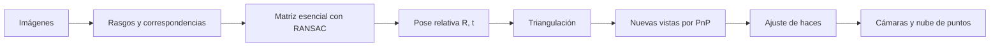

# Inteligencia Artificial - Percepción y conocimiento

## 5.2 Visión: geometría.

---

Una cámara proyecta un mundo de tres dimensiones en una imagen de dos, y en la proyección se pierde la profundidad. La **geometría de la visión** estudia esa proyección y cómo invertirla: con varias imágenes del mismo objeto, o con una cámara que se mueve, es posible recuperar la forma tridimensional de la escena y la posición de la cámara. Es la base de la medición con cámaras, la realidad aumentada, la navegación de robots y vehículos, y la reconstrucción de edificios o ciudades enteras a partir de fotografías. Este tema presenta el modelo de cámara, la calibración, la geometría epipolar de dos vistas, la estereovisión, la triangulación, la estructura a partir del movimiento con el ajuste de haces, y la estimación de la pose de una cámara.

### Coordenadas homogéneas y el modelo de cámara

En **coordenadas homogéneas**, un punto del plano $(x, y)$ se escribe $(x, y, 1)$ y cualquier múltiplo $(\lambda x, \lambda y, \lambda)$ representa el mismo punto. Con ellas, las traslaciones y las proyecciones se vuelven lineales. La cámara **estenopeica** proyecta un punto $X$ del mundo en

$$\lambda \begin{pmatrix} u \\ v \\ 1 \end{pmatrix} = K\,[R \mid t]\,\begin{pmatrix} X \\ 1 \end{pmatrix}, \qquad K = \begin{pmatrix} f_x & s & c_x \\ 0 & f_y & c_y \\ 0 & 0 & 1 \end{pmatrix}$$

donde $R$ y $t,$ los parámetros **extrínsecos**, llevan el punto al sistema de la cámara, y $K,$ los **intrínsecos**, contiene las distancias focales en píxeles $f_x$ y $f_y,$ el punto principal $(c_x, c_y)$ y el sesgo $s,$ casi siempre 0. La matriz $P = K[R \mid t]$ de 3x4 tiene 11 grados de libertad.

Las lentes reales agregan **distorsión**. Con coordenadas normalizadas $(x, y)$ y $r^2 = x^2 + y^2,$ el modelo usual, de Brown y Conrady, es

$$x_d = x\,(1 + k_1 r^2 + k_2 r^4 + k_3 r^6) + 2 p_1 x y + p_2 (r^2 + 2 x^2)$$

y análogo para $y_d,$ con coeficientes **radiales** $k_i,$ que producen el efecto de barril o de cojín, y **tangenciales** $p_i,$ por la lente no paralela al sensor.

### Rotaciones

Una rotación en 3D tiene 3 grados de libertad, pero se representa de varias formas: como **matriz** ortogonal con determinante 1, cómoda para componer; como **eje y ángulo**, o vector de Rodrigues, que la optimización prefiere porque tiene exactamente 3 parámetros; y como **cuaternión** unitario $q = w + x\,i + y\,j + z\,k,$ con $q$ y $-q$ la misma rotación, que se interpola suavemente y no tiene las singularidades de los ángulos de Euler.

### Calibración: el método de Zhang

Zhang (2000) calibra con varias fotos de un patrón plano, como un tablero de ajedrez. Con el patrón en el plano $Z = 0,$ la proyección se reduce a una **homografía** $H = K[r_1\ r_2\ t],$ que se estima con 4 o más esquinas. Como $r_1$ y $r_2$ son ortonormales, cada homografía da dos ecuaciones lineales en la matriz simétrica $B = K^{-\top} K^{-1}:$

$$h_1^\top B\,h_2 = 0, \qquad h_1^\top B\,h_1 = h_2^\top B\,h_2$$

Con 3 o más vistas se obtiene $B$ por mínimos cuadrados y de ella $K,$ por una factorización de Cholesky. Después, una optimización no lineal de Levenberg y Marquardt refina todos los parámetros, incluida la distorsión, minimizando el **error de reproyección**: la distancia en píxeles entre las esquinas detectadas y las proyectadas con el modelo.

### Geometría epipolar

Dos cámaras que ven el mismo punto $X$ forman con él un plano, el **plano epipolar**. Por eso, el punto $x'$ correspondiente a $x$ debe estar sobre una recta de la segunda imagen, la **recta epipolar** $l' = F x,$ y

$$x'^\top F\,x = 0$$

La **matriz fundamental** $F$ de 3x3 tiene rango 2 y 7 grados de libertad, y se estima con 8 o más correspondencias con el **algoritmo de los 8 puntos**, que es lineal; para que sea estable hay que **normalizar** las coordenadas, centrándolas y escalándolas, como mostró Hartley (1997), y luego imponer el rango 2. Si la calibración es conocida, en coordenadas normalizadas la relación es la **matriz esencial** $E = K'^\top F K = [t]_\times R,$ con 5 grados de libertad, de la que se recuperan $R$ y $t,$ esta última solo hasta la escala. Con correspondencias erróneas, se estima con **RANSAC**: se ajustan muchos modelos con muestras mínimas y se elige el que más correspondencias explica.

### Estereovisión

Con dos cámaras **rectificadas**, alineadas de modo que las rectas epipolares son las filas de la imagen, un punto aparece en la misma fila en las dos imágenes, desplazado una **disparidad** $d.$ Por semejanza de triángulos, con distancia focal $f$ y separación de las cámaras, o **línea base**, $B,$

$$Z = \frac{f\,B}{d}$$

La profundidad es inversamente proporcional a la disparidad, y su error crece como $Z^2:$ un error de disparidad fijo es más grave en los objetos lejanos. Calcular la disparidad es un problema de correspondencia: la **comparación por bloques** busca, para cada píxel, el desplazamiento cuyo bloque vecino se parece más; el método **semiglobal**, SGM, de Hirschmüller (2008), agrega penalizaciones por cambios de disparidad entre vecinos a lo largo de varias direcciones y produce mapas más completos.

### Triangulación y estructura a partir del movimiento

Dadas dos o más cámaras conocidas y las proyecciones de un punto, la **triangulación** recupera el punto. La versión lineal, DLT, plantea con cada vista dos ecuaciones, $u\,p_3^\top X - p_1^\top X = 0$ y $v\,p_3^\top X - p_2^\top X = 0,$ con $p_i^\top$ las filas de $P,$ y resuelve el sistema homogéneo con la SVD.

La **estructura a partir del movimiento** (SfM) recupera a la vez las cámaras y los puntos:

1. se detectan y emparejan rasgos entre imágenes, como en el tema 5.1;
2. con dos vistas se estima $E$ con RANSAC, se recuperan $R$ y $t$ y se triangulan los puntos;
3. cada nueva vista se ubica con PnP sobre los puntos ya reconstruidos, y se triangulan puntos nuevos;
4. el **ajuste de haces** (*bundle adjustment*) minimiza el error de reproyección total sobre todas las cámaras y todos los puntos, con mínimos cuadrados no lineales que aprovechan la estructura dispersa del problema.

La reconstrucción queda determinada solo hasta una **similitud**, rotación, traslación y escala, porque las imágenes no revelan el tamaño absoluto. Con cámaras afines, el método de **factorización** de Tomasi y Kanade (1992) obtiene movimiento y estructura de una vez con la SVD de la matriz de observaciones, de rango 3.

### Estimación de la pose: PnP

El problema de **perspectiva desde n puntos** (PnP) estima $R$ y $t$ de una cámara calibrada a partir de $n$ puntos 3D conocidos y sus proyecciones. Con 3 puntos hay hasta 4 soluciones, P3P; con más, hay métodos lineales como el **DLT**, que estima $P$ completa; **EPnP** (Lepetit y otros, 2009), que expresa los puntos con 4 puntos de control y es $O(n);$ **SQPnP** (Terzakis y Lourakis, 2020), que encuentra el óptimo global de un problema cuadrático, y el refinamiento **iterativo** de Levenberg y Marquardt. El método DLS de Hesch y Roumeliotis (2011) ya no está en OpenCV 5. Con correspondencias erróneas, PnP se combina con RANSAC.



### Implementación en Python

El programa usa OpenCV, SciPy y el par estéreo Motorcycle de Middlebury incluido en scikit-image, con su disparidad real y su calibración. Para el ejercicio 1, calibra una cámara con 12 vistas simuladas de un tablero con distorsión conocida, con su implementación de la solución cerrada de Zhang y con OpenCV, corrige la distorsión de una vista nueva y detecta las esquinas de un tablero sintético. Para el ejercicio 2, calcula la disparidad con comparación por bloques y semiglobal, la compara con la real y construye la nube de puntos. Para el ejercicio 3, implementa el algoritmo de los 8 puntos y una SfM de 3 vistas con ajuste de haces; para el ejercicio 4, compara EPnP, SQPnP, el método iterativo y un DLT propio, con ruido y con correspondencias erróneas.

```python
import numpy as np
import cv2
from scipy.optimize import least_squares
from skimage import data

cv2.setRNGSeed(0)
def rodrigues(v): return cv2.Rodrigues(np.asarray(v, float))[0]
def proyecta(K, R, t, X): x = (K @ (R @ X.T + t.reshape(3, 1))).T; return x[:, :2] / x[:, 2:]

# ---------- Ejercicio 1: calibración con un tablero de ajedrez ----------
K_v = np.array([[820.0, 0, 320], [0, 815.0, 240], [0, 0, 1]]); dist_v = np.array([-0.25, 0.08, 0.001, -0.0005, 0.0])
tablero = np.array([[c * 25.0, f * 25.0, 0] for f in range(6) for c in range(9)])            # 9x6 esquinas, cuadros de 25 mm
rng = np.random.default_rng(0); vistas = []
while len(vistas) < 12:                                         # poses al azar; solo las que caben completas en la imagen
    rv = rng.uniform(-0.5, 0.5, 3); tv = np.array([-100, -60, 350]) + rng.uniform(-120, 120, 3) * [1, 1, 0.3]
    p = cv2.projectPoints(tablero, rv, tv, K_v, dist_v)[0].reshape(-1, 2)
    if p.min() > 5 and p[:, 0].max() < 635 and p[:, 1].max() < 475: vistas.append(p + rng.normal(0, 0.3, (54, 2)))
def zhang(H_list):                                              # solución cerrada de Zhang, sin distorsión
    def v(H, i, j):
        h = H.T; return np.array([h[i, 0] * h[j, 0], h[i, 0] * h[j, 1] + h[i, 1] * h[j, 0], h[i, 1] * h[j, 1],
                                  h[i, 2] * h[j, 0] + h[i, 0] * h[j, 2], h[i, 2] * h[j, 1] + h[i, 1] * h[j, 2], h[i, 2] * h[j, 2]])
    V = np.vstack([np.vstack([v(H, 0, 1), v(H, 0, 0) - v(H, 1, 1)]) for H in H_list])
    b = np.linalg.svd(V)[2][-1]; B11, B12, B22, B13, B23, B33 = b
    v0 = (B12 * B13 - B11 * B23) / (B11 * B22 - B12 ** 2); lam = B33 - (B13 ** 2 + v0 * (B12 * B13 - B11 * B23)) / B11
    alfa = np.sqrt(lam / B11); beta = np.sqrt(lam * B11 / (B11 * B22 - B12 ** 2)); gam = -B12 * alfa ** 2 * beta / lam
    u0 = gam * v0 / beta - B13 * alfa ** 2 / lam
    return np.array([[alfa, gam, u0], [0, beta, v0], [0, 0, 1]])
Hs = [cv2.findHomography(tablero[:, :2], p)[0] for p in vistas]
Kz = zhang(Hs)
sin_dist = [cv2.projectPoints(tablero, rng.uniform(-0.5, 0.5, 3), np.array([-100, -60, 450]) + rng.uniform(-50, 50, 3), K_v, None)[0].reshape(-1, 2)
            + rng.normal(0, 0.3, (54, 2)) for _ in range(12)]
Kz0 = zhang([cv2.findHomography(tablero[:, :2], p)[0] for p in sin_dist])
rms, K_c, dist_c, rvecs, tvecs = cv2.calibrateCamera([tablero.astype(np.float32)] * 12, [p.astype(np.float32) for p in vistas], (640, 480), None, None, flags=cv2.CALIB_FIX_K3)
print("ejercicio 1: K verdadera fx, fy, cx, cy =", K_v[0, 0], K_v[1, 1], K_v[0, 2], K_v[1, 2], "; distorsión", dist_v.tolist())
print(f"   Zhang cerrado con datos sin distorsión: fx {Kz0[0, 0]:.1f}, fy {Kz0[1, 1]:.1f}, cx {Kz0[0, 2]:.1f}, cy {Kz0[1, 2]:.1f}, sesgo {Kz0[0, 1]:.2f}")
print(f"   Zhang cerrado con los datos distorsionados: fx {Kz[0, 0]:.1f}, fy {Kz[1, 1]:.1f}, cx {Kz[0, 2]:.1f}, cy {Kz[1, 2]:.1f}, sesgo {Kz[0, 1]:.2f}")
print(f"   calibrateCamera: fx {K_c[0, 0]:.1f}, fy {K_c[1, 1]:.1f}, cx {K_c[0, 2]:.1f}, cy {K_c[1, 2]:.1f}; "
      f"k1, k2, p1, p2, k3 = {np.round(dist_c.ravel(), 4).tolist()}; error RMS de reproyección {rms:.3f} px")
rv, tv = np.array([0.3, -0.2, 0.1]), np.array([-80.0, -50, 450])
p_dist, _ = cv2.projectPoints(tablero, rv, tv, K_v, dist_v); p_ideal, _ = cv2.projectPoints(tablero, rv, tv, K_v, None)
corr = cv2.undistortPoints(p_dist, K_c, dist_c, P=K_c)
print(f"   vista nueva: distancia a la proyección sin distorsión: antes {np.abs(p_dist - p_ideal).reshape(-1, 2).max():.2f} px, "
      f"después de corregir {np.linalg.norm((corr - p_ideal).reshape(-1, 2), axis=1).max():.3f} px")
img = np.full((480, 640), 255, np.uint8)                        # un tablero sintético, para la detección de esquinas
for f in range(7):
    for c in range(10):
        if (f + c) % 2 == 0: img[60 + f * 50:110 + f * 50, 70 + c * 50:120 + c * 50] = 0
Hw = np.array([[0.9, 0.12, 20], [-0.05, 0.85, 30], [0.0001, 0.0002, 1]]); warp = cv2.warpPerspective(img, Hw, (640, 480), borderValue=255)
ok, esq = cv2.findChessboardCorners(warp, (9, 6))
esq = cv2.cornerSubPix(warp, esq, (5, 5), (-1, -1), (cv2.TERM_CRITERIA_EPS + cv2.TERM_CRITERIA_MAX_ITER, 50, 1e-3))
reales = cv2.perspectiveTransform(np.array([[[120 + c * 50 - 0.5, 110 + f * 50 - 0.5]] for f in range(6) for c in range(9)], np.float32), Hw)
d = np.linalg.norm(esq.reshape(-1, 2)[:, None] - reales.reshape(-1, 2)[None], axis=2).min(1)
print(f"   detección de esquinas en un tablero sintético: encontrado {ok}, {len(esq)} esquinas, error medio {d.mean():.3f} px, máximo {d.max():.3f} px")

# ---------- Ejercicio 2: estereovisión con el par de Middlebury ----------
izq, der, gt = data.stereo_motorcycle()
gi, gd = cv2.cvtColor(izq, cv2.COLOR_RGB2GRAY), cv2.cvtColor(der, cv2.COLOR_RGB2GRAY)
f_px, B_mm, doffs = 994.978, 193.001, 31.086
validos = np.isfinite(gt)
print(f"ejercicio 2: imágenes {gi.shape[1]}x{gi.shape[0]}, disparidad real entre {gt[validos].min():.1f} y {gt[validos].max():.1f} px")
for nombre, m in (("bloques, StereoBM", cv2.StereoBM_create(numDisparities=80, blockSize=15)),
                  ("semiglobal, StereoSGBM", cv2.StereoSGBM_create(minDisparity=0, numDisparities=80, blockSize=5, P1=8 * 25, P2=32 * 25, uniquenessRatio=10))):
    disp = m.compute(gi, gd).astype(np.float32) / 16                    # OpenCV devuelve la disparidad × 16
    est = (disp > 0) & validos; err = np.abs(disp[est] - gt[est])
    print(f"   {nombre:22}: densidad {est.sum() / validos.sum():.1%}, error medio {err.mean():.2f} px, con error > 2 px {np.mean(err > 2):.1%}")
Z = f_px * B_mm / (disp + doffs)                                      # profundidad en mm, con la última disparidad (SGBM)
fila, col = np.nonzero(est); Zs = Z[fila, col]
X = (col - 311.193) * Zs / f_px; Y = (fila - 254.877) * Zs / f_px
nube = np.c_[X, Y, Zs]; Zr = f_px * B_mm / (gt[fila, col] + doffs)
print(f"   nube de puntos: {len(nube)} puntos, profundidad entre {Zs.min() / 1000:.2f} y {Zs.max() / 1000:.2f} m; "
      f"error de profundidad mediano {np.median(np.abs(Zs - Zr)):.1f} mm")
print(f"   centro de la moto (píxel 250, 370): disparidad real {gt[250, 370]:.1f} px → Z = {f_px * B_mm / (gt[250, 370] + doffs) / 1000:.3f} m")

# ---------- Ejercicio 3: estructura a partir del movimiento con 3 vistas ----------
rng = np.random.default_rng(3); K = np.array([[700.0, 0, 320], [0, 700, 240], [0, 0, 1]])
P3 = rng.uniform([-1, -1, 4], [1, 1, 6], (120, 3))
poses = [(np.eye(3), np.zeros(3)), (rodrigues([0, -0.15, 0.02]), np.array([1.0, 0, 0.1])), (rodrigues([0.05, -0.3, 0]), np.array([2.0, 0.1, 0.3]))]
obs = [proyecta(K, R, t, P3) + rng.normal(0, 0.5, (120, 2)) for R, t in poses]
def ocho_puntos(x1, x2):                                              # matriz fundamental con normalización de Hartley
    def norm(x): c = x.mean(0); s = np.sqrt(2) / np.mean(np.linalg.norm(x - c, axis=1)); T = np.array([[s, 0, -s * c[0]], [0, s, -s * c[1]], [0, 0, 1]]); return (T @ np.c_[x, np.ones(len(x))].T).T, T
    a, T1 = norm(x1); b, T2 = norm(x2)
    A = np.array([np.kron(q, p) for p, q in zip(a, b)]); F = np.linalg.svd(A)[2][-1].reshape(3, 3)
    U, S, Vt = np.linalg.svd(F); F = U @ np.diag([S[0], S[1], 0]) @ Vt                # rango 2
    F = T2.T @ F @ T1; return F / np.linalg.norm(F)
def dist_epipolar(F, x1, x2):
    h1, h2 = np.c_[x1, np.ones(len(x1))], np.c_[x2, np.ones(len(x2))]; l = (F @ h1.T).T
    return np.abs(np.sum(h2 * l, 1)) / np.hypot(l[:, 0], l[:, 1])
F8 = ocho_puntos(obs[0], obs[1]); Fv = np.linalg.inv(K).T @ (lambda t: np.array([[0, -t[2], t[1]], [t[2], 0, -t[0]], [-t[1], t[0], 0]]))(poses[1][1]) @ poses[1][0] @ np.linalg.inv(K)
print(f"ejercicio 3: F por 8 puntos normalizado: distancia epipolar media {dist_epipolar(F8, obs[0], obs[1]).mean():.3f} px (con la F verdadera {dist_epipolar(Fv / np.linalg.norm(Fv), obs[0], obs[1]).mean():.3f})")
E, _ = cv2.findEssentialMat(obs[0], obs[1], K, method=cv2.RANSAC, prob=0.999, threshold=1.0)
_, R1, t1, _ = cv2.recoverPose(E, obs[0], obs[1], K)
P0m, P1m = K @ np.c_[np.eye(3), np.zeros(3)], K @ np.c_[R1, t1]
Xh = cv2.triangulatePoints(P0m, P1m, obs[0].T, obs[1].T); Xi = (Xh[:3] / Xh[3]).T
_, r2, t2 = cv2.solvePnP(Xi, obs[2], K, None, flags=cv2.SOLVEPNP_SQPNP)
x0 = np.r_[cv2.Rodrigues(R1)[0].ravel(), t1.ravel(), r2.ravel(), t2.ravel(), Xi.ravel()]
def residuos(z):
    R_1, t_1, R_2, t_2 = rodrigues(z[:3]), z[3:6], rodrigues(z[6:9]), z[9:12]; Xp = z[12:].reshape(-1, 3)
    return np.concatenate([(proyecta(K, R, t, Xp) - o).ravel() for (R, t), o in zip([(np.eye(3), np.zeros(3)), (R_1, t_1), (R_2, t_2)], obs)])
antes = np.sqrt(np.mean(residuos(x0) ** 2)); sol = least_squares(residuos, x0, method="trf", x_scale="jac"); despues = np.sqrt(np.mean(sol.fun ** 2))
Xba = sol.x[12:].reshape(-1, 3)
def alinea(A, B):                                                     # similitud de Umeyama: la escala no es observable
    ma, mb = A.mean(0), B.mean(0); U, S, Vt = np.linalg.svd((B - mb).T @ (A - ma)); D = np.diag([1, 1, np.sign(np.linalg.det(U @ Vt))])
    R = U @ D @ Vt; s = np.trace(np.diag(S) @ D) / ((A - ma) ** 2).sum(); return s * (R @ (A - ma).T).T + mb, s
Xal, s = alinea(Xba, P3)
print(f"   2 vistas → triangulación → PnP para la tercera → ajuste de haces con {len(x0)} parámetros")
print(f"   error RMS de reproyección: antes del ajuste {antes:.3f} px, después {despues:.3f} px (ruido simulado 0.5 px)")
print(f"   tras alinear con una similitud (escala {s:.3f}): error 3D medio {np.linalg.norm(Xal - P3, axis=1).mean() * 1000:.1f} mm en puntos a ~5 m")

# ---------- Ejercicio 4: PnP ----------
rng = np.random.default_rng(4); P4 = rng.uniform([-1, -1, 4], [1, 1, 7], (40, 3))
Rv, tv = rodrigues([0.1, -0.2, 0.05]), np.array([0.2, -0.1, 0.5])
def dlt(X, x):                                                        # PnP lineal: P de 3x4 por DLT, luego K⁻¹P → [R | t]
    A = []
    for (Xw, Yw, Zw), (u, v) in zip(X, x):
        p = [Xw, Yw, Zw, 1]; A.append(p + [0] * 4 + [-u * c for c in p]); A.append([0] * 4 + p + [-v * c for c in p])
    M = np.linalg.inv(K) @ np.linalg.svd(np.array(A))[2][-1].reshape(3, 4)
    U, S, Vt = np.linalg.svd(M[:, :3]); R = U @ Vt; esc = S.mean()
    if np.linalg.det(R) < 0: R, esc = -R, -esc
    return R, M[:, 3] / esc
def errores(R, t): return np.degrees(np.linalg.norm(cv2.Rodrigues(R @ Rv.T)[0])), np.linalg.norm(t - tv) * 1000
for ruido in (0.5, 2.0):
    x = proyecta(K, Rv, tv, P4) + rng.normal(0, ruido, (40, 2)); fila = []
    for nombre, fl in (("EPnP", cv2.SOLVEPNP_EPNP), ("SQPnP", cv2.SOLVEPNP_SQPNP), ("iterativo LM", cv2.SOLVEPNP_ITERATIVE)):
        _, r, t = cv2.solvePnP(P4, x, K, None, flags=fl); e = errores(rodrigues(r.ravel()), t.ravel()); fila.append(f"{nombre} {e[0]:.3f}° {e[1]:.1f} mm")
    e = errores(*dlt(P4, x)); fila.append(f"DLT {e[0]:.3f}° {e[1]:.1f} mm")
    print(f"ejercicio 4: ruido {ruido} px: " + " | ".join(fila))
x = proyecta(K, Rv, tv, P4) + rng.normal(0, 0.5, (40, 2)); malos = rng.choice(40, 8, replace=False); x[malos] += rng.uniform(-80, 80, (8, 2))
_, r, t = cv2.solvePnP(P4, x, K, None, flags=cv2.SOLVEPNP_SQPNP); e1 = errores(rodrigues(r.ravel()), t.ravel())
_, r, t, inl = cv2.solvePnPRansac(P4, x, K, None, reprojectionError=3.0, flags=cv2.SOLVEPNP_SQPNP); e2 = errores(rodrigues(r.ravel()), t.ravel())
print(f"   con 8 de 40 correspondencias erróneas: SQPnP {e1[0]:.2f}° {e1[1]:.0f} mm | SQPnP + RANSAC {e2[0]:.3f}° {e2[1]:.1f} mm, "
      f"{len(inl)} inliers, detecta todos los erróneos: {set(malos.tolist()).isdisjoint(inl.ravel().tolist())}")
```

Salida:

```text
ejercicio 1: K verdadera fx, fy, cx, cy = 820.0 815.0 320.0 240.0 ; distorsión [-0.25, 0.08, 0.001, -0.0005, 0.0]
   Zhang cerrado con datos sin distorsión: fx 822.0, fy 816.7, cx 322.2, cy 239.0, sesgo -0.02
   Zhang cerrado con los datos distorsionados: fx 755.5, fy 749.4, cx 315.4, cy 237.1, sesgo 2.84
   calibrateCamera: fx 819.4, fy 814.8, cx 320.4, cy 238.6; k1, k2, p1, p2, k3 = [-0.2466, 0.0666, 0.0011, -0.001, 0.0]; error RMS de reproyección 0.411 px
   vista nueva: distancia a la proyección sin distorsión: antes 2.93 px, después de corregir 0.076 px
   detección de esquinas en un tablero sintético: encontrado True, 54 esquinas, error medio 0.158 px, máximo 0.235 px
ejercicio 2: imágenes 741x500, disparidad real entre 7.2 y 59.9 px
   bloques, StereoBM     : densidad 76.1%, error medio 1.21 px, con error > 2 px 6.8%
   semiglobal, StereoSGBM: densidad 85.5%, error medio 1.23 px, con error > 2 px 6.7%
   nube de puntos: 293631 puntos, profundidad entre 1.74 y 6.07 m; error de profundidad mediano 8.9 mm
   centro de la moto (píxel 250, 370): disparidad real 49.0 px → Z = 2.398 m
ejercicio 3: F por 8 puntos normalizado: distancia epipolar media 0.534 px (con la F verdadera 0.540)
   2 vistas → triangulación → PnP para la tercera → ajuste de haces con 372 parámetros
   error RMS de reproyección: antes del ajuste 1.103 px, después 0.331 px (ruido simulado 0.5 px)
   tras alinear con una similitud (escala 1.136): error 3D medio 20.8 mm en puntos a ~5 m
ejercicio 4: ruido 0.5 px: EPnP 0.080° 9.4 mm | SQPnP 0.087° 7.6 mm | iterativo LM 0.082° 8.0 mm | DLT 0.419° 25.4 mm
ejercicio 4: ruido 2.0 px: EPnP 0.248° 24.8 mm | SQPnP 0.271° 26.4 mm | iterativo LM 0.262° 26.3 mm | DLT 1.585° 298.1 mm
   con 8 de 40 correspondencias erróneas: SQPnP 2.27° 765 mm | SQPnP + RANSAC 0.138° 14.2 mm, 32 inliers, detecta todos los erróneos: True
```

### Ejercicios Propuestos

1. **Calibración.** Implementa la calibración de una cámara con un tablero de ajedrez, calcula la matriz de intrínsecos $K,$ estima los coeficientes de distorsión radial y tangencial, y corrige la distorsión en imágenes nuevas.

2. **Estereovisión.** Dado un par estéreo calibrado, calcula la disparidad por comparación de bloques, obtén el mapa de profundidad y reconstruye una nube de puntos 3D.

3. **Estructura a partir del movimiento.** Implementa un flujo básico de SfM: empareja rasgos entre varias vistas, calcula la geometría epipolar entre pares de imágenes, triangula puntos 3D y optimiza con ajuste de haces.

4. **PnP.** Dados puntos 3D y sus correspondencias 2D, estima la pose de la cámara con EPnP y otro método, y compara su precisión y robustez.

### Soluciones

**Ejercicio 1.** Con 12 vistas de un tablero de 9x6 esquinas, simuladas con $f_x = 820,$ $f_y = 815,$ distorsión de barril $k_1 = -0.25$ y ruido de 0.3 px, la solución cerrada de Zhang, implementada a partir de las ecuaciones de las homografías, recupera $K$ con un error de 2 px si los datos no tienen distorsión. Con los datos distorsionados, la solución cerrada da $f_x \approx 756,$ un error de 8 %, porque el modelo lineal no tiene distorsión; por eso solo es el punto de partida. La optimización de OpenCV recupera $f_x = 819.4,$ $f_y = 814.8,$ el punto principal con error de 1.4 px y $k_1 = -0.247,$ $k_2 = 0.067,$ con un error de reproyección de 0.41 px, que es lo esperado para un ruido de 0.3 px en cada coordenada, $0.3\sqrt{2}.$ El coeficiente $k_3$ se fija en 0, porque con un campo de visión moderado está mal determinado y compensa a $k_2;$ y las vistas deben cubrir toda la imagen, incluidas las esquinas, donde la distorsión es mayor. En una vista nueva, la distorsión desplaza las esquinas hasta 2.93 px, y tras corregirla con los parámetros estimados quedan a menos de 0.08 px de la proyección ideal. Con imágenes reales, las esquinas se detectan con `findChessboardCorners` y se refinan con `cornerSubPix`: en el tablero sintético, con una homografía conocida, el error de detección es de 0.16 px en promedio.

**Ejercicio 2.** El par Motorcycle, reducido a 741x500, tiene disparidades reales entre 7 y 60 px. Con 80 disparidades posibles, la comparación por bloques de 15x15 asigna disparidad al 76 % de los píxeles con un error medio de 1.2 px, y el método semiglobal, con bloques de 5x5, al 86 % con un error similar; ambos fallan en el 7 % de los píxeles por más de 2 px, sobre todo en zonas sin textura, en los reflejos y en los bordes de oclusión. La profundidad se obtiene con $Z = f B / (d + d_x),$ donde $d_x = 31.086$ px es la diferencia entre los puntos principales de las dos cámaras de Middlebury, y cada píxel se lleva a 3D con $X = (u - c_x) Z / f$ e $Y = (v - c_y) Z / f.$ La nube tiene unos 294 000 puntos entre 1.7 y 6.1 m, con un error de profundidad mediano de 9 mm; el centro de la moto, con disparidad 49, está a 2.40 m.

**Ejercicio 3.** Con 120 puntos vistos por 3 cámaras simuladas y ruido de 0.5 px, el algoritmo de los 8 puntos normalizado da una $F$ con distancia epipolar media de 0.534 px, igual a la de la $F$ verdadera, 0.540: el residuo se debe al ruido, no a la estimación. El flujo estima $E$ con RANSAC, recupera la pose de la segunda cámara, triangula, ubica la tercera con PnP y ajusta los haces sobre 372 parámetros: 6 por cada una de las dos cámaras libres y 3 por punto. El error RMS de reproyección baja de 1.10 a 0.33 px. Es menor que el ruido de 0.5 px porque el ajuste absorbe parte del ruido con sus parámetros: con 720 observaciones y unos 365 parámetros efectivos, el valor esperado es $0.5\sqrt{(720 - 365)/720} \approx 0.35.$ La reconstrucción coincide con la real tras una similitud de escala 1.136, la que no puede observarse, con un error medio de 21 mm a unos 5 m de distancia. Con imágenes reales, el primer paso es emparejar rasgos ORB o SIFT con la prueba de razón de Lowe.

**Ejercicio 4.** Con 40 puntos y ruido de 0.5 px, EPnP, SQPnP y el método iterativo estiman la rotación con error menor que 0.09° y la traslación con error de 8 a 9 mm, a unos 5 m; con 2 px de ruido, los errores crecen casi proporcionalmente, a unos 0.26° y 25 mm. El DLT lineal es mucho peor, 0.42° y 25 mm con poco ruido y 1.6° y 298 mm con más, porque estima 11 parámetros en lugar de 6 y minimiza un error algebraico, no geométrico: solo sirve como inicialización. Con 8 de 40 correspondencias erróneas, SQPnP solo se equivoca por 2.3° y 765 mm, y con RANSAC identifica las 32 correctas y recupera la precisión, 0.14° y 14 mm. La robustez frente a correspondencias erróneas viene de RANSAC, no del método de PnP.

### Referencias

1. Hartley, R., and Zisserman, A., _Multiple View Geometry in Computer Vision_. Cambridge University Press, 2004.
2. Zhang, Z., A flexible new technique for camera calibration. _IEEE Transactions on Pattern Analysis and Machine Intelligence_ 22(11), 2000.
3. Hartley, R., In defense of the eight-point algorithm. _IEEE Transactions on Pattern Analysis and Machine Intelligence_ 19(6), 1997.
4. Hirschmüller, H., Stereo processing by semiglobal matching and mutual information. _IEEE Transactions on Pattern Analysis and Machine Intelligence_ 30(2), 2008.
5. Triggs, B., McLauchlan, P., Hartley, R., and Fitzgibbon, A., Bundle adjustment: a modern synthesis. _Vision Algorithms: Theory and Practice_, Springer, 2000.
6. Lepetit, V., Moreno-Noguer, F., and Fua, P., EPnP: an accurate O(n) solution to the PnP problem. _International Journal of Computer Vision_ 81, 2009.
7. Scharstein, D., et al., High-resolution stereo datasets with subpixel-accurate ground truth. _German Conference on Pattern Recognition_, 2014.
8. Tomasi, C., and Kanade, T., Shape and motion from image streams under orthography: a factorization method. _International Journal of Computer Vision_ 9(2), 1992.
