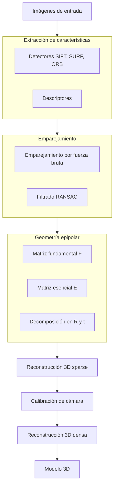

# Inteligencia Artificial - Percepción y conocimiento

## 5.2 Visión: geometría.

---

La geometría en visión por computadora estudia las propiedades geométricas de las escenas y su proyección en imágenes. Según Russell y Norvig (2009), la comprensión geométrica es fundamental para tareas como navegación, reconstrucción 3D y reconocimiento de objetos. Esta guía cubre los principios matemáticos que relacionan las estructuras 3D del mundo con sus representaciones 2D en imágenes.

### Conceptos Fundamentales

#### Modelo de Cámara y Proyección

##### Coordenadas Homogéneas

Las coordenadas homogéneas permiten representar transformaciones proyectivas de manera lineal. Un punto 2D $(x, y)$ se representa como $(x, y, 1)$ y un punto 3D $(X, Y, Z)$ como $(X, Y, Z, 1)$.

##### Proyección Perspectiva

La proyección perspectiva modela cómo una cámara forma imágenes:

$$ \begin{pmatrix} x \\\ y \\\ 1 \end{pmatrix} \simeq \begin{pmatrix} f & 0 & 0 & 0 \\\ 0 & f & 0 & 0 \\\ 0 & 0 & 1 & 0 \end{pmatrix} \begin{pmatrix} X \\\ Y \\\ Z \\\ 1 \end{pmatrix} $$

Donde $f$ es la distancia focal y $\simeq$ indica igualdad hasta un factor escalar.

##### Matriz de Cámara

La matriz de cámara $P$ combina parámetros intrínsecos $(K)$ y extrínsecos $([R|t])$:

$$ P = K[R|t] $$

$$ K = \begin{pmatrix} f_x & s & c_x \\\ 0 & f_y & c_y \\\ 0 & 0 & 1 \end{pmatrix} $$

Donde:

- $f_x, f_y$: distancias focales en píxeles
- $c_x, c_y$: punto principal
- $s$: parámetro de sesgo (skew)
- $R$: matriz de rotación
- $t$: vector de traslación

### Transformaciones Geométricas

#### Transformaciones 2D

```python
import numpy as np
import cv2

# Matriz de transformación afín 2D
def create_affine_matrix(angle, tx, ty, scale):
    theta = np.radians(angle)
    cos_theta = np.cos(theta) * scale
    sin_theta = np.sin(theta) * scale

    return np.array([
        [cos_theta, -sin_theta, tx],
        [sin_theta, cos_theta, ty],
        [0, 0, 1]
    ])

# Aplicar transformación a puntos
def transform_points(points, matrix):
    homogeneous_points = np.hstack([points, np.ones((points.shape[0], 1))])
    transformed = homogeneous_points @ matrix.T
    return transformed[:, :2] / transformed[:, 2:]
```

#### Transformaciones 3D

##### Matriz de Rotación 3D

Para rotación alrededor del eje Z:

$$ R_z(\theta) = \begin{pmatrix} \cos\theta & -\sin\theta & 0 \\\ \sin\theta & \cos\theta & 0 \\\ 0 & 0 & 1 \end{pmatrix} $$

##### Cuaterniones

Alternativa eficiente para representar rotaciones 3D:

$$
q = w + xi + yj + zk
$$

### Geometría Epipolar

#### Matriz Fundamental

La matriz fundamental $F$ relaciona puntos correspondientes en dos vistas:

$$
\mathbf{x'}^T F \mathbf{x} = 0
$$

Donde $\mathbf{x}$ y $\mathbf{x'}$ son puntos correspondientes en coordenadas homogéneas.

#### Matriz Esencial

La matriz esencial $E$ relaciona las cámaras en coordenadas normalizadas:

$$
E = [t]_{\times} R
$$

Donde $[t]_{\times}$ es la matriz antisimétrica del vector de traslación.

#### Cálculo de la Matriz Fundamental

```python
def compute_fundamental_matrix(pts1, pts2):
    # Normalizar puntos
    pts1_norm, T1 = normalize_points(pts1)
    pts2_norm, T2 = normalize_points(pts2)

    # Construir matriz A para Af = 0
    A = np.zeros((len(pts1), 9))
    for i in range(len(pts1)):
        x1, y1 = pts1_norm[i]
        x2, y2 = pts2_norm[i]
        A[i] = [x2*x1, x2*y1, x2, y2*x1, y2*y1, y2, x1, y1, 1]

    # Resolver usando SVD
    U, S, Vt = np.linalg.svd(A)
    F = Vt[-1].reshape(3, 3)

    # Forzar rango 2
    U, S, Vt = np.linalg.svd(F)
    S[2] = 0
    F = U @ np.diag(S) @ Vt

    # Desnormalizar
    F = T2.T @ F @ T1

    return F / F[2, 2]
```

### Reconstrucción 3D

#### Triangulación

Dadas dos vistas de un punto 3D, podemos reconstruir su posición:

```python
def triangulate_point(P1, P2, x1, x2):
    # Construir matriz A
    A = np.array([
        x1[0] * P1[2] - P1[0],
        x1[1] * P1[2] - P1[1],
        x2[0] * P2[2] - P2[0],
        x2[1] * P2[2] - P2[1]
    ])

    # Resolver usando SVD
    U, S, Vt = np.linalg.svd(A)
    X = Vt[-1]

    return X / X[3]  # Convertir a coordenadas no homogéneas
```

#### Factorización de Matrices

Para múltiples puntos y vistas, podemos usar factorización:

$$ W = \begin{pmatrix} x_{11} & \cdots & x_{1n} \\\ \vdots & \ddots & \vdots \\\ x_{m1} & \cdots & x_{mn} \end{pmatrix} = M S $$

Donde $M$ contiene los parámetros de movimiento y $S$ la estructura 3D.

### Calibración de Cámara

#### Algoritmo de Zhang

Método popular para calibración usando un patrón de calibración:

```python
def zhang_calibration(images, pattern_size, square_size):
    obj_points = []  # Puntos 3D del patrón
    img_points = []  # Puntos 2D en la imagen

    # Preparar puntos del objeto (0,0,0), (square_size,0,0), ...
    objp = np.zeros((pattern_size[0] * pattern_size[1], 3), np.float32)
    objp[:, :2] = np.mgrid[0:pattern_size[0], 0:pattern_size[1]].T.reshape(-1, 2) * square_size

    for img in images:
        # Encontrar esquinas del tablero de ajedrez
        ret, corners = cv2.findChessboardCorners(img, pattern_size)
        if ret:
            obj_points.append(objp)
            img_points.append(corners)

    # Calibrar cámara
    ret, K, dist, rvecs, tvecs = cv2.calibrateCamera(
        obj_points, img_points, img.shape[::-1], None, None
    )

    return ret, K, dist, rvecs, tvecs
```

### Diagrama de Flujo de Reconstrucción 3D



### Ejercicios Propuestos

#### Ejercicio 1: Calibración de Cámara

1. Implementa el algoritmo de calibración de cámara usando un tablero de ajedrez
2. Calcula la matriz de parámetros intrínsecos $K$
3. Estima los coeficientes de distorsión radial y tangencial
4. Corrige la distorsión en nuevas imágenes

#### Ejercicio 2: Estereovisión

Dado un par estéreo calibrado:

1. Calcula la disparidad usando block matching
2. Implementa el cálculo de mapa de profundidad
3. Reconstruye una nube de puntos 3D

```python
# Cálculo de disparidad
stereo = cv2.StereoBM_create(numDisparities=64, blockSize=15)
disparity = stereo.compute(left_img, right_img)
```

#### Ejercicio 3: SFM (Structure from Motion)

Implementa un pipeline básico de SFM:

1. Extrae y empareja características entre múltiples vistas
2. Calcula la geometría epipolar entre pares de imágenes
3. Triangular puntos 3D consistentes
4. Optimiza usando bundle adjustment

#### Ejercicio 4: PnP (Perspective-n-Point)

Resuelve el problema PnP para estimar la pose de la cámara:

1. Dados puntos 3D y sus correspondencias 2D
2. Implementa los métodos EPnP y DLS
3. Compara la precisión y robustez

### Aplicaciones Prácticas

#### Mapeo 3D y SLAM

Sistemas que construyen mapas mientras estiman su propia posición:

```python
# Pipeline simplificado de SLAM visual
def visual_slam(images):
    map_3d = []
    camera_poses = []

    for i, img in enumerate(images):
        if i == 0:
            # Inicializar con dos frames
            map_3d, camera_poses = initialize_map(images[0], images[1])
        else:
            # Trackear features y estimar pose
            pose = estimate_pose(map_3d, img, camera_poses[-1])
            camera_poses.append(pose)

            # Triangular nuevos puntos
            new_points = triangulate_new_points(img, images[i-1], pose, camera_poses[-2])
            map_3d.extend(new_points)

            # Bundle adjustment
            optimize_bundle_adjustment(map_3d, camera_poses)

    return map_3d, camera_poses
```

#### Reconstrucción 3D Multi-vista

Técnicas para reconstruir modelos 3D densos a partir de múltiples imágenes:

$$
\min_{S} \sum_{i} \|x_i - P_i S\|^2
$$

### Referencias

#### Bibliografía Básica

1. Russell, S. J., & Norvig, P. (2009). _Artificial Intelligence: A Modern Approach_ (3rd ed.). Prentice Hall. (Capítulo 25: Visión por computadora)
2. Marsland, S. (2009). _Machine Learning: An Algorithmic Perspective_. Chapman and Hall. (Capítulo 12: Aprendizaje en visión)

#### Bibliografía Complementaria

1. Hartley, R., & Zisserman, A. (2003). _Multiple View Geometry in Computer Vision_. Cambridge University Press.
2. Szeliski, R. (2010). _Computer Vision: Algorithms and Applications_. Springer.
3. Forsyth, D. A., & Ponce, J. (2002). _Computer Vision: A Modern Approach_. Prentice Hall.

#### Recursos Adicionales

- OpenCV: Librería open source para visión por computadora
- COLMAP: Software para reconstrucción 3D multi-vista
- MATLAB Computer Vision Toolbox
- Coursera: "Multi-View Geometry" por University of Sydney

### Conclusiones

La geometría en visión por computadora proporciona las bases matemáticas para entender cómo las escenas 3D se proyectan en imágenes 2D y cómo podemos invertir este proceso para recuperar información 3D. Los conceptos de calibración de cámara, geometría epipolar y reconstrucción 3D son fundamentales para aplicaciones como realidad aumentada, robótica y modelado 3D. El dominio de estas técnicas permite desarrollar sistemas que pueden interpretar y interactuar con el mundo tridimensional a partir de observaciones bidimensionales.
