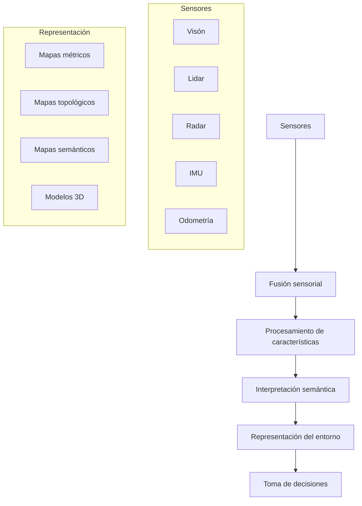

# Inteligencia Artificial - Percepción y conocimiento

## 5.3 Percepción (en robótica)

---

La percepción en robótica es el proceso mediante el cual un robot adquiere, interpreta y organiza información sensorial de su entorno para permitir la toma de decisiones autónomas. Según Russell y Norvig (2009), "la percepción robótica convierte las mediciones de sensores en representaciones internas útiles para la toma de decisiones". Esta capacidad es fundamental para que los robots interactúen de manera efectiva con entornos dinámicos y complejos.

### Conceptos Fundamentales

#### Definición de Percepción Robótica

La percepción robótica integra múltiples modalidades sensoriales para crear modelos coherentes del entorno:

$$
P(world|sensors) = \frac{P(sensors|world) \cdot P(world)}{P(sensors)}
$$

Donde:

- $P(world|sensors)$ es la probabilidad del estado del mundo dada la información sensorial
- $P(sensors|world)$ es el modelo sensorial (likelihood)
- $P(world)$ es la creencia previa sobre el estado del mundo

#### Arquitecturas de Percepción



### Sensores en Robótica

#### Tipos de Sensores

**Sensores exteroceptivos:**

- Cámaras (monoculares, estéreo, RGB-D)
- Lidar (2D, 3D)
- Radar
- Sonar

**Sensores proprioceptivos:**

- IMU (Unidad de Medición Inercial)
- Odometría
- Encoders

#### Modelado de Sensores

##### Modelo de Cámara Pin-hole

$$ \begin{pmatrix} u \\\ v \\\ 1 \end{pmatrix} = \frac{1}{Z} \begin{pmatrix} f_x & 0 & c_x \\\ 0 & f_y & c_y \\\ 0 & 0 & 1 \end{pmatrix} \begin{pmatrix} X \\\ Y \\\ Z \end{pmatrix} $$

##### Modelo Lidar

Para un sensor lidar 2D:

$$
r_i = r_{true} + \epsilon_r, \quad \epsilon_r \sim N(0, \sigma_r^2)
$$

$$
\theta_i = \theta_{true} + \epsilon_\theta, \quad \epsilon_\theta \sim N(0, \sigma_\theta^2)
$$

### Fusión Sensorial

#### Filtro de Kalman

Algoritmo óptimo para estimación de estado con modelos lineales y Gaussianos:

**Predicción:**
$$ \hat{x}\_{ k|k-1 } = F\_k \hat{x}\_{ k-1|k-1 } + B\_k u\_k $$

$$ P\_{k|k-1} = F\_k P\_{ k-1|k-1 } F\_k ^ T + Q\_k $$

**Actualización:**
$$ y\_k = z\_k - H\_k \hat{x}\_{ k|k-1 } $$

$$ S\_k = H\_k P\_{ k|k-1 } H\_k ^ T + R\_k $$

$$ K\_k = P\_{ k|k-1 } H\_k ^ T S\_k ^ {-1} $$

$$ \hat{x}\_{ k|k } = \hat{x}\_{ k|k-1 } + K\_k y\_k $$

$$ P\_{ k|k } = (I - K\_k H\_k) P\_{ k|k-1 } $$

#### Implementación de Kalman Filter

```python
import numpy as np

class KalmanFilter:
    def __init__(self, F, H, Q, R, P, x0):
        self.F = F  # Matriz de transición de estado
        self.H = H  # Matriz de observación
        self.Q = Q  # Covarianza del proceso
        self.R = R  # Covarianza de la medición
        self.P = P  # Covarianza del error
        self.x = x0 # Estado inicial

    def predict(self, u=None):
        # Predicción del estado
        if u is not None:
            self.x = self.F @ self.x + u
        else:
            self.x = self.F @ self.x

        # Predicción de la covarianza
        self.P = self.F @ self.P @ self.F.T + self.Q
        return self.x

    def update(self, z):
        # Innovación
        y = z - self.H @ self.x

        # Covarianza de la innovación
        S = self.H @ self.P @ self.H.T + self.R

        # Ganancia de Kalman
        K = self.P @ self.H.T @ np.linalg.inv(S)

        # Actualización del estado
        self.x = self.x + K @ y

        # Actualización de la covarianza
        I = np.eye(self.P.shape[0])
        self.P = (I - K @ self.H) @ self.P

        return self.x
```

### Localización y Mapeo

#### SLAM (Simultaneous Localization and Mapping)

Problema fundamental en robótica donde un robot debe construir un mapa de un entorno desconocido mientras se localiza dentro de él.

##### Formulación Bayesiana

$$ p( x\_{1:t}, m | z\_{1:t}, u\_{1:t}) = \eta \cdot p(z\_t | x\_t, m) \cdot \int p(x\_t | x\_{t-1}, u\_t) \cdot p(x\_{1:t-1}, m | z\_{1:t-1}, u\_{1:t-1}) dx\_{t-1} $$

#### Algoritmo FastSLAM

Implementación partícular para SLAM:

```python
class Particle:
    def __init__(self, pose, weight):
        self.pose = pose  # (x, y, theta)
        self.weight = weight
        self.landmarks = {}  # Mapas de landmarks con EKFs

class FastSLAM:
    def __init__(self, num_particles, initial_pose):
        self.particles = [Particle(initial_pose, 1.0/num_particles)
                         for _ in range(num_particles)]

    def motion_update(self, u, dt):
        for particle in self.particles:
            # Actualizar pose con modelo de movimiento
            particle.pose = self.motion_model(particle.pose, u, dt)

    def measurement_update(self, z):
        for particle in self.particles:
            weight = 1.0
            for measurement in z:
                landmark_id = measurement.id
                if landmark_id not in particle.landmarks:
                    # Nuevo landmark
                    particle.landmarks[landmark_id] = self.initialize_landmark(
                        particle.pose, measurement)
                else:
                    # Landmark existente - actualizar con EKF
                    weight *= particle.landmarks[landmark_id].update(
                        particle.pose, measurement)

            particle.weight = weight

        # Resampling
        self.resample_particles()
```

### Percepción Visual en Robótica

#### Extracción de Características

```python
import cv2
import numpy as np

class VisualPerception:
    def __init__(self):
        self.orb = cv2.ORB_create(nfeatures=1000)
        self.matcher = cv2.BFMatcher(cv2.NORM_HAMMING, crossCheck=True)

    def extract_features(self, image):
        # Detectar keypoints y descriptores
        keypoints, descriptors = self.orb.detectAndCompute(image, None)
        return keypoints, descriptors

    def match_features(self, desc1, desc2):
        # Emparejar características
        matches = self.matcher.match(desc1, desc2)
        matches = sorted(matches, key=lambda x: x.distance)
        return matches

    def estimate_motion(self, kp1, kp2, matches, K):
        # Estimar movimiento entre frames
        pts1 = np.float32([kp1[m.queryIdx].pt for m in matches])
        pts2 = np.float32([kp2[m.trainIdx].pt for m in matches])

        # Matriz esencial y descomposición
        E, mask = cv2.findEssentialMat(pts1, pts2, K, method=cv2.RANSAC, prob=0.999, threshold=1.0)
        _, R, t, mask = cv2.recoverPose(E, pts1, pts2, K)

        return R, t
```

### Procesamiento de Nube de Puntos

#### Segmentación y Clustering

```python
import open3d as o3d
from sklearn.cluster import DBSCAN

def process_pointcloud(pointcloud):
    # Preprocesamiento
    pcd = o3d.geometry.PointCloud()
    pcd.points = o3d.utility.Vector3dVector(pointcloud)

    # Remover outliers
    cl, ind = pcd.remove_statistical_outlier(nb_neighbors=20, std_ratio=2.0)

    # Segmentación por plano
    plane_model, inliers = pcd.segment_plane(distance_threshold=0.02,
                                            ransac_n=3,
                                            num_iterations=1000)

    # Clustering
    points = np.asarray(pcd.points)
    clustering = DBSCAN(eps=0.1, min_samples=10).fit(points)
    labels = clustering.labels_

    return labels, points
```

### Ejercicios Propuestos

#### Ejercicio 1: Implementación de Filtro de Kalman

1. Implementa un filtro de Kalman para tracking de posición 2D
2. Simula un objeto moviéndose con aceleración constante
3. Añade mediciones ruidosas y visualiza el rendimiento del filtro
4. Compara con un filtro de promedio móvil simple

#### Ejercicio 2: SLAM con Landmarks Artificiales

1. Crea un entorno simulado con landmarks conocidos
2. Implementa un algoritmo de SLAM basado en EKF
3. Visualiza la evolución del mapa y la trayectoria estimada
4. Analiza el error de localización frente a la trayectoria real

#### Ejercicio 3: Sistema de Percepción Multi-sensorial

1. Integra datos de cámara, IMU y odometría
2. Implementa fusión sensorial usando filtro de Kalman extendido (EKF)
3. Desarrolla un sistema de visualización para los datos fusionados
4. Evalúa la precisión comparada con usar cada sensor individualmente

#### Ejercicio 4: Navegación Basada en Visión

1. Desarrolla un sistema de detección y seguimiento de objetos
2. Implementa evitación de obstáculos usando visión estéreo
3. Crea un controlador que use la información perceptual para navegación
4. Prueba en entorno simulado o real con robot móvil

### Aplicaciones Prácticas

#### Robot Autónomo Indoor

Sistema de percepción completo para navegación interior:

```python
class IndoorPerceptionSystem:
    def __init__(self):
        self.slam = FastSLAM(num_particles=100)
        self.visual_odometry = VisualOdometry()
        self.obstacle_detector = ObstacleDetector()
        self.object_recognition = ObjectRecognizer()

    def process_frame(self, rgb_image, depth_image, imu_data, odom_data):
        # Fusión de datos multi-sensorial
        visual_odom = self.visual_odometry.estimate_motion(rgb_image)
        fused_odom = self.fuse_odometry(visual_odom, odom_data, imu_data)

        # Actualizar SLAM
        self.slam.update(fused_odom)

        # Detección de obstáculos
        obstacles = self.obstacle_detector.detect(depth_image)

        # Reconocimiento de objetos
        objects = self.object_recognition.detect(rgb_image)

        return {
            'pose': self.slam.get_pose(),
            'map': self.slam.get_map(),
            'obstacles': obstacles,
            'objects': objects
        }
```

### Referencias

#### Bibliografía Básica

1. Russell, S. J., & Norvig, P. (2009). _Artificial Intelligence: A Modern Approach_ (3rd ed.). Prentice Hall. (Capítulos 25-26)
2. Marsland, S. (2009). _Machine Learning: An Algorithmic Perspective_. Chapman and Hall. (Capítulo 12)

#### Bibliografía Complementaria

1. Thrun, S., Burgard, W., & Fox, D. (2005). _Probabilistic Robotics_. MIT Press.
2. Siciliano, B., & Khatib, O. (2016). _Springer Handbook of Robotics_. Springer.
3. Corke, P. (2017). _Robotics, Vision and Control: Fundamental Algorithms in MATLAB_. Springer.

#### Recursos Adicionales

- ROS (Robot Operating System): Framework para desarrollo de software robótico
- Gazebo: Simulador de robots
- OpenCV: Librería de visión por computadora
- Point Cloud Library (PCL): Procesamiento de nubes de puntos 3D

### Conclusiones

La percepción en robótica es un campo multidisciplinario que integra técnicas de visión por computadora, procesamiento de señales, aprendizaje automático y teoría de estimación. Los sistemas de percepción modernos utilizan fusión multi-sensorial para crear representaciones robustas del entorno que permiten a los robots operar de manera autónoma en condiciones del mundo real. El dominio de estos conceptos es esencial para el desarrollo de sistemas robóticos capaces de interactuar inteligentemente con entornos complejos y dinámicos.
