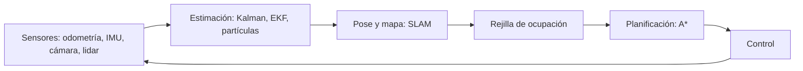

# Inteligencia Artificial - Percepción y conocimiento

## 5.3 Percepción (en robótica)

---

Un robot no observa su estado: lo **estima** a partir de sensores imperfectos. Las ruedas patinan y la odometría acumula error; un giróscopo tiene sesgo; un GPS falla bajo techo; una cámara mide bien pero de forma intermitente y con retraso. La **percepción robótica** combina modelos del movimiento y de los sensores con la teoría de la probabilidad para obtener la mejor estimación posible del estado del robot y de su entorno, junto con su incertidumbre, y es la base de la navegación autónoma. Este tema presenta los sensores y sus modelos, el filtro de Bayes y sus implementaciones, el filtro de Kalman y su versión extendida, la fusión sensorial, el problema de localización y mapeo simultáneos y su uso para navegar.

### Sensores y sus modelos

- **Propioceptivos**, que miden el propio robot: los **codificadores** de las ruedas dan la odometría; la **IMU** combina acelerómetros y giróscopos, con alta frecuencia pero con sesgos que, integrados, producen deriva.
- **Exteroceptivos**, que miden el entorno: el **lidar** mide distancias por tiempo de vuelo de un láser con error de centímetros; las **cámaras** dan información rica pero requieren procesarla, y la profundidad, con estéreo o con cámaras RGB-D; el **GPS** da posición absoluta en exteriores; los **sonares** son baratos pero imprecisos.

Cada sensor se describe con un **modelo de medición** $p(z \mid x),$ la probabilidad de cada lectura dado el estado. Un lidar mide un rango $r = r_{\text{real}} + \epsilon_r$ y un ángulo $\theta = \theta_{\text{real}} + \epsilon_\theta,$ con ruidos gaussianos, y un modelo realista agrega lecturas máximas y falsos obstáculos. Una cámara proyecta con el modelo estenopeico del tema 5.2, y un par estéreo convierte disparidad en profundidad con $Z = fB/d,$ cuyo error crece como $Z^2.$

### El filtro de Bayes

El estado $x_t$ evoluciona según un **modelo de movimiento** $p(x_t \mid x_{t-1}, u_t),$ con los controles $u_t,$ y produce mediciones según $p(z_t \mid x_t).$ La **creencia** $\text{bel}(x_t) = p(x_t \mid z_{1:t}, u_{1:t})$ se actualiza en dos pasos:

$$\overline{\text{bel}}(x_t) = \int p(x_t \mid x_{t-1}, u_t)\,\text{bel}(x_{t-1})\,dx_{t-1}, \qquad \text{bel}(x_t) = \eta\,p(z_t \mid x_t)\,\overline{\text{bel}}(x_t)$$

La **predicción** propaga la creencia con el movimiento y aumenta la incertidumbre; la **corrección** la multiplica por la verosimilitud de la medición y la reduce. Las implementaciones difieren en cómo representan la creencia: una gaussiana en el filtro de Kalman, un histograma en el filtro de rejilla, un conjunto de muestras en el **filtro de partículas**, que admite creencias con varios picos.

### El filtro de Kalman

Con modelos lineales, $x_t = F x_{t-1} + B u_t + w_t$ y $z_t = H x_t + v_t,$ y ruidos gaussianos $w_t \sim N(0, Q)$ y $v_t \sim N(0, R),$ la creencia es exactamente gaussiana y el filtro de Bayes se reduce a las ecuaciones de Kalman (1960). Predicción:

$$\hat x_{t \mid t-1} = F\,\hat x_{t-1} + B\,u_t, \qquad P_{t \mid t-1} = F P_{t-1} F^\top + Q$$

Corrección, con la **innovación** $y_t = z_t - H \hat x_{t \mid t-1}$ y su covarianza $S_t = H P_{t \mid t-1} H^\top + R:$

$$K_t = P_{t \mid t-1} H^\top S_t^{-1}, \qquad \hat x_t = \hat x_{t \mid t-1} + K_t\,y_t, \qquad P_t = (I - K_t H)\,P_{t \mid t-1}$$

La **ganancia de Kalman** $K_t$ pondera la predicción y la medición según sus incertidumbres. Bajo estas hipótesis, el filtro es el estimador de mínimo error cuadrático medio, y entre los estimadores lineales lo es aunque los ruidos no sean gaussianos. La consistencia se comprueba con la **NIS**, $y_t^\top S_t^{-1} y_t,$ que debe tener media igual a la dimensión de la medición.

El **filtro de Kalman extendido** (EKF) aplica las mismas ecuaciones a modelos no lineales $x_t = g(x_{t-1}, u_t)$ y $z_t = h(x_t),$ linealizándolos con sus jacobianos en la estimación actual. Es el caballo de batalla de la fusión sensorial, aunque puede divergir si los modelos son muy no lineales o la incertidumbre es grande; el filtro de Kalman *unscented* propaga puntos sigma en lugar de linealizar.

### Fusión sensorial

La **fusión** combina sensores con errores complementarios: la odometría y la IMU son frecuentes y suaves pero derivan; la cámara o el GPS son absolutos pero intermitentes y ruidosos. En un EKF, cada sensor es un modelo de medición, y el estado puede incluir los **sesgos** y factores de escala de los sensores, que el filtro estima a la vez que la pose: así, una fuente absoluta calibra a las relativas.

### SLAM

En la **localización y mapeo simultáneos** el robot no conoce ni su posición ni el mapa, y debe estimar ambos. La versión **en línea** estima la pose actual y el mapa,

$$p(x_t, m \mid z_{1:t}, u_{1:t}) = \eta\,p(z_t \mid x_t, m) \int p(x_t \mid x_{t-1}, u_t)\,p(x_{t-1}, m \mid z_{1:t-1}, u_{1:t-1})\,dx_{t-1}$$

y la versión **completa**, $p(x_{1:t}, m \mid z_{1:t}, u_{1:t}),$ toda la trayectoria, sin integrar las poses anteriores. Los enfoques principales son:

- **EKF-SLAM:** el estado contiene la pose y las posiciones de todas las marcas, con su covarianza conjunta; cuesta $O(n^2)$ por paso con $n$ marcas. Las correlaciones son la clave: al volver a ver una marca antigua, el **cierre del ciclo** corrige la pose y todas las marcas correlacionadas.
- **FastSLAM** (Montemerlo y otros, 2002): un filtro de partículas sobre las trayectorias, con un pequeño EKF por marca en cada partícula, porque dadas las poses las marcas son independientes.
- **SLAM de grafos:** las poses y marcas son nodos, y las mediciones, restricciones entre ellos; se resuelve como mínimos cuadrados dispersos, como el ajuste de haces del tema 5.2. Es el enfoque dominante, en sistemas como ORB-SLAM o Cartographer.

### Navegación basada en percepción

La percepción alimenta la planificación: las mediciones de profundidad se acumulan en una **rejilla de ocupación**, cada celda con su probabilidad de estar ocupada, que se infla según el tamaño del robot, y un planificador como A* del tema 2.2 busca un camino libre, que se recalcula al descubrir obstáculos nuevos. Ese ciclo de percibir, planificar y actuar es la arquitectura básica de un robot móvil.



### Implementación en Python

El programa simula los cuatro ejercicios con NumPy. Implementa un filtro de Kalman de aceleración constante y lo compara con promedios móviles; un EKF-SLAM con 8 marcas y sensor de rango y rumbo, comparado con la odometría sola; un EKF que fusiona odometría, giróscopo, el giro medido con las ruedas y posiciones de una cámara, estimando además el sesgo del giróscopo y la escala de la odometría; y un robot que navega con un sensor estéreo simulado, una rejilla de ocupación y A*.

```python
import heapq, math
import numpy as np

# ---------- Ejercicio 1: filtro de Kalman 2D con aceleración constante ----------
dt, n = 0.1, 300
F = np.eye(6)
for i in range(2):                                         # estado: x, y, vx, vy, ax, ay
    F[i, i + 2] = dt; F[i, i + 4] = dt * dt / 2; F[i + 2, i + 4] = dt
G = np.zeros((6, 2)); G[0, 0] = G[1, 1] = dt ** 3 / 6; G[2, 0] = G[3, 1] = dt ** 2 / 2; G[4, 0] = G[5, 1] = dt
q = 0.5; Q = G @ G.T * q ** 2                               # ruido de proceso: sacudida aleatoria de desviación q
H = np.zeros((2, 6)); H[0, 0] = H[1, 1] = 1; R = np.eye(2) * 2.0 ** 2
rng = np.random.default_rng(0); x = np.array([0, 0, 5, 1, 0.2, 0.4]); real, med = [], []
for k in range(n):
    if k == 150: x[4:] = [-0.6, 0.1]                        # cambio de aceleración a mitad del recorrido
    x = F @ x + G @ rng.normal(0, q, 2); real.append(x.copy()); med.append(x[:2] + rng.normal(0, 2.0, 2))
real, med = np.array(real), np.array(med)
xe, P = np.r_[med[0], np.zeros(4)], np.diag([4, 4, 100, 100, 10, 10.0]); est, nis = [], []
for z in med:
    xe = F @ xe; P = F @ P @ F.T + Q                       # predicción
    y = z - H @ xe; S = H @ P @ H.T + R; K = P @ H.T @ np.linalg.inv(S)
    xe = xe + K @ y; P = (np.eye(6) - K @ H) @ P; est.append(xe.copy()); nis.append(y @ np.linalg.solve(S, y))
est = np.array(est)
def ecm(a, b, desde=20): return np.sqrt(np.mean(np.sum((a[desde:] - b[desde:]) ** 2, axis=1)))
def promedio_movil(z, w): return np.array([z[max(0, k - w + 1):k + 1].mean(0) for k in range(len(z))])
print("ejercicio 1: error RMS de posición (m), ruido de medición σ = 2 m por eje")
print(f"   mediciones crudas {ecm(med, real[:, :2]):.3f} | promedio móvil de 5 {ecm(promedio_movil(med, 5), real[:, :2]):.3f} | "
      f"de 15 {ecm(promedio_movil(med, 15), real[:, :2]):.3f} | Kalman {ecm(est[:, :2], real[:, :2]):.3f}")
print(f"   velocidad estimada por Kalman: error RMS {ecm(est[:, 2:4], real[:, 2:4]):.3f} m/s; NIS medio {np.mean(nis[20:]):.2f} (esperado 2 si el filtro es consistente)")
pm = promedio_movil(med, 15)
for k in (100, 200, 299):
    print(f"   t = {k * dt:4.1f} s: real ({real[k, 0]:7.2f}, {real[k, 1]:6.2f}) | medición ({med[k, 0]:7.2f}, {med[k, 1]:6.2f}) | "
          f"promedio móvil ({pm[k, 0]:7.2f}, {pm[k, 1]:6.2f}) | Kalman ({est[k, 0]:7.2f}, {est[k, 1]:6.2f})")

# ---------- Ejercicio 2: EKF-SLAM con marcas de posición desconocida ----------
def ang(a): return (a + np.pi) % (2 * np.pi) - np.pi
MARCAS = np.array([[5, 0], [8, 6], [3, 9], [-3, 8], [-6, 2], [-4, -5], [2, -6], [7, -3.0]])
rng = np.random.default_rng(1); v, w, dt2 = 1.0, 0.1, 0.1; sv, sw, sr, sb = 0.1, 0.05, 0.1, np.radians(2)
xr = np.array([0, -6.0, 0]); xslam = np.r_[xr, np.zeros(2 * len(MARCAS))]; Pz = np.zeros((3 + 2 * len(MARCAS),) * 2)
Pz[3:, 3:] = np.eye(2 * len(MARCAS)) * 1e6; vistas = np.zeros(len(MARCAS), bool); xdr = xr.copy(); err_slam, err_dr = [], []
for k in range(int(2 * 2 * np.pi / (w * dt2))):            # dos vueltas a un círculo de radio 10
    xr = xr + [v * dt2 * math.cos(xr[2]), v * dt2 * math.sin(xr[2]), w * dt2]
    vm, wm = v + rng.normal(0, sv), w + rng.normal(0, sw)   # odometría ruidosa
    for e in (xslam, xdr):
        th = e[2]; e[:3] += [vm * dt2 * math.cos(th), vm * dt2 * math.sin(th), wm * dt2]
    th = xslam[2] - wm * dt2
    Fx = np.eye(len(xslam)); Fx[0, 2] = -vm * dt2 * math.sin(th); Fx[1, 2] = vm * dt2 * math.cos(th)
    V = np.zeros((len(xslam), 2)); V[0, 0] = dt2 * math.cos(th); V[1, 0] = dt2 * math.sin(th); V[2, 1] = dt2
    Pz = Fx @ Pz @ Fx.T + V @ np.diag([sv ** 2, sw ** 2]) @ V.T
    for j, m in enumerate(MARCAS):
        d = m - xr[:2]; r = np.hypot(*d)
        if r > 7: continue                                  # alcance del sensor
        z = np.array([r + rng.normal(0, sr), ang(math.atan2(d[1], d[0]) - xr[2] + rng.normal(0, sb))])
        i = 3 + 2 * j
        if not vistas[j]:                                   # inicializa la marca con la primera observación
            xslam[i:i + 2] = xslam[:2] + z[0] * np.array([math.cos(z[1] + xslam[2]), math.sin(z[1] + xslam[2])]); vistas[j] = True
        dd = xslam[i:i + 2] - xslam[:2]; qq = dd @ dd; rq = math.sqrt(qq)
        zh = np.array([rq, ang(math.atan2(dd[1], dd[0]) - xslam[2])])
        Hj = np.zeros((2, len(xslam)))
        Hj[:, :3] = [[-dd[0] / rq, -dd[1] / rq, 0], [dd[1] / qq, -dd[0] / qq, -1]]
        Hj[:, i:i + 2] = [[dd[0] / rq, dd[1] / rq], [-dd[1] / qq, dd[0] / qq]]
        S = Hj @ Pz @ Hj.T + np.diag([sr ** 2, sb ** 2]); Kg = Pz @ Hj.T @ np.linalg.inv(S)
        inn = z - zh; inn[1] = ang(inn[1]); xslam = xslam + Kg @ inn; xslam[2] = ang(xslam[2])
        Pz = (np.eye(len(xslam)) - Kg @ Hj) @ Pz
    err_slam.append(np.hypot(*(xslam[:2] - xr[:2]))); err_dr.append(np.hypot(*(xdr[:2] - xr[:2])))
pasos = len(err_slam)
print(f"ejercicio 2: {len(MARCAS)} marcas, alcance 7 m, {pasos} pasos (dos vueltas)")
for k in (pasos // 4, pasos // 2 - 1, pasos - 1):
    print(f"   paso {k + 1:4}: error de posición EKF-SLAM {err_slam[k]:.3f} m | solo odometría {err_dr[k]:.3f} m")
em = np.hypot(*(xslam[3:].reshape(-1, 2) - MARCAS).T)
print(f"   error de las marcas al final: medio {em.mean():.3f} m, máximo {em.max():.3f} m; "
      f"desviación de la posición del robot según el filtro {math.sqrt(Pz[0, 0] + Pz[1, 1]):.3f} m")

# ---------- Ejercicio 3: fusión de odometría, IMU y cámara con EKF ----------
rng = np.random.default_rng(2); dt3, n3 = 0.05, 1200
xr = np.array([0.0, 0, 0, 1.0]); reales = []
sesgo_odo, sesgo_giro = 0.03, np.radians(1.0)              # la rueda mide 3 % de más; el giróscopo tiene sesgo de 1 °/s
datos = []
for k in range(n3):
    wv = 0.3 * math.sin(0.02 * k); a = 0.2 * math.cos(0.01 * k)
    xr = xr + [xr[3] * dt3 * math.cos(xr[2]), xr[3] * dt3 * math.sin(xr[2]), wv * dt3, a * dt3]; reales.append(xr.copy())
    odo = xr[3] * (1 + sesgo_odo) + rng.normal(0, 0.05)
    giro = wv + sesgo_giro + rng.normal(0, np.radians(0.5))
    rueda_w = wv + rng.normal(0, np.radians(5))             # giro estimado con las ruedas: sin sesgo pero muy ruidoso
    cam = xr[:2] + rng.normal(0, 0.3, 2) if k % 20 == 0 else None    # marcadores visuales a 1 Hz
    datos.append((odo, giro, rueda_w, cam))
reales = np.array(reales)
def integra(usa_giro):
    e = np.zeros(4); e[3] = 1.0; tray = []
    for odo, giro, rueda_w, _ in datos:
        wv = giro if usa_giro else rueda_w; e = e + [odo * dt3 * math.cos(e[2]), odo * dt3 * math.sin(e[2]), wv * dt3, 0]; tray.append(e[:2].copy())
    return np.array(tray)
def ekf_fusion():                                           # estado: x, y, θ, sesgo del giróscopo, factor de escala de la odometría
    e = np.array([0, 0, 0, 0, 1.0]); P = np.diag([0.01, 0.01, 0.01, np.radians(2) ** 2, 0.05 ** 2]); tray = []
    Qd = np.diag([1e-4, 1e-4, 0, 1e-10, 1e-8])
    for odo, giro, rueda_w, cam in datos:
        vv, wv = odo / e[4], giro - e[3]
        th = e[2]; e = e + [vv * dt3 * math.cos(th), vv * dt3 * math.sin(th), wv * dt3, 0, 0]
        Fj = np.eye(5); Fj[0, 2] = -vv * dt3 * math.sin(th); Fj[1, 2] = vv * dt3 * math.cos(th); Fj[2, 3] = -dt3
        Fj[0, 4] = -odo / e[4] ** 2 * dt3 * math.cos(th); Fj[1, 4] = -odo / e[4] ** 2 * dt3 * math.sin(th)
        Qk = Qd.copy(); Qk[2, 2] = (np.radians(0.5) * dt3) ** 2; Qk[0, 0] += (0.05 * dt3) ** 2; Qk[1, 1] += (0.05 * dt3) ** 2
        P = Fj @ P @ Fj.T + Qk
        Hm = np.array([[0, 0, 0, -1, 0.0]]); Rm = np.array([[np.radians(5) ** 2]])   # el giro de las ruedas mide giro − sesgo
        y = np.array([rueda_w - (giro - e[3])]); S = Hm @ P @ Hm.T + Rm; K = P @ Hm.T / S; e = e + (K @ y).ravel(); P = (np.eye(5) - K @ Hm) @ P
        if cam is not None:
            Hm = np.zeros((2, 5)); Hm[0, 0] = Hm[1, 1] = 1; S = Hm @ P @ Hm.T + np.eye(2) * 0.09; K = P @ Hm.T @ np.linalg.inv(S)
            e = e + K @ (cam - e[:2]); P = (np.eye(5) - K @ Hm) @ P
        tray.append(e[:2].copy())
    return np.array(tray), e
camara = []; ultima = np.zeros(2)
for _, _, _, cam in datos:
    if cam is not None: ultima = cam
    camara.append(ultima.copy())
fus, e_fin = ekf_fusion()
def ecm2(a): return np.sqrt(np.mean(np.sum((a - reales[:, :2]) ** 2, axis=1)))
print(f"ejercicio 3: {n3 * dt3:.0f} s de trayectoria; error RMS de posición (m):")
print(f"   odometría + giro de las ruedas {ecm2(integra(False)):.3f} | odometría + giróscopo {ecm2(integra(True)):.3f} | "
      f"solo cámara (1 Hz) {ecm2(np.array(camara)):.3f} | EKF con todo {ecm2(fus):.3f}")
print(f"   el EKF estima el sesgo del giróscopo en {np.degrees(e_fin[3]):.2f} °/s (real 1.00) y el factor de la odometría en {e_fin[4]:.3f} (real 1.030)")

# ---------- Ejercicio 4: navegación con un sensor estéreo simulado ----------
OBST = [((6, 5), 1.5), ((10, 9), 2.0), ((5, 12), 1.2), ((14, 4), 1.5), ((13, 14), 1.8), ((9, 2), 1.0)]
F_PX, BASE, SD = 500.0, 0.12, 0.5                          # focal (px), línea base (m), ruido de disparidad (px)
CEL = 0.25; NG = int(20 / CEL)
def rayo(p, a, alcance=8.0):                               # distancia al primer obstáculo en la dirección a
    d = np.array([math.cos(a), math.sin(a)]); mejor = alcance
    for c, r in OBST:
        oc = p - np.array(c); b = oc @ d; disc = b * b - (oc @ oc - r * r)
        if disc >= 0 and -b - math.sqrt(disc) > 0: mejor = min(mejor, -b - math.sqrt(disc))
    return mejor
def astar(ocup, ini, fin):
    dist = {ini: 0}; padre = {}; cola = [(0, ini)]
    while cola:
        _, u = heapq.heappop(cola)
        if u == fin: break
        for df, dc in ((1, 0), (-1, 0), (0, 1), (0, -1), (1, 1), (1, -1), (-1, 1), (-1, -1)):
            v_ = (u[0] + df, u[1] + dc)
            if not (0 <= v_[0] < NG and 0 <= v_[1] < NG) or ocup[v_]: continue
            nd = dist[u] + math.hypot(df, dc)
            if nd < dist.get(v_, 1e18): dist[v_] = nd; padre[v_] = u; heapq.heappush(cola, (nd + math.hypot(fin[0] - v_[0], fin[1] - v_[1]), v_))
    camino, u = [], fin
    while u in padre: camino.append(u); u = padre[u]
    return camino[::-1]
def navega(percibe, semilla=3, inflado=0.45):
    rng = np.random.default_rng(semilla); p = np.array([1.0, 1.0]); meta = np.array([18.0, 18.0]); ocup = np.zeros((NG, NG), bool)
    recorrido, holgura = 0.0, 1e9
    for paso in range(400):
        if np.linalg.norm(p - meta) < 0.3: return True, recorrido, holgura, paso
        rumbo = math.atan2(*(meta - p)[::-1])
        if percibe:
            for a in np.linspace(rumbo - math.pi / 2, rumbo + math.pi / 2, 61):   # campo de visión de 180° hacia la meta
                z = rayo(p, a)
                if z >= 8.0: continue
                d = F_PX * BASE / z + rng.normal(0, SD); zest = F_PX * BASE / d                 # profundidad por disparidad
                q_ = p + zest * np.array([math.cos(a), math.sin(a)])
                f0, c0 = int(q_[0] / CEL), int(q_[1] / CEL); k = int(inflado / CEL) + 1
                ocup[max(0, f0 - k):f0 + k + 1, max(0, c0 - k):c0 + k + 1] = True               # inflado por el tamaño del robot
            ocup[int(p[0] / CEL), int(p[1] / CEL)] = False
            camino = astar(ocup, (int(p[0] / CEL), int(p[1] / CEL)), (int(meta[0] / CEL), int(meta[1] / CEL)))
            if not camino: return False, recorrido, holgura, paso
            obj = (np.array(camino[min(2, len(camino) - 1)]) + 0.5) * CEL
        else:
            obj = meta
        dirc = obj - p; paso_ = dirc / np.linalg.norm(dirc) * min(0.25, np.linalg.norm(dirc)); p = p + paso_; recorrido += np.linalg.norm(paso_)
        holgura = min(holgura, min(np.linalg.norm(p - np.array(c)) - r for c, r in OBST))
        if holgura < 0: return False, recorrido, holgura, paso
    return False, recorrido, holgura, 400
for z in (2.0, 5.0, 8.0):
    print(f"ejercicio 4: a {z} m, el ruido de 0.5 px en la disparidad da un error de profundidad de ±{z * z * SD / (F_PX * BASE):.3f} m")
for nombre, percibe in (("sin percepción, en línea recta", False), ("estéreo + rejilla de ocupación + A*", True)):
    ok, L, h, k = navega(percibe)
    print(f"   {nombre:36}: llega {ok}, recorrido {L:.2f} m (línea recta {math.hypot(17, 17):.2f}), holgura mínima {h:.2f} m, {k} pasos")
```

Salida:

```text
ejercicio 1: error RMS de posición (m), ruido de medición σ = 2 m por eje
   mediciones crudas 2.809 | promedio móvil de 5 2.176 | de 15 5.799 | Kalman 1.110
   velocidad estimada por Kalman: error RMS 0.967 m/s; NIS medio 1.98 (esperado 2 si el filtro es consistente)
   t = 10.0 s: real (  54.36,  35.95) | medición (  51.48,  40.19) | promedio móvil (  50.24,  32.44) | Kalman (  54.76,  36.50)
   t = 20.0 s: real ( 106.87, 112.62) | medición ( 106.81, 113.45) | promedio móvil ( 104.52, 107.22) | Kalman ( 107.02, 113.19)
   t = 29.9 s: real (  91.71, 179.80) | medición (  92.25, 177.45) | promedio móvil (  96.49, 176.83) | Kalman (  92.35, 179.91)
ejercicio 2: 8 marcas, alcance 7 m, 1256 pasos (dos vueltas)
   paso  315: error de posición EKF-SLAM 0.146 m | solo odometría 2.230 m
   paso  628: error de posición EKF-SLAM 0.031 m | solo odometría 1.040 m
   paso 1256: error de posición EKF-SLAM 0.007 m | solo odometría 3.085 m
   error de las marcas al final: medio 0.070 m, máximo 0.120 m; desviación de la posición del robot según el filtro 0.041 m
ejercicio 3: 60 s de trayectoria; error RMS de posición (m):
   odometría + giro de las ruedas 3.307 | odometría + giróscopo 12.129 | solo cámara (1 Hz) 0.871 | EKF con todo 0.163
   el EKF estima el sesgo del giróscopo en 0.98 °/s (real 1.00) y el factor de la odometría en 1.028 (real 1.030)
ejercicio 4: a 2.0 m, el ruido de 0.5 px en la disparidad da un error de profundidad de ±0.033 m
ejercicio 4: a 5.0 m, el ruido de 0.5 px en la disparidad da un error de profundidad de ±0.208 m
ejercicio 4: a 8.0 m, el ruido de 0.5 px en la disparidad da un error de profundidad de ±0.533 m
   sin percepción, en línea recta      : llega False, recorrido 5.25 m (línea recta 24.04), holgura mínima -0.18 m, 20 pasos
   estéreo + rejilla de ocupación + A* : llega True, recorrido 25.50 m (línea recta 24.04), holgura mínima 0.78 m, 102 pasos
```

### Ejercicios Propuestos

1. **Filtro de Kalman.** Implementa un filtro de Kalman para seguir una posición en 2D, simula un objeto con aceleración constante y mediciones ruidosas, evalúa el rendimiento del filtro y compáralo con un promedio móvil simple.

2. **SLAM con marcas.** Crea un entorno simulado con marcas, implementa SLAM basado en EKF, observa la evolución del mapa y de la trayectoria estimada, y analiza el error de localización frente a la trayectoria real.

3. **Percepción multisensorial.** Integra datos de cámara, IMU y odometría con un filtro de Kalman extendido, y compara la precisión con la de cada sensor por separado.

4. **Navegación basada en visión.** Desarrolla un sistema que detecte obstáculos con visión estéreo, y un controlador que use esa información para navegar, probado en un entorno simulado.

### Soluciones

**Ejercicio 1.** El estado es $(x, y, v_x, v_y, a_x, a_y),$ con la matriz de transición de aceleración constante y un ruido de proceso que modela cambios aleatorios de la aceleración, y la medición es la posición con $\sigma = 2$ m por eje. El filtro reduce el error RMS de 2.81 m de las mediciones a 1.11 m, y estima además la velocidad, que no se mide. El promedio móvil de 5 mediciones reduce el ruido a 2.18 m, pero el de 15 lo empeora a 5.80 m: promediar posiciones de un objeto que se mueve a unos 7 m/s introduce un **retraso** de medio intervalo, visible en las posiciones del programa. El filtro de Kalman no tiene ese problema porque predice con el modelo de movimiento antes de promediar, y su NIS media de 1.98, cerca de 2, confirma que su incertidumbre es consistente con sus errores. A los 15 s la aceleración cambia de golpe, y el filtro se adapta en pocos pasos porque el ruido de proceso admite esos cambios.

**Ejercicio 2.** El robot da dos vueltas a un círculo de radio 10 m entre 8 marcas, con odometría ruidosa y un sensor de rango, con 0.1 m de error, y rumbo, con 2°, de 7 m de alcance; cada marca se inicializa con su primera observación. Con la odometría sola, el error de posición crece sin límite y llega a 3.1 m al final. EKF-SLAM lo mantiene por debajo de 0.15 m, y al final de la segunda vuelta es de 0.007 m: cada vez que el robot vuelve a ver las marcas de la primera vuelta, el cierre del ciclo corrige su pose y, por las correlaciones, todas las marcas. El mapa final tiene un error medio de 0.07 m. La desviación estimada por el filtro, 0.04 m, está en el orden del error real. El sistema de referencia lo fija la pose inicial conocida; sin ella, el mapa solo se determina hasta una transformación rígida.

**Ejercicio 3.** La simulación dura 60 s, con una odometría que mide 3 % de más, un giróscopo con sesgo de 1 °/s, un giro estimado con las ruedas sin sesgo pero muy ruidoso, de 5 °/s, y una cámara que da la posición con 0.3 m de error una vez por segundo. Cada fuente sola es mala: la odometría con el giróscopo deriva hasta 12.1 m de error RMS, porque el sesgo acumula 60° de error de rumbo; con el giro de las ruedas, 3.3 m; la cámara sola, manteniendo la última posición, 0.87 m. El EKF, con el estado aumentado por el sesgo del giróscopo y la escala de la odometría, logra 0.16 m, y estima el sesgo en 0.98 °/s y la escala en 1.028, casi los valores reales. La fusión es mejor que cualquier sensor porque sus errores son complementarios, y porque modelar los sesgos convierte un error sistemático en un parámetro que se aprende.

**Ejercicio 4.** El sensor estéreo simulado tiene una focal de 500 px y una línea base de 12 cm, con 0.5 px de ruido en la disparidad: el error de profundidad es de 3 cm a 2 m y de 53 cm a 8 m, por la dependencia en $Z^2.$ El robot va de (1, 1) a (18, 18) entre 6 obstáculos circulares. Sin percepción, en línea recta, choca a los 5 m. Con percepción, en cada paso mide la profundidad en 61 direcciones de un campo de visión de 180°, marca las celdas ocupadas de una rejilla de 25 cm infladas 45 cm por el tamaño del robot, y replanifica con A*: llega a la meta en 102 pasos con un recorrido de 25.5 m, solo 6 % más que la línea recta, y una holgura mínima de 0.78 m. El sistema se completa con la detección de objetos del tema 5.1, para distinguir personas u otros obstáculos que se mueven, y un filtro de Kalman por objeto para predecir su trayectoria.

En el material original, la ecuación de SLAM escribía la distribución de la trayectoria completa, $x_{1:t},$ con la integral sobre $x_{t-1}$ de la versión en línea; son dos formulaciones distintas, como se muestra arriba.

### Referencias

1. Thrun, S., Burgard, W., and Fox, D., _Probabilistic Robotics_. MIT Press, 2005.
2. Kalman, R. E., A new approach to linear filtering and prediction problems. _Journal of Basic Engineering_ 82(1), 1960.
3. Durrant-Whyte, H., and Bailey, T., Simultaneous localization and mapping: part I. _IEEE Robotics and Automation Magazine_ 13(2), 2006.
4. Montemerlo, M., Thrun, S., Koller, D., and Wegbreit, B., FastSLAM: a factored solution to the simultaneous localization and mapping problem. _AAAI_, 2002.
5. Bar-Shalom, Y., Li, X. R., and Kirubarajan, T., _Estimation with Applications to Tracking and Navigation_. Wiley, 2001.
6. Mur-Artal, R., Montiel, J. M. M., and Tardós, J. D., ORB-SLAM: a versatile and accurate monocular SLAM system. _IEEE Transactions on Robotics_ 31(5), 2015.
7. Elfes, A., Using occupancy grids for mobile robot perception and navigation. _Computer_ 22(6), 1989.
