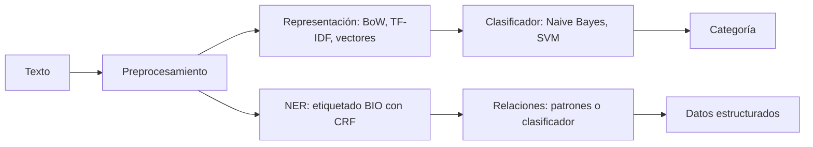

# Inteligencia Artificial - Percepción y conocimiento

## 5.4 Procesamiento de lenguaje natural (categorizar texto y extracción de información).

---

La mayor parte de la información que producen las personas está escrita: correos, reseñas, noticias, expedientes, contratos. El **procesamiento de lenguaje natural** (PLN) permite a una computadora trabajar con ese texto. Este tema trata dos tareas clásicas: la **categorización**, que asigna a un documento una clase, como positivo o negativo, o deportes o economía; y la **extracción de información**, que convierte texto libre en datos estructurados, como las personas, organizaciones y lugares que menciona y las relaciones entre ellos. Presenta el preprocesamiento, las representaciones de bolsa de palabras y TF-IDF, los clasificadores Naive Bayes y SVM, el reconocimiento de entidades como etiquetado de secuencias, la extracción de relaciones con patrones, las métricas y el papel de los modelos modernos.

### Preprocesamiento

1. **Tokenización:** separar el texto en unidades, palabras y signos; parece trivial, pero hay casos como "EE. UU.", "3.5" o "¿Qué?".
2. **Normalización:** minúsculas, y opcionalmente quitar acentos, lo que unifica "rápido" y "rapido" pero confunde "esta" y "está".
3. **Palabras vacías:** quitar las muy frecuentes y poco informativas, como "el", "de" o "que", con cuidado: "no" es vacía para la categorización por tema y crucial para el sentimiento.
4. **Lematización o raíces:** llevar "funciona", "funcionó" y "funcionando" a una forma común.
5. **Negación:** marcar las palabras que siguen a una negación, de modo que "no funciona" produzca el rasgo `NO_funciona`, distinto de `funciona`.

### Representaciones

En la **bolsa de palabras**, un documento es un vector con el número de apariciones de cada término del vocabulario, sin orden. Agregar **n-gramas**, secuencias de 2 o más palabras, recupera parte del orden, como "no recomiendo". **TF-IDF** pondera cada término por su frecuencia en el documento y por su rareza en la colección:

$$\text{tfidf}(t, d) = \text{tf}(t, d) \cdot \text{idf}(t), \qquad \text{idf}(t) = \log \frac{N}{\text{df}(t)}$$

con $N$ documentos, de los cuales $\text{df}(t)$ contienen a $t:$ una palabra que aparece en todos los documentos tiene idf 0 y no distingue nada. Las implementaciones suelen usar variantes: scikit-learn usa $\ln\frac{1 + N}{1 + \text{df}(t)} + 1,$ que nunca es 0, y normaliza cada vector a norma 1. Los **n-gramas de caracteres** son robustos a errores de escritura y a las variantes morfológicas.

Estas representaciones son dispersas y no capturan que "excelente" y "magnífico" se parecen. Los **vectores de palabras**, como word2vec (Mikolov y otros, 2013), asignan a cada palabra un vector denso de unos cientos de dimensiones aprendido de su contexto, en el que las palabras de uso parecido quedan cerca; los **transformadores** como BERT (Devlin y otros, 2019) producen vectores que dependen del contexto, y BETO es su versión en español.

### Clasificación

**Naive Bayes multinomial** aplica la regla de Bayes suponiendo que las palabras son independientes dada la clase:

$$\hat c = \arg\max_c \Big[\log P(c) + \sum_{t \in d} \log P(t \mid c)\Big], \qquad P(t \mid c) = \frac{N_{t,c} + \alpha}{N_c + \alpha\,|V|}$$

con suavizado de Laplace $\alpha$ para que una palabra no vista no anule la probabilidad. La independencia es falsa, pero el clasificador funciona bien porque solo importa qué clase gana, no las probabilidades exactas; es rápido y fuerte con pocos datos. La **SVM lineal** del tema 4.1 suele ser más precisa con más datos, porque no supone independencia y maneja bien los vectores de alta dimensión y dispersos del texto.

### Extracción de información

El **reconocimiento de entidades nombradas** (NER) encuentra y clasifica menciones de personas, organizaciones, lugares, fechas y cantidades. Se plantea como **etiquetado de secuencias** con el esquema **BIO**: B marca el inicio de una entidad, I su continuación y O lo demás, de modo que "Ana López trabaja en Pemex" es `B-PER I-PER O O B-ORG`. Los modelos clásicos son los CRF del tema 3.4, con rasgos como la palabra, sus mayúsculas, sus sufijos y sus vecinas; los actuales, redes neuronales con una capa CRF o transformadores ajustados. Para el español, los corpus de referencia son AnCora y el de la tarea compartida CoNLL-2002.

La **extracción de relaciones** identifica vínculos entre entidades, como trabaja-en(persona, organización). El enfoque más simple usa **patrones** léxicos o sintácticos, como `PER trabaja en ORG` o `ORG contrató a PER`, al estilo de los patrones de Hearst (1992); es preciso pero de exhaustividad limitada. Los enfoques supervisados clasifican cada par de entidades de una oración, y la **supervisión distante** obtiene ejemplos de entrenamiento alineando una base de conocimiento con texto.

### Evaluación

Para la clasificación, la **exactitud** y, por clase, la **precisión**, la **exhaustividad** y su media armónica, $F_1 = 2PR/(P + R);$ con clases desbalanceadas, el promedio macro de $F_1.$ Para NER se evalúa por **entidad completa**: una entidad cuenta como acierto solo si coinciden sus límites y su tipo. Con pocos datos, la **validación cruzada** estratificada da estimaciones más estables que una sola partición.



### Implementación en Python

El programa calcula el TF-IDF del ejemplo del material original y aplica scikit-learn a los cuatro ejercicios con corpus pequeños escritos para el ejemplo, porque los conjuntos de reseñas y noticias en español y AnCora no están disponibles sin conexión. Compara representaciones y clasificadores de sentimiento con y sin marcar la negación; entrena un CRF propio para NER y lo evalúa por entidad; extrae relaciones con patrones, y clasifica noticias y recomienda por similitud de contenido.

```python
import re, unicodedata
import numpy as np
from scipy.optimize import minimize
from scipy.special import logsumexp
from sklearn.feature_extraction.text import CountVectorizer, TfidfVectorizer
from sklearn.metrics.pairwise import cosine_similarity
from sklearn.model_selection import StratifiedKFold, cross_val_score
from sklearn.naive_bayes import MultinomialNB
from sklearn.pipeline import make_pipeline
from sklearn.svm import LinearSVC

# ---------- TF-IDF del ejemplo del material original ----------
corpus = ["el gato come pescado", "el perro come carne", "el gato y el perro son animales"]
tv = TfidfVectorizer(); Xt = tv.fit_transform(corpus)
print("tf-idf de scikit-learn:", {k: round(float(v), 3) for k, v in zip(tv.get_feature_names_out(), Xt.toarray()[0])})
print("   idf suavizado ln((1 + N)/(1 + df)) + 1:", {k: round(float(v), 3) for k, v in zip(tv.get_feature_names_out(), tv.idf_)})

# ---------- Preprocesamiento ----------
VACIAS = set("el la los las un una unos unas de del a al y o en con por para es son fue muy lo que se mi me le su".split())
NEGACIONES = {"no", "nunca", "nada", "ni", "jamás", "tampoco"}
def sin_acentos(t): return "".join(c for c in unicodedata.normalize("NFD", t) if unicodedata.category(c) != "Mn")
def preprocesa(texto, negacion=True):
    palabras = re.findall(r"[a-záéíóúñü]+", texto.lower()); salida, neg = [], 0
    for w in palabras:
        if w in NEGACIONES: neg = 3; continue                    # marca las 3 palabras siguientes
        if w in VACIAS: continue
        w = sin_acentos(w); salida.append(("NO_" + w) if (negacion and neg > 0) else w); neg -= 1
    return " ".join(salida)

# ---------- Ejercicio 1: sentimiento de reseñas (corpus pequeño escrito para el ejemplo) ----------
POS = ["excelente producto, llegó rápido y funciona perfecto", "me encanta, la calidad es muy buena", "muy buena compra, lo recomiendo",
       "funciona bien y la batería dura mucho", "el envío fue rápido y el empaque impecable", "superó mis expectativas, gran calidad",
       "buen precio y buena calidad", "estoy muy contento con la compra", "fácil de usar y muy cómodo", "no tiene ningún defecto, perfecto",
       "la pantalla se ve increíble", "el sonido es claro y potente", "atención al cliente amable y rápida", "lo volvería a comprar sin dudar",
       "cumple con lo prometido, buena compra", "no me arrepiento, es excelente", "resistente y bien hecho", "vale cada peso",
       "mi hijo está feliz con su regalo", "práctico, ligero y bonito", "todo llegó en perfecto estado", "la mejor compra del año",
       "muy recomendable, funciona de maravilla", "nunca falla, muy confiable", "producto de calidad a buen precio"]
NEG = ["no funciona, muy mala calidad", "llegó roto y tarde", "no lo recomiendo, se descompuso en una semana", "pésimo servicio al cliente",
       "la batería dura muy poco", "es caro para lo que ofrece", "no es lo que esperaba, decepcionante", "dejó de funcionar al mes",
       "el material es frágil y barato", "no sirve, perdí mi dinero", "el envío tardó un mes", "la pantalla tiene manchas",
       "muy ruidoso e incómodo", "las instrucciones no se entienden", "nunca llegó el reembolso", "producto defectuoso, lo devolví",
       "no vale la pena", "se calienta demasiado", "la peor compra que he hecho", "no tiene buena calidad, se rompió", "mala atención y respuesta lenta",
       "el color no es como en la foto", "huele a plástico y se despega", "no carga bien, muy lento", "me arrepiento de comprarlo"]
textos = POS + NEG; etiquetas = np.array([1] * len(POS) + [0] * len(NEG))
cv = StratifiedKFold(5, shuffle=True, random_state=0)
print(f"ejercicio 1: {len(textos)} reseñas; exactitud con validación cruzada de 5 partes")
for neg in (False, True):
    docs = [preprocesa(t, neg) for t in textos]
    fila = []
    for nr, vec in (("BoW", lambda: CountVectorizer(ngram_range=(1, 2))), ("TF-IDF", lambda: TfidfVectorizer(ngram_range=(1, 2), sublinear_tf=True)),
                    ("TF-IDF de caracteres", lambda: TfidfVectorizer(analyzer="char_wb", ngram_range=(2, 4), sublinear_tf=True))):
        for nc, clf in (("Naive Bayes", lambda: MultinomialNB(alpha=0.5)), ("SVM", lambda: LinearSVC(C=1.0))):
            fila.append(f"{nr} + {nc} {cross_val_score(make_pipeline(vec(), clf()), docs, etiquetas, cv=cv).mean():.3f}")
    print(f"   {'con' if neg else 'sin'} marcar la negación: " + " | ".join(fila[:3])); print("      " + " | ".join(fila[3:]))
print("   ejemplo de preprocesamiento:", repr(preprocesa("No tiene buena calidad, se rompió")))
modelo = make_pipeline(TfidfVectorizer(ngram_range=(1, 2), sublinear_tf=True), MultinomialNB(alpha=0.5)).fit([preprocesa(t) for t in textos], etiquetas)
for t in ("me encanta, funciona perfecto", "no funciona y llegó tarde", "no es malo, pero tampoco es bueno"):
    p = modelo.predict_proba([preprocesa(t)])[0]; print(f"   «{t}»: P(positiva) = {p[1]:.3f}")

# ---------- Ejercicio 2: reconocimiento de entidades con un CRF de cadena lineal ----------
def anota(s):                                                     # "[Ana López|PER] trabaja en [Pemex|ORG]" → tokens y etiquetas BIO
    toks, tags = [], []
    for ent, tipo, palabra in re.findall(r"\[([^\]|]+)\|(\w+)\]|(\S+)", s):
        if palabra: toks.append(palabra); tags.append("O")
        else:
            for i, w in enumerate(ent.split()): toks.append(w); tags.append(("B-" if i == 0 else "I-") + tipo)
    return toks, tags
FRASES = ["[Ana López|PER] trabaja en [Pemex|ORG] desde 2019 .", "[Carlos Ruiz|PER] es ingeniero de [Telmex|ORG] en [Monterrey|LOC] .",
          "La empresa [Bimbo|ORG] abrió una planta en [Guadalajara|LOC] .", "[María Pérez|PER] visitó [Oaxaca|LOC] con su familia .",
          "El banco [Banorte|ORG] contrató a [Luis Gómez|PER] .", "[Sofía Ramírez|PER] , directora de [Cemex|ORG] , viajó a [Madrid|LOC] .",
          "En [Puebla|LOC] , [Volkswagen|ORG] produce autos .", "[Jorge Díaz|PER] dejó la [UNAM|ORG] el año pasado .",
          "[Lucía Torres|PER] trabaja para [Banco de México|ORG] .", "El presidente de [Grupo Modelo|ORG] , [Pedro Sánchez|PER] , habló en [Toluca|LOC] .",
          "[Elena Castro|PER] nació en [Veracruz|LOC] .", "[Femsa|ORG] anunció ganancias en [Nuevo León|LOC] .",
          "[Raúl Medina|PER] es investigador del [IPN|ORG] .", "La [Secretaría de Salud|ORG] informó desde [Ciudad de México|LOC] .",
          "[Daniel Herrera|PER] y [Paula Vega|PER] estudian en [Querétaro|LOC] .", "[Alfa|ORG] compró una empresa de [Chile|LOC] .",
          "[Andrea Flores|PER] trabaja en [Liverpool|ORG] , en [Mérida|LOC] .", "El equipo de [Televisa|ORG] llegó a [Cancún|LOC] .",
          "[Miguel Ortiz|PER] , gerente de [Walmart|ORG] , renunció .", "[Gabriela Ríos|PER] vive en [Tijuana|LOC] y trabaja en [Foxconn|ORG] ."]
PRUEBA_NER = ["[Fernando Luna|PER] trabaja en [Pemex|ORG] , en [Tabasco|LOC] .", "[Claudia Mora|PER] , directora de [Bimbo|ORG] , viajó a [Lima|LOC] .",
              "El banco [Santander|ORG] contrató a [Óscar Vela|PER] .", "[Rosa Aguilar|PER] nació en [Chihuahua|LOC] .",
              "[Iván Cruz|PER] es ingeniero de [Nissan|ORG] en [Aguascalientes|LOC] .", "La empresa [Lala|ORG] abrió una planta en [Durango|LOC] ."]
ETQ = ["O", "B-PER", "I-PER", "B-ORG", "I-ORG", "B-LOC", "I-LOC"]
def rasgos(toks, t):
    w = toks[t]; f = ["sesgo", "w=" + w.lower(), "suf3=" + w[-3:].lower(), "may=" + str(w[0].isupper()), "todo_may=" + str(w.isupper() and len(w) > 1),
                      "inicio=" + str(t == 0), "prev=" + (toks[t - 1].lower() if t else "<i>"), "sig=" + (toks[t + 1].lower() if t + 1 < len(toks) else "<f>"),
                      "prev_may=" + str(t > 0 and toks[t - 1][0].isupper())]
    return f
entren = [anota(s) for s in FRASES]; IDX = {}
for toks, _ in entren:
    for t in range(len(toks)):
        for f in rasgos(toks, t): IDX.setdefault(f, len(IDX))
K, Fn = len(ETQ), len(IDX)
def matriz(toks): return [[IDX[f] for f in rasgos(toks, t) if f in IDX] for t in range(len(toks))]
def partes(th): return th[:Fn * K].reshape(Fn, K), th[Fn * K:Fn * K + K * K].reshape(K, K), th[Fn * K + K * K:]
def nll(th, datos, l2=0.1):
    W, T, S = partes(th); gW, gT, gS = np.zeros_like(W), np.zeros_like(T), np.zeros_like(S); total = 0.0
    for X, y in datos:
        E = np.array([W[ix].sum(0) for ix in X]); n = len(y); a = np.zeros((n, K)); b = np.zeros((n, K)); a[0] = S + E[0]
        for t in range(1, n): a[t] = E[t] + logsumexp(a[t - 1][:, None] + T, axis=0)
        for t in range(n - 2, -1, -1): b[t] = logsumexp(T + (E[t + 1] + b[t + 1])[None, :], axis=1)
        lz = logsumexp(a[-1]); total -= S[y[0]] + sum(E[t, y[t]] for t in range(n)) + sum(T[y[t - 1], y[t]] for t in range(1, n)) - lz
        m = np.exp(a + b - lz); gS[y[0]] -= 1; gS += m[0]
        for t in range(n):
            for i in X[t]: gW[i, y[t]] -= 1; gW[i] += m[t]
        for t in range(1, n): gT[y[t - 1], y[t]] -= 1; gT += np.exp(a[t - 1][:, None] + T + (E[t] + b[t])[None, :] - lz)
    return total + l2 / 2 * th @ th, np.concatenate([gW.ravel(), gT.ravel(), gS]) + l2 * th
def viterbi(th, X):
    W, T, S = partes(th); E = np.array([W[ix].sum(0) for ix in X]); d = S + E[0]; bp = []
    for t in range(1, len(X)): c = d[:, None] + T; bp.append(c.argmax(0)); d = c.max(0) + E[t]
    y = [int(d.argmax())]
    for b in reversed(bp): y.append(int(b[y[-1]]))
    return [ETQ[k] for k in y[::-1]]
th = minimize(nll, np.zeros(Fn * K + K * K + K), args=([(matriz(t), [ETQ.index(e) for e in g]) for t, g in entren],), jac=True, method="L-BFGS-B").x
def entidades(toks, tags):
    ents, cur = [], None
    for i, (w, t) in enumerate(zip(toks, tags)):
        if t.startswith("B-") or (t.startswith("I-") and (cur is None or cur[0] != t[2:])):
            if cur: ents.append(cur)
            cur = (t[2:], [w])
        elif t.startswith("I-"): cur[1].append(w)
        else:
            if cur: ents.append(cur)
            cur = None
    if cur: ents.append(cur)
    return {(tipo, " ".join(p)) for tipo, p in ents}
vp = fp = fn = 0; por_tipo = {}
for s in PRUEBA_NER:
    toks, gold = anota(s); pred = viterbi(th, matriz(toks)); G, Pd = entidades(toks, gold), entidades(toks, pred)
    vp += len(G & Pd); fp += len(Pd - G); fn += len(G - Pd)
    for tipo, _ in G: por_tipo.setdefault(tipo, [0, 0]); por_tipo[tipo][1] += 1; por_tipo[tipo][0] += (tipo, _) in Pd
    print("   " + " ".join(f"{w}/{p}" for w, p in zip(toks, pred) if p != "O"))
P, Rr = vp / (vp + fp), vp / (vp + fn)
print(f"ejercicio 2: CRF con {Fn * K + K * K + K} parámetros; entidades en prueba: precisión {P:.3f}, exhaustividad {Rr:.3f}, F1 {2 * P * Rr / (P + Rr):.3f}; "
      + ", ".join(f"{t} {a}/{b}" for t, (a, b) in sorted(por_tipo.items())))

# ---------- Ejercicio 3: relación persona-trabaja-en-organización con patrones ----------
PATRONES = [r"<PER> (?:trabaja|labora) (?:en|para) (?:el |la )?<ORG>", r"<PER> , (?:director|directora|gerente|presidente|empleado|empleada) de (?:el |la )?<ORG>",
            r"<PER> es (?:\w+ )(?:de|del) (?:la )?<ORG>", r"<ORG> contrató a <PER>", r"(?:presidente|director|directora|gerente) de <ORG> , <PER>"]
def relaciones(toks, tags):
    ents, s, i = [], [], 0                                         # reemplaza cada entidad por su tipo y guarda su texto
    while i < len(toks):
        if tags[i].startswith("B-"):
            tipo = tags[i][2:]; j = i + 1
            while j < len(toks) and tags[j] == "I-" + tipo: j += 1
            ents.append((tipo, " ".join(toks[i:j]))); s.append(f"<{tipo}{len(ents) - 1}>"); i = j
        else: s.append(toks[i].lower()); i += 1
    texto = " ".join(s); res = set()
    for p in PATRONES:
        rx = p.replace("<PER>", r"<PER(\d+)>").replace("<ORG>", r"<ORG(\d+)>")
        for m in re.finditer(rx, texto):
            g = m.groups(); per, org = (g[0], g[1]) if p.index("<PER>") < p.index("<ORG>") else (g[1], g[0])
            res.add((ents[int(per)][1], ents[int(org)][1]))
    return res
ORO = {0: {("Ana López", "Pemex")}, 1: {("Carlos Ruiz", "Telmex")}, 4: {("Luis Gómez", "Banorte")}, 5: {("Sofía Ramírez", "Cemex")},
       7: set(), 8: {("Lucía Torres", "Banco de México")}, 9: {("Pedro Sánchez", "Grupo Modelo")}, 12: {("Raúl Medina", "IPN")},
       16: {("Andrea Flores", "Liverpool")}, 18: {("Miguel Ortiz", "Walmart")}, 19: {("Gabriela Ríos", "Foxconn")}}
vp = fp = fn = 0; errores = []
for i, s in enumerate(FRASES):
    toks, tags = anota(s); pred = relaciones(toks, tags); oro = ORO.get(i, set())
    vp += len(pred & oro); fp += len(pred - oro); fn += len(oro - pred)
    if pred != oro: errores.append((" ".join(toks), sorted(pred - oro), sorted(oro - pred)))
print(f"ejercicio 3: {len(PATRONES)} patrones sobre entidades correctas: precisión {vp / max(vp + fp, 1):.3f}, exhaustividad {vp / (vp + fn):.3f}")
for t, sobra, falta in errores: print(f"   error en «{t}»: sobra {sobra}, falta {falta}")
toks = anota(PRUEBA_NER[0])[0]; print("   sobre las entidades del CRF en una frase nueva:", relaciones(toks, viterbi(th, matriz(toks))))

# ---------- Ejercicio 4: categorías de noticias y recomendación por contenido ----------
NOTICIAS = {"deportes": [
    "el equipo ganó el partido con un gol en el último minuto; el entrenador celebró el triunfo con la afición",
    "la selección nacional se prepara para el mundial; el técnico convocó a veintiséis jugadores",
    "el delantero firmó con un club europeo por cuatro temporadas; anotó quince goles en la liga",
    "el maratón reunió a miles de corredores; el ganador cruzó la meta en dos horas",
    "la tenista avanzó a la final del torneo tras vencer a la campeona en tres sets",
    "el entrenador anunció la alineación para el clásico; el equipo visitante llega invicto",
    "el portero atajó un penal decisivo y su equipo pasó a la siguiente ronda del torneo",
    "la liga suspendió el partido por la lluvia; los jugadores volverán a la cancha el domingo",
    "el ciclista ganó la etapa de montaña y es líder de la carrera",
    "el boxeador defenderá su título ante el campeón europeo; la pelea será en el estadio"],
  "economía": [
    "el banco central subió la tasa de interés para contener la inflación",
    "la inflación bajó por tercer mes consecutivo según el instituto de estadística",
    "el peso se apreció frente al dólar por la llegada de inversión extranjera",
    "las exportaciones crecieron en el trimestre; los analistas esperan más crecimiento económico",
    "la bolsa cerró con ganancias impulsada por las acciones de los bancos",
    "el gobierno presentó el presupuesto anual con más gasto en infraestructura y menos deuda",
    "las empresas reportaron mayores ventas y utilidades en el trimestre",
    "el desempleo bajó en el sector industrial; los salarios crecieron por encima de la inflación",
    "el precio del petróleo subió y presiona la inflación de los combustibles",
    "la deuda pública aumentó; el banco central advierte riesgos para la economía"],
  "tecnología": [
    "la empresa presentó un nuevo teléfono inteligente con mejor cámara y más batería",
    "un modelo de inteligencia artificial escribe código y responde preguntas de los usuarios",
    "el nuevo procesador consume menos energía; las computadoras portátiles tendrán más batería",
    "la red social cambió su algoritmo y los usuarios ven menos publicaciones de amigos",
    "un ataque informático afectó los sistemas de varios bancos; los datos de los usuarios están seguros",
    "la aplicación permite pagar con el teléfono sin tarjeta; ya tiene un millón de usuarios",
    "el satélite dará internet a zonas rurales con una conexión de alta velocidad",
    "la computadora cuántica resolvió un problema que tardaría años en una computadora normal",
    "el fabricante lanzó una tableta con pantalla plegable y un procesador más rápido",
    "la nube de datos sufrió una falla y miles de sitios de internet quedaron sin servicio"],
  "salud": [
    "la vacuna redujo los contagios en los hospitales; los médicos recomiendan la segunda dosis",
    "los médicos recomiendan hacer ejercicio para cuidar el corazón y prevenir la diabetes",
    "el hospital abrió una nueva unidad de cuidados intensivos para pacientes graves",
    "un estudio relaciona el consumo de azúcar con la diabetes y la obesidad",
    "la campaña de vacunación llegó a las escuelas; los niños recibirán la vacuna gratis",
    "dormir poco afecta el corazón, advierte un estudio con miles de pacientes",
    "el nuevo tratamiento reduce el dolor en pacientes con artritis, según los médicos",
    "aumentan los casos de dengue; las autoridades de salud piden eliminar el agua estancada",
    "la dieta mediterránea protege el corazón y reduce el riesgo de diabetes",
    "los médicos piden lavarse las manos para prevenir contagios en temporada de frío"]}
docs = [preprocesa(t, False) for c in NOTICIAS for t in NOTICIAS[c]]; cats = np.array([c for c in NOTICIAS for _ in NOTICIAS[c]])
print("ejercicio 4: 40 notas breves en 4 categorías; exactitud con validación cruzada de 5 partes")
for nombre, pipe in (("BoW + Naive Bayes", make_pipeline(CountVectorizer(), MultinomialNB(alpha=0.5))), ("TF-IDF + Naive Bayes", make_pipeline(TfidfVectorizer(), MultinomialNB(alpha=0.1))),
                     ("TF-IDF + SVM", make_pipeline(TfidfVectorizer(), LinearSVC())), ("TF-IDF de caracteres + SVM", make_pipeline(TfidfVectorizer(analyzer="char_wb", ngram_range=(3, 5)), LinearSVC()))):
    print(f"   {nombre:28}: {cross_val_score(pipe, docs, cats, cv=cv).mean():.3f}")
vec = TfidfVectorizer(analyzer="char_wb", ngram_range=(3, 5)).fit(docs); M = vec.transform(docs); sim = cosine_similarity(M); np.fill_diagonal(sim, -1)
aciertos = np.mean([np.mean(cats[np.argsort(-sim[i])[:3]] == cats[i]) for i in range(len(docs))])
leida = NOTICIAS["salud"][0]; i = docs.index(preprocesa(leida, False))
print(f"   recomendación: de las 3 noticias más parecidas, {aciertos:.1%} son de la misma categoría; para «{leida}»:")
for j in np.argsort(-sim[i])[:3]: print(f"      {sim[i, j]:.3f} [{cats[j]}] {[t for c in NOTICIAS for t in NOTICIAS[c]][j]}")
```

Salida:

```text
tf-idf de scikit-learn: {'animales': 0.0, 'carne': 0.0, 'come': 0.48, 'el': 0.373, 'gato': 0.48, 'perro': 0.0, 'pescado': 0.632, 'son': 0.0}
   idf suavizado ln((1 + N)/(1 + df)) + 1: {'animales': 1.693, 'carne': 1.693, 'come': 1.288, 'el': 1.0, 'gato': 1.288, 'perro': 1.288, 'pescado': 1.693, 'son': 1.693}
ejercicio 1: 50 reseñas; exactitud con validación cruzada de 5 partes
   sin marcar la negación: BoW + Naive Bayes 0.560 | BoW + SVM 0.520 | TF-IDF + Naive Bayes 0.560
      TF-IDF + SVM 0.580 | TF-IDF de caracteres + Naive Bayes 0.540 | TF-IDF de caracteres + SVM 0.560
   con marcar la negación: BoW + Naive Bayes 0.680 | BoW + SVM 0.640 | TF-IDF + Naive Bayes 0.680
      TF-IDF + SVM 0.680 | TF-IDF de caracteres + Naive Bayes 0.680 | TF-IDF de caracteres + SVM 0.640
   ejemplo de preprocesamiento: 'NO_tiene NO_buena NO_calidad rompio'
   «me encanta, funciona perfecto»: P(positiva) = 0.819
   «no funciona y llegó tarde»: P(positiva) = 0.256
   «no es malo, pero tampoco es bueno»: P(positiva) = 0.500
   Fernando/B-PER Luna/I-PER Pemex/B-ORG Tabasco/B-LOC
   Claudia/B-PER Mora/I-PER Bimbo/B-ORG Lima/B-LOC
   Santander/B-ORG Óscar/B-PER Vela/I-PER
   Rosa/B-PER Aguilar/I-PER Chihuahua/B-LOC
   Iván/B-PER Cruz/I-PER Nissan/B-ORG Aguascalientes/B-LOC
   Lala/B-ORG Durango/B-LOC
ejercicio 2: CRF con 3038 parámetros; entidades en prueba: precisión 1.000, exhaustividad 1.000, F1 1.000; LOC 5/5, ORG 5/5, PER 5/5
ejercicio 3: 5 patrones sobre entidades correctas: precisión 1.000, exhaustividad 0.900
   error en «Gabriela Ríos vive en Tijuana y trabaja en Foxconn .»: sobra [], falta [('Gabriela Ríos', 'Foxconn')]
   sobre las entidades del CRF en una frase nueva: {('Fernando Luna', 'Pemex')}
ejercicio 4: 40 notas breves en 4 categorías; exactitud con validación cruzada de 5 partes
   BoW + Naive Bayes           : 0.825
   TF-IDF + Naive Bayes        : 0.825
   TF-IDF + SVM                : 0.850
   TF-IDF de caracteres + SVM  : 0.875
   recomendación: de las 3 noticias más parecidas, 75.8% son de la misma categoría; para «la vacuna redujo los contagios en los hospitales; los médicos recomiendan la segunda dosis»:
      0.277 [salud] los médicos recomiendan hacer ejercicio para cuidar el corazón y prevenir la diabetes
      0.241 [salud] los médicos piden lavarse las manos para prevenir contagios en temporada de frío
      0.199 [salud] la campaña de vacunación llegó a las escuelas; los niños recibirán la vacuna gratis
```

### Ejercicios Propuestos

1. **Sentimiento.** Con un conjunto de reseñas de productos en español, implementa un preprocesamiento, entrena clasificadores Naive Bayes y SVM, y evalúa su rendimiento con distintas representaciones, como bolsa de palabras y TF-IDF.

2. **NER para el español.** Implementa un sistema de reconocimiento de entidades con CRF o transformadores, evalúalo con las métricas apropiadas y extrae entidades de noticias en español.

3. **Extracción de relaciones.** Identifica patrones sintácticos para la relación persona-trabaja-en-organización, implementa un extractor y evalúa su precisión y exhaustividad.

4. **Categorización de noticias.** Construye un clasificador multiclase de noticias, experimenta con distintos algoritmos y representaciones, e implementa un sistema de recomendación basado en el contenido.

### Soluciones

**Ejercicio 1.** El preprocesamiento pasa a minúsculas, quita las palabras vacías y los acentos, y marca con `NO_` las tres palabras que siguen a una negación: "No tiene buena calidad, se rompió" queda como `NO_tiene NO_buena NO_calidad rompio`. Con 50 reseñas y validación cruzada de 5 partes, sin marcar la negación las exactitudes están entre 0.52 y 0.58, poco más que el azar; marcándola suben a entre 0.64 y 0.68 con cualquier representación y clasificador. La negación importa más que la elección del modelo, porque muchas reseñas negativas usan las mismas palabras que las positivas, como "funciona" o "calidad", negadas. Con tan pocos datos, Naive Bayes y la SVM empatan, y cada cifra tiene un intervalo de confianza del 95 % de unos ±0.13; con miles de reseñas, como en los corpus de opiniones de Amazon en español, se alcanza 85 % o 90 %, y un transformador ajustado supera el 90 %. Una frase como "no es malo, pero tampoco es bueno" recibe 0.5: sin entender la estructura, las dos negaciones se cancelan.

**Ejercicio 2.** El CRF usa como rasgos la palabra, su sufijo, si empieza con mayúscula, si está toda en mayúsculas, si es la primera de la oración y las palabras vecinas, con el esquema BIO para 3 tipos de entidad. Entrenado con 20 oraciones, reconoce las 15 entidades de 6 oraciones nuevas sin error, con nombres que no vio, como Fernando Luna o Aguascalientes, gracias a las mayúsculas y al contexto: después de "trabaja en" viene una organización, y después de "nació en", un lugar. Una prueba tan pequeña y regular sobreestima el rendimiento: en CoNLL-2002 en español, los CRF alcanzan $F_1$ de alrededor de 0.80 y los transformadores cerca de 0.88. Para entrenar con AnCora, se convierten sus anotaciones al esquema BIO y se usa el mismo código, o una biblioteca como sklearn-crfsuite.

**Ejercicio 3.** Los 5 patrones operan sobre las oraciones con las entidades sustituidas por su tipo: `PER trabaja en ORG`, `PER, directora de ORG`, `PER es ingeniero de ORG`, `ORG contrató a PER` y `presidente de ORG, PER`. Sobre las 20 oraciones anotadas, con las entidades correctas, logran precisión 1.0 y exhaustividad 0.9: la relación que falta está en "Gabriela Ríos vive en Tijuana y trabaja en Foxconn", donde el sujeto de "trabaja" está lejos, separado por otra cláusula. Agregar el patrón `PER ... y trabaja en ORG` lo resolvería, pero cada patrón nuevo arriesga falsos positivos; un análisis de dependencias, que identifica el sujeto de cada verbo, generaliza mejor. Combinado con el CRF del ejercicio 2, el extractor funciona sobre texto nuevo. El código del material original buscaba sujetos entre los hijos de tokens que ya eran sujetos u objetos, y usaba la relación `pobj`, que no existe en el esquema de Universal Dependencies de los modelos de spaCy para el español.

**Ejercicio 4.** Con 40 notas breves de 4 categorías, la validación cruzada da 0.825 con Naive Bayes, con bolsa de palabras o con TF-IDF, 0.850 con TF-IDF y SVM, y 0.875 con n-gramas de caracteres y SVM, que reconocen raíces comunes como "vacun-" en "vacuna" y "vacunación". La recomendación por contenido representa cada nota con TF-IDF y recomienda las más parecidas por similitud coseno: el 75.8 % de las 3 recomendaciones de cada nota son de su misma categoría, y para una nota de vacunas las tres primeras son de salud. Un sistema real combinaría la similitud de contenido con la recencia y con el historial de lectura del usuario, y usaría vectores de oraciones de un transformador, que capturan sinónimos que TF-IDF no ve.

El material original importaba `MultinomialNB` desde `sklearn.naisyes`, un módulo que no existe; el correcto es `sklearn.naive_bayes`.

### Referencias

1. Jurafsky, D., and Martin, J. H., _Speech and Language Processing_. 3a ed., borrador, 2024. Capítulos 4, 6, 17 y 20.
2. Manning, C. D., Raghavan, P., and Schütze, H., _Introduction to Information Retrieval_. Cambridge University Press, 2008.
3. Lafferty, J., McCallum, A., and Pereira, F., Conditional random fields. _ICML_, 2001.
4. Tjong Kim Sang, E. F., Introduction to the CoNLL-2002 shared task: language-independent named entity recognition. _CoNLL_, 2002.
5. Taulé, M., Martí, M. A., and Recasens, M., AnCora: multilevel annotated corpora for Catalan and Spanish. _LREC_, 2008.
6. Hearst, M. A., Automatic acquisition of hyponyms from large text corpora. _COLING_, 1992.
7. Devlin, J., Chang, M.-W., Lee, K., and Toutanova, K., BERT: pre-training of deep bidirectional transformers for language understanding. _NAACL_, 2019.
8. Cañete, J., et al., Spanish pre-trained BERT model and evaluation data. _PML4DC at ICLR_, 2020.
