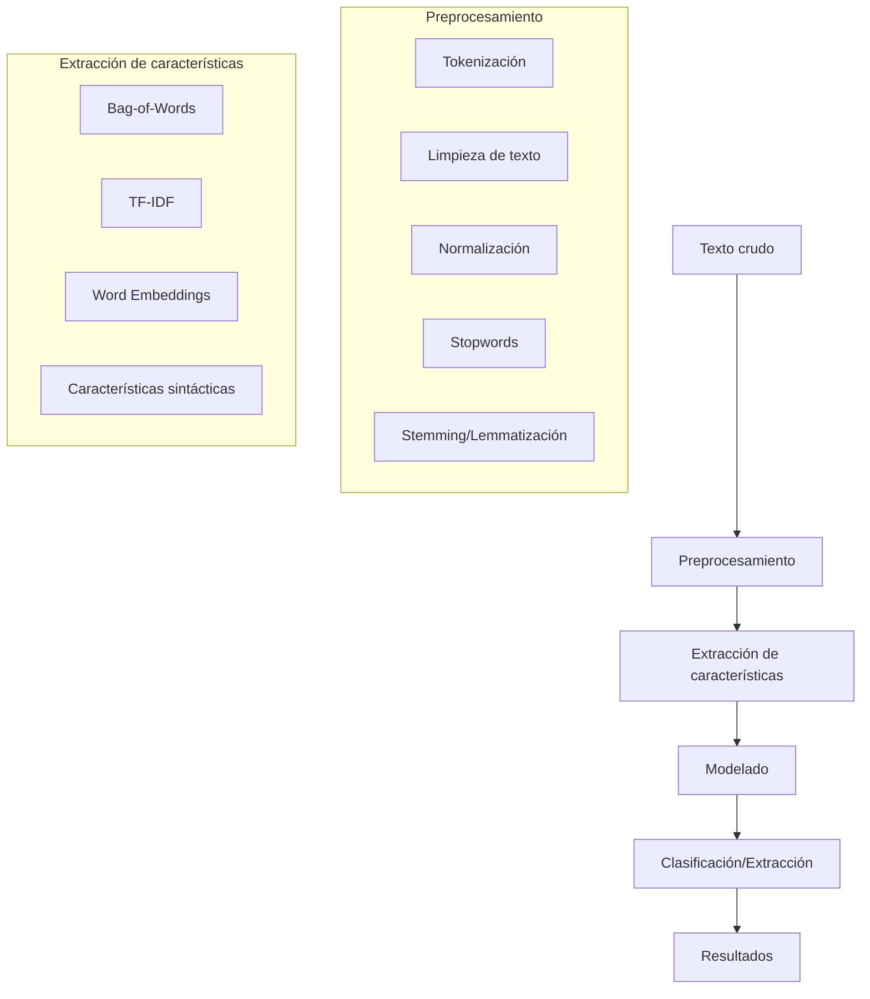

# Inteligencia Artificial - Percepción y conocimiento

## 5.4 Procesamiento de lenguaje natural (categorizar texto y extracción de información).

---

El Procesamiento de Lenguaje Natural (PLN) es una rama de la inteligencia artificial que se enfoca en la interacción entre computadoras y lenguaje humano. Según Russell y Norvig (2009), "el PLN aborda el problema de comprender y generar lenguaje natural". La categorización de texto y extracción de información son tareas fundamentales que permiten organizar, clasificar y estructurar información textual no estructurada.

### Conceptos Fundamentales

#### Definición de PLN

El PLN es el campo que estudia la capacidad de las computadoras para entender, interpretar y manipular lenguaje humano. Incluye:

- **Comprensión del Lenguaje Natural**: Convertir texto en representaciones estructuradas
- **Generación de Lenguaje Natural**: Producir texto coherente a partir de representaciones estructuradas

#### Pipeline de Procesamiento de Texto



### Preprocesamiento de Texto

#### Tokenización

División de texto en unidades más pequeñas (tokens):

```python
import nltk
from nltk.tokenize import word_tokenize, sent_tokenize

# Tokenización de oraciones
texto = "El PLN es fascinante. Permite a las máquinas entender el lenguaje humano."
oraciones = sent_tokenize(texto, language='spanish')

# Tokenización de palabras
tokens = word_tokenize("Categorización de texto es fundamental", language='spanish')
```

#### Normalización y Limpieza

```python
import re
from nltk.corpus import stopwords
from nltk.stem import SnowballStemmer

def preprocess_text(text):
    # Convertir a minúsculas
    text = text.lower()

    # Eliminar caracteres especiales y números
    text = re.sub(r'[^a-zA-Záéíóúñ\s]', '', text)

    # Tokenizar
    tokens = word_tokenize(text, language='spanish')

    # Eliminar stopwords
    stop_words = set(stopwords.words('spanish'))
    tokens = [token for token in tokens if token not in stop_words]

    # Stemming
    stemmer = SnowballStemmer('spanish')
    tokens = [stemmer.stem(token) for token in tokens]

    return ' '.join(tokens)
```

### Representación de Texto

#### Bag-of-Words (BoW)

Representación vectorial donde cada dimensión corresponde a una palabra:

$$
\text{BoW}(d) = (w_{1}, w_{2}, \ldots, w_{n})
$$

Donde $w_i$ representa la frecuencia de la palabra $i$ en el documento $d$.

#### TF-IDF (Term Frequency-Inverse Document Frequency)

Ponderación que mide la importancia de una palabra en un documento:

$$
\text{tf-idf}(t, d) = \text{tf}(t, d) \times \text{idf}(t)
$$

$$
\text{idf}(t) = \log\frac{N}{\text{df}(t)}
$$

Donde:

- $\text{tf}(t, d)$: Frecuencia del término $t$ en el documento $d$
- $\text{df}(t)$: Número de documentos que contienen el término $t$
- $N$: Número total de documentos

#### Implementación de TF-IDF

```python
from sklearn.feature_extraction.text import TfidfVectorizer

# Ejemplo de TF-IDF en español
corpus = [
    "el gato come pescado",
    "el perro come carne",
    "el gato y el perro son animales"
]

vectorizer = TfidfVectorizer()
X = vectorizer.fit_transform(corpus)
print(vectorizer.get_feature_names_out())
print(X.toarray())
```

### Clasificación de Texto

#### Algoritmo Naive Bayes

Clasificador probabilístico basado en el teorema de Bayes:

$$
P(c|d) = \frac{P(d|c) \cdot P(c)}{P(d)}
$$

Donde:

- $P(c|d)$: Probabilidad posterior de la clase $c$ dado el documento $d$
- $P(d|c)$: Verosimilitud del documento dado la clase
- $P(c)$: Probabilidad previa de la clase

#### Implementación de Naive Bayes

```python
from sklearn.naisyes import MultinomialNB
from sklearn.model_selection import train_test_split
from sklearn.metrics import accuracy_score, classification_report

# Ejemplo de clasificación de texto
def text_classification_example():
    # Datos de ejemplo (en la práctica serían textos reales)
    textos = [
        "excelente producto calidad superior",
        "pésimo servicio muy decepcionado",
        "increíble experiencia recomendable",
        "horrible atención no vuelvo nunca",
        "buen precio calidad aceptable",
        "malísimo todo estafadores"
    ]

    etiquetas = [1, 0, 1, 0, 1, 0]  # 1: positivo, 0: negativo

    # Vectorización TF-IDF
    vectorizer = TfidfVectorizer()
    X = vectorizer.fit_transform(textos)

    # Dividir datos
    X_train, X_test, y_train, y_test = train_test_split(
        X, etiquetas, test_size=0.3, random_state=42
    )

    # Entrenar modelo
    model = MultinomialNB()
    model.fit(X_train, y_train)

    # Predecir
    y_pred = model.predict(X_test)

    # Evaluar
    print("Accuracy:", accuracy_score(y_test, y_pred))
    print(classification_report(y_test, y_pred))

    return model, vectorizer
```

### Extracción de Información

#### Named Entity Recognition (NER)

Identificación de entidades nombradas en texto:

```python
import spacy

# Cargar modelo de spaCy para español
nlp = spacy.load("es_core_news_sm")

def extract_entities(text):
    doc = nlp(text)
    entities = []

    for ent in doc.ents:
        entities.append({
            'text': ent.text,
            'label': ent.label_,
            'start': ent.start_char,
            'end': ent.end_char
        })

    return entities

# Ejemplo
texto = "Google fue fundado por Larry Page y Sergey Brin en Menlo Park en 1998."
entities = extract_entities(texto)
```

#### Relación entre Entidades

Extracción de relaciones semánticas entre entidades:

```python
def extract_relations(text):
    doc = nlp(text)
    relations = []

    for token in doc:
        if token.dep_ in ['nsubj', 'dobj', 'pobj']:
            subject = [w for w in token.lefts if w.dep_ == 'nsubj']
            if subject:
                relations.append({
                    'sujeto': subject[0].text,
                    'acción': token.text,
                    'objeto': [w.text for w in token.rights if w.dep_ == 'dobj']
                })

    return relations
```

### Modelos Avanzados

#### Word Embeddings

Representación densa de palabras en espacio vectorial:

```python
from gensim.models import Word2Vec

# Entrenamiento de Word2Vec
def train_word2vec(corpus):
    # Tokenizar corpus
    tokenized_corpus = [word_tokenize(text.lower()) for text in corpus]

    # Entrenar modelo
    model = Word2Vec(
        sentences=tokenized_corpus,
        vector_size=100,
        window=5,
        min_count=1,
        workers=4
    )

    return model

# Uso de embeddings pre-entrenados
from gensim.models import KeyedVectors

# Cargar embeddings en español (ejemplo)
# model = KeyedVectors.load_word2vec_format('spanish_embeddings.bin', binary=True)
```

#### Transformers y BERT

Modelos de atención para comprensión contextual:

```python
from transformers import AutoTokenizer, AutoModelForSequenceClassification
import torch

# Clasificación con transformers
def transformer_classification(text, model_name="dccuchile/bert-base-spanish-wwm-uncased"):
    tokenizer = AutoTokenizer.from_pretrained(model_name)
    model = AutoModelForSequenceClassification.from_pretrained(model_name, num_labels=2)

    # Tokenizar entrada
    inputs = tokenizer(text, return_tensors="pt", truncation=True, padding=True)

    # Predecir
    with torch.no_grad():
        outputs = model(**inputs)
        predictions = torch.nn.functional.softmax(outputs.logits, dim=-1)

    return predictions
```

### Evaluación de Modelos

#### Métricas de Evaluación

**Para clasificación:**

- Precisión: $\frac{TP}{TP + FP}$
- Recall: $\frac{TP}{TP + FN}$
- F1-score: $ 2 \times \frac{\text{Precisión} \times Recall}{\text{Precisión} + Recall} $

**Para extracción de información:**

- Precisión a nivel de entidad
- Recall a nivel de relación
- F1-score para NER

#### Validación Cruzada

```python
from sklearn.model_selection import cross_val_score
from sklearn.ensemble import RandomForestClassifier

def evaluate_model(X, y):
    model = RandomForestClassifier(n_estimators=100)
    scores = cross_val_score(model, X, y, cv=5, scoring='f1_weighted')
    print(f"F1-score: {scores.mean():.3f} (±{scores.std():.3f})")
    return scores
```

### Ejercicios Propuestos

#### Ejercicio 1: Clasificación de Sentimientos

1. Recopila un dataset de reseñas de productos en español
2. Implementa un pipeline de preprocesamiento
3. Entrena un clasificador Naive Bayes y SVM
4. Evalúa el rendimiento con diferentes representaciones (BoW, TF-IDF)

#### Ejercicio 2: Sistema de NER para Español

1. Utiliza el corpus AnCora para entrenamiento
2. Implementa un sistema de NER usando CRF o transformers
3. Evalúa el rendimiento con las métricas apropiadas
4. Extrae entidades de noticias en español

#### Ejercicio 3: Extracción de Relaciones

1. Identifica patrones sintácticos para relaciones
2. Implementa un extractor de relaciones "persona-trabaja-en-organización"
3. Evalúa la precisión y recall del sistema

#### Ejercicio 4: Sistema de Categorización de Noticias

1. Construye un clasificador multi-clase para categorías de noticias
2. Experimenta con diferentes algoritmos y representaciones
3. Implementa un sistema de recomendación basado en contenido

### Aplicaciones Prácticas

#### Sistema de Análisis de Sentimientos

```python
class SentimentAnalyzer:
    def __init__(self):
        self.vectorizer = TfidfVectorizer(max_features=5000)
        self.model = MultinomialNB()
        self.labels = ['negativo', 'positivo']

    def train(self, texts, labels):
        # Preprocesamiento
        processed_texts = [preprocess_text(text) for text in texts]

        # Vectorización
        X = self.vectorizer.fit_transform(processed_texts)

        # Entrenamiento
        self.model.fit(X, labels)

    def predict(self, text):
        processed_text = preprocess_text(text)
        X = self.vectorizer.transform([processed_text])
        prediction = self.model.predict(X)[0]
        probability = self.model.predict_proba(X)[0]

        return {
            'sentimiento': self.labels[prediction],
            'probabilidad': max(probability),
            'detalles': dict(zip(self.labels, probability))
        }

# Uso del sistema
analyzer = SentimentAnalyzer()
analyzer.train(textos_entrenamiento, etiquetas_entrenamiento)
resultado = analyzer.predict("Me encanta este producto, es excelente")
```

### Referencias

#### Bibliografía Básica

1. Russell, S. J., & Norvig, P. (2009). _Artificial Intelligence: A Modern Approach_ (3rd ed.). Prentice Hall. (Capítulo 22: Natural Language Processing)
2. Marsland, S. (2009). _Machine Learning: An Algorithmic Perspective_. Chapman and Hall. (Capítulo 14: Natural Language Processing)

#### Bibliografía Complementaria

1. Jurafsky, D., & Martin, J. H. (2020). _Speech and Language Processing_. Pearson.
2. Manning, C. D., Raghavan, P., & Schütze, H. (2008). _Introduction to Information Retrieval_. Cambridge University Press.
3. Bird, S., Klein, E., & Loper, E. (2009). _Natural Language Processing with Python_. O'Reilly.

#### Recursos Adicionales

- NLTK: Natural Language Toolkit
- spaCy: Industrial-strength NLP
- Hugging Face Transformers
- Corpus AnCora para español
- ELTeC: European Literary Text Collection

### Conclusiones

La categorización de texto y extracción de información son componentes fundamentales del PLN que permiten transformar texto no estructurado en información estructurada y utilizable. Los enfoques van desde métodos tradicionales basados en características lingüísticas hasta modelos modernos de deep learning que capturan contextos complejos. El dominio de estas técnicas es esencial para aplicaciones como análisis de sentimientos, sistemas de recomendación, motores de búsqueda y asistentes virtuales inteligentes.
