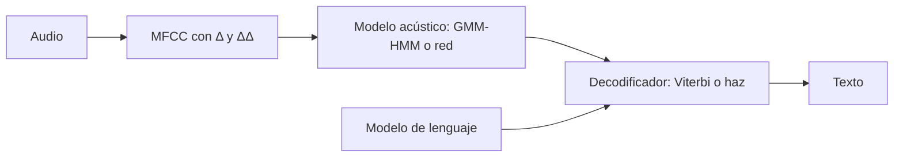

# Inteligencia Artificial - Percepción y conocimiento

## 5.5 Procesamiento de lenguaje natural (habla).

---

El habla es la forma más natural de comunicación humana, y procesarla abre el lenguaje a las máquinas sin teclado: asistentes de voz, dictado, subtítulos automáticos, centros de atención telefónica, accesibilidad para personas con discapacidad visual o motriz. El **procesamiento del habla** abarca el **reconocimiento** de lo que se dice (ASR), la **síntesis** de voz a partir de texto (TTS), la identificación de **quién** habla y el reconocimiento de **cómo** lo dice, por ejemplo su emoción. Este tema presenta el modelo de fuente y filtro de la producción del habla, los coeficientes MFCC, el reconocimiento con modelos ocultos de Markov, los modelos neuronales modernos, la verificación del hablante con GMM-UBM, el reconocimiento de emociones, la síntesis por concatenación y las métricas de cada tarea.

### La señal de voz

El habla se produce con una **fuente** y un **filtro**. En los sonidos **sonoros**, como las vocales, las cuerdas vocales vibran a la **frecuencia fundamental** $F_0,$ de unos 85 a 180 Hz en voces masculinas y de 165 a 255 Hz en femeninas, y producen un tren de pulsos rico en armónicos; en los **sordos**, como /s/, la fuente es el ruido de aire turbulento. El **tracto vocal** filtra la fuente, y sus resonancias, los **formantes** $F_1, F_2, F_3,$ determinan qué vocal se oye: /a/ tiene $F_1$ alto, /i/ tiene $F_1$ bajo y $F_2$ alto. Un tracto vocal más corto, como el de un niño, eleva todos los formantes. La voz ocupa aproximadamente de 80 Hz a 8 kHz, con la mayor parte de la inteligibilidad entre 300 y 3 400 Hz, la banda telefónica; por eso se muestrea a 16 kHz para reconocimiento y a 8 kHz en telefonía.

### MFCC

Los **coeficientes cepstrales en la escala mel** (Davis y Mermelstein, 1980) resumen la envolvente espectral de cada fragmento corto de voz, que refleja la forma del tracto vocal, separándola de la fuente:

1. **preénfasis**, $y_n = x_n - 0.97\,x_{n-1},$ que compensa la caída de la energía con la frecuencia;
2. **ventanas** de 25 ms cada 10 ms, con una ventana de Hamming, porque la voz es casi estacionaria en ese intervalo;
3. **espectro de potencia** con la FFT;
4. **banco de filtros triangulares** en la escala mel, $m = 2595 \log_{10}(1 + f/700),$ que imita la resolución del oído, fina en las frecuencias bajas y gruesa en las altas;
5. **logaritmo** de la energía de cada filtro, que convierte el producto de fuente y filtro en una suma y comprime el rango dinámico;
6. **transformada discreta del coseno**, que decorrelaciona los valores; se conservan los primeros 12 o 13 coeficientes, que describen la envolvente, y se descartan los altos, que describen el detalle armónico de la fuente.

Se agregan las **derivadas** temporales, Δ y ΔΔ, calculadas con una regresión sobre los marcos vecinos, porque la dinámica de la voz es tan informativa como su espectro instantáneo.

### Reconocimiento con modelos ocultos de Markov

El reconocimiento busca la secuencia de palabras $W$ más probable dadas las observaciones acústicas $O:$

$$\hat W = \arg\max_W P(W \mid O) = \arg\max_W P(O \mid W)\,P(W)$$

con un **modelo acústico** $P(O \mid W)$ y un **modelo de lenguaje** $P(W).$ En el enfoque clásico, cada palabra o fonema es un **HMM** de izquierda a derecha, cuyos estados emiten vectores MFCC con una mezcla de gaussianas, GMM-HMM, y $P(O \mid W) = \sum_q P(O \mid q)\,P(q \mid W)$ suma sobre las secuencias de estados $q.$ El modelo se entrena con el algoritmo de **Baum-Welch**, un caso del EM del tema 3.3; la verosimilitud se calcula con el algoritmo de **avance**, y la mejor secuencia de estados con **Viterbi**, en $O(T N^2)$ para $T$ marcos y $N$ estados. Ambos trabajan con **logaritmos**: el producto de cientos de probabilidades pequeñas se desborda por abajo en aritmética de punto flotante.

Desde 2012, las redes neuronales profundas reemplazaron a las GMM como modelos de emisión, y desde 2015 los modelos de **extremo a extremo** reemplazan todo el sistema: CTC, codificador-decodificador con atención y transformadores como Whisper (Radford y otros, 2022), entrenado con 680 000 horas de audio en decenas de idiomas.

### Hablante y emoción

La **verificación del hablante** decide si una voz pertenece a quien dice ser. El sistema clásico **GMM-UBM** (Reynolds, Quatieri y Dunn, 2000) entrena un **modelo universal de fondo**, una GMM con los MFCC de muchos hablantes; adapta sus medias a cada cliente con su voz de registro por **adaptación MAP**,

$$\mu_k' = \alpha_k\,\bar x_k + (1 - \alpha_k)\,\mu_k, \qquad \alpha_k = \frac{n_k}{n_k + r}$$

donde $n_k$ y $\bar x_k$ son la ocupación y la media de los marcos asignados a la componente $k,$ y $r$ el factor de relevancia; y decide con la **razón de log-verosimilitudes** entre el modelo del cliente y el UBM. Los i-vectores y, hoy, los x-vectores de redes neuronales generalizan la idea. El rendimiento se resume con la **tasa de error igual** (EER), el punto en que la tasa de falsos rechazos iguala la de falsas aceptaciones.

El **reconocimiento de emociones** usa rasgos **prosódicos**, la $F_0$ y su variación, la energía, la velocidad, y **espectrales**, como los MFCC y la inclinación espectral: la alegría y el enojo elevan la $F_0$ y la energía, la tristeza las baja y hace el habla más lenta.

### Síntesis de voz

La **síntesis por concatenación** une fragmentos grabados de una voz real: **difonos**, de la mitad de un fonema a la mitad del siguiente, para que las uniones caigan en las partes estables; o, en la **selección de unidades**, fragmentos de longitud variable elegidos de horas de grabación minimizando un costo de objetivo, cuánto se parece la unidad a lo que se pide, más un costo de unión, cuánto se nota la juntura. Las uniones se suavizan con fundidos y con modificación de $F_0$ y duración por **PSOLA**. La síntesis **neuronal**, como Tacotron 2 con un vocoder WaveNet o los modelos actuales, genera el espectrograma y la onda directamente y es casi indistinguible de una voz humana.

### Métricas

- **ASR:** la tasa de error de palabras, $\text{WER} = (S + D + I)/N,$ con las sustituciones, eliminaciones e inserciones de la alineación de distancia mínima de edición, y $N$ las palabras de la referencia; puede superar el 100 %.
- **Verificación:** EER y la función de costo de detección.
- **Síntesis:** la **calificación media de opinión** (MOS) de oyentes, de 1 a 5, y medidas objetivas como la **distorsión mel-cepstral** (MCD), $\frac{10}{\ln 10}\sqrt{2 \sum_k (c_k - c_k')^2}$ en dB.



### Implementación en Python

No hay grabaciones de dígitos, de emociones ni de hablantes disponibles sin conexión, así que el programa incluye un **sintetizador de fuente y filtro**: pulsos glotales a la $F_0$ de cada hablante, filtrados por tres resonadores en los formantes de las vocales del español, escalados según la longitud del tracto vocal, con ruido filtrado para /s/ y otras consonantes simplificadas. Con él genera 10 dígitos, 20 hablantes distintos y 4 estilos emocionales. Implementa los MFCC paso a paso; entrena un HMM de izquierda a derecha por dígito con hmmlearn; clasifica emociones con rasgos prosódicos y espectrales; implementa la verificación GMM-UBM con adaptación MAP y calcula la EER, y arma palabras nuevas por concatenación con tres tipos de suavizado.

```python
import warnings
import numpy as np
from scipy.fft import dct, rfft
from scipy.signal import lfilter, butter
from hmmlearn.hmm import GaussianHMM
from sklearn.mixture import GaussianMixture
from sklearn.model_selection import StratifiedKFold, cross_val_score
from sklearn.ensemble import RandomForestClassifier
from sklearn.neighbors import KNeighborsClassifier
from sklearn.pipeline import make_pipeline
from sklearn.preprocessing import StandardScaler
from sklearn.svm import SVC
warnings.filterwarnings("ignore"); import logging; logging.getLogger("hmmlearn").setLevel(logging.ERROR)
FS = 16000

# ---------- Un sintetizador de fuente y filtro: pulsos glotales filtrados por formantes ----------
FORM = {"a": (700, 1250, 2500), "e": (450, 1900, 2550), "i": (300, 2250, 3000), "o": (500, 950, 2450), "u": (330, 800, 2400),
        "n": (250, 1100, 2300)}
PALABRAS = {"cero": "s e o", "uno": "u n o", "dos": "t o s", "tres": "t e s", "cuatro": "t u a t o",
            "cinco": "s i n t o", "seis": "s e i s", "siete": "s i e t e", "ocho": "o x o", "nueve": "n u e e"}
DUR = {"s": 0.10, "x": 0.10, "t": 0.06, "n": 0.07}
def resonador(f, bw):                                     # filtro de 2 polos con frecuencia central f y ancho de banda bw
    r = np.exp(-np.pi * bw / FS); c = -r * r; b = 2 * r * np.cos(2 * np.pi * f / FS); a0 = 1 - b - c
    return [a0], [1, -b, -c]
def sintetiza(fonemas, voz, rng, f0=None, rango=0.15, rapidez=1.0, energia=1.0, inclinacion=0.97, transicion=0.03):
    escala, f0b = voz; f0 = f0 or f0b; segs = fonemas.split(); bloque = 80
    durs = [DUR.get(p, 0.12) / rapidez for p in segs]; n = int(sum(durs) * FS); t_fin = np.cumsum(durs); t_ini = t_fin - durs
    contorno = f0 * (1 + rango * np.sin(np.linspace(0, np.pi, n)) - 0.5 * rango * np.linspace(0, 1, n))   # entonación
    fase = np.cumsum(contorno * (1 + rng.normal(0, 0.01, n)) / FS); pulsos = np.diff(np.floor(fase), prepend=0)
    fuente = lfilter([1], [1, -inclinacion], pulsos); fuente = np.diff(fuente, prepend=0)            # inclinación glotal y radiación
    salida = np.zeros(n); estados = [None] * 3
    for k in range(0, n, bloque):
        t = k / FS; i = min(np.searchsorted(t_fin, t, side="right"), len(segs) - 1); p = segs[i]
        if p in FORM:
            F = np.array(FORM[p], float)
            if i + 1 < len(segs) and segs[i + 1] in FORM and t > t_fin[i] - transicion:          # coarticulación hacia el siguiente
                w = (t - (t_fin[i] - transicion)) / transicion; F = (1 - w) * F + w * np.array(FORM[segs[i + 1]])
            x = fuente[k:k + bloque] * (0.3 if p == "n" else 1.0)
            for j, (f, bw) in enumerate(zip(F * escala, (80, 100, 140))):
                b, a = resonador(f, bw); zi = estados[j] if estados[j] is not None else np.zeros(2)
                x, estados[j] = lfilter(b, a, x, zi=zi)
            salida[k:k + bloque] = x
        else:
            estados = [None] * 3
            if p == "t": salida[k:k + bloque] = 0 if t < t_ini[i] + 0.045 / rapidez else rng.normal(0, 0.05, len(salida[k:k + bloque]))
            else:
                lo, hi = (4000, 7000) if p == "s" else (2000, 4000)
                b, a = butter(2, [lo / (FS / 2), hi / (FS / 2)], btype="band")
                salida[k:k + bloque] = lfilter(b, a, rng.normal(0, 0.08, len(salida[k:k + bloque])))
    salida = salida / (np.max(np.abs(salida)) + 1e-9) * 0.5 * energia
    return salida + rng.normal(0, 0.002, n)
def con_ruido(x, snr, rng): ruido = rng.normal(0, 1, len(x)); return x + ruido * np.sqrt(np.mean(x ** 2) / (10 ** (snr / 10)))

# ---------- MFCC implementados paso a paso ----------
def mel(f): return 2595 * np.log10(1 + f / 700)
def banco_mel(n_filtros=26, nfft=512):
    puntos = 700 * (10 ** (np.linspace(mel(0), mel(FS / 2), n_filtros + 2) / 2595) - 1); bins = np.floor((nfft + 1) * puntos / FS).astype(int)
    B = np.zeros((n_filtros, nfft // 2 + 1))
    for m in range(1, n_filtros + 1):
        B[m - 1, bins[m - 1]:bins[m]] = (np.arange(bins[m - 1], bins[m]) - bins[m - 1]) / max(bins[m] - bins[m - 1], 1)
        B[m - 1, bins[m]:bins[m + 1]] = (bins[m + 1] - np.arange(bins[m], bins[m + 1])) / max(bins[m + 1] - bins[m], 1)
    return B
BANCO = banco_mel()
def deltas(C, N=2):
    P = np.pad(C, ((N, N), (0, 0)), mode="edge"); return sum(k * (P[N + k:len(C) + N + k] - P[N - k:len(C) + N - k]) for k in range(1, N + 1)) / (2 * sum(k * k for k in range(1, N + 1)))
def mfcc(x, n_coef=13, con_deltas=True):
    x = np.append(x[0], x[1:] - 0.97 * x[:-1])                                   # preénfasis
    largo, paso = 400, 160                                                        # ventanas de 25 ms cada 10 ms
    marcos = np.array([x[i:i + largo] for i in range(0, len(x) - largo + 1, paso)]) * np.hamming(largo)
    potencia = np.abs(rfft(marcos, 512)) ** 2 / 512
    log_mel = np.log(potencia @ BANCO.T + 1e-10)
    C = dct(log_mel, type=2, norm="ortho", axis=1)[:, :n_coef]
    if con_deltas: D = deltas(C); C = np.hstack([C, D, deltas(D)])
    return C

# ---------- Ejercicio 1: dígitos aislados con HMM ----------
rng = np.random.default_rng(0)
VOCES = [(rng.uniform(0.85, 1.2), rng.uniform(90, 230)) for _ in range(20)]     # escala del tracto vocal y F0 de cada hablante
grab = {(p, h, r): sintetiza(PALABRAS[p], VOCES[h], np.random.default_rng(1000 * h + 10 * r + list(PALABRAS).index(p)),
                             rapidez=rng.uniform(0.85, 1.15)) for p in PALABRAS for h in range(15) for r in range(3)}
def experimento(n_coef, con_deltas, snr_entr=None, snr_prueba=None, estados=4):
    rr = np.random.default_rng(5)
    def feats(x, snr): return mfcc(con_ruido(x, snr, rr) if snr is not None else x, n_coef, con_deltas)
    modelos = {}
    for p in PALABRAS:
        X = [feats(grab[(p, h, r)], snr_entr) for h in range(10) for r in range(3)]
        m = GaussianHMM(n_components=estados, covariance_type="diag", n_iter=20, random_state=0, init_params="mc", params="mc")   # topología fija
        m.startprob_ = np.r_[1.0, np.zeros(estados - 1)]
        T = np.zeros((estados, estados))
        for i in range(estados): T[i, i] = 0.7; T[i, min(i + 1, estados - 1)] += 0.3       # izquierda a derecha
        m.transmat_ = T; m.fit(np.vstack(X), [len(x) for x in X]); modelos[p] = m
    aciertos = total = 0
    for p in PALABRAS:
        for h in range(10, 15):
            for r in range(3):
                f = feats(grab[(p, h, r)], snr_prueba); aciertos += max(modelos, key=lambda q: modelos[q].score(f)) == p; total += 1
    return aciertos / total
print("ejercicio 1: 10 dígitos, 10 hablantes de entrenamiento y 5 nuevos de prueba, 3 repeticiones; HMM de 4 estados")
for nc, dl in ((5, False), (13, False), (13, True)):
    print(f"   {nc:2} MFCC{' + Δ + ΔΔ' if dl else '          '}: limpio {experimento(nc, dl):.3f} | "
          f"entrenado limpio, prueba a 10 dB {experimento(nc, dl, None, 10):.3f} | ambos a 10 dB {experimento(nc, dl, 10, 10):.3f}")

# ---------- Ejercicio 2: emociones con rasgos prosódicos y espectrales ----------
EMOC = {"neutral": dict(f0m=1.0, rango=0.15, rapidez=1.0, energia=0.6, inclinacion=0.97),
        "alegría": dict(f0m=1.25, rango=0.35, rapidez=1.15, energia=0.8, inclinacion=0.95),
        "tristeza": dict(f0m=0.85, rango=0.06, rapidez=0.8, energia=0.35, inclinacion=0.99),
        "enojo": dict(f0m=1.15, rango=0.25, rapidez=1.2, energia=1.0, inclinacion=0.90)}
def f0_autocorr(x):
    vals = []
    for i in range(0, len(x) - 640, 320):
        m = x[i:i + 640] - x[i:i + 640].mean(); ac = np.correlate(m, m, "full")[639:]
        if ac[0] <= 0: continue
        lo, hi = FS // 400, FS // 60; k = lo + np.argmax(ac[lo:hi])
        if ac[k] / ac[0] > 0.4: vals.append(FS / k)                               # solo marcos sonoros
    return np.array(vals) if vals else np.array([0.0])
def rasgos_emocion(x):
    f0 = f0_autocorr(x); e = np.array([np.sqrt(np.mean(x[i:i + 400] ** 2)) for i in range(0, len(x) - 400, 160)]); C = mfcc(x, 13, False)
    prosodia = [f0.mean(), f0.std(), np.percentile(f0, 90) - np.percentile(f0, 10), e.mean(), e.std(), len(x) / FS]
    return np.array(prosodia), np.r_[C.mean(0), C.std(0)]
rng = np.random.default_rng(2); Xp, Xe, Y = [], [], []
for k in range(160):
    emo = list(EMOC)[k % 4]; par = dict(EMOC[emo]); voz = VOCES[k % 20]; frase = " ".join(PALABRAS[p] for p in rng.choice(list(PALABRAS), 3))
    x = sintetiza(frase, voz, rng, f0=voz[1] * par.pop("f0m") * rng.uniform(0.92, 1.08), **{q: v * rng.uniform(0.9, 1.1) if q != "inclinacion" else v for q, v in par.items()})
    p, s = rasgos_emocion(con_ruido(x, 20, rng)); Xp.append(p); Xe.append(s); Y.append(emo)
Xp, Xe, Y = np.array(Xp), np.array(Xe), np.array(Y); cv = StratifiedKFold(5, shuffle=True, random_state=0)
print("ejercicio 2: 160 frases de 20 hablantes en 4 emociones; exactitud con validación cruzada de 5 partes")
for nombre, X in (("prosódicos (6)", Xp), ("espectrales (26)", Xe), ("ambos (32)", np.hstack([Xp, Xe]))):
    fila = [f"{nm} {cross_val_score(make_pipeline(StandardScaler(), c), X, Y, cv=cv).mean():.3f}"
            for nm, c in (("SVM", SVC(C=10)), ("bosque", RandomForestClassifier(200, random_state=0)), ("3-NN", KNeighborsClassifier(3)))]
    print(f"   rasgos {nombre:16}: " + " | ".join(fila))

# ---------- Ejercicio 3: verificación del hablante con GMM-UBM ----------
rng = np.random.default_rng(3); HABL = [(rng.uniform(0.8, 1.25), rng.uniform(85, 250), rng.uniform(0.93, 0.99)) for _ in range(40)]
def habla(h, n_pal, rr):
    escala, f0, incl = HABL[h]; frase = " ".join(PALABRAS[p] for p in rr.choice(list(PALABRAS), n_pal))
    return mfcc(con_ruido(sintetiza(frase, (escala, f0), rr, inclinacion=incl), 25, rr), 13, True)
fondo = np.vstack([habla(h, 6, np.random.default_rng(h)) for h in range(20)])
ubm = GaussianMixture(32, covariance_type="diag", random_state=0, max_iter=200).fit(fondo)
def adapta_map(X, r=16.0):                                                     # adaptación MAP de las medias (Reynolds y otros, 2000)
    g = GaussianMixture(32, covariance_type="diag"); g.weights_, g.covariances_ = ubm.weights_, ubm.covariances_
    g.precisions_cholesky_ = ubm.precisions_cholesky_; post = ubm.predict_proba(X); n = post.sum(0)
    Ex = (post.T @ X) / np.maximum(n[:, None], 1e-10); a = (n / (n + r))[:, None]; g.means_ = a * Ex + (1 - a) * ubm.means_
    return g
clientes = range(20, 40); modelos = {h: adapta_map(habla(h, 4, np.random.default_rng(100 + h))) for h in clientes}
directos = {h: GaussianMixture(4, covariance_type="diag", random_state=0).fit(habla(h, 4, np.random.default_rng(100 + h))) for h in clientes}
def eer(genuinos, impostores):
    umbrales = np.sort(np.r_[genuinos, impostores]); mejor = (1, 0)
    for u in umbrales:
        fr, fa = np.mean(genuinos < u), np.mean(impostores >= u)
        if abs(fr - fa) < mejor[0]: mejor = (abs(fr - fa), (fr + fa) / 2)
    return mejor[1]
prueba = {h: [habla(h, 2, np.random.default_rng(500 + 10 * h + k)) for k in range(3)] for h in clientes}
for nombre, M, base in (("GMM-UBM con adaptación MAP", modelos, True), ("GMM de 4 componentes por hablante", directos, False)):
    gen, imp = [], []
    for h in clientes:
        for c in clientes:
            for X in prueba[c]:
                s = M[h].score(X) - (ubm.score(X) if base else 0)              # razón de verosimilitudes promedio por marco
                (gen if c == h else imp).append(s)
    print(f"ejercicio 3: {nombre:34}: {len(gen)} pruebas genuinas y {len(imp)} de impostores, EER = {eer(np.array(gen), np.array(imp)):.1%}")

# ---------- Ejercicio 4: síntesis por concatenación de unidades ----------
voz = (1.0, 120); rng = np.random.default_rng(4)
def limites(fonemas): return (np.r_[0, np.cumsum([DUR.get(p, 0.12) for p in fonemas.split()])] * FS).astype(int)
base = {}                                                                      # cada unidad: (grabación, inicio, fin, F0, palabra de origen)
for palabra in ("cero", "uno", "dos", "cuatro", "ocho"):                      # inventario: unidades de palabras grabadas con F0 y volumen distintos
    fon = PALABRAS[palabra]; f0 = 120 * rng.uniform(0.85, 1.15)
    x = sintetiza(fon, voz, np.random.default_rng(len(palabra)), f0=f0, energia=rng.uniform(0.5, 1.0)); L = limites(fon)
    for i, p in enumerate(fon.split()): base.setdefault(p, (np.r_[np.zeros(800), x, np.zeros(800)], L[i] + 800, L[i + 1] + 800, f0, palabra))
def rms(v): return float(np.sqrt(np.mean(v ** 2)) + 1e-9)
def concatena(fonemas, fundido, normaliza=False):
    n = int(fundido * FS); y = np.zeros(limites(fonemas)[-1] + n); pos = 0
    for k, p in enumerate(fonemas.split()):
        x, a, b, _, _ = base[p]; trozo = x[a - n // 2:b + n - n // 2].copy()   # la unidad con un margen para el fundido
        if normaliza and p in FORM: trozo *= 0.12 / rms(x[a:b])               # misma energía para todas las vocales
        if n:
            w = np.linspace(0, 1, n)
            if k > 0: trozo[:n] *= w
            trozo[-n:] *= w[::-1]
        y[pos:pos + len(trozo)] += trozo; pos += b - a
    return y[n // 2:n // 2 + limites(fonemas)[-1]]
def uniones(y, fonemas):                                                       # en las uniones entre vocales: salto de muestra y de energía
    segs = fonemas.split(); L = limites(fonemas); saltos, energias = [], []
    for k in range(1, len(segs)):
        if segs[k - 1] in FORM and segs[k] in FORM:
            u = L[k]; saltos.append(abs(y[u] - y[u - 1]) / rms(y)); energias.append(abs(20 * np.log10(rms(y[u:u + 320]) / rms(y[u - 320:u]))))
    return max(saltos), max(energias)
def mcd(a, b):                                                                 # distorsión mel-cepstral (dB), marcos con energía
    A, B = mfcc(a, 13, False), mfcc(b, 13, False); n = min(len(A), len(B)); A, B = A[:n], B[:n]; act = A[:, 0] > np.percentile(A[:, 0], 30)
    return float(np.mean(10 / np.log(10) * np.sqrt(2 * np.sum((A[act, 1:] - B[act, 1:]) ** 2, axis=1))))
palabra = "nueve"; fon = PALABRAS[palabra]; natural = sintetiza(fon, voz, np.random.default_rng(99))
print(f"ejercicio 4: '{palabra}' ({fon}) armada con unidades de otras palabras: " + ", ".join(f"{p} de '{base[p][4]}' a {base[p][3]:.0f} Hz" for p in dict.fromkeys(fon.split())))
for nombre, f, nm in (("corte directo", 0.0, False), ("fundido de 5 ms", 0.005, False), ("fundido de 5 ms + energía normalizada", 0.005, True)):
    y = concatena(fon, f, nm); sm, se = uniones(y, fon)
    print(f"   {nombre:38}: salto de muestra {sm:5.2f} × RMS, salto de energía {se:4.1f} dB, MCD con la natural {mcd(y, natural):5.2f} dB")
sm, se = uniones(natural, fon)
print(f"   {'grabación natural':38}: salto de muestra {sm:5.2f} × RMS, salto de energía {se:4.1f} dB; "
      f"dos grabaciones naturales difieren en MCD {mcd(sintetiza(fon, voz, np.random.default_rng(7)), sintetiza(fon, voz, np.random.default_rng(8))):.2f} dB")
```

Salida:

```text
ejercicio 1: 10 dígitos, 10 hablantes de entrenamiento y 5 nuevos de prueba, 3 repeticiones; HMM de 4 estados
    5 MFCC          : limpio 0.980 | entrenado limpio, prueba a 10 dB 0.273 | ambos a 10 dB 1.000
   13 MFCC          : limpio 0.980 | entrenado limpio, prueba a 10 dB 0.213 | ambos a 10 dB 0.980
   13 MFCC + Δ + ΔΔ: limpio 0.993 | entrenado limpio, prueba a 10 dB 0.420 | ambos a 10 dB 1.000
ejercicio 2: 160 frases de 20 hablantes en 4 emociones; exactitud con validación cruzada de 5 partes
   rasgos prosódicos (6)  : SVM 0.931 | bosque 0.906 | 3-NN 0.881
   rasgos espectrales (26): SVM 0.787 | bosque 0.725 | 3-NN 0.525
   rasgos ambos (32)      : SVM 0.938 | bosque 0.931 | 3-NN 0.719
ejercicio 3: GMM-UBM con adaptación MAP        : 60 pruebas genuinas y 1140 de impostores, EER = 19.8%
ejercicio 3: GMM de 4 componentes por hablante : 60 pruebas genuinas y 1140 de impostores, EER = 33.3%
ejercicio 4: 'nueve' (n u e e) armada con unidades de otras palabras: n de 'uno' a 137 Hz, u de 'uno' a 137 Hz, e de 'cero' a 136 Hz
   corte directo                         : salto de muestra  1.02 × RMS, salto de energía  6.4 dB, MCD con la natural 22.05 dB
   fundido de 5 ms                       : salto de muestra  0.57 × RMS, salto de energía  7.2 dB, MCD con la natural 24.36 dB
   fundido de 5 ms + energía normalizada : salto de muestra  0.45 × RMS, salto de energía  3.5 dB, MCD con la natural 22.92 dB
   grabación natural                     : salto de muestra  0.59 × RMS, salto de energía 12.1 dB; dos grabaciones naturales difieren en MCD 5.72 dB
```

### Ejercicios Propuestos

1. **Reconocimiento de dígitos.** Implementa un extractor de MFCC, entrena un modelo GMM-HMM para reconocer dígitos y evalúa el rendimiento con distintas configuraciones de MFCC.

2. **Emociones en el habla.** Con un conjunto de voces con emociones, como RAVDESS o CREMA-D, extrae rasgos prosódicos y espectrales, entrena clasificadores para detectar emociones como alegría, tristeza o enojo, y compara distintos algoritmos.

3. **Verificación del hablante.** Implementa un sistema de verificación del hablante con GMM-UBM o i-vectores y evalúalo con la tasa de error igual.

4. **Síntesis por concatenación.** Implementa un sistema básico de síntesis por concatenación de unidades, experimenta con distintos algoritmos de suavizado y evalúa la calidad con métricas objetivas y subjetivas.

### Soluciones

**Ejercicio 1.** Los MFCC siguen los seis pasos descritos, con 26 filtros mel y una FFT de 512 puntos. Cada dígito tiene un HMM de 4 estados de izquierda a derecha, con una gaussiana diagonal por estado, entrenado con 30 grabaciones de 10 hablantes y probado con 15 de 5 hablantes nuevos. En condiciones limpias, cualquier configuración acierta 98 % o más, porque las voces sintéticas son poco variables. La diferencia aparece con **ruido no visto**: entrenado en limpio y probado a 10 dB de relación señal a ruido, el sistema cae al 27 % con 5 coeficientes y al 21 % con 13, mientras que con Δ y ΔΔ conserva el 42 %, porque las derivadas son menos sensibles a un ruido estacionario, que cambia el nivel de los coeficientes pero no su evolución. Entrenando con el mismo ruido, la exactitud vuelve a 98 % o 100 %: lo que daña es la **diferencia de condiciones** entre entrenamiento y prueba, y por eso los sistemas reales se entrenan con ruido agregado y normalizan la media cepstral. Con voz real, como en el corpus TIDIGITS, un GMM-HMM de dígitos llega a WER menores que 1 % en limpio.

**Ejercicio 2.** Las 160 frases sintéticas varían la $F_0,$ su rango, la velocidad, la energía y la inclinación espectral según la emoción, con hablantes distintos y variación aleatoria. Con 6 rasgos **prosódicos**, la media, la desviación y el rango de la $F_0$ estimada por autocorrelación, la media y la desviación de la energía y la duración, la SVM acierta 93.1 %; con 26 rasgos **espectrales**, las medias y desviaciones de los MFCC, 78.7 %; con ambos, 93.8 %. La prosodia domina porque así se construyeron las emociones, y los MFCC dependen más del hablante que de la emoción, lo que perjudica sobre todo al vecino más cercano, 52.5 %, que no puede aprender a ignorar las dimensiones irrelevantes. Con emociones actuadas reales, en RAVDESS, los sistemas clásicos alcanzan entre 60 % y 75 % en 8 clases, y los modelos neuronales preentrenados, como wav2vec 2.0, más de 80 %; la emoción real es más sutil y varía mucho entre personas.

**Ejercicio 3.** El UBM es una GMM de 32 componentes entrenada con 20 hablantes de fondo; cada uno de los 20 clientes se registra con 4 palabras, unos 1.6 s, y su modelo se obtiene por adaptación MAP de las medias con $r = 16.$ Cada cliente se prueba con 3 grabaciones propias y con las 57 de los otros clientes, como impostores. La EER es 19.8 % con GMM-UBM, frente a 33.3 % entrenando una GMM de 4 componentes directamente con la voz de registro: con tan pocos datos, la GMM directa sobreajusta, y la adaptación MAP solo mueve las componentes que los datos del cliente ocupan, dejando las demás en el UBM. La razón con el UBM, además, normaliza el puntaje respecto de lo que es típico de cualquier voz. Las grabaciones de prueba duran menos de un segundo, lo que hace difícil la tarea; con 10 s o más de habla real, un GMM-UBM llega a EER de pocos por ciento, y los x-vectores, a menos de 1 % en VoxCeleb.

**Ejercicio 4.** El inventario se forma cortando las unidades de 5 palabras grabadas con distinta $F_0$ y volumen, y la palabra nueva "nueve" se arma con la /n/ y la /u/ de "uno" y la /e/ de "cero". Con **corte directo**, la onda salta en la unión 1.02 veces su valor RMS, un clic audible; un **fundido** de 5 ms lo reduce a 0.57, como en la grabación natural, 0.59. **Normalizar la energía** de las vocales reduce el salto de volumen entre unidades de 7.2 a 3.5 dB. Pero la distorsión mel-cepstral con una grabación natural de la misma palabra sigue en unos 22 dB, frente a 5.7 dB entre dos grabaciones naturales, con cualquier suavizado: las unidades sacadas de otro contexto conservan la coarticulación de su palabra de origen, y el suavizado local no lo corrige. Por eso los sistemas reales usan difonos o selección de unidades con contexto, y PSOLA para ajustar la $F_0.$ La evaluación subjetiva requiere oyentes: una prueba MOS con al menos 20 personas que califican de 1 a 5 la naturalidad de cada frase, o una prueba de preferencia entre dos sistemas.

El material original tenía la palabra inglesa *typically* en la descripción de la señal de voz; su función de formantes tomaba los primeros picos del espectrograma, que son armónicos de la $F_0$ y no formantes, aunque el comentario decía que tomaba los más altos; los formantes se estiman con predicción lineal, LPC. Su algoritmo de Viterbi multiplicaba probabilidades en lugar de sumar logaritmos.

### Referencias

1. Jurafsky, D., and Martin, J. H., _Speech and Language Processing_. 3a ed., borrador, 2024. Capítulo 16.
2. Rabiner, L. R., A tutorial on hidden Markov models and selected applications in speech recognition. _Proceedings of the IEEE_ 77(2), 1989.
3. Davis, S., and Mermelstein, P., Comparison of parametric representations for monosyllabic word recognition. _IEEE Transactions on Acoustics, Speech, and Signal Processing_ 28(4), 1980.
4. Reynolds, D. A., Quatieri, T. F., and Dunn, R. B., Speaker verification using adapted Gaussian mixture models. _Digital Signal Processing_ 10, 2000.
5. Hunt, A. J., and Black, A. W., Unit selection in a concatenative speech synthesis system using a large speech database. _ICASSP_, 1996.
6. Livingstone, S. R., and Russo, F. A., The Ryerson audio-visual database of emotional speech and song (RAVDESS). _PLoS ONE_ 13(5), 2018.
7. Radford, A., et al., Robust speech recognition via large-scale weak supervision. _arXiv:2212.04356_, 2022.
8. Fant, G., _Acoustic Theory of Speech Production_. Mouton, 1960.
