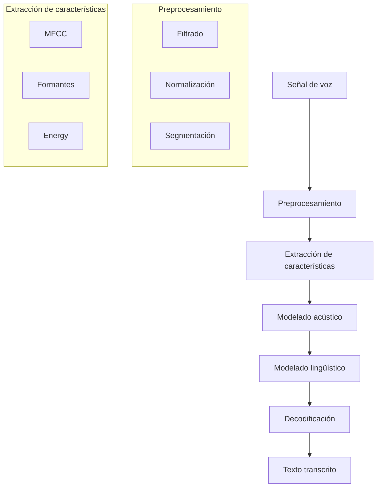

# Inteligencia Artificial - Percepción y conocimiento

## 5.5 Procesamiento de lenguaje natural (habla).

---

El procesamiento del habla es una subárea fundamental del Procesamiento de Lenguaje Natural (PLN) que se enfoca en la interacción entre computadoras y el lenguaje humano hablado. Según Russell y Norvig (2009), "el reconocimiento del habla implica convertir señales acústicas en representaciones lingüísticas". Esta disciplina combina técnicas de procesamiento de señales, aprendizaje automático y lingüística computacional.

### Conceptos Fundamentales

#### Definición de Procesamiento del Habla

El procesamiento del habla comprende las técnicas para analizar, reconocer, sintetizar y transformar señales de voz. Incluye:

- **Reconocimiento de Voz (ASR)**: Convertir señal acústica en texto
- **Síntesis de Voz (TTS)**: Convertir texto en señal acústica
- **Identificación del hablante**: Reconocer quién está hablando
- **Análisis de emociones**: Detectar emociones en la voz

#### Arquitectura de un Sistema de Procesamiento de Voz



### Procesamiento de Señales de Voz

#### Características de la Señal de Voz

La voz humana typically ocupa el rango de frecuencia de 80 Hz a 8 kHz, con la mayor información en 300-3400 Hz.

#### Preprocesamiento de Audio

```python
import numpy as np
import librosa
import scipy.signal as signal

def preprocess_audio(audio_path, target_sr=16000):
    # Cargar audio
    audio, sr = librosa.load(audio_path, sr=target_sr)

    # Preénfasis (realce de altas frecuencias)
    pre_emphasis = 0.97
    audio = np.append(audio[0], audio[1:] - pre_emphasis * audio[:-1])

    # Filtrado pasa-banda (300-3400 Hz para voz)
    nyquist = sr / 2
    low = 300 / nyquist
    high = 3400 / nyquist
    b, a = signal.butter(4, [low, high], btype='band')
    audio = signal.filtfilt(b, a, audio)

    # Normalización
    audio = audio / np.max(np.abs(audio))

    return audio, sr
```

### Extracción de Características

#### MFCC (Mel Frequency Cepstral Coefficients)

Los MFCC son las características más utilizadas en reconocimiento de voz:

```python
def extract_mfcc(audio, sr, n_mfcc=13):
    # Calcular MFCC
    mfcc = librosa.feature.mfcc(y=audio, sr=sr, n_mfcc=n_mfcc)

    # Añadir derivadas (delta y delta-delta)
    delta_mfcc = librosa.feature.delta(mfcc)
    delta2_mfcc = librosa.feature.delta(mfcc, order=2)

    # Concatenar características
    features = np.vstack([mfcc, delta_mfcc, delta2_mfcc])

    return features.T  # Transponer para tener (frames, features)
```

#### Formantes y Otras Características

```python
def extract_formants(audio, sr, n_formants=3):
    # Calcular espectrograma
    frequencies, times, spectrogram = signal.spectrogram(audio, sr)

    formants = []
    for time_idx in range(spectrogram.shape[1]):
        # Encontrar picos en el espectro (formantes)
        peaks, _ = signal.find_peaks(spectrogram[:, time_idx])
        # Tomar los n_formants picos más altos
        if len(peaks) > 0:
            formant_freqs = frequencies[peaks[:n_formants]]
            formants.append(formant_freqs)

    return np.array(formants)
```

### Modelado Acústico

#### Modelos Ocultos de Markov (HMM)

Los HMM modelan la probabilidad de secuencias de observaciones:

$$
P(O|W) = \sum_{q} P(O|q) P(q|W)
$$

Donde:

- $O$: Secuencia de observaciones (características acústicas)
- $W$: Secuencia de palabras
- $q$: Secuencia de estados ocultos

#### Algoritmo de Viterbi

Para encontrar la secuencia de estados más probable:

```python
def viterbi(observations, states, start_p, trans_p, emit_p):
    V = [{}]
    path = {}

    # Inicialización
    for state in states:
        V[0][state] = start_p[state] * emit_p[state][observations[0]]
        path[state] = [state]

    # Recursión
    for t in range(1, len(observations)):
        V.append({})
        new_path = {}

        for state in states:
            (prob, prev_state) = max(
                (V[t-1][prev_state] * trans_p[prev_state][state] *
                 emit_p[state][observations[t]], prev_state)
                for prev_state in states
            )
            V[t][state] = prob
            new_path[state] = path[prev_state] + [state]

        path = new_path

    # Terminación
    (prob, state) = max((V[len(observations)-1][state], state) for state in states)
    return (prob, path[state])
```

### Redes Neuronales para ASR

#### Modelos Deep Learning Modernos

```python
import tensorflow as tf
from tensorflow.keras.models import Model
from tensorflow.keras.layers import Input, LSTM, Dense, TimeDistributed

def create_deep_asr_model(input_dim, output_dim, hidden_units=128):
    # Modelo encoder-decoder para ASR
    inputs = Input(shape=(None, input_dim))

    # Encoder
    encoder_lstm = LSTM(hidden_units, return_sequences=True, return_state=True)
    encoder_outputs, state_h, state_c = encoder_lstm(inputs)
    encoder_states = [state_h, state_c]

    # Decoder
    decoder_lstm = LSTM(hidden_units, return_sequences=True, return_state=True)
    decoder_outputs, _, _ = decoder_lstm(encoder_outputs, initial_state=encoder_states)

    # Capa de salida
    outputs = TimeDistributed(Dense(output_dim, activation='softmax'))(decoder_outputs)

    model = Model(inputs, outputs)
    model.compile(optimizer='adam', loss='categorical_crossentropy')

    return model
```

### Síntesis de Voz (TTS)

#### Concatenative TTS

```python
def concatenative_tts(text, unit_database):
    # Segmentar texto en fonemas
    phonemes = text_to_phonemes(text)

    # Concatenar unidades acústicas
    audio_units = []
    for phoneme in phonemes:
        if phoneme in unit_database:
            audio_units.append(unit_database[phoneme])

    # Aplicar algoritmos de concatenación y suavizado
    synthesized_audio = smooth_concatenation(audio_units)

    return synthesized_audio
```

#### Neural TTS con Tacotron

```python
# Ejemplo simplificado de arquitectura Tacotron-like
def create_tacotron_model(vocab_size, mel_bins):
    # Encoder de texto
    text_input = Input(shape=(None,))
    text_embedding = Embedding(vocab_size, 256)(text_input)
    encoder_outputs = LSTM(128, return_sequences=True)(text_embedding)

    # Decoder de mel-spectrograma
    decoder_input = Input(shape=(None, mel_bins))
    decoder_lstm = LSTM(128, return_sequences=True)
    decoder_outputs = decoder_lstm(decoder_input, initial_state=[encoder_outputs[:, -1, :]] * 2)

    # Capa de atención
    attention = Attention()([decoder_outputs, encoder_outputs])

    # Predicción de mel-spectrograma
    mel_output = Dense(mel_bins, activation='sigmoid')(attention)

    model = Model([text_input, decoder_input], mel_output)
    return model
```

### Evaluación de Sistemas de Voz

#### Métricas para ASR

- **Word Error Rate (WER)**:

  $$
  WER = \frac{S + D + I}{N} \times 100\%
  $$

  Donde S = sustituciones, D = eliminaciones, I = inserciones, N = número total de palabras

- **Character Error Rate (CER)**: Similar a WER pero a nivel de caracteres

#### Implementación de WER

```python
def wer(reference, hypothesis):
    # Tokenizar
    ref_words = reference.split()
    hyp_words = hypothesis.split()

    # Matriz de distancia
    d = np.zeros((len(ref_words) + 1, len(hyp_words) + 1))

    for i in range(len(ref_words) + 1):
        d[i, 0] = i
    for j in range(len(hyp_words) + 1):
        d[0, j] = j

    # Calcular distancia de Levenshtein
    for i in range(1, len(ref_words) + 1):
        for j in range(1, len(hyp_words) + 1):
            if ref_words[i-1] == hyp_words[j-1]:
                d[i, j] = d[i-1, j-1]
            else:
                substitution = d[i-1, j-1] + 1
                insertion = d[i, j-1] + 1
                deletion = d[i-1, j] + 1
                d[i, j] = min(substitution, insertion, deletion)

    return d[len(ref_words), len(hyp_words)] / len(ref_words)
```

### Ejercicios Propuestos

#### Ejercicio 1: Sistema Básico de Reconocimiento de Voz

1. Implementa un extractor de características MFCC
2. Entrena un modelo GMM-HMM para reconocimiento de dígitos
3. Evalúa el rendimiento con diferentes configuraciones de MFCC

#### Ejercicio 2: Clasificación de Emociones en el Habla

1. Utiliza un dataset de emociones vocales (RAVDESS, CREMA-D)
2. Extrae características prosódicas y espectrales
3. Entrena clasificadores para detectar emociones (alegría, tristeza, enojo, etc.)
4. Evalúa diferentes algoritmos de machine learning

#### Ejercicio 3: Sistema de Identificación del Hablante

1. Implementa un sistema de verificación del hablante
2. Utiliza modelos GMM-UBM o i-vectors
3. Evalúa el rendimiento con métricas EER (Equal Error Rate)

#### Ejercicio 4: Síntesis de Voz con Modelos Neuronales

1. Implementa un sistema TTS básico usando concatenación de unidades
2. Experimenta con diferentes algoritmos de suavizado
3. Evalúa la calidad natural usando métricas objetivas y subjetivas

### Aplicaciones Prácticas

#### Asistente Virtual por Voz

```python
class VoiceAssistant:
    def __init__(self):
        self.asr_model = load_asr_model()
        self.nlu_model = load_nlu_model()
        self.tts_model = load_tts_model()

    def process_command(self, audio_input):
        # Reconocimiento de voz
        text = self.asr_model.transcribe(audio_input)

        # Comprensión del lenguaje natural
        intent, entities = self.nlu_model.understand(text)

        # Generación de respuesta
        response_text = self.generate_response(intent, entities)

        # Síntesis de voz
        response_audio = self.tts_model.synthesize(response_text)

        return response_audio

    def generate_response(self, intent, entities):
        # Lógica para generar respuestas basadas en intención y entidades
        responses = {
            'weather': "El clima hoy es soleado con 25 grados",
            'time': f"Son las {datetime.now().strftime('%H:%M')}",
            'joke': "¿Por qué los pájaros vuelan al sur? ¡Porque es demasiado lejos para caminar!"
        }
        return responses.get(intent, "No entendí tu solicitud")
```

### Referencias

#### Bibliografía Básica

1. Russell, S. J., & Norvig, P. (2009). _Artificial Intelligence: A Modern Approach_ (3rd ed.). Prentice Hall. (Capítulo 15: Probabilistic Reasoning over Time)
2. Marsland, S. (2009). _Machine Learning: An Algorithmic Perspective_. Chapman and Hall. (Capítulo 13: Reinforcement Learning)

#### Bibliografía Complementaria

1. Rabiner, L. R., & Schafer, R. W. (2007). _Introduction to Digital Speech Processing_. Foundations and Trends in Signal Processing.
2. Jurafsky, D., & Martin, J. H. (2020). _Speech and Language Processing_. Pearson.
3. Gold, B., Morgan, N., & Ellis, D. (2011). _Speech and Audio Signal Processing_. Wiley.

#### Recursos Adicionales

- Librosa: Librería para análisis de audio
- Kaldi: Toolkit para reconocimiento de voz
- Mozilla TTS: Sistema de síntesis de voz neural
- CMU Sphinx: Toolkit de reconocimiento de voz
- RAVDESS: Dataset de emociones vocales

### Conclusiones

El procesamiento del habla es un campo multidisciplinario que combina signal processing, machine learning y lingüística. Los avances recientes en deep learning han revolucionado tanto el reconocimiento como la síntesis de voz, permitiendo sistemas cada vez más precisos y naturales. La comprensión de los fundamentos acústicos, junto con el dominio de técnicas modernas de aprendizaje automático, es esencial para desarrollar sistemas de voz robustos y efectivos.
