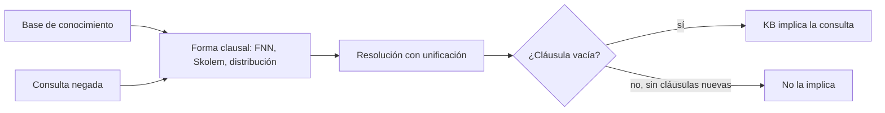

# Inteligencia Artificial - Percepción y conocimiento

## 5.6 Representación de conocimiento lógico.

---

Un agente inteligente no solo percibe y actúa: también **sabe** cosas y **razona** con ellas. Que todos los misiles son armas, que vender armas a una nación hostil es delito, que un paciente con fiebre y tos puede tener gripe. La **representación del conocimiento** busca lenguajes formales para expresar ese saber de modo que una máquina pueda derivar consecuencias de forma correcta y automática. La **lógica** es el más estudiado: tiene una semántica precisa, que dice cuándo una afirmación es verdadera, y procedimientos de inferencia que garantizan que lo derivado se sigue de lo sabido. Este tema presenta la lógica proposicional y de primer orden, la forma clausal, la unificación, la resolución, los sistemas de reglas con encadenamiento hacia adelante y hacia atrás, y la lógica temporal.

### Lógica proposicional

Las fórmulas se construyen con **proposiciones** atómicas, verdaderas o falsas, y conectivos: $\neg,$ $\wedge,$ $\vee,$ $\to$ y $\leftrightarrow.$ Una **interpretación** asigna un valor de verdad a cada proposición, y una base de conocimiento $\text{KB}$ **implica** una fórmula $\alpha,$ escrito $\text{KB} \models \alpha,$ si $\alpha$ es verdadera en todas las interpretaciones en que lo es $\text{KB}.$ Con $n$ proposiciones hay $2^n$ interpretaciones, y decidir la implicación es co-NP-completo, porque equivale a la insatisfacibilidad de $\text{KB} \wedge \neg\alpha.$

Las equivalencias más usadas son la eliminación de la implicación, $\alpha \to \beta \equiv \neg\alpha \vee \beta;$ las leyes de De Morgan, $\neg(\alpha \wedge \beta) \equiv \neg\alpha \vee \neg\beta,$ y la distributividad, $\alpha \vee (\beta \wedge \gamma) \equiv (\alpha \vee \beta) \wedge (\alpha \vee \gamma).$ Con ellas, toda fórmula se lleva a **forma normal conjuntiva** (FNC), una conjunción de **cláusulas**, cada una una disyunción de literales:

1. eliminar $\leftrightarrow$ y $\to;$
2. llevar las negaciones hasta los átomos con De Morgan y la doble negación, la **forma normal negativa**;
3. distribuir $\vee$ sobre $\wedge.$

La distribución puede producir un número exponencial de cláusulas; la transformación de Tseitin introduce variables nuevas y da una fórmula equisatisfacible de tamaño lineal.

### Lógica de primer orden

La lógica de primer orden agrega **objetos**, **predicados** que expresan relaciones entre ellos, **funciones**, **variables** y los **cuantificadores** $\forall$ y $\exists:$ $\forall x\,(\text{Misil}(x) \to \text{Arma}(x)).$ Una interpretación tiene un **dominio** de objetos y asigna a cada constante un objeto, a cada predicado una relación y a cada función una operación. La implicación es **semidecidible**: si $\text{KB} \models \alpha,$ un procedimiento completo lo demuestra en tiempo finito, pero si no, puede no terminar (Church y Turing, 1936).

Para obtener la **forma clausal** se agregan dos pasos: la **skolemización**, que elimina cada $\exists y$ reemplazando $y$ por una función nueva de las variables universales que lo rodean, o por una constante si no hay ninguna, y la eliminación de los $\forall,$ que quedan implícitos. La forma clausal no es equivalente a la fórmula original, pero sí **equisatisfacible**, que es lo que la resolución necesita. La **forma prenex**, con todos los cuantificadores al inicio, es un paso intermedio común.

### Unificación

Para aplicar una regla general a un caso particular hay que hacer coincidir términos con variables. La **unificación** encuentra el **unificador más general** (MGU), la sustitución más simple que iguala dos términos: $\text{Conoce}(\text{Juan}, x)$ y $\text{Conoce}(y, \text{Madre}(y))$ se unifican con $\{y/\text{Juan}, x/\text{Madre}(\text{Juan})\}.$ La **verificación de ocurrencia** impide unificar una variable con un término que la contiene, como $x$ con $f(x),$ que daría un término infinito. El algoritmo de Robinson (1965) es lineal en versiones optimizadas.

### Resolución

La regla de **resolución** combina dos cláusulas con literales complementarios:

$$\frac{\ell_1 \vee \dots \vee \ell_k \vee A \qquad \neg B \vee m_1 \vee \dots \vee m_n}{(\ell_1 \vee \dots \vee \ell_k \vee m_1 \vee \dots \vee m_n)\,\theta}, \qquad \theta = \text{MGU}(A, B)$$

Para demostrar $\text{KB} \models \alpha,$ se agrega $\neg\alpha$ en forma clausal y se resuelve hasta obtener la **cláusula vacía**, $\square,$ una contradicción. La resolución es **correcta** y **completa por refutación** (Robinson, 1965): si $\text{KB} \wedge \neg\alpha$ es insatisfacible, la cláusula vacía se alcanza. Estrategias como la **preferencia unitaria**, el **conjunto soporte** y la resolución **lineal de entrada** limitan la explosión de cláusulas.

### Sistemas de reglas

Con **cláusulas definidas**, reglas con una sola conclusión positiva como $A \wedge B \to C,$ la inferencia es mucho más eficiente:

- **encadenamiento hacia adelante:** parte de los hechos y aplica las reglas cuyas premisas se cumplen hasta que no se derive nada nuevo; es lineal en el tamaño de la base en el caso proposicional y es la base de los sistemas de producción, como CLIPS y Drools, con el algoritmo Rete;
- **encadenamiento hacia atrás:** parte de la meta y busca reglas que la concluyan, convirtiendo sus premisas en submetas; solo explora lo relevante para la pregunta y es la base de Prolog.

Los **sistemas expertos**, como MYCIN (1976) para infecciones de la sangre, codifican el conocimiento de especialistas en cientos de reglas, y explican sus conclusiones mostrando la cadena de reglas aplicadas.

### Lógica temporal

La **lógica temporal lineal** (LTL, Pnueli, 1977) agrega operadores sobre secuencias de estados: $\mathbf{X}\,\varphi,$ en el siguiente estado; $\mathbf{F}\,\varphi,$ alguna vez; $\mathbf{G}\,\varphi,$ siempre; y $\varphi\,\mathbf{U}\,\psi,$ $\varphi$ hasta que $\psi.$ Por ejemplo, $\mathbf{G}(\text{solicitud} \to \mathbf{F}\,\text{respuesta})$ dice que toda solicitud se atiende alguna vez. Se usa para especificar y verificar sistemas, con la verificación de modelos, y para expresar metas y restricciones en planificación.



### Implementación en Python

El programa representa las fórmulas como tuplas e implementa la conversión a forma clausal con skolemización, la unificación con verificación de ocurrencia, la resolución proposicional por saturación y la de primer orden con resolución lineal de entrada, un sistema experto con encadenamiento hacia adelante y hacia atrás con explicación, y la evaluación de fórmulas LTL sobre trazas finitas, aplicada a la planificación de tareas.

```python
from itertools import product, count
from collections import deque

# ---------- Fórmulas como tuplas: ("¬", A), ("∧", A, B), ("∨", A, B), ("→", A, B), ("∀", x, A), ("∃", x, A), átomos ("P", t1, ...) ----------
OPS = {"¬", "∧", "∨", "→", "↔", "∀", "∃"}
def texto(f):
    if isinstance(f, str): return f
    if f[0] == "¬": return "¬" + texto(f[1])
    if f[0] in ("∀", "∃"): return f"{f[0]}{f[1]} {texto(f[2])}"
    if f[0] in ("∧", "∨", "→", "↔"): return f"({texto(f[1])} {f[0]} {texto(f[2])})"
    return f[0] + ("(" + ", ".join(texto(t) for t in f[1:]) + ")" if len(f) > 1 else "")
def sin_implicacion(f):
    if isinstance(f, str) or f[0] not in OPS: return f
    if f[0] == "→": return ("∨", ("¬", sin_implicacion(f[1])), sin_implicacion(f[2]))
    if f[0] == "↔": a, b = sin_implicacion(f[1]), sin_implicacion(f[2]); return ("∧", ("∨", ("¬", a), b), ("∨", ("¬", b), a))
    if f[0] in ("∀", "∃"): return (f[0], f[1], sin_implicacion(f[2]))
    return (f[0],) + tuple(sin_implicacion(g) for g in f[1:])
def fnn(f):                                                   # forma normal negativa: ¬ solo sobre átomos
    if isinstance(f, str) or f[0] not in OPS: return f
    if f[0] == "¬":
        g = f[1]
        if isinstance(g, str) or g[0] not in OPS: return f
        if g[0] == "¬": return fnn(g[1])
        if g[0] == "∧": return ("∨", fnn(("¬", g[1])), fnn(("¬", g[2])))
        if g[0] == "∨": return ("∧", fnn(("¬", g[1])), fnn(("¬", g[2])))
        if g[0] == "∀": return ("∃", g[1], fnn(("¬", g[2])))
        if g[0] == "∃": return ("∀", g[1], fnn(("¬", g[2])))
    if f[0] in ("∀", "∃"): return (f[0], f[1], fnn(f[2]))
    return (f[0],) + tuple(fnn(g) for g in f[1:])
def sustituye(f, s):
    if isinstance(f, str): return s.get(f, f)
    if f[0] in ("∀", "∃"): return (f[0], f[1], sustituye(f[2], {k: v for k, v in s.items() if k != f[1]}))
    return (f[0],) + tuple(sustituye(g, s) for g in f[1:])
contador_sk = count(1)
def skolem(f, universales=()):                                # elimina ∃ con constantes y funciones de Skolem
    if isinstance(f, str) or f[0] not in OPS or f[0] == "¬": return f
    if f[0] == "∀": return ("∀", f[1], skolem(f[2], universales + (f[1],)))
    if f[0] == "∃":
        k = next(contador_sk); termino = (f"f{k}",) + universales if universales else f"a{k}"
        return skolem(sustituye(f[2], {f[1]: termino}), universales)
    return (f[0],) + tuple(skolem(g, universales) for g in f[1:])
def sin_universales(f):
    if isinstance(f, str) or f[0] not in OPS or f[0] == "¬": return f
    if f[0] == "∀": return sin_universales(f[2])
    return (f[0],) + tuple(sin_universales(g) for g in f[1:])
def distribuye(f):                                            # ∨ sobre ∧, y devuelve una lista de cláusulas
    if isinstance(f, str) or f[0] not in ("∧", "∨"): return [frozenset([f])]
    if f[0] == "∧": return distribuye(f[1]) + distribuye(f[2])
    return [a | b for a in distribuye(f[1]) for b in distribuye(f[2])]
def a_clausulas(f):
    global contador_sk; contador_sk = count(1)                # numeración de Skolem por fórmula
    return distribuye(sin_universales(skolem(fnn(sin_implicacion(f)))))
def lit(l): return texto(l)
def clausula(c): return "{" + ", ".join(sorted(lit(l) for l in c)) + "}"

# ---------- Ejercicio 1: forma normal conjuntiva ----------
P, Q, R, S = ("P",), ("Q",), ("R",), ("S",)
formulas = [("→", ("¬", ("∧", P, Q)), ("∨", R, S)),
            ("∀", "x", ("→", ("P", "x"), ("∃", "y", ("Q", "x", "y")))),
            ("∃", "x", ("∀", "y", ("∧", ("P", "x", "y"), ("¬", ("Q", "y")))))]
print("ejercicio 1:")
for f in formulas: print(f"   {texto(f):34} → cláusulas {', '.join(clausula(c) for c in a_clausulas(f))}")
def evalua(f, v):
    if f[0] == "¬": return not evalua(f[1], v)
    if f[0] == "∧": return evalua(f[1], v) and evalua(f[2], v)
    if f[0] == "∨": return evalua(f[1], v) or evalua(f[2], v)
    if f[0] == "→": return (not evalua(f[1], v)) or evalua(f[2], v)
    return v[f[0]]
cl = a_clausulas(formulas[0])
equiv = all(evalua(formulas[0], dict(zip("PQRS", vals))) == all(any(evalua(l, dict(zip("PQRS", vals))) for l in c) for c in cl)
            for vals in product([False, True], repeat=4))
print(f"   la FNC de la primera es equivalente en las 16 interpretaciones: {equiv}")

# ---------- Unificación, con la falla del material original ----------
def es_var(t): return isinstance(t, str) and t[0].islower() and not t[0].isdigit() and t not in CONSTANTES
CONSTANTES = set()
def unifica(x, y, s):
    if s is None: return None
    if x == y: return s
    if es_var(x): return unifica_var(x, y, s)
    if es_var(y): return unifica_var(y, x, s)
    if isinstance(x, tuple) and isinstance(y, tuple) and len(x) == len(y):
        for a, b in zip(x, y): s = unifica(a, b, s)
        return s
    return None
def unifica_var(v, t, s):
    if v in s: return unifica(s[v], t, s)
    if isinstance(t, str) and t in s: return unifica(v, s[t], s)
    if ocurre(v, t, s): return None
    return {**s, v: t}
def ocurre(v, t, s):
    if v == t: return True
    if isinstance(t, str) and t in s: return ocurre(v, s[t], s)
    return isinstance(t, tuple) and any(ocurre(v, a, s) for a in t)
def aplica(t, s):
    if isinstance(t, str): return aplica(s[t], s) if t in s else t
    return (t[0],) + tuple(aplica(a, s) for a in t[1:])
def unify_original(x, y, substitution=None):                 # el código del original, con listas
    if substitution is None: substitution = {}
    if x == y: return substitution
    if isinstance(x, str) and x.islower() and len(x) == 1: substitution[x] = y; return substitution
    if isinstance(y, str) and y.islower() and len(y) == 1: substitution[y] = x; return substitution
    if isinstance(x, list) and isinstance(y, list) and len(x) == len(y):
        return unify_original(x[1:], y[1:], unify_original(x[0], y[0], substitution))
    return None
print("unificación de P(A, B) con P(C, B):", "original", unify_original(["P", "A", "B"], ["P", "C", "B"]), "| corregida", unifica(("P", "A", "B"), ("P", "C", "B"), {}))
print("unificación de Q(x, f(x)) con Q(f(y), y):", unifica(("Q", "x", ("f", "x")), ("Q", ("f", "y"), "y"), {}), "(falla por la verificación de ocurrencia)")
u = unifica(("Conoce", "Juan", "x"), ("Conoce", "y", ("Madre", "y")), {})
print("unificación de Conoce(Juan, x) con Conoce(y, Madre(y)):", {v: texto(aplica(t, u)) for v, t in u.items()})

# ---------- Ejercicio 2: resolución proposicional y de primer orden ----------
def neg(l): return l[1] if l[0] == "¬" else ("¬", l)
def resolucion_prop(kb, consulta):
    clausulas = set(kb) | {frozenset([neg(consulta)])}; origen = {c: "KB" for c in kb}; origen[frozenset([neg(consulta)])] = "¬consulta"
    nuevas = set(); pasos = []
    while True:
        lista = sorted(clausulas, key=clausula)
        for i in range(len(lista)):
            for j in range(i + 1, len(lista)):
                for l in lista[i]:
                    if neg(l) in lista[j]:
                        r = (lista[i] - {l}) | (lista[j] - {neg(l)})
                        if any(neg(m) in r for m in r): continue          # tautología
                        if r not in clausulas and r not in nuevas:
                            nuevas.add(r); pasos.append(f"{clausula(lista[i])} + {clausula(lista[j])} ⊢ {clausula(r) if r else '□'}")
                            if not r: return True, pasos
        if not nuevas - clausulas: return False, pasos
        clausulas |= nuevas
kb = [frozenset([P, Q]), frozenset([("¬", P), R]), frozenset([("¬", Q), R])]
ok, pasos = resolucion_prop(kb, R)
print(f"ejercicio 2: KB = {{P ∨ Q, ¬P ∨ R, ¬Q ∨ R}} ⊨ R: {ok}")
for p in pasos: print("   " + p)
print(f"   KB ⊨ P: {resolucion_prop(kb, P)[0]}")
CONSTANTES.update({"West", "Nono", "América", "M1"})
def renombra(c, k):
    def r(t):
        if es_var(t): return f"{t}_{k}"
        return (t[0],) + tuple(r(a) for a in t[1:]) if isinstance(t, tuple) else t
    return frozenset((("¬", r(l[1])) if l[0] == "¬" else r(l)) for l in c)
def resolucion_lpo(kb, consulta, limite=2000):
    meta = frozenset([("¬", consulta)]); cola = deque([(meta, [f"¬{texto(consulta)}"])]); vistos = {meta}; k = 0
    while cola and k < limite:                                # resolución lineal de entrada a partir de la meta negada
        c, traza = cola.popleft()
        for regla in kb:
            k += 1; rr = renombra(regla, k)
            for l in c:
                for m in rr:
                    if (l[0] == "¬") == (m[0] == "¬"): continue
                    a, b = (l[1], m) if l[0] == "¬" else (l, m[1])
                    s = unifica(a, b, {})
                    if s is None: continue
                    res = frozenset(("¬", aplica(x[1], s)) if x[0] == "¬" else aplica(x, s) for x in (c - {l}) | (rr - {m}))
                    t = traza + [clausula(res) if res else "□"]
                    if not res: return True, t, k
                    if res not in vistos: vistos.add(res); cola.append((res, t))
    return False, [], k
x, y, z = "x", "y", "z"
west = [frozenset([("¬", ("Americano", x)), ("¬", ("Arma", y)), ("¬", ("Vende", x, y, z)), ("¬", ("Hostil", z)), ("Criminal", x)]),
        frozenset([("Tiene", "Nono", "M1")]), frozenset([("Misil", "M1")]),
        frozenset([("¬", ("Misil", x)), ("¬", ("Tiene", "Nono", x)), ("Vende", "West", x, "Nono")]),
        frozenset([("¬", ("Misil", x)), ("Arma", x)]), frozenset([("¬", ("Enemigo", x, "América")), ("Hostil", x)]),
        frozenset([("Americano", "West")]), frozenset([("Enemigo", "Nono", "América")])]
ok, traza, k = resolucion_lpo(west, ("Criminal", "West"))
print(f"   primer orden, el crimen del coronel West: Criminal(West) se demuestra: {ok}, con {k} intentos de resolución; cadena:")
print("   " + " ⊢ ".join(traza))

# ---------- Ejercicio 3: sistema experto con encadenamiento hacia adelante y hacia atrás ----------
REGLAS = [("R1", {"fiebre", "tos", "dolor_muscular"}, "gripe"), ("R2", {"fiebre", "tos", "perdida_olfato"}, "covid_probable"),
          ("R3", {"estornudos", "congestion"}, "resfriado_o_alergia"), ("R4", {"resfriado_o_alergia", "picor_ojos"}, "alergia"),
          ("R5", {"resfriado_o_alergia", "fiebre"}, "resfriado"), ("R6", {"gripe"}, "reposo_e_hidratacion"),
          ("R7", {"covid_probable"}, "prueba_covid"), ("R8", {"alergia"}, "antihistaminico"),
          ("R9", {"dificultad_respirar"}, "urgencias"), ("R10", {"covid_probable", "edad_mayor_65"}, "urgencias")]
def adelante(hechos):
    hechos, aplicadas = set(hechos), []
    while True:
        nueva = next(((n, c) for n, ant, c in REGLAS if ant <= hechos and c not in hechos), None)
        if not nueva: return hechos, aplicadas
        hechos.add(nueva[1]); aplicadas.append(f"{nueva[0]}: {nueva[1]}")
def atras(meta, hechos, nivel=0, traza=None):
    traza = [] if traza is None else traza
    if meta in hechos: traza.append("   " * nivel + f"{meta}: es un hecho"); return True, traza
    for n, ant, c in REGLAS:
        if c == meta:
            traza.append("   " * nivel + f"{meta}? por {n}, si {' y '.join(sorted(ant))}")
            if all(atras(a, hechos, nivel + 1, traza)[0] for a in sorted(ant)): return True, traza
    traza.append("   " * nivel + f"{meta}: no se puede demostrar"); return False, traza
paciente = {"fiebre", "tos", "perdida_olfato", "edad_mayor_65"}
h, ap = adelante(paciente)
print(f"ejercicio 3: hechos {sorted(paciente)} → reglas aplicadas {ap}")
ok, tr = atras("urgencias", paciente)
print(f"   ¿urgencias? {ok}; explicación:"); [print("      " + t) for t in tr]
print(f"   paciente con estornudos, congestión y picor de ojos → {sorted(adelante({'estornudos', 'congestion', 'picor_ojos'})[0] - {'estornudos', 'congestion', 'picor_ojos'})}")

# ---------- Ejercicio 4: lógica temporal lineal sobre trazas finitas y planificación ----------
def cumple(f, traza, i=0):
    op = f[0]
    if op == "p": return f[1] in traza[i]
    if op == "¬": return not cumple(f[1], traza, i)
    if op == "∧": return cumple(f[1], traza, i) and cumple(f[2], traza, i)
    if op == "∨": return cumple(f[1], traza, i) or cumple(f[2], traza, i)
    if op == "→": return (not cumple(f[1], traza, i)) or cumple(f[2], traza, i)
    if op == "X": return i + 1 < len(traza) and cumple(f[1], traza, i + 1)          # siguiente
    if op == "F": return any(cumple(f[1], traza, j) for j in range(i, len(traza)))  # alguna vez
    if op == "G": return all(cumple(f[1], traza, j) for j in range(i, len(traza)))  # siempre
    if op == "U": return any(cumple(f[2], traza, j) and all(cumple(f[1], traza, k) for k in range(i, j)) for j in range(i, len(traza)))
TAREAS = {"diseño": set(), "código": {"diseño"}, "pruebas": {"código"}, "documentación": {"diseño"}, "despliegue": {"código"}}
p = lambda a: ("p", a)
RESTRICCIONES = {"F despliegue": ("F", p("despliegue")),
                 "¬despliegue U pruebas": ("U", ("¬", p("despliegue")), p("pruebas")),
                 "G(código → X documentación ∨ X pruebas)": ("G", ("→", p("código"), ("∨", ("X", p("documentación")), ("X", p("pruebas"))))),
                 "F documentación": ("F", p("documentación"))}
def planes():                                                 # todas las secuencias que respetan las dependencias
    pila = [[]]
    while pila:
        s = pila.pop()
        if len(s) == len(TAREAS): yield s; continue
        for t in TAREAS:
            if t not in s and TAREAS[t] <= set(s): pila.append(s + [t])
todos = sorted(planes())
traza = lambda plan: [{t} for t in plan]
print(f"ejercicio 4: {len(todos)} órdenes respetan las dependencias")
for nombre, f in RESTRICCIONES.items(): print(f"   {nombre:42}: la cumplen {sum(cumple(f, traza(pl)) for pl in todos)}")
validos = [pl for pl in todos if all(cumple(f, traza(pl)) for f in RESTRICCIONES.values())]
print(f"   planes que cumplen todas: {[' → '.join(pl) for pl in validos]}")
```

Salida:

```text
ejercicio 1:
   (¬(P ∧ Q) → (R ∨ S))               → cláusulas {P, R, S}, {Q, R, S}
   ∀x (P(x) → ∃y Q(x, y))             → cláusulas {Q(x, f1(x)), ¬P(x)}
   ∃x ∀y (P(x, y) ∧ ¬Q(y))            → cláusulas {P(a1, y)}, {¬Q(y)}
   la FNC de la primera es equivalente en las 16 interpretaciones: True
unificación de P(A, B) con P(C, B): original {} | corregida None
unificación de Q(x, f(x)) con Q(f(y), y): None (falla por la verificación de ocurrencia)
unificación de Conoce(Juan, x) con Conoce(y, Madre(y)): {'y': 'Juan', 'x': 'Madre(Juan)'}
ejercicio 2: KB = {P ∨ Q, ¬P ∨ R, ¬Q ∨ R} ⊨ R: True
   {P, Q} + {R, ¬P} ⊢ {Q, R}
   {P, Q} + {R, ¬Q} ⊢ {P, R}
   {R, ¬P} + {¬R} ⊢ {¬P}
   {R, ¬Q} + {¬R} ⊢ {¬Q}
   {P, Q} + {¬P} ⊢ {Q}
   {P, Q} + {¬Q} ⊢ {P}
   {P, R} + {R, ¬P} ⊢ {R}
   {P} + {¬P} ⊢ □
   KB ⊨ P: False
   primer orden, el crimen del coronel West: Criminal(West) se demuestra: True, con 1504 intentos de resolución; cadena:
   ¬Criminal(West) ⊢ {¬Americano(West), ¬Arma(y_1), ¬Hostil(z_1), ¬Vende(West, y_1, z_1)} ⊢ {¬Americano(West), ¬Arma(x_12), ¬Hostil(Nono), ¬Misil(x_12), ¬Tiene(Nono, x_12)} ⊢ {¬Americano(West), ¬Arma(M1), ¬Hostil(Nono), ¬Misil(M1)} ⊢ {¬Americano(West), ¬Hostil(Nono), ¬Misil(M1)} ⊢ {¬Americano(West), ¬Hostil(Nono)} ⊢ {¬Americano(West), ¬Enemigo(Nono, América)} ⊢ {¬Enemigo(Nono, América)} ⊢ □
ejercicio 3: hechos ['edad_mayor_65', 'fiebre', 'perdida_olfato', 'tos'] → reglas aplicadas ['R2: covid_probable', 'R7: prueba_covid', 'R10: urgencias']
   ¿urgencias? True; explicación:
      urgencias? por R9, si dificultad_respirar
         dificultad_respirar: no se puede demostrar
      urgencias? por R10, si covid_probable y edad_mayor_65
         covid_probable? por R2, si fiebre y perdida_olfato y tos
            fiebre: es un hecho
            perdida_olfato: es un hecho
            tos: es un hecho
         edad_mayor_65: es un hecho
   paciente con estornudos, congestión y picor de ojos → ['alergia', 'antihistaminico', 'resfriado_o_alergia']
ejercicio 4: 8 órdenes respetan las dependencias
   F despliegue                              : la cumplen 8
   ¬despliegue U pruebas                     : la cumplen 4
   G(código → X documentación ∨ X pruebas)   : la cumplen 5
   F documentación                           : la cumplen 8
   planes que cumplen todas: ['diseño → código → documentación → pruebas → despliegue', 'diseño → código → pruebas → despliegue → documentación', 'diseño → código → pruebas → documentación → despliegue', 'diseño → documentación → código → pruebas → despliegue']
```

### Ejercicios Propuestos

1. **Forma normal.** Convierte a forma normal conjuntiva $\neg(P \wedge Q) \to (R \vee S),$ $\forall x\,(P(x) \to \exists y\,Q(x, y))$ y $\exists x\,\forall y\,(P(x, y) \wedge \neg Q(y)),$ e implementa un algoritmo de conversión.

2. **Resolución.** Implementa la resolución para lógica proposicional, extiéndela a primer orden con unificación, y pruébala con $\text{KB} = \{P \vee Q, \neg P \vee R, \neg Q \vee R\}$ y la consulta $R.$

3. **Sistema experto.** Diseña una base de conocimiento para diagnóstico médico, implementa un motor de inferencia basado en reglas y permite consultas sobre posibles diagnósticos.

4. **Conocimiento temporal.** Extiende la lógica proposicional con operadores temporales, implementa el razonamiento sobre secuencias y aplícalo a la planificación de tareas.

### Soluciones

**Ejercicio 1.** Para la primera fórmula, eliminando la implicación, $\neg\neg(P \wedge Q) \vee R \vee S,$ que es $(P \wedge Q) \vee R \vee S,$ y distribuyendo:

$$(P \vee R \vee S) \wedge (Q \vee R \vee S)$$

El programa lo confirma en las 16 interpretaciones. La segunda se convierte en $\forall x\,(\neg P(x) \vee \exists y\,Q(x, y));$ como el $y$ que existe depende de $x,$ se reemplaza por una función de Skolem, $f_1(x),$ y la cláusula es $\neg P(x) \vee Q(x, f_1(x)).$ En la tercera, el $\exists x$ no está dentro de ningún $\forall,$ así que $x$ se reemplaza por una constante nueva $a_1,$ y quedan dos cláusulas: $P(a_1, y)$ y $\neg Q(y).$ En las dos últimas, el resultado es equisatisfacible, no equivalente: la forma clausal afirma algo sobre $f_1$ y $a_1,$ que no estaban en la fórmula. El algoritmo implementado aplica los pasos en orden: eliminar implicaciones, forma normal negativa, skolemización, eliminación de los universales y distribución.

**Ejercicio 2.** Con la consulta negada, $\neg R,$ la saturación encuentra la contradicción en 8 pasos; la refutación más corta usa 3: $\{\neg P, R\}$ y $\{\neg R\}$ dan $\{\neg P\};$ con $\{P, Q\}$ dan $\{Q\};$ con $\{\neg Q, R\}$ dan $\{R\},$ y con $\{\neg R\},$ la cláusula vacía. Es un razonamiento por casos: si $P$ o $Q$ es verdadera, y cada una implica $R,$ entonces $R.$ En cambio, $P$ no se sigue de la base, y la saturación termina sin la cláusula vacía. Para primer orden, la resolución con unificación demuestra $\text{Criminal}(\text{West})$ en el problema clásico de Russell y Norvig, en el que es delito que un estadounidense venda armas a una nación hostil, Nono tiene misiles, todos vendidos por el coronel West, y Nono es enemiga de Estados Unidos: la cadena de 8 resolventes unifica $y$ con M1 y $z$ con Nono. La unificación del material original tenía una falla: si la unificación de los primeros argumentos fallaba y devolvía `None`, la llamada siguiente lo interpretaba como una sustitución vacía y seguía, de modo que $P(A, B)$ y $P(C, B)$ se unificaban con `{}`; la versión corregida propaga la falla.

**Ejercicio 3.** La base tiene 10 reglas de la forma premisas → conclusión, con diagnósticos intermedios, como "resfriado o alergia", y recomendaciones. Para un paciente con fiebre, tos, pérdida del olfato y más de 65 años, el encadenamiento hacia adelante aplica R2, sospecha de covid; R7, hacer la prueba, y R10, acudir a urgencias. El encadenamiento hacia atrás responde la pregunta "¿debe ir a urgencias?" e imprime su explicación: R9 no aplica porque no hay dificultad para respirar, y R10 sí, porque su premisa de covid probable se demuestra con R2. Con estornudos, congestión y picor de ojos, concluye alergia y recomienda un antihistamínico. Las reglas son ilustrativas y no constituyen un criterio médico; un sistema real necesitaría manejar incertidumbre, como los factores de certeza de MYCIN o una red bayesiana del tema 3.1.

**Ejercicio 4.** Los operadores X, F, G y U se evalúan sobre trazas finitas, una lista de estados con las proposiciones verdaderas en cada uno, con la semántica de LTLf (De Giacomo y Vardi, 2013). En el dominio de planificación, 5 tareas tienen dependencias: el código y la documentación requieren el diseño, y las pruebas y el despliegue requieren el código; 8 órdenes las respetan. Las restricciones temporales son: alguna vez se despliega, $\mathbf{F}\,\text{despliegue};$ no se despliega hasta que se prueba, $\neg\text{despliegue}\ \mathbf{U}\ \text{pruebas};$ inmediatamente después del código vienen la documentación o las pruebas, $\mathbf{G}(\text{código} \to \mathbf{X}\,\text{documentación} \vee \mathbf{X}\,\text{pruebas}),$ y alguna vez se documenta. La segunda la cumplen 4 órdenes y la tercera 5, y las 4 juntas, 4 planes, que el programa enumera. En planificación real, en lugar de enumerar los planes, la fórmula LTL se compila en un autómata que guía la búsqueda.

El material original tenía dos errores en sus ejemplos de bases de conocimiento: en la regla de recomendación, la variable $g$ no estaba cuantificada, y la consulta preguntaba por `Suggested` cuando la regla concluía `Suggest`, de modo que nunca habría respuesta.

### Referencias

1. Russell, S., and Norvig, P., _Artificial Intelligence: A Modern Approach_. Pearson, 2021. Capítulos 7 a 10.
2. Robinson, J. A., A machine-oriented logic based on the resolution principle. _Journal of the ACM_ 12(1), 1965.
3. Brachman, R. J., and Levesque, H. J., _Knowledge Representation and Reasoning_. Morgan Kaufmann, 2004.
4. Pnueli, A., The temporal logic of programs. _Proceedings of FOCS_, 1977.
5. De Giacomo, G., and Vardi, M. Y., Linear temporal logic and linear dynamic logic on finite traces. _IJCAI_, 2013.
6. Shortliffe, E. H., _Computer-Based Medical Consultations: MYCIN_. Elsevier, 1976.
7. Huth, M., and Ryan, M., _Logic in Computer Science_. Cambridge University Press, 2004.
