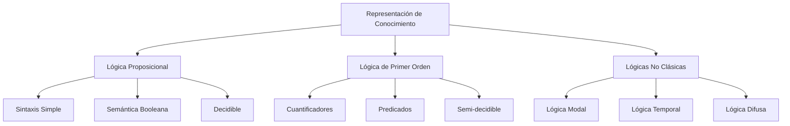

# Inteligencia Artificial - Percepción y conocimiento

## 5.6 Representación de conocimiento lógico.

---

La representación de conocimiento lógico es fundamental en inteligencia artificial para modelar el mundo, razonar sobre él y tomar decisiones. Según Russell y Norvig (2009), "un agente inteligente debe tener una representación interna del mundo que le permita razonar sobre los estados posibles y tomar decisiones". La lógica proporciona un marco formal para este tipo de representación.

### Conceptos Fundamentales

#### Definición de Representación de Conocimiento

La representación de conocimiento es el estudio de cómo el conocimiento sobre el mundo puede representarse formalmente y manipularse automáticamente por programas computacionales. Incluye:

- **Sintaxis**: Las estructuras formales que constituyen el lenguaje
- **Semántica**: El significado de las estructuras sintácticas
- **Inferencia**: Los mecanismos para derivar nuevo conocimiento

#### Sistemas de Representación de Conocimiento



### Lógica Proposicional

#### Sintaxis y Semántica

La lógica proposicional utiliza proposiciones atómicas que pueden ser verdaderas o falsas:

- **Símbolos proposicionales**: P, Q, R, ...
- **Conectivos lógicos**: ¬ (negación), ∧ (conjunción), ∨ (disyunción), → (implicación), ↔ (bicondicional)

##### Tablas de Verdad

| P   | Q   | ¬P  | P ∧ Q | P ∨ Q | P → Q | P ↔ Q |
| --- | --- | --- | ----- | ----- | ----- | ----- |
| T   | T   | F   | T     | T     | T     | T     |
| T   | F   | F   | F     | T     | F     | F     |
| F   | T   | T   | F     | T     | T     | F     |
| F   | F   | T   | F     | F     | T     | T     |

#### Equivalencias Lógicas

$$ \begin{align*} P \rightarrow Q & \equiv \neg P \lor Q \\\ P \leftrightarrow Q & \equiv (P \rightarrow Q) \land (Q \rightarrow P) \\\ \neg(P \land Q) & \equiv \neg P \lor \neg Q \quad \text{(Ley de De Morgan)} \\\ \neg(P \lor Q) & \equiv \neg P \land \neg Q \quad \text{(Ley de De Morgan)} \end{align*} $$

#### Implementación de Evaluación de Fórmulas

```python
class PropositionalLogic:
    def __init__(self):
        self.variables = {}

    def evaluate(self, expression, interpretation):
        """
        Evalúa una expresión proposicional dada una interpretación
        """
        if isinstance(expression, str):
            return interpretation[expression]

        if expression[0] == '¬':
            return not self.evaluate(expression[1], interpretation)
        elif expression[0] == '∧':
            return self.evaluate(expression[1], interpretation) and self.evaluate(expression[2], interpretation)
        elif expression[0] == '∨':
            return self.evaluate(expression[1], interpretation) or self.evaluate(expression[2], interpretation)
        elif expression[0] == '→':
            return not self.evaluate(expression[1], interpretation) or self.evaluate(expression[2], interpretation)
        elif expression[0] == '↔':
            return self.evaluate(expression[1], interpretation) == self.evaluate(expression[2], interpretation)

    def is_tautology(self, expression):
        """
        Verifica si una expresión es una tautología
        """
        variables = self.get_variables(expression)
        for interpretation in self.generate_interpretations(variables):
            if not self.evaluate(expression, interpretation):
                return False
        return True

# Ejemplo de uso
logic = PropositionalLogic()
expression = ('→', 'P', ('∨', 'Q', 'R'))
interpretation = {'P': True, 'Q': False, 'R': True}
result = logic.evaluate(expression, interpretation)
```

### Lógica de Primer Orden (LPO)

#### Sintaxis de LPO

La lógica de primer orden extiende la proposicional con:

- **Cuantificadores**: ∀ (universal), ∃ (existencial)
- **Predicados**: P(x), Q(x, y), ...
- **Funciones**: f(x), g(x, y), ...
- **Constantes**: a, b, c, ...
- **Variables**: x, y, z, ...

#### Semántica de LPO

Una interpretación en LPO consiste en:

- Un dominio D de objetos
- Asignación de constantes a objetos en D
- Asignación de predicados a relaciones en D
- Asignación de funciones a operaciones en D

#### Forma Normal Prenex

Toda fórmula de LPO puede convertirse a forma normal prenex:

$$
Q_1x_1Q_2x_2...Q_nx_n M
$$

Donde $Q_i$ son cuantificadores y M es una fórmula sin cuantificadores.

#### Implementación de Unificación

```python
def unify(x, y, substitution=None):
    """
    Algoritmo de unificación para lógica de primer orden
    """
    if substitution is None:
        substitution = {}

    if x == y:
        return substitution
    elif isinstance(x, str) and is_variable(x):
        return unify_var(x, y, substitution)
    elif isinstance(y, str) and is_variable(y):
        return unify_var(y, x, substitution)
    elif isinstance(x, list) and isinstance(y, list) and len(x) == len(y):
        return unify(x[1:], y[1:], unify(x[0], y[0], substitution))
    else:
        return None

def unify_var(var, x, substitution):
    if var in substitution:
        return unify(substitution[var], x, substitution)
    elif occurs_check(var, x, substitution):
        return None
    else:
        substitution[var] = x
        return substitution

def occurs_check(var, x, substitution):
    """
    Verifica si una variable ocurre en un término
    """
    if var == x:
        return True
    elif isinstance(x, str) and x in substitution:
        return occurs_check(var, substitution[x], substitution)
    elif isinstance(x, list):
        return any(occurs_check(var, term, substitution) for term in x)
    return False
```

### Sistemas de Inferencia

#### Modus Ponens

$$
\frac{P \rightarrow Q, P}{Q}
$$

#### Resolución en Lógica Proposicional

$$
\frac{(A \lor B), (\neg A \lor C)}{(B \lor C)}
$$

#### Resolución en LPO

$$
\frac{(P(x) \lor Q(x)), (\neg P(a) \lor R(y))}{Q(a) \lor R(y)} \quad \text{[con unificación x/a]}
$$

#### Algoritmo de Resolución

```python
def resolve(clause1, clause2):
    """
    Aplica resolución a dos cláusulas
    """
    resolvents = []

    for literal1 in clause1:
        for literal2 in clause2:
            # Buscar literales complementarios
            if is_complementary(literal1, literal2):
                # Crear nueva cláusula sin los literales complementarios
                new_clause = [l for l in clause1 if l != literal1] + \
                             [l for l in clause2 if l != literal2]

                # Simplificar y agregar si no es tautología
                new_clause = simplify_clause(new_clause)
                if not is_tautology(new_clause):
                    resolvents.append(new_clause)

    return resolvents

def resolution_refutation(kb, query):
    """
    Demostración por refutación usando resolución
    """
    clauses = kb + [negate(query)]  # Convertir a forma clausal y negar query
    new = set()

    while True:
        n = len(clauses)
        pairs = [(clauses[i], clauses[j])
                for i in range(n) for j in range(i+1, n)]

        for (ci, cj) in pairs:
            resolvents = resolve(ci, cj)
            if [] in resolvents:  # Cláusula vacía encontrada
                return True
            new = new.union(set([tuple(clause) for clause in resolvents]))

        if new.issubset(set([tuple(clause) for clause in clauses])):
            return False  # No se puede derivar contradicción

        clauses.extend([list(clause) for clause in new])
```

### Representación del Conocimiento en Dominios

#### Ejemplo: Dominio de Bloques

```python
# Representación de conocimiento sobre bloques
block_knowledge = [
    # Hechos
    'On(A, Table)',
    'On(B, Table)',
    'On(C, A)',
    'Clear(B)',
    'Clear(C)',
    'Block(A)', 'Block(B)', 'Block(C)',

    # Reglas
    '∀x ∀y (On(x, y) → ¬Clear(y))',
    '∀x (Block(x) ∧ Clear(x) → ∃y CanMove(x, y))',
    '∀x ∀y (CanMove(x, y) ∧ Clear(y) → Move(x, y))'
]

# Consultas
queries = [
    'Clear(A)',
    'CanMove(C, B)',
    '∃x On(x, B)'
]
```

#### Ejemplo: Sistema de Recomendaciones

```python
# Base de conocimiento para sistema de recomendación
recommendation_kb = [
    # Usuarios y sus preferencias
    'Likes(John, ActionMovies)',
    'Likes(John, SciFi)',
    'Likes(Mary, Romance)',
    'Likes(Mary, Comedy)',

    # Información sobre películas
    'Genre(Matrix, ActionMovies)',
    'Genre(Matrix, SciFi)',
    'Genre(Titanic, Romance)',
    'Genre(Titanic, Drama)',

    # Reglas de recomendación
    '∀p ∀u (Likes(u, g) ∧ Genre(p, g) → Recommended(p, u))',
    '∀p ∀u (Recommended(p, u) ∧ ¬Watched(u, p) → Suggest(p, u))'
]

# Consultar películas recomendadas para John
query = '∃p Suggested(p, John)'
```

### Ejercicios Propuestos

#### Ejercicio 1: Conversión a Forma Normal

1. Convierte las siguientes fórmulas a forma normal conjuntiva:
   - ¬(P ∧ Q) → (R ∨ S)
   - ∀x (P(x) → ∃y Q(x, y))
   - ∃x ∀y (P(x, y) ∧ ¬Q(y))

2. Implementa un algoritmo para la conversión a FNC

#### Ejercicio 2: Implementación de Resolución

1. Implementa el algoritmo de resolución completo para lógica proposicional
2. Extiende el algoritmo para lógica de primer orden con unificación
3. Prueba con el siguiente conocimiento:
   - KB: {P ∨ Q, ¬P ∨ R, ¬Q ∨ R}
   - Query: R

#### Ejercicio 3: Sistema Experto con Lógica

1. Diseña una base de conocimiento para diagnóstico médico
2. Implementa un motor de inferencia basado en reglas
3. Permite consultas sobre posibles diagnósticos

#### Ejercicio 4: Representación de Conocimiento Temporal

1. Extiende la lógica proposicional con operadores temporales
2. Implementa reasoning sobre secuencias temporales
3. Aplica a un dominio de planificación de tareas

### Aplicaciones Prácticas

#### Sistema de Diagnóstico con Lógica

```python
class DiagnosticSystem:
    def __init__(self):
        self.kb = []  # Base de conocimiento
        self.facts = set()  # Hechos conocidos

    def add_rule(self, rule):
        """Añade una regla a la base de conocimiento"""
        self.kb.append(rule)

    def assert_fact(self, fact):
        """Añade un hecho a la base de conocimiento"""
        self.facts.add(fact)

    def forward_chaining(self):
        """Encadenamiento hacia adelante"""
        new_facts = True
        while new_facts:
            new_facts = False
            for rule in self.kb:
                if self.rule_applies(rule) and self.conclusion_not_known(rule):
                    self.facts.add(self.get_conclusion(rule))
                    new_facts = True

    def backward_chaining(self, goal):
        """Encadenamiento hacia atrás para un objetivo"""
        if goal in self.facts:
            return True

        for rule in self.kb:
            if self.get_conclusion(rule) == goal:
                premises = self.get_premises(rule)
                if all(self.backward_chaining(premise) for premise in premises):
                    return True

        return False

# Ejemplo de uso
medical_system = DiagnosticSystem()
medical_system.add_rule('Fever ∧ Headache → Flu')
medical_system.add_rule('Flu → Recommend(Rest)')
medical_system.assert_fact('Fever')
medical_system.assert_fact('Headache')
medical_system.forward_chaining()
```

### Referencias

#### Bibliografía Básica

1. Russell, S. J., & Norvig, P. (2009). _Artificial Intelligence: A Modern Approach_ (3rd ed.). Prentice Hall. (Capítulos 7-9)
2. Marsland, S. (2009). _Machine Learning: An Algorithmic Perspective_. Chapman and Hall. (Capítulo 4)

#### Bibliografía Complementaria

1. Davis, E. (1990). _Representations of Commonsense Knowledge_. Morgan Kaufmann.
2. Genesereth, M. R., & Nilsson, N. J. (1987). _Logical Foundations of Artificial Intelligence_. Morgan Kaufmann.
3. Huth, M., & Ryan, M. (2004). _Logic in Computer Science: Modelling and Reasoning about Systems_. Cambridge University Press.

#### Recursos Adicionales

- Prover9: Demostrador automático de teoremas
- Coq: Asistente de pruebas formales
- Stanford Logic Group: Recursos sobre lógica computacional
- Journal of Automated Reasoning: Publicaciones especializadas

### Conclusiones

La representación de conocimiento lógico proporciona las bases formales para que los sistemas de IA puedan razonar sobre el mundo, tomar decisiones y resolver problemas complejos. Desde la simple lógica proposicional hasta las complejas lógicas modales y temporales, estos formalismos permiten modelar dominios de conocimiento y realizar inferencias automáticas. El dominio de estas técnicas es esencial para el desarrollo de sistemas expertos, agentes inteligentes y sistemas de razonamiento automatizado.
