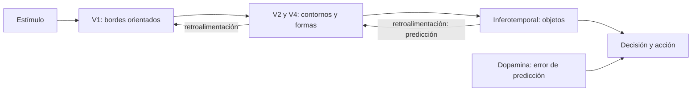

# Inteligencia Artificial - Percepción y conocimiento

## 5.7 Inteligencia artificial y el cerebro.

---

La inteligencia artificial y la neurociencia se han alimentado mutuamente desde el inicio. La neurona artificial de McCulloch y Pitts (1943), el aprendizaje de Hebb (1949), las redes convolucionales inspiradas en la corteza visual de Hubel y Wiesel, y el aprendizaje por refuerzo, cuyo error de predicción resultó coincidir con la actividad de las neuronas de dopamina, son ejemplos de ideas que fueron y vinieron entre los dos campos. Al mismo tiempo, el cerebro sigue siendo muy distinto de las redes que usamos: se comunica con pulsos, aprende con reglas locales, consume unos 20 W y aprende de pocos ejemplos. Este tema presenta los modelos de neuronas, la plasticidad sináptica y la regla STDP, la organización de la corteza con conexiones hacia adelante y de retroalimentación, la memoria asociativa de Hopfield y su capacidad, y la dopamina como señal de error de predicción.

### Modelos de neurona

- **McCulloch y Pitts (1943):** una unidad binaria que dispara si la suma de sus entradas excitatorias alcanza un umbral y ninguna inhibitoria está activa. Con ellas se construye cualquier función lógica; no aprenden, sus conexiones son fijas.
- **Neurona artificial:** $y = f(\sum_i w_i x_i + b),$ con pesos ajustables y una activación $f$ como la sigmoide, $\tanh$ o ReLU, $\max(0, z),$ que es la estándar de las redes profundas porque no se satura para valores positivos. Su salida es una tasa, un número real, no un pulso.
- **Integra y dispara con fuga** (LIF): el potencial de membrana $v$ cumple $\tau\,\frac{dv}{dt} = -(v - v_{\text{reposo}}) + R\,I(t);$ al cruzar un umbral emite un pulso y se reinicia. Es el modelo de las **redes de pulsos** y del hardware neuromórfico.
- **Hodgkin y Huxley (1952):** ecuaciones diferenciales para las corrientes de sodio y potasio que generan el potencial de acción, con precisión biofísica y un costo computacional mucho mayor.

### Plasticidad sináptica

La **regla de Hebb**, $\Delta w_{ij} = \eta\,x_i\,y_j,$ resume la idea de que las neuronas que se activan juntas fortalecen su conexión. Por sí sola es inestable, porque los pesos solo crecen; la **regla de Oja** agrega un término de olvido que normaliza los pesos, y con ella una neurona aprende la primera componente principal de sus entradas.

La **plasticidad dependiente del tiempo de los pulsos** (STDP), medida por Bi y Poo (1998), hace que importe el orden: si el pulso presináptico precede al postsináptico por $\Delta t = t_{\text{post}} - t_{\text{pre}} \gt 0,$ la sinapsis se **potencia**, y si llega después, se **deprime**:

$$\Delta w = \begin{cases} A_+\,e^{-\Delta t/\tau_+} & \Delta t \gt 0 \\ -A_-\,e^{\Delta t/\tau_-} & \Delta t \lt 0 \end{cases}$$

con $\tau_\pm$ de unos 20 ms. Es una forma causal de Hebb: se refuerzan las entradas que contribuyen a hacer disparar a la neurona. Si la depresión total supera a la potenciación, $A_- \tau_- \gt A_+ \tau_+,$ las entradas no correlacionadas se debilitan y las que disparan juntas compiten por controlar a la neurona (Song, Miller y Abbott, 2000).

### La corteza: jerarquía y retroalimentación

La corteza visual está organizada en una **jerarquía** de áreas, V1, V2, V4 y la corteza inferotemporal, con campos receptivos cada vez más grandes y respuestas cada vez más abstractas: bordes orientados en V1, que Hubel y Wiesel describieron en 1959, contornos y texturas en V2, objetos y caras en la inferotemporal. Esa jerarquía inspiró el neocognitrón de Fukushima (1980) y las redes convolucionales, cuyas capas aprendidas se parecen sorprendentemente a las respuestas de la corteza (Yamins y DiCarlo, 2016). Pero la corteza tiene tantas conexiones de **retroalimentación**, de las áreas altas a las bajas, como hacia adelante. Una interpretación es la **codificación predictiva** (Rao y Ballard, 1999): las áreas altas predicen la actividad de las bajas y estas solo transmiten el error, lo que permite completar información ocluida o ruidosa con el contexto.

### Memoria asociativa

Una **red de Hopfield** (1982) almacena patrones binarios $\xi^\mu \in \{-1, +1\}^N$ con la regla de Hebb, $w_{ij} = \frac{1}{N}\sum_\mu \xi_i^\mu \xi_j^\mu$ con $w_{ii} = 0,$ y los recupera actualizando cada neurona a $s_i = \operatorname{signo}(\sum_j w_{ij} s_j).$ Con pesos simétricos, cada actualización asíncrona no aumenta la **energía**

$$E = -\frac{1}{2} \sum_{i, j} w_{ij}\,s_i s_j$$

y la red cae en un mínimo local: los patrones almacenados son **atractores**, y una versión ruidosa o incompleta converge al original. Es una memoria **direccionable por contenido**, como el recuerdo humano. Su **capacidad** es limitada: con patrones aleatorios, la recuperación falla de forma abrupta cuando $P/N$ supera aproximadamente 0.138 (Amit, Gutfreund y Sompolinsky, 1985), porque la interferencia entre patrones crea atractores espurios. Las redes de Hopfield modernas, con energías no cuadráticas, tienen capacidad exponencial y están relacionadas con el mecanismo de atención de los transformadores (Ramsauer y otros, 2021).

### Dopamina y aprendizaje por refuerzo

Schultz, Dayan y Montague (1997) observaron que las neuronas de dopamina del mesencéfalo responden a un premio inesperado, dejan de responder al premio cuando una señal lo predice y responden en cambio a la señal, y bajan su actividad si el premio predicho no llega. Es exactamente el comportamiento del **error de diferencia temporal** del tema 4.3, $\delta_t = r_{t+1} + \gamma V(s_{t+1}) - V(s_t).$ La arquitectura **actor-crítico** tiene un paralelo anatómico: el estriado ventral como crítico, que aprende el valor, y el dorsal como actor, que aprende la política, ambos modulados por la señal de dopamina.

### Cerebro y redes artificiales

| Aspecto | Cerebro humano | Red neuronal artificial |
| ------- | -------------- | ----------------------- |
| Unidades | unas $8.6 \times 10^{10}$ neuronas | de miles a miles de millones de unidades |
| Conexiones | unas $10^{14}$ sinapsis, unas $10^3$ a $10^4$ por neurona | hasta $10^{12}$ parámetros en los modelos más grandes |
| Señal | pulsos, de 1 a 200 por segundo en la corteza | números reales, una pasada por entrada |
| Aprendizaje | reglas locales, continuo, de pocos ejemplos | retropropagación del error, global, de muchos ejemplos |
| Consumo | unos 20 W | cientos de vatios por acelerador, megavatios para entrenar los modelos grandes |

La retropropagación requiere enviar errores hacia atrás por las mismas conexiones, algo que no parece ocurrir en el cerebro; cómo aprende el cerebro con reglas locales es una pregunta abierta, con propuestas como la alineación por retroalimentación y la codificación predictiva.



### Implementación en Python

El programa simula los cuatro ejercicios con NumPy y scikit-learn: una neurona integra y dispara con 200 entradas de pulsos y la regla STDP, de las cuales 50 disparan de forma parcialmente sincronizada; una jerarquía visual con detectores de orientación fijos, una capa de categorías aprendida y una retroalimentación que rellena las partes ocluidas; una red de Hopfield de 100 neuronas con un número creciente de patrones, y el error de diferencia temporal en un condicionamiento con señal y premio, más un actor-crítico en una tarea de elección con inversión.

```python
import numpy as np
from sklearn.linear_model import LogisticRegression

# ---------- Ejercicio 1: STDP con una neurona integra y dispara ----------
A_mas, A_menos, tau_mas, tau_menos = 0.005, 0.006, 20.0, 20.0             # ms; A− mayor que A+: depresión neta sin correlación
def ventana(dt): return A_mas * np.exp(-dt / tau_mas) if dt > 0 else -A_menos * np.exp(dt / tau_menos)
print("ejercicio 1: ventana de STDP, Δw según Δt = t_post − t_pre:")
print("   " + "  ".join(f"{dt:+d} ms: {ventana(dt) * 1000:+.2f}e-3" for dt in (-40, -20, -10, -5, 5, 10, 20, 40)))
rng = np.random.default_rng(0); N, T, dt_ms = 200, 100_000, 1.0          # 200 entradas, 100 s con paso de 1 ms
corr = np.arange(N) < 50                                                  # las primeras 50 entradas disparan en sincronía parcial
w = np.full(N, 0.5); x_pre = np.zeros(N); x_post = 0.0; v = -70.0; disparos = 0
for t in range(T):
    comun = rng.random() < 0.01                                           # eventos comunes a 10 Hz
    p = np.where(corr, 0.005 + (0.5 if comun else 0), 0.01)               # unas 10 Hz de tasa media en todas
    s = rng.random(N) < p
    x_pre = x_pre * np.exp(-dt_ms / tau_mas) + s; x_post *= np.exp(-dt_ms / tau_menos)
    w -= A_menos * x_post * s                                             # pre después de post: depresión
    v += dt_ms / 10.0 * (-70.0 - v) + 0.6 * (w @ s)                       # integra y dispara, τ = 10 ms
    if v > -54.0:
        v = -60.0; x_post += 1; disparos += 1; w += A_mas * x_pre         # post después de pre: potenciación
    np.clip(w, 0, 1, out=w)
print(f"   tras 100 s: la neurona disparó a {disparos / 100:.1f} Hz; peso medio de las entradas correlacionadas {w[corr].mean():.3f}, "
      f"de las independientes {w[~corr].mean():.3f} (todas empezaron en 0.5)")
h1, _ = np.histogram(w[corr], bins=5, range=(0, 1)); h2, _ = np.histogram(w[~corr], bins=5, range=(0, 1))
print("   histograma de pesos [0, 0.2), …, [0.8, 1]: correlacionadas", h1.tolist(), "| independientes", h2.tolist())

# ---------- Ejercicio 2: jerarquía visual con conexiones hacia adelante y retroalimentación ----------
def patron(k, rng):                                                       # 4 clases de patrones de 8x8 con posición variable
    im = np.zeros((8, 8)); f, c = rng.integers(1, 7, 2)
    if k == 0: im[f, 1:7] = 1                                             # barra horizontal
    elif k == 1: im[1:7, c] = 1                                           # barra vertical
    elif k == 2: im[f, 1:7] = 1; im[1:7, c] = 1                           # cruz
    else: np.fill_diagonal(im, 1)                                         # diagonal
    return np.clip(im + rng.normal(0, 0.1, im.shape), 0, 1)
FILTROS = [np.array([[-1, -1, -1], [2, 2, 2], [-1, -1, -1]]), np.array([[-1, 2, -1]] * 3), np.eye(3) * 3 - 1, np.fliplr(np.eye(3)) * 3 - 1]
def v1(im):                                                               # capa 1: detectores de orientación, rectificados y agrupados 2x2
    sal = []
    for F in FILTROS:
        R = np.array([[np.sum(im[i:i + 3, j:j + 3] * F) for j in range(6)] for i in range(6)]); R = np.maximum(R, 0)
        sal.append(R.reshape(3, 2, 3, 2).max(axis=(1, 3)).ravel())
    return np.concatenate(sal)
rng = np.random.default_rng(1); Y = np.repeat(np.arange(4), 150); IM = np.array([patron(k, rng) for k in Y])
V1 = np.array([v1(im) for im in IM]); clasif = LogisticRegression(max_iter=3000).fit(V1, Y)       # capa 2: categorías
plantillas = np.array([IM[Y == k].mean(0) for k in range(4)])            # modelo generativo de arriba abajo: cómo se ve cada clase
def con_retro(im, mascara, iteraciones=5):                                # la predicción de la capa alta rellena lo ocluido
    x = im * mascara
    for _ in range(iteraciones):
        p = clasif.predict_proba([v1(x)])[0]; recon = np.tensordot(p, plantillas, 1)
        x = mascara * im + (1 - mascara) * recon
    return clasif.predict([v1(x)])[0]
rng = np.random.default_rng(2); Yp = np.repeat(np.arange(4), 50); prueba = [patron(k, rng) for k in Yp]
print("ejercicio 2: 600 patrones de entrenamiento, 200 de prueba; exactitud con oclusión de una franja de columnas")
for ancho in (0, 2, 3, 4):
    m = np.ones((8, 8)); m[:, 2:2 + ancho] = 0
    solo = np.mean([clasif.predict([v1(im * m)])[0] == k for im, k in zip(prueba, Yp)])
    retro = np.mean([con_retro(im, m) == k for im, k in zip(prueba, Yp)])
    print(f"   {ancho} columnas ocluidas: solo hacia adelante {solo:.3f} | con retroalimentación {retro:.3f}")

# ---------- Ejercicio 3: memoria de Hopfield y su capacidad ----------
def hopfield(patrones):
    W = patrones.T @ patrones / patrones.shape[1]; np.fill_diagonal(W, 0); return W
def recupera(W, s, rng, barridos=20):
    s = s.copy()
    for _ in range(barridos):
        cambio = False
        for i in rng.permutation(len(s)):                                 # actualización asíncrona
            nuevo = 1 if W[i] @ s >= 0 else -1
            if nuevo != s[i]: s[i] = nuevo; cambio = True
        if not cambio: break
    return s
def energia(W, s): return -0.5 * s @ W @ s
rng = np.random.default_rng(3); Nn = 100
print(f"ejercicio 3: N = {Nn} neuronas; se recupera un patrón con 10 % de bits invertidos (20 pruebas por punto)")
for P in (5, 10, 13, 15, 20, 30):
    exitos, superpos = 0, []
    for rep in range(20):
        X = rng.choice([-1, 1], (P, Nn)); W = hopfield(X); k = rep % P
        ruidoso = X[k].copy(); idx = rng.choice(Nn, 10, replace=False); ruidoso[idx] *= -1
        r = recupera(W, ruidoso, rng); m = r @ X[k] / Nn; superpos.append(m); exitos += m == 1
    print(f"   P = {P:2} patrones (P/N = {P / Nn:.2f}): recuperación perfecta {exitos / 20:.0%}, superposición media {np.mean(superpos):.3f}")
X = rng.choice([-1, 1], (5, Nn)); W = hopfield(X); s = X[0].copy(); s[:30] *= -1
print(f"   energía: patrón con 30 % de ruido {energia(W, s):.2f} → recuperado {energia(W, recupera(W, s, rng)):.2f} = almacenado {energia(W, X[0]):.2f}")

# ---------- Ejercicio 4: dopamina como error de predicción temporal ----------
pasos, t_clave, t_premio = 20, 5, 15; V = np.zeros(pasos + 1); alfa, gamma = 0.1, 1.0
def ensayo(V, premio=True, aprende=True):
    d = np.zeros(pasos)
    for t in range(pasos):
        x_t = t >= t_clave; x_s = t + 1 >= t_clave                       # el estado solo es informativo tras la señal
        r = 1.0 if (premio and t + 1 == t_premio) else 0.0
        v_t = V[t] if x_t else 0.0; v_s = V[t + 1] if x_s and t + 1 <= t_premio else 0.0
        d[t] = r + gamma * v_s - v_t
        if aprende and x_t and t < t_premio: V[t] += alfa * d[t]
    return d
print("ejercicio 4a: error de predicción δ, como la respuesta de las neuronas dopaminérgicas (Schultz, Dayan y Montague, 1997)")
for n in (1, 30, 100, 300):
    Vc = np.zeros(pasos + 1)
    for _ in range(n): d = ensayo(Vc)
    print(f"   ensayo {n:3}: δ al aparecer la señal {d[t_clave - 1]:+.2f} | δ al llegar el premio {d[t_premio - 1]:+.2f}")
d = ensayo(Vc, premio=False, aprende=False)
print(f"   premio omitido tras el aprendizaje: δ en el momento esperado {d[t_premio - 1]:+.2f}")
rng = np.random.default_rng(4); pref, Vb = np.zeros(2), 0.0; prob = [0.8, 0.2]; elecciones = []
for ensayo_n in range(600):                                               # actor y crítico en una tarea de elección con inversión
    if ensayo_n == 300: prob = [0.2, 0.8]
    pi = np.exp(pref - pref.max()); pi /= pi.sum(); a = rng.choice(2, p=pi); r = float(rng.random() < prob[a])
    delta = r - Vb; Vb += 0.05 * delta                                    # crítico: valor esperado; δ = señal de dopamina
    pref += 0.2 * delta * ((np.arange(2) == a) - pi)                      # actor: refuerza la acción si δ > 0
    elecciones.append(a == int(np.argmax(prob)))
el = np.array(elecciones)
print("ejercicio 4b: actor-crítico, dos opciones con premio 0.8 y 0.2, invertidas en el ensayo 300; fracción de elecciones de la mejor opción")
print("   " + " | ".join(f"ensayos {i}-{i + 49}: {el[i:i + 50].mean():.2f}" for i in (0, 250, 300, 350, 550)))
```

Salida:

```text
ejercicio 1: ventana de STDP, Δw según Δt = t_post − t_pre:
   -40 ms: -0.81e-3  -20 ms: -2.21e-3  -10 ms: -3.64e-3  -5 ms: -4.67e-3  +5 ms: +3.89e-3  +10 ms: +3.03e-3  +20 ms: +1.84e-3  +40 ms: +0.68e-3
   tras 100 s: la neurona disparó a 7.6 Hz; peso medio de las entradas correlacionadas 0.999, de las independientes 0.399 (todas empezaron en 0.5)
   histograma de pesos [0, 0.2), …, [0.8, 1]: correlacionadas [0, 0, 0, 0, 50] | independientes [0, 84, 66, 0, 0]
ejercicio 2: 600 patrones de entrenamiento, 200 de prueba; exactitud con oclusión de una franja de columnas
   0 columnas ocluidas: solo hacia adelante 1.000 | con retroalimentación 1.000
   2 columnas ocluidas: solo hacia adelante 0.880 | con retroalimentación 0.930
   3 columnas ocluidas: solo hacia adelante 0.675 | con retroalimentación 0.770
   4 columnas ocluidas: solo hacia adelante 0.215 | con retroalimentación 0.545
ejercicio 3: N = 100 neuronas; se recupera un patrón con 10 % de bits invertidos (20 pruebas por punto)
   P =  5 patrones (P/N = 0.05): recuperación perfecta 100%, superposición media 1.000
   P = 10 patrones (P/N = 0.10): recuperación perfecta 85%, superposición media 0.990
   P = 13 patrones (P/N = 0.13): recuperación perfecta 90%, superposición media 0.973
   P = 15 patrones (P/N = 0.15): recuperación perfecta 65%, superposición media 0.961
   P = 20 patrones (P/N = 0.20): recuperación perfecta 30%, superposición media 0.795
   P = 30 patrones (P/N = 0.30): recuperación perfecta 0%, superposición media 0.524
   energía: patrón con 30 % de ruido -8.18 → recuperado -48.58 = almacenado -48.58
ejercicio 4a: error de predicción δ, como la respuesta de las neuronas dopaminérgicas (Schultz, Dayan y Montague, 1997)
   ensayo   1: δ al aparecer la señal +0.00 | δ al llegar el premio +1.00
   ensayo  30: δ al aparecer la señal +0.00 | δ al llegar el premio +0.05
   ensayo 100: δ al aparecer la señal +0.54 | δ al llegar el premio +0.00
   ensayo 300: δ al aparecer la señal +1.00 | δ al llegar el premio +0.00
   premio omitido tras el aprendizaje: δ en el momento esperado -1.00
ejercicio 4b: actor-crítico, dos opciones con premio 0.8 y 0.2, invertidas en el ensayo 300; fracción de elecciones de la mejor opción
   ensayos 0-49: 0.50 | ensayos 250-299: 0.98 | ensayos 300-349: 0.00 | ensayos 350-399: 0.10 | ensayos 550-599: 0.92
```

### Ejercicios Propuestos

1. **Plasticidad sináptica.** Implementa un modelo de STDP, simula el efecto del orden temporal de los pulsos en la plasticidad y observa los cambios en los pesos sinápticos.

2. **Red cortical.** Diseña una red que simule las capas de la corteza visual, con conectividad hacia adelante y de retroalimentación, y entrénala con patrones visuales simples.

3. **Memoria asociativa.** Implementa una memoria de Hopfield, almacena y recupera patrones simples y analiza su capacidad de almacenamiento.

4. **Integración sensoriomotora.** Diseña un modelo que integre percepción y acción, con aprendizaje por refuerzo inspirado en el sistema dopaminérgico, y simula tareas simples de toma de decisiones.

### Soluciones

**Ejercicio 1.** La ventana de STDP del programa potencia hasta $3.9 \times 10^{-3}$ cuando el pulso presináptico precede en 5 ms al postsináptico, y deprime hasta $4.7 \times 10^{-3}$ en el orden inverso, con un efecto que decae a una sexta parte a los 40 ms. Se implementa con **trazas**: cada entrada guarda una traza que decae con $\tau_+$ y crece en cada pulso, y la neurona una con $\tau_-;$ un pulso postsináptico potencia cada sinapsis según la traza de su entrada, y un pulso presináptico la deprime según la traza de la neurona. Con 200 entradas a unos 10 Hz, de las cuales 50 tienen eventos comunes, tras 100 s simulados las 50 correlacionadas alcanzan el peso máximo, 0.999 en promedio, y las independientes bajan de 0.5 a 0.40, con 84 de 150 por debajo de 0.4. Las entradas que disparan juntas causan pulsos postsinápticos poco después de su llegada, y STDP las refuerza; las independientes llegan antes o después al azar, y la depresión, algo mayor, las debilita. La neurona termina detectando la correlación, una forma de aprendizaje no supervisado.

**Ejercicio 2.** La primera capa, como V1, aplica 4 detectores de bordes orientados, horizontal, vertical y las dos diagonales, rectifica y agrupa por máximos, como las células complejas; la segunda, una regresión logística, aprende las 4 categorías de patrones: barra horizontal, barra vertical, cruz y diagonal. La retroalimentación usa la predicción de la capa alta, las probabilidades de cada clase, para generar una imagen esperada y rellenar con ella las partes ocluidas; el ciclo se repite 5 veces. Sin oclusión, ambas versiones aciertan el 100 %. Al ocluir 2, 3 y 4 columnas, la red solo hacia adelante cae a 0.88, 0.675 y 0.215, y con retroalimentación a 0.93, 0.77 y 0.545: el contexto de las capas altas compensa la información que falta, como propone la codificación predictiva. Cuando la oclusión es tan grande que la primera predicción es mala, la retroalimentación refuerza el error en lugar de corregirlo; por eso no llega al 100 %.

**Ejercicio 3.** Con 100 neuronas y patrones aleatorios, y un 10 % de bits invertidos en el patrón de entrada, la red recupera el patrón exacto en todas las pruebas con 5 patrones, en el 85 % y 90 % con 10 y 13, en el 65 % con 15, en el 30 % con 20 y en ninguna con 30, donde la superposición media con el original cae a 0.52, casi al azar. La transición está cerca de $P/N = 0.138,$ la capacidad teórica para $N$ grande; con $N = 100$ es gradual por los efectos de tamaño finito. La energía confirma la dinámica: un patrón con 30 % de ruido tiene energía $-8.2,$ y la red desciende hasta $-48.6,$ la del patrón almacenado. La capacidad aumenta con patrones poco correlacionados entre sí, con reglas de aprendizaje como la de la pseudoinversa o con las redes de Hopfield modernas.

**Ejercicio 4.** En el condicionamiento, una señal aparece en el paso 5 y el premio llega en el paso 15. En el primer ensayo, el error de predicción $\delta$ es $+1$ al llegar el premio, que es inesperado. Con el aprendizaje, el valor se propaga hacia atrás desde el premio: a los 30 ensayos el premio ya está casi predicho, $\delta = 0.05,$ y a los 100 aparece un $\delta$ de $+0.54$ al presentarse la señal, que llega a $+1$ a los 300. Si entonces se omite el premio, $\delta = -1$ en el momento esperado: la pausa de las neuronas de dopamina que observó Schultz. En la tarea de elección, el crítico aprende el valor esperado y el actor ajusta sus preferencias en la dirección de $\delta.$ Tras 300 ensayos elige la opción buena el 98 % de las veces; al invertirse las probabilidades, sigue eligiendo la anterior, 0 % de acierto, porque sus preferencias son fuertes, y se recupera lentamente: 10 % en los ensayos 350 a 399 y 92 % al final. Esa perseveración tras una inversión también aparece en animales y personas, y se usa en clínica para evaluar la flexibilidad cognitiva.

El material original llamaba neurona de McCulloch y Pitts a la neurona con pesos ajustables, sesgo y activaciones continuas; la de McCulloch y Pitts es binaria, con umbral y conexiones fijas. Su tabla comparativa atribuía a las redes artificiales "decenas a cientos" de conexiones por unidad, mezclando español e inglés, cuando las capas densas de los modelos actuales tienen miles de entradas por unidad.

### Referencias

1. Dayan, P., and Abbott, L. F., _Theoretical Neuroscience_. MIT Press, 2001.
2. McCulloch, W. S., and Pitts, W., A logical calculus of the ideas immanent in nervous activity. _Bulletin of Mathematical Biophysics_ 5, 1943.
3. Bi, G., and Poo, M., Synaptic modifications in cultured hippocampal neurons. _Journal of Neuroscience_ 18(24), 1998.
4. Song, S., Miller, K. D., and Abbott, L. F., Competitive Hebbian learning through spike-timing-dependent synaptic plasticity. _Nature Neuroscience_ 3, 2000.
5. Hopfield, J. J., Neural networks and physical systems with emergent collective computational abilities. _PNAS_ 79, 1982.
6. Schultz, W., Dayan, P., and Montague, P. R., A neural substrate of prediction and reward. _Science_ 275, 1997.
7. Rao, R. P. N., and Ballard, D. H., Predictive coding in the visual cortex. _Nature Neuroscience_ 2, 1999.
8. Hassabis, D., Kumaran, D., Summerfield, C., and Botvinick, M., Neuroscience-inspired artificial intelligence. _Neuron_ 95(2), 2017.
