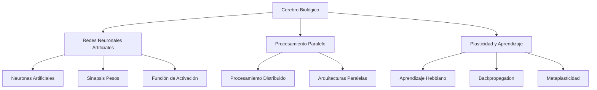

# Inteligencia Artificial - Percepción y conocimiento

## 5.7 Inteligencia artificial y el cerebro.

---

La relación entre inteligencia artificial y el cerebro humano es fundamental para entender tanto la naturaleza de la inteligencia como el desarrollo de sistemas artificiales inteligentes. Según Russell y Norvig (2009), "la IA se inspira en la inteligencia humana pero no necesariamente la replica". Esta guía explora las conexiones entre la neurociencia cognitiva y los modelos computacionales de inteligencia.

### Conceptos Fundamentales

#### Definición de Neuro-AI

La Neuro-AI es el campo interdisciplinario que estudia las conexiones entre los sistemas neurales biológicos y los sistemas de inteligencia artificial, buscando inspirarse en el cerebro para desarrollar mejores algoritmos y entender la inteligencia natural mediante modelos computacionales.

#### Analogías entre Cerebro y IA



### Neurociencia Computacional

#### Modelo de Neurona de McCulloch-Pitts

La neurona artificial básica se modela como:

$$
y = f\left(\sum_{i=1}^{n} w_i x_i + b\right)
$$

Donde:

- $x_i$: Entradas
- $w_i$: Pesos sinápticos
- $b$: Sesgo (bias)
- $f$: Función de activación

#### Funciones de Activación

**Sigmoide**:

$$
f(x) = \frac{1}{1 + e^{-x}}
$$

**ReLU (Rectified Linear Unit)**:

$$
f(x) = \max(0, x)
$$

**Tanh**:

$$
f(x) = \tanh(x) = \frac{e^x - e^{-x}}{e^x + e^{-x}}
$$

#### Implementación de una Neurona

```python
import numpy as np

class ArtificialNeuron:
    def __init__(self, n_inputs, activation='sigmoid'):
        self.weights = np.random.randn(n_inputs)
        self.bias = np.random.randn()
        self.activation = activation

    def forward(self, inputs):
        # Cálculo de la suma ponderada
        z = np.dot(inputs, self.weights) + self.bias

        # Aplicar función de activación
        if self.activation == 'sigmoid':
            return 1 / (1 + np.exp(-z))
        elif self.activation == 'relu':
            return np.maximum(0, z)
        elif self.activation == 'tanh':
            return np.tanh(z)
        else:
            return z

# Ejemplo de uso
neurona = ArtificialNeuron(3, 'sigmoid')
inputs = np.array([0.5, 0.3, 0.8])
output = neurona.forward(inputs)
print(f"Salida de la neurona: {output}")
```

### Plasticidad Neural y Aprendizaje

#### Regla de Hebb

"Neuronas que se activan juntas, se conectan juntas":

$$
\Delta w_{ij} = \eta x_i y_j
$$

Donde:

- $\Delta w_{ij}$: Cambio en el peso sináptico
- $\eta$: Tasa de aprendizaje
- $x_i$: Actividad de la neurona presináptica
- $y_j$: Actividad de la neurona postsinaptica

#### Aprendizaje Hebbiano Implementado

```python
class HebbianNetwork:
    def __init__(self, n_neurons, learning_rate=0.1):
        self.weights = np.random.randn(n_neurons, n_neurons) * 0.1
        self.learning_rate = learning_rate

    def learn(self, patterns):
        for pattern in patterns:
            # Aplicar regla de Hebb
            for i in range(len(pattern)):
                for j in range(len(pattern)):
                    if i != j:  # Evitar conexiones auto-recurrentes
                        self.weights[i, j] += self.learning_rate * pattern[i] * pattern[j]

    def recall(self, pattern, steps=5):
        current_pattern = pattern.copy()
        for _ in range(steps):
            for i in range(len(pattern)):
                # Calcular entrada total
                total_input = np.dot(self.weights[i, :], current_pattern)
                # Función de activación (umbral)
                current_pattern[i] = 1 if total_input > 0 else 0
        return current_pattern

# Ejemplo de patrones para aprender
patrones = [
    np.array([1, 0, 1, 0, 1]),
    np.array([0, 1, 0, 1, 0]),
    np.array([1, 1, 0, 0, 1])
]

red_hebb = HebbianNetwork(5, learning_rate=0.1)
red_hebb.learn(patrones)

# Probar recuperación
patron_prueba = np.array([1, 0, 0, 0, 1])
patron_recuperado = red_hebb.recall(patron_prueba)
```

### Redes Neuronales Artificiales vs. Biológicas

#### Comparativa Estructural

| Aspecto       | Cerebro Biológico        | Red Neuronal Artificial        |
| ------------- | ------------------------ | ------------------------------ |
| Unidad básica | Neurona                  | Perceptrón/Neurona artificial  |
| Conectividad  | ~10^4 conexiones/neurona | Decenas-hundreds de conexiones |
| Velocidad     | ~200 Hz                  | ~10^9 Hz                       |
| Consumo       | ~20 W                    | ~100-1000 W                    |
| Plasticidad   | Muy alta                 | Limitada                       |

#### Modelos de Corteza Cerebral

```python
class CorticalColumn:
    def __init__(self, n_neurons, n_inputs):
        self.neurons = [ArtificialNeuron(n_inputs, 'sigmoid') for _ in range(n_neurons)]
        self.lateral_weights = np.random.randn(n_neurons, n_neurons) * 0.1

    def process(self, inputs):
        # Procesamiento feedforward
        outputs = [neuron.forward(inputs) for neuron in self.neurons]

        # Inhibición lateral
        for i in range(len(self.neurons)):
            lateral_input = 0
            for j in range(len(self.neurons)):
                if i != j:
                    lateral_input += self.lateral_weights[i, j] * outputs[j]
            outputs[i] = max(0, outputs[i] - lateral_input)

        return outputs

# Simulación de mini-columna cortical
columna = CorticalColumn(10, 5)
entradas = np.random.randn(5)
salidas = columna.process(entradas)
```

### Sistemas de Memoria

#### Memoria Asociativa

Basada en el modelo de Hopfield:

$$
E = -\frac{1}{2} \sum_{i,j} w_{ij} s_i s_j + \sum_i \theta_i s_i
$$

Donde $E$ es la energía del sistema y $s_i$ el estado de las neuronas.

#### Implementación de Memoria Asociativa

```python
class HopfieldNetwork:
    def __init__(self, size):
        self.weights = np.zeros((size, size))
        self.size = size

    def train(self, patterns):
        # Regla de Hebb para patrones ortogonales
        for pattern in patterns:
            pattern = pattern.reshape(-1, 1)
            self.weights += np.dot(pattern, pattern.T)
            np.fill_diagonal(self.weights, 0)  # Sin conexiones auto-recurrentes

    def energy(self, state):
        return -0.5 * np.dot(state, np.dot(self.weights, state))

    def recall(self, pattern, max_iter=100):
        state = pattern.copy()
        energy_history = [self.energy(state)]

        for _ in range(max_iter):
            for i in range(self.size):
                # Actualización asíncrona
                net_input = np.dot(self.weights[i, :], state)
                state[i] = 1 if net_input > 0 else -1

            current_energy = self.energy(state)
            energy_history.append(current_energy)

            # Verificar convergencia
            if len(energy_history) > 2 and abs(energy_history[-1] - energy_history[-2]) < 1e-6:
                break

        return state, energy_history
```

### Percepción y Cognición

#### Modelo de Percepción Visual

Inspirado en la corteza visual:

```python
class VisualCortexModel:
    def __init__(self):
        # Capas similares a V1, V2, V4, IT
        self.layers = [
            GaborFilterLayer(),       # Detección de bordes (V1)
            FeatureCombinationLayer(), # Combinación de características (V2)
            ObjectDetectionLayer(),   # Detección de objetos (V4/IT)
            RecognitionLayer()        # Reconocimiento (Corteza temporal)
        ]

    def process(self, retinal_input):
        activations = []
        current_input = retinal_input

        for layer in self.layers:
            current_input = layer.forward(current_input)
            activations.append(current_input)

        return activations

# Simulación de procesamiento visual
modelo_visual = VisualCortexModel()
imagen_entrada = np.random.randn(32, 32)  # Input retiniano simulado
activaciones = modelo_visual.process(imagen_entrada)
```

### Ejercicios Propuestos

#### Ejercicio 1: Simulación de Plasticidad Sináptica

1. Implementa un modelo de STDP (Spike-Timing Dependent Plasticity)
2. Simula el efecto del timing de spikes en la plasticidad
3. Visualiza los cambios en los pesos sinápticos

#### Ejercicio 2: Modelo de Red Neuronal Cortical

1. Diseña una red que simule las capas de la corteza visual
2. Implementa conectividad feedforward y feedback
3. Entrena con patrones visuales simples

#### Ejercicio 3: Sistema de Memoria Asociativa

1. Implementa una memoria asociativa tipo Hopfield
2. Almacena y recupera patrones simples
3. Analiza la capacidad de almacenamiento

#### Ejercicio 4: Integración Sensoriomotora

1. Diseña un modelo que integre percepción y acción
2. Implementa learning por refuerzo inspirado en sistemas dopaminérgicos
3. Simula tareas de toma de decisiones simples

### Aplicaciones e Implicaciones

#### Neuromorphic Computing

```python
# Simulación de computación neuromórfica
class NeuromorphicProcessor:
    def __init__(self, n_cores, core_size):
        self.cores = [SpikingNeuralCore(core_size) for _ in range(n_cores)]
        self.connectivity = np.random.randn(n_cores, n_cores) * 0.1

    def process(self, input_spikes):
        # Procesamiento distribuido similar a cerebro
        core_outputs = []
        for i, core in enumerate(self.cores):
            # Input + conectividad entre cores
            total_input = input_spikes[i] + np.sum([
                self.connectivity[j, i] * core_outputs[j]
                for j in range(i)
            ])
            core_outputs.append(core.process(total_input))

        return core_outputs

# Ejemplo de uso
processor = NeuromorphicProcessor(8, 256)  # 8 cores, 256 neuronas cada uno
```

#### Consideraciones Éticas

- **Privacidad neural**: Protección de datos neurales
- **Aumento cognitivo**: Implicaciones éticas de interfaces cerebro-computadora
- **Bias en modelos**: Cómo los sesgos humanos pueden transferirse a IA
- **Conciencia artificial**: Debate sobre la posibilidad de conciencia en sistemas artificiales

### Referencias

#### Bibliografía Básica

1. Russell, S. J., & Norvig, P. (2009). _Artificial Intelligence: A Modern Approach_ (3rd ed.). Prentice Hall. (Capítulo 1, 26)
2. Marsland, S. (2009). _Machine Learning: An Algorithmic Perspective_. Chapman and Hall. (Capítulo 4)

#### Bibliografía Complementaria

1. Dayan, P., & Abbott, L. F. (2001). _Theoretical Neuroscience_. MIT Press.
2. Churchland, P. S., & Sejnowski, T. J. (1992). _The Computational Brain_. MIT Press.
3. Hassabis, D., et al. (2017). _Neuroscience-Inspired Artificial Intelligence_. Neuron.

#### Recursos Adicionales

- Human Brain Project: Investigación europea en neurociencia computacional
- Allen Brain Atlas: Mapas detallados del cerebro
- NeuroML: Estándar para modelos neurales computacionales
- BindsNET: Simulación de redes de spiking neurons

### Conclusiones

La relación entre inteligencia artificial y el cerebro es simbiótica: la IA se inspira en principios neurales para desarrollar mejores algoritmos, mientras que los modelos computacionales ayudan a entender los mecanismos cerebrales. El estudio comparativo revela tanto similitudes fundamentales como diferencias cruciales, destacando que el cerebro sigue siendo mucho más eficiente energéticamente y flexible que los sistemas artificiales actuales. La neuro-AI representa una frontera prometedora para el desarrollo de sistemas realmente inteligentes y el entendimiento de la cognición humana.
