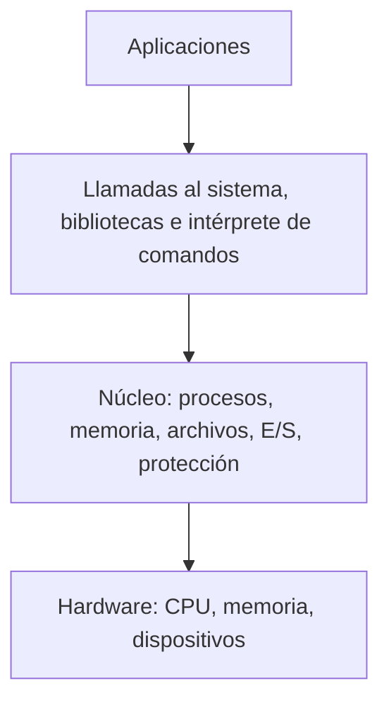

# Sistemas Operativos - Introducción

## 1.1 Funciones de un sistema operativo. Evolución de los sistemas operativos. Factores a considerar al diseñar un sistema operativo.

---

Un **sistema operativo** (SO) es el programa que administra el hardware de una computadora y ofrece a los demás programas un entorno para ejecutarse. Cumple dos papeles complementarios: es una **máquina extendida**, que oculta la complejidad del hardware tras abstracciones como procesos, archivos y conexiones de red, y es un **administrador de recursos**, que reparte el procesador, la memoria y los dispositivos entre programas y usuarios que compiten por ellos, de forma eficiente, justa y segura. Este tema presenta sus funciones, su evolución histórica y los factores que guían su diseño, con el principio de separar mecanismos y políticas.

### Funciones

1. **Abstracción del hardware:** las **llamadas al sistema** dan una interfaz uniforme a dispositivos muy distintos; un programa pide "leer 4 KiB del archivo", sin saber de sectores, controladores ni interrupciones.
2. **Administración de recursos:**
   - **CPU:** decide qué proceso se ejecuta y durante cuánto tiempo, con algoritmos de planificación (tema 3);
   - **memoria:** asigna memoria a los procesos, la protege y la extiende con memoria virtual (tema 4);
   - **almacenamiento:** organiza los datos en archivos y directorios (tema 6);
   - **E/S:** controla los dispositivos con sus manejadores e interrupciones (tema 7).
3. **Protección y aislamiento:** el hardware ofrece al menos dos **modos** de ejecución, usuario y núcleo, y solo el núcleo puede ejecutar instrucciones privilegiadas; así, el error de un programa no afecta a los demás ni al sistema.
4. **Seguridad:** autentica a los usuarios y controla el acceso a los recursos (tema 5).



### Evolución

| Época | Hardware | Características del SO | Ejemplos |
| ----- | -------- | ---------------------- | -------- |
| Años 40 | tubos de vacío | sin sistema operativo; programación directa en lenguaje máquina o con tableros | ENIAC |
| Años 50 | transistores | **lotes**: un monitor residente encadena trabajos sin intervención del operador | GM-NAA I/O, FMS para la IBM 7094 |
| Años 60 | circuitos integrados, canales de E/S | **multiprogramación** y **tiempo compartido** | OS/360, CTSS, Multics |
| Años 70 | minicomputadoras | sistemas portables escritos en un lenguaje de alto nivel | UNIX, escrito en C desde 1973 |
| Años 80 | microprocesadores, PC | sistemas personales, interfaces gráficas, redes | MS-DOS, Mac OS, SunOS |
| Años 90 | Internet, multiprocesadores | soporte de red integrado, núcleos de 32 bits con protección | Windows NT, Linux |
| Desde 2000 | multinúcleo, móviles, nube | ahorro de energía, pantallas táctiles, virtualización y contenedores | Android, iOS, Windows 10 y 11, KVM, VMware ESXi |

La **multiprogramación** fue el cambio decisivo: con varios trabajos en memoria, cuando uno espera una operación de E/S, la CPU pasa a otro en lugar de quedar ociosa. El **tiempo compartido** la extendió a usuarios interactivos, alternando entre ellos con la suficiente rapidez para que cada uno sienta que tiene la máquina para sí.

### Factores de diseño

- **Eficiencia:** poca sobrecarga del propio SO; buen **rendimiento**, trabajos por unidad de tiempo, y buen **tiempo de respuesta**.
- **Confiabilidad:** funcionar correctamente y aislar las fallas.
- **Seguridad:** impedir el acceso no autorizado.
- **Portabilidad:** funcionar en distintas arquitecturas.
- **Extensibilidad y mantenibilidad:** incorporar nuevos dispositivos y funciones sin rediseñar el sistema.
- **Compatibilidad:** seguir ejecutando los programas existentes.

Los objetivos entran en conflicto, y el diseño consiste en elegir los compromisos para el uso previsto: un sistema de tiempo real prioriza los plazos, un servidor el rendimiento, un teléfono la batería.

### Mecanismos y políticas

Un principio central, formulado en el sistema Hydra (Levin y otros, 1975), es separar el **mecanismo**, *cómo* se hace algo, de la **política**, *qué* se hace o cuándo. El cambio de contexto es un mecanismo; elegir qué proceso se ejecuta es una política. La separación permite cambiar la política sin tocar el mecanismo: Linux ofrece varias clases de planificación sobre el mismo despachador, y el reemplazo de páginas puede cambiar de algoritmo sin modificar el código que carga y desaloja páginas.

### Estructuras

El núcleo puede ser **monolítico**, un solo programa en modo núcleo, como el UNIX clásico y Linux, que además carga **módulos** dinámicamente, también en modo núcleo; **por capas**, como THE de Dijkstra; un **micronúcleo**, con solo lo esencial en modo núcleo y los servicios como procesos de usuario, como Mach, MINIX 3, QNX o seL4; o **híbrido**, como Windows NT y el XNU de macOS. El tema 1.4 los compara.

### Implementación en Python

El programa ilustra tres de las ideas del tema. Separa el mecanismo de reemplazo de páginas de tres políticas intercambiables y las compara en una cadena de referencias, incluida la anomalía de Belady; mide el uso de la CPU con multiprogramación con una simulación y dos modelos, y calcula el costo del cifrado de contraseñas para el usuario y para un atacante.

```python
import hashlib, random
from collections import deque

# ---------- Ejercicio 1: mecanismo y política en el reemplazo de páginas ----------
class Memoria:                                        # MECANISMO: cargar una página y desalojar la que diga la política
    def __init__(self, marcos, politica): self.marcos, self.politica, self.residentes, self.fallos = marcos, politica, [], 0
    def accede(self, pagina, t, futuro):
        if pagina in self.residentes: self.politica.usa(pagina, t); return
        self.fallos += 1
        if len(self.residentes) == self.marcos:
            victima = self.politica.elige(self.residentes, t, futuro); self.residentes.remove(victima)
        self.residentes.append(pagina); self.politica.carga(pagina, t)
class FIFO:                                           # POLÍTICAS intercambiables: solo deciden cuál página sale
    def __init__(self): self.llegada = {}
    def carga(self, p, t): self.llegada[p] = t
    def usa(self, p, t): pass
    def elige(self, res, t, futuro): return min(res, key=lambda p: self.llegada[p])
class LRU(FIFO):
    def usa(self, p, t): self.llegada[p] = t          # la "llegada" se actualiza con cada uso
class Optima(FIFO):
    def elige(self, res, t, futuro):                  # la que se usará más tarde, o nunca (Belady, 1966)
        return max(res, key=lambda p: futuro.index(p) if p in futuro else len(futuro) + 1)
cadena = [7, 0, 1, 2, 0, 3, 0, 4, 2, 3, 0, 3, 2, 1, 2, 0, 1, 7, 0, 1]
print("ejercicio 1: cadena de referencias", cadena)
for marcos in (3, 4):
    fila = []
    for nombre, pol in (("FIFO", FIFO), ("LRU", LRU), ("óptima", Optima)):
        m = Memoria(marcos, pol())
        for t, p in enumerate(cadena): m.accede(p, t, cadena[t + 1:])
        fila.append(f"{nombre} {m.fallos}")
    print(f"   {marcos} marcos: fallos de página " + " | ".join(fila))
belady = [1, 2, 3, 4, 1, 2, 5, 1, 2, 3, 4, 5]
for marcos in (3, 4):
    m = Memoria(marcos, FIFO())
    for t, p in enumerate(belady): m.accede(p, t, belady[t + 1:])
    print(f"   anomalía de Belady con FIFO y la cadena {belady}: {marcos} marcos → {m.fallos} fallos")

# ---------- Ejercicio 2: multiprogramación y uso de la CPU ----------
def geom(rng, media):                                # duración geométrica con la media dada, al menos 1
    n = 1
    while rng.random() > 1 / media: n += 1
    return n
def simula(n_procesos, pasos=200_000, semilla=0):    # ráfagas de CPU de media 4 y de E/S de media 16: 80 % de E/S si estuviera solo
    rng = random.Random(semilla); listos = deque(range(n_procesos)); resto = {i: geom(rng, 4) for i in range(n_procesos)}
    es = {}; actual = None; ocupada = 0
    for _ in range(pasos):
        for i in list(es):
            es[i] -= 1
            if es[i] == 0: del es[i]; listos.append(i); resto[i] = geom(rng, 4)
        if actual is None and listos: actual = listos.popleft()
        if actual is not None:
            ocupada += 1; resto[actual] -= 1
            if resto[actual] == 0: es[actual] = geom(rng, 16); actual = None
    return ocupada / pasos
print("ejercicio 2: uso de la CPU con procesos que, solos, pasarían el 80 % del tiempo esperando E/S")
print("   modelo 1 − p^n:   " + "  ".join(f"n={n}: {1 - 0.8 ** n:.2f}" for n in (1, 2, 4, 8, 16)))
from math import factorial
def reparador(n, r=4 / 16):                            # cola cerrada de n procesos y una CPU, E/S en paralelo (Erlang)
    return 1 - 1 / sum(factorial(n) / factorial(n - k) * r ** k for k in range(n + 1))
print("   modelo de colas:  " + "  ".join(f"n={n}: {reparador(n):.2f}" for n in (1, 2, 4, 8, 16)))
print("   simulación:       " + "  ".join(f"n={n}: {simula(n):.2f}" for n in (1, 2, 4, 8, 16)))
print(f"   6 trabajos de 4 unidades de CPU y 16 de E/S: por lotes terminan en {6 * (4 + 16)}; "
      f"con multiprogramación en {max(4 * (i + 1) + 16 for i in range(6))}, porque la E/S de cada uno se solapa con la CPU de los siguientes")

# ---------- Ejercicio 3: eficiencia frente a seguridad en las contraseñas ----------
sal = b"sal-unica-por-usuario"
for it in (1, 1_000, 100_000):
    h = hashlib.pbkdf2_hmac("sha256", b"contrasena", sal, it).hex()[:16]
    print(f"ejercicio 3: PBKDF2-SHA256 con {it:7,} iteraciones: {h}…; un ataque de fuerza bruta a 8 minúsculas cuesta {26 ** 8 * it:.2e} HMAC")
print(f"   con 600 000 iteraciones, la recomendación de OWASP para PBKDF2-SHA256, el ataque cuesta {26 ** 8 * 600_000:.2e} HMAC y cada inicio de sesión 600 000")
```

Salida:

```text
ejercicio 1: cadena de referencias [7, 0, 1, 2, 0, 3, 0, 4, 2, 3, 0, 3, 2, 1, 2, 0, 1, 7, 0, 1]
   3 marcos: fallos de página FIFO 15 | LRU 12 | óptima 9
   4 marcos: fallos de página FIFO 10 | LRU 8 | óptima 8
   anomalía de Belady con FIFO y la cadena [1, 2, 3, 4, 1, 2, 5, 1, 2, 3, 4, 5]: 3 marcos → 9 fallos
   anomalía de Belady con FIFO y la cadena [1, 2, 3, 4, 1, 2, 5, 1, 2, 3, 4, 5]: 4 marcos → 10 fallos
ejercicio 2: uso de la CPU con procesos que, solos, pasarían el 80 % del tiempo esperando E/S
   modelo 1 − p^n:   n=1: 0.20  n=2: 0.36  n=4: 0.59  n=8: 0.83  n=16: 0.97
   modelo de colas:  n=1: 0.20  n=2: 0.38  n=4: 0.69  n=8: 0.97  n=16: 1.00
   simulación:       n=1: 0.21  n=2: 0.40  n=4: 0.72  n=8: 0.98  n=16: 1.00
   6 trabajos de 4 unidades de CPU y 16 de E/S: por lotes terminan en 120; con multiprogramación en 40, porque la E/S de cada uno se solapa con la CPU de los siguientes
ejercicio 3: PBKDF2-SHA256 con       1 iteraciones: d46cc7ce782e3762…; un ataque de fuerza bruta a 8 minúsculas cuesta 2.09e+11 HMAC
ejercicio 3: PBKDF2-SHA256 con   1,000 iteraciones: ac2a282869c27ea6…; un ataque de fuerza bruta a 8 minúsculas cuesta 2.09e+14 HMAC
ejercicio 3: PBKDF2-SHA256 con 100,000 iteraciones: 08934e45eed72a80…; un ataque de fuerza bruta a 8 minúsculas cuesta 2.09e+16 HMAC
   con 600 000 iteraciones, la recomendación de OWASP para PBKDF2-SHA256, el ataque cuesta 1.25e+17 HMAC y cada inicio de sesión 600 000
```

### Ejercicios Propuestos

1. **Mecanismo y política.** Explica con tus palabras la diferencia entre un mecanismo y una política en el diseño de un SO, con un ejemplo distinto del planificador.

2. **Multiprogramación.** ¿Por qué la multiprogramación es un avance crucial respecto a los sistemas por lotes simples? ¿Qué problema fundamental resuelve?

3. **Eficiencia y seguridad.** Relaciona estos dos factores de diseño: ¿cómo pueden entrar en conflicto? Da un ejemplo, por ejemplo con contraseñas, permisos o cifrado.

4. **Estructuras.** Identifica qué estructura, monolítica, micronúcleo, modular o híbrida, tienen Linux, Windows NT, 10 y 11, macOS y Android.

### Soluciones

**Ejercicio 1.** El mecanismo es la parte que realiza una acción y la política la que decide cuál realizar. En la memoria virtual, el **mecanismo** de reemplazo detecta el fallo de página, desaloja una página de un marco, la escribe en disco si fue modificada y carga la nueva; la **política** solo decide qué página desalojar. En el programa, la clase `Memoria` es el mecanismo y no cambia, y FIFO, LRU y la óptima de Belady son tres políticas de unas líneas cada una. Con 3 marcos y la cadena clásica de Silberschatz, causan 15, 12 y 9 fallos. Separarlas permite experimentar con políticas, o ajustarlas a cada carga, sin tocar el código delicado. Otros ejemplos: el temporizador es un mecanismo y el tamaño del quantum una política; los bits de permiso son un mecanismo y quién recibe qué permisos una política. La separación también revela que una política intuitiva puede comportarse mal: FIFO sufre la **anomalía de Belady**, con la cadena 1, 2, 3, 4, 1, 2, 5, 1, 2, 3, 4, 5, más marcos dan más fallos, 10 con 4 marcos frente a 9 con 3.

**Ejercicio 2.** En un sistema por lotes simple, la CPU queda ociosa cada vez que el trabajo en ejecución espera una operación de E/S, que es miles de veces más lenta. La multiprogramación mantiene varios trabajos en memoria y, cuando uno se bloquea, pasa la CPU a otro, lo que resuelve el problema del **desperdicio de la CPU** durante la E/S. Con procesos que solos pasarían el 80 % del tiempo esperando, el uso de la CPU sube de 0.21 con un proceso a 0.72 con 4 y a 0.98 con 8 en la simulación; el modelo de colas de Erlang da 0.20, 0.69 y 0.97, y el modelo simple $1 - p^n$ de Tanenbaum, que supone que los procesos esperan la E/S de forma independiente, es algo más pesimista, 0.59 con 4. Seis trabajos de 4 unidades de CPU y 16 de E/S tardan 120 unidades en secuencia y 40 con multiprogramación. La multiprogramación requiere a cambio protección de memoria entre los trabajos, planificación de la CPU y administración de la memoria, que son justamente las funciones del SO moderno.

**Ejercicio 3.** Casi todo mecanismo de seguridad cuesta tiempo o memoria. Las contraseñas deben guardarse con una función de derivación **lenta** a propósito, como PBKDF2, bcrypt o Argon2, para que un atacante que robe la base no pueda probar miles de millones de candidatas por segundo. Con PBKDF2-SHA256, cada iteración adicional multiplica el costo de ambos: con 600 000 iteraciones, la recomendación de OWASP para esa función, un inicio de sesión cuesta 600 000 evaluaciones de HMAC, unas décimas de segundo, y probar todas las contraseñas de 8 minúsculas cuesta $1.25 \times 10^{17},$ frente a $2.1 \times 10^{11}$ sin iteraciones. El diseñador elige el número que el usuario no nota pero que hace impráctico el ataque, y una **sal** distinta por usuario impide reutilizar el trabajo entre cuentas. Otros conflictos: verificar permisos en cada acceso a un archivo, cifrar el disco, aislar procesos en máquinas virtuales o las mitigaciones de Meltdown y Spectre, que en 2018 costaron hasta un 30 % de rendimiento en cargas con muchas llamadas al sistema.

**Ejercicio 4.** **Linux** es monolítico y modular: todo el núcleo, incluidos los manejadores, se ejecuta en modo núcleo en un mismo espacio de direcciones, y los módulos se cargan dinámicamente pero también en modo núcleo. **Windows NT**, y con él Windows 10 y 11, es **híbrido**: nació con un diseño inspirado en los micronúcleos, con subsistemas en modo usuario, pero por rendimiento lleva al modo núcleo los gráficos, desde NT 4.0, y la mayoría de los servicios. **macOS** usa el núcleo **XNU**, híbrido: Mach para los hilos, la memoria virtual y la comunicación, y BSD para los procesos, el sistema de archivos y la red, ambos en modo núcleo. **Android** usa el núcleo **Linux**, monolítico y modular, con una capa en modo usuario que incluye el entorno de ejecución ART y el mecanismo de comunicación Binder.

El material original escribía "Gariza" por "garantiza"; ponía como ejemplo de sistema operativo de los años 50 a la IBM 1401, que es una computadora, y a Kubernetes entre los sistemas operativos actuales, cuando es un orquestador de contenedores. Su código de ejemplo usaba un campo `state` que no estaba en la estructura `pcb_t` y las constantes `NUM_PROCESSES` y `all_processes`, que no definía, y llamaba al cambio de contexto con un proceso anterior nulo.

### Referencias

1. Silberschatz, A., Galvin, P. B., and Gagne, G., _Operating System Concepts_. 10a ed., Wiley, 2018. Capítulos 1 y 2.
2. Tanenbaum, A. S., and Bos, H., _Modern Operating Systems_. 5a ed., Pearson, 2023. Capítulo 1.
3. Arpaci-Dusseau, R. H., and Arpaci-Dusseau, A. C., _Operating Systems: Three Easy Pieces_. 2023.
4. Levin, R., Cohen, E., Corwin, W., Pollack, F., and Wulf, W., Policy/mechanism separation in Hydra. _SOSP_, 1975.
5. Belady, L. A., Nelson, R. A., and Shedler, G. S., An anomaly in space-time characteristics of certain programs running in a paging machine. _Communications of the ACM_ 12(6), 1969.
6. OWASP, Password Storage Cheat Sheet, 2023.
