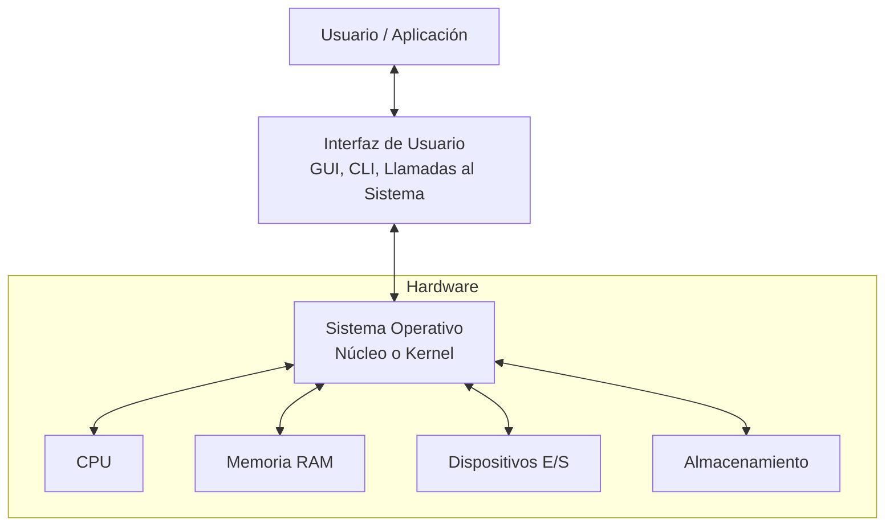

# Sistemas Operativos - Introducción

## 1.1 Funciones de un sistema operativo. Evolución de los sistemas operativos. Factores a considerar al diseñar un sistema operativo.

---

### Funciones de un Sistema Operativo

Un Sistema Operativo (SO) es un software que actúa como intermediario entre el usuario de una computadora y el hardware de la misma. Su propósito principal es proporcionar un entorno en el cual el usuario pueda ejecutar programas de manera conveniente y eficiente.

Las funciones principales de un SO se pueden resumir en:

1.  **Abstracción del Hardware:** Proporciona una interfaz simplificada (llamadas al sistema) para usar el hardware complejo (discos, red, CPU, etc.). Por ejemplo, un programa solo debe pedir "abrir un archivo", no preocuparse por los sectores del disco.
2.  **Gestión de Recursos:** Actúa como un asignador de recursos para gestionar el hardware de manera ordenada y eficiente entre los diversos programas y usuarios que compiten por ellos.
    - **Gestión del Procesador (CPU):** Decide qué proceso se ejecuta y cuándo, mediante algoritmos de planificación.
    - **Gestión de la Memoria Principal (RAM):** Supervisa qué partes de la memoria están en uso, asigna memoria a procesos cuando la necesitan y la liberan cuando terminan.
    - **Gestión de Almacenamiento Secundario (Disco):** Gestiona el espacio de almacenamiento, la estructura de directorios y el acceso a los datos (sistemas de archivos).
    - **Gestión del Sistema de E/S:** Controla y coordina los dispositivos de entrada y salida.
3.  **Control de Ejecución de Programas:** Permite la ejecución de aplicaciones, previniendo que los errores de un programa afecten a otros (protección y aislamiento).
4.  **Seguridad y Protección:** Gariza que el acceso a los recursos del sistema se realice de manera autorizada y controlada, impidiendo accesos no deseados.



_Diagrama: El SO como intermediario entre el usuario/aplicaciones y el hardware._

### Evolución de los Sistemas Operativos

La evolución de los SO está intrínsecamente ligada a la evolución del hardware y las necesidades de computación.

| Era (Década)      | Tecnología                               | Características del SO                                                                                                                                                   | Ejemplo                                      |
| :---------------- | :--------------------------------------- | :----------------------------------------------------------------------------------------------------------------------------------------------------------------------- | :------------------------------------------- |
| **1940-1950**     | Tubos de vacío, paneles                  | Sin SO. Programación en lenguaje máquina.                                                                                                                                | —                                            |
| **1950**          | Transistores, sistemas por lote (batch)  | **Sistemas por Lote.** Primeros SO. Ejecutan un trabajo tras otro automáticamente. Reduce tiempo de setup.                                                               | IBM 1401, Fortran Monitor System             |
| **1960**          | Circuitos integrados, canales de E/S     | **Multiprogramación.** Múltiples trabajos en memoria. Mientras uno espera por E/S, otro usa la CPU. Aumenta el uso de CPU.                                               | OS/360 (IBM)                                 |
| **1970-1980**     | LSI, VLSI, PCs                           | **Tiempo Compartido (Time-Sharing).** Extiende la multiprogramación para permitir interacción usuario-SO (terminales). **Sistemas Personales.** SO para un solo usuario. | UNIX, MS-DOS                                 |
| **1980-1990**     | GUI, redes                               | **Sistemas con Interfaz Gráfica (GUI).** Más amigables para el usuario. **Sistemas Distribuidos.** Gestionan recursos en red.                                            | Mac OS, Windows, SunOS                       |
| **1990-2000**     | Internet, sistemas embebidos             | **Sistemas de Red/Internet.** Soporte integrado para protocolos de red. **Sistemas Embebidos.** Para dispositivos específicos.                                           | Windows 95, Linux, VxWorks                   |
| **2000-Presente** | Móviles, multicore, virtualización, nube | **Sistemas Móviles.** Optimizados para batería y touch. **Sistemas para Multicore.** Paralelismo a nivel de SO. **Hipervisores.** Virtualización eficiente.              | Android, iOS, Windows 10, VMware, Kubernetes |

### Factores a Considerar al Diseñar un Sistema Operativo

Diseñar un SO implica tomar decisiones de diseño que prioricen diferentes factores, a menudo en conflicto entre sí.

1.  **Objetivos de Diseño:**
    - **Funcionalidad:** ¿Qué servicios debe proporcionar? (e.g., tipos de sistemas de archivos, modelos de concurrencia).
    - **Eficiencia:** Minimizar la sobrecarga (overhead) del SO. Maximizar el uso de recursos (CPU, memoria). Un SO lento o que consume mucha memoria es inútil.
      - **Tiempo de Respuesta:** Crítico en sistemas interactivos.
      - **Rendimiento (Throughput):** Número de trabajos por unidad de tiempo, crítico en sistemas por lotes.
    - **Fiabilidad (Reliability):** Debe funcionar correctamente sin fallos. Debe ser robusto ante errores de software (aplicaciones) y hardware (paridad de memoria).
    - **Seguridad (Security):** Proteger el sistema y los datos de accesos no autorizados y daños maliciosos.
    - **Portabilidad:** Facilidad para ser implementado en diferentes arquitecturas de hardware.
    - **Extensibilidad y Mantenibilidad:** Facilidad para agregar nuevas funciones, corregir errores y adaptarse a nuevos hardware sin rediseñar todo el sistema.

2.  **Mecanismos vs. Políticas:** Un principio crucial de diseño.
    - **Mecanismo:** _Cómo_ se hace algo. (e.g., el mecanismo de cambio de contexto _cómo_ se salva el estado de un proceso).
    - **Política:** _Qué_ se hará. (e.g., la política de planificación _qué_ proceso se elegirá para ejecutar a continuación).
    - **Diseño Ideal:** Separar los mecanismos en los niveles bajos del núcleo (kernel) de las políticas, que pueden ser definidas en módulos de más alto nivel o incluso por el usuario. Esto permite mayor flexibilidad.

3.  **Estructura del Sistema (Arquitectura):**
    - **Sistema Monolítico:** El núcleo es un único gran programa que contiene todos los servicios. Es eficiente pero difícil de mantener y depurar (e.g., UNIX tradicional, Linux).
    - **Sistema por Capas (Layered):** El SO se organiza en niveles, donde cada capa solo usa servicios de las capas inferiores. Es más modular y simple de verificar.
    - **Microkernel:** Minimiza el código que se ejecuta en modo kernel. Solo las funciones esenciales (comunicación entre procesos, planificación básica) están en el kernel. Los demás servicios (gestión de archivos, red) se ejecutan como servidores en modo usuario. Es muy estable y seguro, pero puede ser menos eficiente debido al cambio constante entre modos (e.g., Mach, Minix 3, QNX).
    - **Módulos (o Núcleo Modular):** Es el enfoque moderno más popular (e.g., Linux, Windows). El núcleo base es pequeño, pero la funcionalidad se puede extender cargando módulos dinámicamente. Combina la eficiencia de los monolíticos con la flexibilidad de los microkernels.

### Ejercicios Propuestos

1.  **Pregunta Conceptual:** Explica con tus propias palabras la diferencia entre un mecanismo y una política en el diseño de un SO. Da un ejemplo diferente al visto en la guía.
2.  **Análisis:** ¿Por qué la multiprogramación es un avance crucial respecto a los sistemas por lotes simples? ¿Qué problema fundamental resuelve?
3.  **Relacionar:** Investiga y relaciona los factores de diseño "Eficiencia" y "Seguridad". ¿Cómo pueden entrar en conflicto? Pon un ejemplo (pista: pensar en contraseñas, permisos, cifrado).
4.  **Investigación:** Identifica a qué tipo de estructura (Monolítica, Microkernel, Modular) pertenecen los siguientes sistemas operativos: Linux, Windows NT/10/11, macOS, Android.

### Código de Ejemplo (Conceptual)

Aunque un SO es complejo, aquí hay una simplificación extrema de cómo un scheduler (planificador) muy básico podría tomar una decisión en código. Esto ilustra el **mecanismo** (cambiar de proceso) y la **política** (usar prioridad).

```c
// Estructura muy simplificada de un Process Control Block (PCB)
typedef struct {
    int pid;
    int priority;
    // ... mucho más estado (registros, estado de E/S, etc.)
} pcb_t;

// Mecanismo: función que salva el contexto actual y carga el nuevo (conceptualmente)
void context_switch(pcb_t *old_process, pcb_t *new_process) {
    // Salvar registros de CPU del old_process a su PCB
    // Cargar registros de CPU desde el PCB del new_process
    // Este código se implementaría en assembler
}

// Política: función de planificación (ejemplo por prioridad)
pcb_t *scheduler(pcb_t *process_list) {
    pcb_t *next_process = NULL;
    int highest_priority = -1;

    // Recorrer la lista de procesos listos
    for(int i = 0; i < NUM_PROCESSES; i++) {
        if(process_list[i].state == READY && process_list[i].priority > highest_priority) {
            highest_priority = process_list[i].priority;
            next_process = &process_list[i];
        }
    }
    // Si no se encuentra un proceso, se ejecuta el 'proceso idle'
    return next_process;
}

// Bucle principal del kernel (conceptual)
void kernel_main_loop() {
    pcb_t *current_process = NULL;
    pcb_t *next_process = NULL;

    while(1) {
        next_process = scheduler(all_processes); // Aplicar la POLÍTICA
        if(next_process != current_process) {
            context_switch(current_process, next_process); // Ejecutar el MECANISMO
            current_process = next_process;
        }
        // Ejecutar el proceso actual hasta que ocurra una interrupción
        // (timer, E/S, etc.)
    }
}
```

### Referencias

#### Bibliografía Básica

1.  Tanenbaum, A. S. (2007). _Modern Operating Systems_ (3rd ed.). Prentice Hall. (Capítulos 1)
2.  Silberschatz, A., Galvin, P. B., & Gagne, G. (2008). _Operating Systems Concepts_ (8th ed.). John Wiley and Sons. (Capítulos 1, 2 y 3)
3.  Stallings, W. (2011). _Operating Systems: Internals and Design Principles_ (7th ed.). Prentice Hall. (Part One: Background)

#### Bibliografía Complementaria

1.  Bovet, D. P., & Cesati, M. (2000). _Understanding the Linux Kernel_. O'Reilly. (Capítulo 1)
2.  Silberschatz, A., Galvin, P. B., & Gagne, G. (2009). _Operating System Concepts with Java_ (8th ed.). John Wiley and sons.
