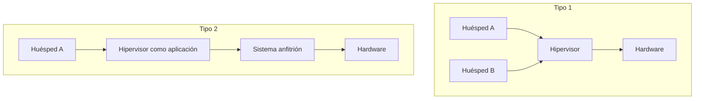

# Sistemas Operativos - Introducción

## 1.2 Máquinas virtuales.

---

Una **máquina virtual** (VM) es una copia eficiente y aislada de una máquina real, en la que puede ejecutarse un sistema operativo completo sin modificarlo. El software que las crea y administra es el **monitor de máquinas virtuales** o **hipervisor**. La idea nació en IBM con el CP/CMS de 1967 y el VM/370, que daba a cada usuario su propia System/370 virtual, y renació en los años 2000 con VMware y Xen, hasta convertirse en la base de la computación en la nube. Este tema presenta los requisitos formales de la virtualización, los tipos de hipervisor, las técnicas para virtualizar la CPU, la memoria y la E/S, sus ventajas y costos, y la comparación con los contenedores.

### Requisitos de Popek y Goldberg

Popek y Goldberg (1974) definieron un monitor de máquinas virtuales por tres propiedades: **equivalencia**, un programa se comporta igual que en la máquina real; **control de recursos**, el monitor controla todos los recursos, y **eficiencia**, la mayoría de las instrucciones se ejecuta directamente en el hardware. Y demostraron que una arquitectura es virtualizable con la técnica de **atrapar y emular** si todas sus instrucciones **sensibles**, las que leen o cambian el estado privilegiado de la máquina, son **privilegiadas**, es decir, provocan una trampa al ejecutarse en modo usuario. Así, el núcleo huésped se ejecuta en modo usuario, y cada instrucción sensible salta al monitor, que la emula sobre el estado virtual de la VM.

El x86 original no cumplía el requisito: tenía 17 instrucciones sensibles no privilegiadas (Robin e Irvine, 2000), como POPF, que en modo usuario ignora en silencio el cambio del indicador de interrupciones, o SMSW, que revela el modo real. Hubo tres soluciones:

- **traducción binaria** (VMware, 1999): el monitor reescribe al vuelo el código del núcleo huésped, reemplazando las instrucciones problemáticas;
- **paravirtualización** (Xen, 2003): se modifica el núcleo huésped para que llame al hipervisor explícitamente con *hiperllamadas*;
- **virtualización asistida por hardware**: Intel VT-x (2005) y AMD-V (2006) agregan un modo de ejecución para el huésped en el que las instrucciones sensibles provocan una **salida de VM** al hipervisor, que guarda y restaura el estado del huésped en una estructura de control, la VMCS de Intel.

### Tipos de hipervisor

- **Tipo 1**, nativo o *bare-metal*: se ejecuta directamente sobre el hardware y administra los recursos él mismo; VMware ESXi, Xen, Hyper-V. **KVM** convierte al propio núcleo Linux en un hipervisor de tipo 1, y QEMU, en modo usuario, emula los dispositivos.
- **Tipo 2**, alojado o *hosted*: se ejecuta como una aplicación sobre un sistema operativo anfitrión, que maneja los dispositivos; VirtualBox, VMware Workstation, Parallels Desktop. QEMU sin KVM es un **emulador** que traduce las instrucciones de la arquitectura del huésped, lo que le permite ejecutar código ARM en un x86, por ejemplo.

### Memoria y E/S

El huésped cree administrar la memoria física, pero esta es a su vez virtual para el hipervisor: hay dos traducciones, de dirección virtual del huésped a física del huésped y de esta a física real. Las **tablas de páginas sombra** las combinan en software, a costa de atrapar cada modificación de las tablas del huésped; la **paginación anidada**, EPT de Intel y NPT de AMD, las hace en hardware, a costa de recorridos de tablas más largos en cada fallo del TLB. Para la E/S, el hipervisor puede **emular** un dispositivo real, como una tarjeta de red e1000; ofrecer dispositivos **paravirtualizados**, como virtio, con colas compartidas que evitan una trampa por registro, o asignar un dispositivo físico a la VM, con una IOMMU y SR-IOV.

### Ventajas y costos

Las VM permiten la **consolidación** de muchos servidores poco usados en pocos físicos, el **aislamiento** de fallas y de seguridad, las **instantáneas** del estado completo, la **migración en vivo** de una VM en ejecución entre servidores, copiando su memoria por rondas mientras sigue funcionando, y la ejecución de **sistemas heredados** en hardware nuevo. Sus costos son la sobrecarga de las salidas de VM y de la traducción anidada, la memoria y el disco de un sistema operativo completo por VM, y la complejidad de administrar muchas máquinas, con la tendencia a crearlas sin control.

### Máquinas virtuales y contenedores

Un **contenedor** no virtualiza el hardware: es un grupo de procesos del anfitrión aislados por el núcleo, con los **espacios de nombres** de Linux para la vista de procesos, red, sistema de archivos y usuarios, y los **cgroups** para limitar los recursos. Docker y Podman crean contenedores; Kubernetes no es un contenedor sino un orquestador que los distribuye en un clúster.

| Aspecto | Máquina virtual | Contenedor |
| ------- | --------------- | ---------- |
| Qué se aísla | un sistema completo, con su núcleo | procesos que comparten el núcleo del anfitrión |
| Imagen | gigabytes, con el sistema operativo | megabytes, la aplicación y sus bibliotecas |
| Arranque | de segundos a minutos | milisegundos a segundos |
| Sistema huésped | cualquiera, Windows en Linux | el mismo núcleo, Linux en Linux |
| Aislamiento | fuerte, frontera de hardware | más débil: una falla del núcleo afecta a todos |

Las **microVM**, como Firecracker de AWS, combinan ambos: VM mínimas que arrancan en unos 125 ms, para ejecutar funciones de clientes distintos con aislamiento de hardware.



### Implementación en Python

El programa simula una CPU de juguete con modos usuario y núcleo, con instrucciones privilegiadas y una instrucción sensible no privilegiada al estilo de POPF, y un monitor que atrapa y emula, con y sin el equivalente de VT-x; cuenta las transiciones de una operación de E/S con hipervisores de tipo 1 y 2, y calcula los accesos a memoria de un recorrido de tablas de páginas nativo y anidado.

```python
# ---------- Una CPU de juguete con modos usuario y núcleo, y un monitor de máquinas virtuales ----------
class Trampa(Exception): pass
class CPU:
    def __init__(self, sensibles_atrapan=True):
        self.modo, self.intr, self.sensibles_atrapan = "núcleo", True, sensibles_atrapan
    def ejecuta(self, instr):
        op = instr[0]
        if op in ("cli", "sti", "out"):                          # privilegiadas: atrapan en modo usuario
            if self.modo == "usuario": raise Trampa(instr)
            if op == "cli": self.intr = False
            if op == "sti": self.intr = True
        elif op == "popf":                                       # como POPF en x86 antes de VT-x: sensible pero NO privilegiada
            if self.modo == "usuario":
                if self.sensibles_atrapan: raise Trampa(instr)
                return "ignorada"                                # en modo usuario el cambio de interrupciones se ignora sin aviso
            self.intr = instr[1]
        elif op == "leer_modo":                                  # como SMSW o PUSHF: revela el modo real
            if self.modo == "usuario" and self.sensibles_atrapan: raise Trampa(instr)
            return self.modo
        return None
class MMV:                                                       # atrapar y emular: el huésped corre en modo usuario
    def __init__(self, cpu): self.cpu, self.trampas, self.virt = cpu, 0, {"intr": True, "modo": "núcleo"}
    def corre(self, programa):
        self.cpu.modo = "usuario"; salida = []
        for instr in programa:
            try:
                r = self.cpu.ejecuta(instr)
                if r is not None: salida.append(f"{instr[0]}→{r}")
            except Trampa:
                self.trampas += 1; op = instr[0]                 # el monitor emula la instrucción sobre el estado virtual
                if op == "cli": self.virt["intr"] = False
                elif op == "sti": self.virt["intr"] = True
                elif op == "popf": self.virt["intr"] = instr[1]
                elif op == "leer_modo": salida.append(f"leer_modo→{self.virt['modo']}")
                elif op == "out": salida.append(f"out emulado al dispositivo virtual {instr[1]}")
        return salida
nucleo_huesped = [("cli",), ("add",), ("popf", True), ("leer_modo",), ("out", "disco"), ("add",)]   # termina con interrupciones habilitadas
for nombre, atrapan in (("x86 clásico, sin VT-x", False), ("con VT-x o AMD-V", True)):
    m = MMV(CPU(atrapan)); s = m.corre(nucleo_huesped)
    print(f"ejercicio 4: {nombre:22}: {m.trampas} trampas; interrupciones virtuales al final = {m.virt['intr']} (el huésped quería True); {s}")

# ---------- Ejercicio 1: tipo 1 frente a tipo 2, contando las transiciones de una E/S del huésped ----------
RUTAS = {1: ["salida de la VM al hipervisor", "manejador del hipervisor", "regreso a la VM"],
         2: ["salida de la VM al módulo del hipervisor", "cambio al proceso del hipervisor en el anfitrión", "llamada al sistema del anfitrión",
             "manejador del anfitrión", "regreso al proceso del hipervisor", "regreso a la VM"]}
for tipo, r in RUTAS.items(): print(f"ejercicio 1: tipo {tipo}: {len(r)} transiciones: {' → '.join(r)}")

# ---------- Ejercicio 4: traducción de direcciones, nativa y anidada ----------
def referencias(niveles_huesped, niveles_anfitrion):
    # cada uno de los n accesos a tablas del huésped, y la dirección final, requieren un recorrido de m niveles del anfitrión
    return (niveles_huesped + 1) * (niveles_anfitrion + 1) - 1
for n in (4, 5):
    print(f"   paginación de {n} niveles: nativa {n} accesos a memoria por fallo de TLB; anidada con EPT o NPT {referencias(n, n)}")
```

Salida:

```text
ejercicio 4: x86 clásico, sin VT-x : 2 trampas; interrupciones virtuales al final = False (el huésped quería True); ['popf→ignorada', 'leer_modo→usuario', 'out emulado al dispositivo virtual disco']
ejercicio 4: con VT-x o AMD-V      : 4 trampas; interrupciones virtuales al final = True (el huésped quería True); ['leer_modo→núcleo', 'out emulado al dispositivo virtual disco']
ejercicio 1: tipo 1: 3 transiciones: salida de la VM al hipervisor → manejador del hipervisor → regreso a la VM
ejercicio 1: tipo 2: 6 transiciones: salida de la VM al módulo del hipervisor → cambio al proceso del hipervisor en el anfitrión → llamada al sistema del anfitrión → manejador del anfitrión → regreso al proceso del hipervisor → regreso a la VM
   paginación de 4 niveles: nativa 4 accesos a memoria por fallo de TLB; anidada con EPT o NPT 24
   paginación de 5 niveles: nativa 5 accesos a memoria por fallo de TLB; anidada con EPT o NPT 35
```

Para crear una VM con QEMU y KVM en Linux, con un disco qcow2, 4 GiB de memoria, 4 CPU virtuales, la imagen de instalación y red NAT con un dispositivo virtio, la forma actual de las opciones es:

```bash
qemu-system-x86_64 -enable-kvm -m 4096 -smp 4 \
    -drive file=mi-servidor.qcow2,format=qcow2,if=virtio \
    -cdrom ubuntu-24.04-live-server-amd64.iso -boot d \
    -nic user,model=virtio-net-pci
```

### Ejercicios Propuestos

1. **Tipos de hipervisor.** Explica por qué un hipervisor de tipo 1 suele ofrecer mejor rendimiento que uno de tipo 2.

2. **Migración.** Un servidor físico muy antiguo ejecuta una aplicación crítica en Windows Server 2003, y su hardware está fallando. ¿Cómo pueden ayudar las máquinas virtuales? Describe el proceso de migración.

3. **Máquinas virtuales o contenedores.** ¿Cuándo recomendarías una máquina virtual completa en lugar de un contenedor? Da al menos tres razones.

4. **Asistencia por hardware.** Explica qué son las extensiones de virtualización Intel VT-x y AMD-V y cómo mejoran el rendimiento de las VM.

### Soluciones

**Ejercicio 1.** En el tipo 1, el hipervisor controla el hardware directamente: una operación de E/S del huésped produce una salida de VM, el hipervisor la atiende con su propio manejador y regresa, 3 transiciones. En el tipo 2, el hipervisor es un proceso más del anfitrión: la salida de VM llega a su módulo en el núcleo del anfitrión, que debe pasar al proceso del hipervisor, este hace una llamada al sistema del anfitrión, cuyo manejador realiza la E/S, y el camino se recorre de vuelta, 6 transiciones con dos cambios de contexto. Además, el planificador y la memoria del anfitrión no conocen las necesidades de las VM, y compiten con las demás aplicaciones. Con la asistencia por hardware y los controladores paravirtualizados, la diferencia en CPU es pequeña; se nota sobre todo en E/S intensiva y en latencia.

**Ejercicio 2.** Es una migración de **física a virtual** (P2V):

1. **inventario:** documentar la aplicación, sus dependencias, cuentas, licencias y conexiones de red, y verificar que la licencia de Windows y de la aplicación permiten la virtualización;
2. **respaldo** completo del servidor antes de tocarlo;
3. **conversión:** una herramienta como VMware vCenter Converter, o Disk2vhd de Sysinternals para Hyper-V, copia los discos en caliente o en frío a un disco virtual, y reemplaza los controladores de almacenamiento por unos que el hardware virtual ofrezca; Windows Server 2003 necesita un controlador IDE o LSI emulado, porque no tiene controladores virtio de fábrica;
4. **prueba** de la VM en una red aislada, para no duplicar el nombre ni la dirección del servidor original;
5. **corte:** detener el servidor físico, sincronizar los últimos cambios y arrancar la VM en producción;
6. **después:** instantáneas antes de cada cambio, y un plan para migrar la aplicación a un sistema con soporte, porque Windows Server 2003 dejó de recibir actualizaciones de seguridad en 2015 y no debe exponerse a Internet.

La VM independiza la aplicación del hardware: en adelante puede moverse a otro servidor sin reinstalar nada.

**Ejercicio 3.** Conviene una VM cuando:

1. se necesita **otro sistema operativo** o una versión de núcleo distinta, como Windows o un Linux antiguo en un anfitrión Linux, porque un contenedor comparte el núcleo del anfitrión;
2. el **aislamiento** debe ser fuerte, como al ejecutar código de clientes distintos que no confían entre sí: una vulnerabilidad del núcleo compromete a todos los contenedores, mientras que escapar de una VM requiere atacar al hipervisor, una superficie mucho menor;
3. se necesita **controlar el núcleo**: módulos propios, parámetros del núcleo, controladores, o un sistema de tiempo real;
4. se quiere **migrar en vivo** una carga con estado, o tomar instantáneas de la memoria completa;
5. se virtualiza un **servidor completo heredado**, como en el ejercicio 2.

Para empaquetar y desplegar muchas aplicaciones del mismo sistema, en cambio, los contenedores son más ligeros y rápidos, y lo común es combinarlos: contenedores dentro de VM.

**Ejercicio 4.** VT-x y AMD-V hacen que el x86 cumpla el requisito de Popek y Goldberg: agregan un modo de ejecución para el huésped, el modo no raíz de VMX, en el que el núcleo huésped corre en su anillo 0 normal y las instrucciones sensibles, y las que el hipervisor elija, provocan una salida de VM. La simulación lo muestra: sin la asistencia, la instrucción tipo POPF que habilita las interrupciones se ignora en silencio y el huésped termina con las interrupciones virtuales deshabilitadas, al revés de lo que quería, y la que lee el modo le revela que está en modo usuario; con la asistencia, las 4 instrucciones sensibles atrapan y el estado virtual es correcto. Mejoran el rendimiento porque eliminan la traducción binaria y la paravirtualización, y la segunda generación, **EPT** y **NPT**, elimina las tablas de páginas sombra. El costo es que un fallo de TLB recorre las dos traducciones: con 4 niveles, hasta 24 accesos a memoria en lugar de 4, y con 5 niveles, 35, lo que se compensa con TLB más grandes, páginas grandes y cachés del recorrido de páginas. La asistencia se completa con la **IOMMU**, Intel VT-d o AMD-Vi, que permite asignar dispositivos directamente a una VM con seguridad.

El material original mostraba el comando de QEMU con `-hda` y `-net nic -net user`, opciones heredadas: con `-hda` y un archivo qcow2, QEMU adivina el formato y advierte del riesgo, y `-net` fue reemplazada por `-nic` y `-netdev`. En su primer diagrama, el grupo del hipervisor de tipo 2 se titulaba "virtualización sin hypervisor tipo 1", y su tabla presentaba a Kubernetes como tecnología de contenedores.

### Referencias

1. Popek, G. J., and Goldberg, R. P., Formal requirements for virtualizable third generation architectures. _Communications of the ACM_ 17(7), 1974.
2. Robin, J. S., and Irvine, C. E., Analysis of the Intel Pentium's ability to support a secure virtual machine monitor. _USENIX Security_, 2000.
3. Barham, P., et al., Xen and the art of virtualization. _SOSP_, 2003.
4. Adams, K., and Agesen, O., A comparison of software and hardware techniques for x86 virtualization. _ASPLOS_, 2006.
5. Bhargava, R., et al., Accelerating two-dimensional page walks for virtualized systems. _ASPLOS_, 2008.
6. Agache, A., et al., Firecracker: lightweight virtualization for serverless applications. _NSDI_, 2020.
7. Silberschatz, A., Galvin, P. B., and Gagne, G., _Operating System Concepts_. 10a ed., Wiley, 2018. Capítulo 18.
