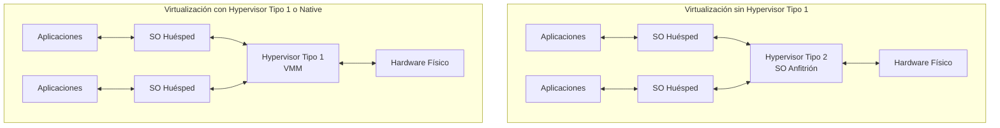
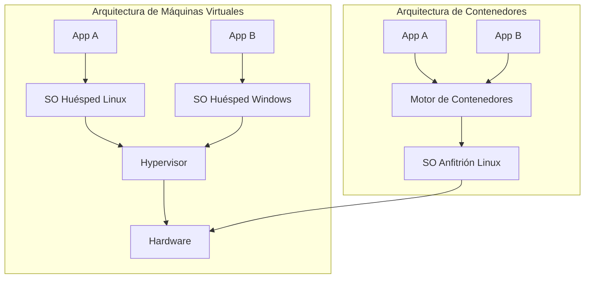

# Sistemas Operativos - Introducción

## 1.2 Máquinas virtuales.

---

### Definición y Concepto Fundamental

Una **Máquina Virtual (VM)** es una abstracción de software que emula un sistema de computación completo, incluyendo hardware (procesador, memoria, discos, tarjetas de red, etc.), permitiendo la ejecución de un sistema operativo completo y sus aplicaciones como si se estuviera ejecutando directamente sobre el hardware físico.

El software que crea y gestiona estas máquinas virtuales se denomina **hypervisor** o **monitor de máquina virtual (VMM)**.



_Diagrama: Comparativa de arquitecturas de Hypervisor Tipo 2 (hosted) y Tipo 1 (bare-metal)._

### Tipos de Hipervisores

#### Hipervisor Tipo 1 (Nativo o "Bare-Metal")

Se ejecuta directamente sobre el hardware físico. No necesita un sistema operativo anfitrión subyacente. Es más eficiente y se utiliza principalmente en entornos empresariales y de centro de datos.

**Ejemplos:** VMware ESXi, Microsoft Hyper-V, Xen, KVM (cuando se utiliza con una imagen Linux mínima).

#### Hipervisor Tipo 2 (Alojado o "Hosted")

Se ejecuta como una aplicación más dentro de un sistema operativo anfitrión convencional. Es más fácil de instalar y configurar, ideal para usuarios finales y desarrolladores.

**Ejemplos:** Oracle VM VirtualBox, VMware Workstation, Parallels Desktop, QEMU.

### Ventajas de las Máquinas Virtuales

1.  **Aislamiento y Seguridad:** Las VM están completamente aisladas entre sí y del hardware anfitrión. Una falla o virus en una VM no afecta a las demás.
2.  **Consolidación de Servidores:** Permite ejecutar múltiples sistemas operativos y aplicaciones en un solo servidor físico, optimizando el uso de recursos y reduciendo costos de hardware, energía y espacio.
3.  **Portabilidad y Snapshots:** El estado completo de una VM (discos, memoria, configuración) se almacena en archivos. Esto permite:
    - **Migración en Caliente:** Mover una VM en ejecución de un servidor físico a otro.
    - **Snapshots:** Guardar el estado exacto de una VM en un punto determinado y revertir a él en cualquier momento, lo cual es invaluable para pruebas y recuperación ante desastres.
4.  **Legacy y Compatibilidad:** Ejecutar software antiguo diseñado para sistemas operativos obsoletos en hardware moderno.
5.  **Desarrollo y Pruebas:** Probar nuevas aplicaciones, actualizaciones o configuraciones en entornos aislados y reproducibles sin riesgo para el sistema principal.

### Desventajas y Retos

1.  **Overhead (Sobrecarga) de Rendimiento:** La emulación y traducción de instrucciones introduce una sobrecarga de rendimiento, aunque los procesadores modernos con extensiones de virtualización (Intel VT-x, AMD-V) la han minimizado enormemente.
2.  **Complejidad de Gestión:** Gestionar un gran parque de máquinas virtuales (parches, redes, almacenamiento) puede ser más complejo que gestionar servidores físicos.
3.  **"Virtual Sprawl" (Dispersión Virtual):** La facilidad para crear VMs puede llevar a una proliferación descontrolada de máquinas subutilizadas, desperdiciando recursos.

### Virtualización vs. Contenedores

Es crucial diferenciar las Máquinas Virtuales de las tecnologías de contenedores (Docker, Kubernetes).

| Característica           | **Máquina Virtual (VM)**       | **Contenedor**                                        |
| :----------------------- | :----------------------------- | :---------------------------------------------------- |
| **Nivel de Aislamiento** | **Fuerte.** Aísla SO completo. | **Ligero.** Aísla procesos, comparte kernel del host. |
| **Imagen**               | Incluye SO completo (GBs).     | Solo aplicación y dependencias (MBs).                 |
| **Overhead**             | Alto (ejecuta SO completo).    | Muy bajo (comparte kernel).                           |
| **Arranque**             | Lento (minutos).               | Muy rápido (segundos).                                |
| **Hipervisor**           | Necesario.                     | No necesario (usa motor de contenedores).             |



_Diagrama: Comparativa de la arquitectura de VMs (aislamiento completo) vs. Contenedores (aislamiento a nivel de proceso)._

### Ejercicios Propuestos

1.  **Pregunta Conceptual:** Explica por qué un hipervisor Tipo 1 (bare-metal) generalmente ofrece un mejor rendimiento que un hipervisor Tipo 2 (hosted).
2.  **Análisis de Caso:** Una empresa tiene un servidor físico muy antiguo ejecutando una aplicación crítica en Windows Server 2003. El hardware está fallando. ¿Cómo podrían las máquinas virtuales ayudar en esta situación? Describe el proceso de migración.
3.  **Selección de Tecnología:** ¿Cuándo recomendarías el uso de una Máquina Virtual completa en lugar de un contenedor? Justifica tu respuesta con al menos tres razones específicas.
4.  **Investigación:** Investiga qué son las extensiones de virtualización por hardware (Intel VT-x, AMD-V) y explica brevemente cómo ayudan a mejorar el rendimiento de las VMs.

### Ejemplo de Comando (QEMU/KVM)

Este es un ejemplo de comando para iniciar una máquina virtual usando QEMU (emulador) y KVM (módulo del kernel de Linux que actúa como hipervisor Tipo 1). Ilustra cómo se asignan recursos y se conectan los dispositivos virtuales.

```bash
# Este comando crea y inicia una VM con:
# - 4 GB de RAM y 4 vCPUs
# - Un disco virtual llamado 'mi-servidor.qcow2'
# - La imagen de instalación de Ubuntu Server desde un ISO
# - Red en modo NAT
# - Aceleración KVM para máximo rendimiento

qemu-system-x86_64 \
    -enable-kvm \
    -m 4096 \
    -smp 4 \
    -hda mi-servidor.qcow2 \
    -cdrom ubuntu-22.04.3-live-server-amd64.iso \
    -boot d \
    -net nic \
    -net user
```

### Referencias

#### Bibliografía Básica

1.  Tanenbaum, A. S. (2007). _Modern Operating Systems_ (3rd ed.). Prentice Hall. (Capítulo 1.7 - Virtual Machines)
2.  Silberschatz, A., Galvin, P. B., & Gagne, G. (2008). _Operating Systems Concepts_ (8th ed.). John Wiley and Sons. (Capítulo 2.8 - Virtual Machines)
3.  Stallings, W. (2011). _Operating Systems: Internals and Design Principles_ (7th ed.). Prentice Hall. (Parte 5 - Sistemas Paralelos y Distribuidos, Capítulo sobre Virtualización)

#### Bibliografía Complementaria

1.  Smith, J. E., & Nair, R. (2005). _The Architecture of Virtual Machines_. Computer, 38(5), 32-38. (Artículo fundamental que explica en profundidad las técnicas de virtualización).
2.  Bovet, D. P., & Cesati, M. (2000). _Understanding the Linux Kernel_. O'Reilly. (Para entender cómo KVM se integra en el kernel de Linux).
