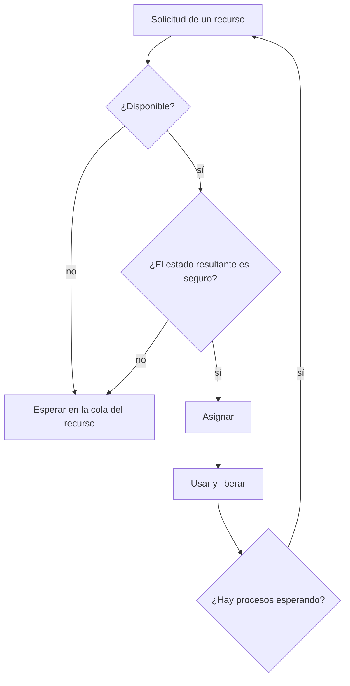

# Sistemas Operativos - Introducción

## 1.3 Control de recursos.

---

Un sistema operativo administra recursos limitados, el tiempo de CPU, la memoria, los dispositivos y los archivos, que muchos procesos piden al mismo tiempo. Controlarlos significa decidir quién obtiene qué y cuándo, impedir que un proceso interfiera con otro y evitar que el sistema se trabe o que alguien espere para siempre. Este tema presenta las formas de compartir recursos, las políticas de asignación, los tres problemas clásicos de la concurrencia, condiciones de carrera, interbloqueos e inanición, los mecanismos para resolverlos, semáforos, cerrojos y monitores, y el algoritmo del banquero, con una primera mirada a la planificación de la CPU y a la asignación de memoria, que los temas 3 y 4 desarrollan.

### Compartir recursos

- **Multiplexación en el tiempo:** los procesos se turnan el recurso completo, como la CPU, que el planificador asigna por intervalos, o una impresora, que imprime un trabajo tras otro.
- **Multiplexación en el espacio:** cada proceso recibe una parte del recurso, como la memoria o el disco.
- **Aislamiento y protección:** cada proceso solo puede usar lo que se le asignó, con apoyo del hardware: modos de ejecución, unidad de administración de memoria y temporizador.
- **Asignación estática o dinámica:** todo al inicio, o según se pide durante la ejecución.

### Condiciones de carrera

Hay una **condición de carrera** cuando el resultado depende del orden en que se intercalan procesos o hilos que comparten datos. Incrementar un contador, `x = x + 1`, se compila en leer, sumar y escribir; si dos hilos leen el mismo valor antes de que alguno escriba, se pierde un incremento. La parte del código que accede a los datos compartidos es la **sección crítica**, y una solución correcta debe garantizar **exclusión mutua**, que solo un hilo esté en ella; **progreso**, que si nadie está, alguien que quiera entrar pueda hacerlo, y **espera acotada**, que nadie espere indefinidamente.

### Semáforos, cerrojos y monitores

Un **semáforo** (Dijkstra, 1965) es un entero con dos operaciones atómicas: `wait` o P, que lo decrementa y bloquea al proceso si queda negativo, y `signal` o V, que lo incrementa y despierta a un proceso bloqueado si lo hay. Con valor inicial 1 sirve para la exclusión mutua; con valor $N,$ para contar recursos disponibles. Un **cerrojo** o *mutex* es un semáforo binario con dueño: solo quien lo cerró puede abrirlo. Un **monitor** (Hoare, 1974; Brinch Hansen, 1975) es una construcción del lenguaje que encapsula los datos compartidos con sus procedimientos y garantiza que solo uno se ejecute a la vez, con **variables de condición** para esperar dentro de él; los métodos `synchronized` de Java son un ejemplo. La atomicidad se implementa con instrucciones del hardware, como *test-and-set* o *compare-and-swap*.

### Interbloqueo

Un conjunto de procesos está en **interbloqueo** si cada uno espera un evento que solo otro del conjunto puede producir. Coffman, Elphick y Shoshani (1971) mostraron que requiere cuatro condiciones simultáneas:

1. **exclusión mutua:** el recurso no puede compartirse;
2. **retención y espera:** un proceso retiene recursos mientras pide otros;
3. **no expropiación:** los recursos no pueden quitarse a la fuerza;
4. **espera circular:** hay un ciclo de procesos, cada uno esperando un recurso del siguiente.

Hay cuatro estrategias: **prevenir**, negando una condición, por ejemplo pidiendo los recursos siempre en el mismo orden, lo que impide los ciclos; **evitar**, concediendo solo las solicitudes que dejan al sistema en un estado seguro, como el algoritmo del banquero; **detectar y recuperar**, buscando ciclos en el grafo de espera y terminando o expropiando a un proceso, e **ignorar**, la estrategia del avestruz, que siguen la mayoría de los sistemas de propósito general para los recursos de los usuarios.

### El algoritmo del banquero

Dijkstra (1965) propuso tratar los recursos como un banquero trata sus préstamos: cada proceso declara su demanda **máxima**, y el sistema mantiene los vectores y matrices de recursos **disponibles**, **asignados** y la **necesidad** restante, $\text{Necesidad} = \text{Máximo} - \text{Asignado}.$ Un estado es **seguro** si existe un orden en que cada proceso puede obtener lo que le falta con lo disponible más lo que liberan los anteriores. El algoritmo de seguridad busca ese orden: con $\text{Trabajo} = \text{Disponible},$ elige un proceso no terminado cuya necesidad no exceda $\text{Trabajo},$ supone que termina y suma su asignación a $\text{Trabajo},$ y repite; el estado es seguro si todos terminan. Cuesta $O(m\,n^2)$ con $n$ procesos y $m$ tipos de recurso. Una solicitud se concede solo si el estado que resultaría es seguro. Un estado inseguro no es necesariamente un interbloqueo, pero puede llevar a uno.

### Inanición

Hay **inanición** cuando un proceso espera indefinidamente aunque el sistema avance, porque los recursos siempre se dan a otros, como un proceso de baja prioridad ante un flujo continuo de procesos de alta prioridad. Se evita con el **envejecimiento**, que aumenta la prioridad de quien lleva mucho tiempo esperando, o con colas FIFO.



### Implementación en Python

El programa resuelve los cuatro ejercicios: un productor-consumidor con semáforos e hilos reales de Python, verificado por propiedades que no dependen del orden de ejecución; el algoritmo del banquero con la secuencia segura y la evaluación de solicitudes; FCFS y Round Robin con los diagramas de Gantt, y la asignación de memoria con particiones variables con primer, mejor y peor ajuste.

```python
import threading
from collections import deque

# ---------- Ejercicio 1: productor-consumidor con semáforos y buffer limitado ----------
N = 5
buffer, vacios, llenos, mutex = deque(), threading.Semaphore(N), threading.Semaphore(0), threading.Lock()
ocupacion_max, consumidos = [0], []
def productor(ident, cuantos):
    for k in range(cuantos):
        vacios.acquire()                                   # espera un lugar libre
        with mutex:                                        # sección crítica: modificar el buffer
            buffer.append((ident, k)); ocupacion_max[0] = max(ocupacion_max[0], len(buffer))
        llenos.release()                                   # avisa que hay un elemento
def consumidor(cuantos):
    for _ in range(cuantos):
        llenos.acquire()
        with mutex: item = buffer.popleft()
        vacios.release(); consumidos.append(item)
hilos = [threading.Thread(target=productor, args=(i, 1000)) for i in range(3)] + [threading.Thread(target=consumidor, args=(1500,)) for _ in range(2)]
for h in hilos: h.start()
for h in hilos: h.join()
por_productor = [sorted(k for i, k in consumidos if i == p) for p in range(3)]
print(f"ejercicio 1: 3 productores × 1000, 2 consumidores × 1500, buffer de {N}: consumidos {len(consumidos)}, "
      f"sin repetidos ni perdidos {all(l == list(range(1000)) for l in por_productor)}, ocupación máxima ≤ {N} {ocupacion_max[0] <= N}, buffer final vacío {len(buffer) == 0}")

# ---------- Ejercicio 2: algoritmo del banquero ----------
def seguro(disponible, asignacion, necesidad):
    trabajo, fin, orden = list(disponible), [False] * len(asignacion), []
    while True:
        for i in range(len(asignacion)):
            if not fin[i] and all(n <= t for n, t in zip(necesidad[i], trabajo)):
                trabajo = [t + a for t, a in zip(trabajo, asignacion[i])]; fin[i] = True; orden.append((f"P{i}", list(trabajo))); break
        else: return all(fin), orden
disp = [3, 1, 2]; asig = [[1, 0, 1], [0, 2, 0], [1, 0, 0]]; nec = [[1, 1, 0], [0, 1, 1], [1, 0, 1]]
ok, orden = seguro(disp, asig, nec)
print(f"ejercicio 2: estado seguro: {ok}; secuencia y recursos disponibles tras cada proceso: {orden}")
def solicita(i, pide):                                     # ¿se puede conceder una solicitud sin salir del estado seguro?
    if any(p > n for p, n in zip(pide, nec[i])) or any(p > d for p, d in zip(pide, disp)): return False
    d2 = [d - p for d, p in zip(disp, pide)]; a2 = [r[:] for r in asig]; n2 = [r[:] for r in nec]
    a2[i] = [a + p for a, p in zip(a2[i], pide)]; n2[i] = [n - p for n, p in zip(n2[i], pide)]
    return seguro(d2, a2, n2)[0]
for i, pide in ((1, [0, 1, 1]), (0, [1, 1, 0]), (2, [1, 0, 1])):
    print(f"   ¿conceder a P{i} la solicitud {pide}? {solicita(i, pide)}")
print(f"   con disponible [1, 0, 1]: estado seguro {seguro([1, 0, 1], asig, nec)[0]}")

# ---------- Ejercicio 3: FCFS y Round Robin ----------
PROC = [("P1", 0, 8), ("P2", 1, 4), ("P3", 2, 9), ("P4", 3, 5)]
def fcfs(procs):
    t, fin, gantt = 0, {}, []
    for n, lleg, dur in sorted(procs, key=lambda p: p[1]):
        t = max(t, lleg); gantt.append((n, t, t + dur)); t += dur; fin[n] = t
    return fin, gantt
def rr(procs, q):
    t, cola, resto, fin, gantt, i = 0, deque(), {n: d for n, _, d in procs}, {}, [], 0
    procs = sorted(procs, key=lambda p: p[1])
    while len(fin) < len(procs):
        while i < len(procs) and procs[i][1] <= t: cola.append(procs[i][0]); i += 1
        if not cola: t = procs[i][1]; continue
        n = cola.popleft(); usa = min(q, resto[n]); gantt.append((n, t, t + usa)); t += usa; resto[n] -= usa
        while i < len(procs) and procs[i][1] <= t: cola.append(procs[i][0]); i += 1   # los que llegan entran antes que el expulsado
        if resto[n]: cola.append(n)
        else: fin[n] = t
    return fin, gantt
for nombre, (fin, gantt) in (("FCFS", fcfs(PROC)), ("RR, q = 4", rr(PROC, 4))):
    ret = {n: fin[n] - l for n, l, _ in PROC}; esp = {n: ret[n] - d for n, _, d in PROC}
    print(f"ejercicio 3: {nombre}: " + " ".join(f"[{n} {a}-{b}]" for n, a, b in gantt))
    print(f"   retorno {ret}, promedio {sum(ret.values()) / 4:.2f} | espera {esp}, promedio {sum(esp.values()) / 4:.2f} | cambios de contexto {len(gantt) - 1}")

# ---------- Ejercicio 4: particiones variables con primer, mejor y peor ajuste ----------
TOTAL = 256
def asigna(huecos, tam, estrategia):
    cand = [(i, h) for i, h in enumerate(huecos) if h[1] >= tam]
    if not cand: return None
    i, (ini, largo) = {"primer": min(cand, key=lambda c: c[1][0]), "mejor": min(cand, key=lambda c: (c[1][1], c[1][0])),
                       "peor": max(cand, key=lambda c: (c[1][1], -c[1][0]))}[estrategia]
    huecos[i] = (ini + tam, largo - tam)
    if huecos[i][1] == 0: del huecos[i]
    return ini
def libera(huecos, ini, tam):
    huecos.append((ini, tam)); huecos.sort(); unidos = []
    for h in huecos:
        if unidos and unidos[-1][0] + unidos[-1][1] == h[0]: unidos[-1] = (unidos[-1][0], unidos[-1][1] + h[1])   # une huecos contiguos
        else: unidos.append(h)
    huecos[:] = unidos
EVENTOS = [("llega", "P1", 60), ("llega", "P2", 100), ("llega", "P3", 30), ("termina", "P2", 0), ("llega", "P5", 50), ("llega", "P4", 70)]
print(f"ejercicio 4: memoria de {TOTAL} KB; los 5 procesos suman {60 + 100 + 30 + 70 + 50} KB, así que no caben a la vez")
for estr in ("primer", "mejor", "peor"):
    huecos, pos, rech = [(0, TOTAL)], {}, []
    for ev, p, tam in EVENTOS:
        if ev == "llega":
            r = asigna(huecos, tam, estr)
            if r is None: rech.append(p)
            else: pos[p] = (r, tam)
        else: libera(huecos, *pos.pop(p))
    libre = sum(h[1] for h in huecos)
    print(f"   {estr:6} ajuste: {dict(sorted(pos.items()))}, sin lugar {rech}, huecos {huecos}: libre {libre} KB, el mayor {max((h[1] for h in huecos), default=0)} KB")
```

Salida:

```text
ejercicio 1: 3 productores × 1000, 2 consumidores × 1500, buffer de 5: consumidos 3000, sin repetidos ni perdidos True, ocupación máxima ≤ 5 True, buffer final vacío True
ejercicio 2: estado seguro: True; secuencia y recursos disponibles tras cada proceso: [('P0', [4, 1, 3]), ('P1', [4, 3, 3]), ('P2', [5, 3, 3])]
   ¿conceder a P1 la solicitud [0, 1, 1]? True
   ¿conceder a P0 la solicitud [1, 1, 0]? True
   ¿conceder a P2 la solicitud [1, 0, 1]? True
   con disponible [1, 0, 1]: estado seguro False
ejercicio 3: FCFS: [P1 0-8] [P2 8-12] [P3 12-21] [P4 21-26]
   retorno {'P1': 8, 'P2': 11, 'P3': 19, 'P4': 23}, promedio 15.25 | espera {'P1': 0, 'P2': 7, 'P3': 10, 'P4': 18}, promedio 8.75 | cambios de contexto 3
ejercicio 3: RR, q = 4: [P1 0-4] [P2 4-8] [P3 8-12] [P4 12-16] [P1 16-20] [P3 20-24] [P4 24-25] [P3 25-26]
   retorno {'P1': 20, 'P2': 7, 'P3': 24, 'P4': 22}, promedio 18.25 | espera {'P1': 12, 'P2': 3, 'P3': 15, 'P4': 17}, promedio 11.75 | cambios de contexto 7
ejercicio 4: memoria de 256 KB; los 5 procesos suman 310 KB, así que no caben a la vez
   primer ajuste: {'P1': (0, 60), 'P3': (160, 30), 'P5': (60, 50)}, sin lugar ['P4'], huecos [(110, 50), (190, 66)]: libre 116 KB, el mayor 66 KB
   mejor  ajuste: {'P1': (0, 60), 'P3': (160, 30), 'P4': (60, 70), 'P5': (190, 50)}, sin lugar [], huecos [(130, 30), (240, 16)]: libre 46 KB, el mayor 30 KB
   peor   ajuste: {'P1': (0, 60), 'P3': (160, 30), 'P5': (60, 50)}, sin lugar ['P4'], huecos [(110, 50), (190, 66)]: libre 116 KB, el mayor 66 KB
```

### Ejercicios Propuestos

1. **Sincronización.** Implementa con semáforos una solución al problema del productor-consumidor con buffer limitado.

2. **Interbloqueo.** Determina si el sistema está en un estado seguro, con recursos disponibles $(3, 1, 2)$ y

    | Proceso | Asignado | Necesidad |
    | ------- | -------- | --------- |
    | P0      | 1, 0, 1  | 1, 1, 0   |
    | P1      | 0, 2, 0  | 0, 1, 1   |
    | P2      | 1, 0, 0  | 1, 0, 1   |

3. **Planificación de la CPU.** Calcula el tiempo de espera promedio y el tiempo de retorno promedio con FCFS y con Round Robin con quantum 4 para P1, que llega en 0 y dura 8; P2, que llega en 1 y dura 4; P3, que llega en 2 y dura 9, y P4, que llega en 3 y dura 5.

4. **Memoria.** En un sistema con 256 KB de memoria principal, diseña un esquema de particiones variables para los procesos P1 de 60 KB, P2 de 100 KB, P3 de 30 KB, P4 de 70 KB y P5 de 50 KB, aplica primer ajuste, mejor ajuste y peor ajuste, y compara la fragmentación.

### Soluciones

**Ejercicio 1.** Se usan tres objetos: `vacios`, un semáforo con valor inicial $N,$ el tamaño del buffer, que cuenta los lugares libres; `llenos`, con valor inicial 0, que cuenta los elementos, y un cerrojo para la sección crítica que modifica el buffer. El productor hace `wait(vacios)`, inserta con el cerrojo y hace `signal(llenos)`; el consumidor, `wait(llenos)`, extrae con el cerrojo y `signal(vacios)`. El orden importa: si el productor tomara el cerrojo antes de esperar un lugar libre, con el buffer lleno se bloquearía reteniendo el cerrojo, y el consumidor no podría entrar a liberar lugar, un interbloqueo. Con 3 productores de 1 000 elementos y 2 consumidores de 1 500, el programa verifica lo que debe cumplirse con cualquier intercalación: se consumen los 3 000 elementos, cada uno exactamente una vez, la ocupación nunca pasa de 5 y el buffer termina vacío. No imprime el orden de consumo porque varía de una ejecución a otra.

**Ejercicio 2.** Con $\text{Trabajo} = (3, 1, 2),$ P0 necesita $(1, 1, 0) \le (3, 1, 2)$ y puede terminar, liberando su asignación: $\text{Trabajo} = (4, 1, 3).$ P1 necesita $(0, 1, 1) \le (4, 1, 3)$ y termina: $(4, 3, 3).$ P2 necesita $(1, 0, 1)$ y termina: $(5, 3, 3).$ El estado es **seguro**, con la secuencia P0, P1, P2; hay otras, porque cualquiera de los tres puede ir primero. Las solicitudes de cualquiera de ellos por toda su necesidad pueden concederse, porque el estado resultante sigue siendo seguro. En cambio, con solo $(1, 0, 1)$ disponibles, ningún proceso podría completar su necesidad, y el estado sería inseguro.

**Ejercicio 3.** Con **FCFS**, los procesos se ejecutan en orden de llegada: P1 de 0 a 8, P2 de 8 a 12, P3 de 12 a 21 y P4 de 21 a 26. Los tiempos de retorno, fin menos llegada, son 8, 11, 19 y 23, con promedio 15.25, y los de espera, retorno menos duración, 0, 7, 10 y 18, con promedio 8.75. Con **Round Robin** y quantum 4, la secuencia es P1 de 0 a 4, P2 de 4 a 8, P3 de 8 a 12, P4 de 12 a 16, P1 de 16 a 20, P3 de 20 a 24, P4 de 24 a 25 y P3 de 25 a 26, con la convención de que un proceso que llega durante un quantum entra a la cola antes que el que fue expulsado. Los tiempos de retorno son 20, 7, 24 y 22, promedio 18.25, y los de espera 12, 3, 15 y 17, promedio 11.75. Round Robin es **peor** en promedio aquí, porque todos los procesos son largos en relación con el quantum y se alternan, terminando todos tarde; su ventaja es el tiempo de **respuesta**, el tiempo hasta la primera ejecución, que es de a lo más 9 unidades para todos, y la equidad: P2, el más corto, termina en 7 en lugar de 11. Además hace 7 cambios de contexto en lugar de 3.

**Ejercicio 4.** Los 5 procesos suman 310 KB, más que la memoria, así que el ejercicio requiere un escenario en que no todos estén a la vez. Llegan P1, P2 y P3, que ocupan de 0 a 190 KB; P2 termina y deja un hueco de 100 KB en la posición 60, además del hueco de 66 KB al final; luego llegan P5 y P4.

- **Primer ajuste** pone a P5 en el primer hueco suficiente, el de 100 KB, y deja huecos de 50 y 66 KB: P4, de 70 KB, no cabe aunque hay 116 KB libres.
- **Peor ajuste** elige el hueco más grande, otra vez el de 100 KB, con el mismo resultado.
- **Mejor ajuste** pone a P5 en el hueco más pequeño suficiente, el de 66 KB, y conserva el de 100 KB para P4: caben todos, y quedan huecos de 30 y 16 KB.

Es **fragmentación externa**: memoria libre suficiente pero dividida en huecos que no sirven. Mejor ajuste ganó en este escenario porque conservó el hueco grande, pero tiende a dejar huecos diminutos inútiles, y en simulaciones con cargas aleatorias primer ajuste es tan bueno y más rápido; la regla del 50 % de Knuth estima que, en equilibrio, por cada $n$ bloques asignados hay unos $n/2$ huecos. Las soluciones son la **compactación**, que mueve los procesos para juntar los huecos y requiere reubicación dinámica, y la **paginación** del tema 4, que elimina la fragmentación externa.

### Referencias

1. Silberschatz, A., Galvin, P. B., and Gagne, G., _Operating System Concepts_. 10a ed., Wiley, 2018. Capítulos 5 a 9.
2. Dijkstra, E. W., Cooperating sequential processes. Informe EWD-123, Universidad Tecnológica de Eindhoven, 1965.
3. Coffman, E. G., Elphick, M. J., and Shoshani, A., System deadlocks. _ACM Computing Surveys_ 3(2), 1971.
4. Hoare, C. A. R., Monitors: an operating system structuring concept. _Communications of the ACM_ 17(10), 1974.
5. Knuth, D. E., _The Art of Computer Programming_, vol. 1. Addison-Wesley, 1997. Sección 2.5.
6. Tanenbaum, A. S., and Bos, H., _Modern Operating Systems_. 5a ed., Pearson, 2023. Capítulos 2 y 6.
