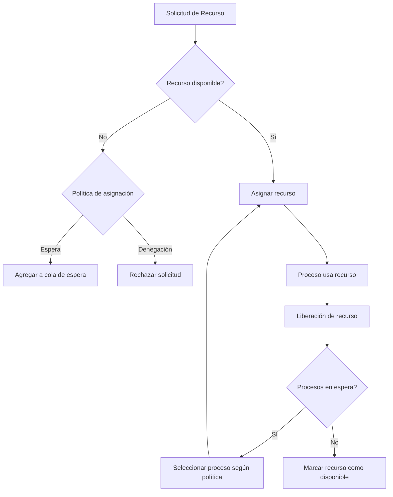
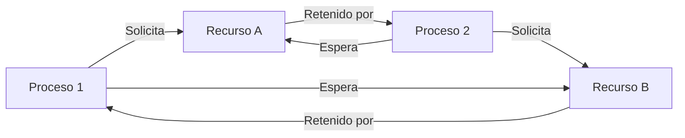

# Sistemas Operativos - Introducción

## 1.3 Control de recursos.

---

### Definición e Importancia

El **control de recursos** es una función fundamental del sistema operativo que consiste en gestionar y asignar los recursos del sistema (CPU, memoria, dispositivos de E/S, almacenamiento) entre los distintos procesos que compiten por ellos, garantizando su uso eficiente y evitando conflictos.

El sistema operativo actúa como un **asignador de recursos** que debe:

- Asignar recursos cuando los procesos los solicitan
- Recuperar recursos cuando los procesos finalizan
- Decidir qué proceso obtiene un recurso cuando hay competencia
- Prevenir condiciones de carrera y bloqueos

### Principios Fundamentales del Control de Recursos

#### 1. Multiplexación Temporal

Compartir un recurso en el tiempo, asignándolo a diferentes procesos durante intervalos específicos.

#### 2. Multiplexación Espacial

Asignar partes diferentes de un recurso a distintos procesos simultáneamente.

#### 3. Aislamiento y Protección

Garantizar que un proceso no pueda interferir con los recursos asignados a otros procesos.

#### 4. Planificación y Asignación

Implementar políticas y mecanismos para decidir qué proceso obtiene qué recurso y cuándo.

### Recursos Críticos del Sistema

#### 1. Control del Procesador (CPU)

El SO decide qué proceso se ejecuta en la CPU y por cuánto tiempo mediante algoritmos de planificación.

**Algoritmos comunes:**

- First-Come, First-Served (FCFS)
- Round Robin (RR)
- Shortest Job First (SJF)
- Priority Scheduling

El **cambio de contexto** (context switch) es el mecanismo fundamental para implementar la multiplexación temporal de la CPU.

#### 2. Control de Memoria

El SO gestiona la memoria principal, asignando espacio a procesos y gestionando la jerarquía de memoria.

**Técnicas principales:**

- Particiones fijas y variables
- Paginación
- Segmentación
- Memoria virtual

#### 3. Control de Dispositivos de E/S

El SO gestiona el acceso a dispositivos periféricos mediante controladores de dispositivo (drivers).

**Mecanismos:**

- Operaciones de E/S programadas
- E/S manejada por interrupciones
- Acceso directo a memoria (DMA)

#### 4. Control del Sistema de Archivos

El SO gestiona el almacenamiento secundario, proporcionando una abstracción lógica de los datos.

### Políticas de Asignación de Recursos

#### Asignación Estática vs. Dinámica

- **Estática:** Los recursos se asignan al inicio de la ejecución y no cambian
- **Dinámica:** Los recursos se asignan y liberan según demanda durante la ejecución

#### Asignación bajo Petición vs. por Prioridades

- **Bajo petición:** Los procesos solicitan recursos explícitamente
- **Por prioridades:** Los recursos se asignan según la importancia del proceso

### Problemas en el Control de Recursos

#### 1. Condición de Carrera (Race Condition)

Situación donde el resultado de una operación depende del orden de ejecución de procesos concurrentes.

#### 2. Interbloqueo (Deadlock)

Situación donde dos o más procesos se bloquean mutuamente porque cada uno espera un recurso que tiene el otro.

**Condiciones necesarias para deadlock:**

- Exclusión mutua
- Retención y espera
- No apropiación
- Espera circular

#### 3. Inanición (Starvation)

Situación donde un proceso no puede acceder a un recurso porque siempre se asigna a otros procesos.

### Mecanismos de Control

#### Semáforos

Estructura de datos que controla el acceso a recursos mediante operaciones atómicas.

```c
// Ejemplo de implementación de semáforos (pseudocódigo)
typedef struct {
    int value;
    ProcessQueue queue;
} Semaphore;

void wait(Semaphore *S) {
    S->value--;
    if (S->value < 0) {
        // Agregar proceso a la cola de espera
        block();
    }
}

void signal(Semaphore *S) {
    S->value++;
    if (S->value <= 0) {
        // Sacar proceso de la cola de espera
        wakeup();
    }
}
```

#### Monitores

Estructura de alto nivel que encapsula datos y procedimientos para acceso concurrente.

#### Bloqueos (Mutexes)

Mecanismos de exclusión mutua que protegen secciones críticas.

### Algoritmos para Detección y Prevención de Interbloqueos

#### Algoritmo del Banquero

Algoritmo de evitación de interbloqueos que requiere conocimiento previo de los recursos máximos que necesitarán los procesos.

**Estructuras de datos:**

- Disponible: Vector de longitud m que indica el número de recursos disponibles de cada tipo
- Máximo: Matriz n × m que define la demanda máxima de cada proceso
- Asignación: Matriz n × m que define el número de recursos de cada tipo asignados a cada proceso
- Necesidad: Matriz n × m que indica la necesidad restante de recursos de cada proceso (Necesidad = Máximo - Asignación)

### Ejercicios Propuestos

1. **Problema de sincronización:** Implementa una solución usando semáforos para el problema del productor-consumidor con buffer limitado.

2. **Análisis de interbloqueo:** Dados los siguientes estados de asignación de recursos, determina si el sistema está en un estado seguro:
   - Recursos disponibles: [3, 1, 2]
   - Matriz de asignación actual:
     P0: [1, 0, 1]
     P1: [0, 2, 0]
     P2: [1, 0, 0]
   - Matriz de necesidad:
     P0: [1, 1, 0]
     P1: [0, 1, 1]
     P2: [1, 0, 1]

3. **Planificación de CPU:** Calcula el tiempo de espera promedio y el tiempo de retorno promedio para los siguientes procesos bajo el algoritmo FCFS y Round Robin (quantum = 4):
   - P1: llegada en 0, duración 8
   - P2: llegada en 1, duración 4
   - P3: llegada en 2, duración 9
   - P4: llegada en 3, duración 5

4. **Gestión de memoria:** Considera un sistema con 256KB de memoria principal. Diseña un esquema de asignación con particiones variables para los siguientes procesos:
   - P1: 60KB
   - P2: 100KB
   - P3: 30KB
   - P4: 70KB
   - P5: 50KB

   Aplica los algoritmos First-fit, Best-fit y Worst-fit y compara la fragmentación resultante.

### Diagramas





### Referencias

#### Bibliografía Básica

1. Tanenbaum, A. S. (2007). _Modern Operating Systems_ (3rd ed.). Prentice Hall. (Capítulos 2, 3, 6)
2. Silberschatz, A., Galvin, P. B., & Gagne, G. (2008). _Operating Systems Concepts_ (8th ed.). John Wiley and Sons. (Capítulos 5, 6, 7, 8)
3. Stallings, W. (2011). _Operating Systems: Internals and Design Principles_ (7th ed.). Prentice Hall. (Capítulos 5, 6, 7, 8)

#### Bibliografía Complementaria

1. Arpaci-Dusseau, R. H., & Arpaci-Dusseau, A. C. (2018). _Operating Systems: Three Easy Pieces_. (Disponible online)
2. Bach, M. (1986). _The Design of the UNIX Operating System_. Prentice Hall. (Capítulos 6, 7)
