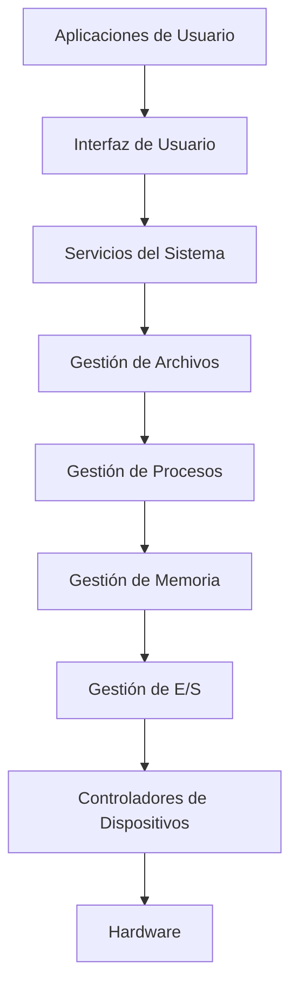
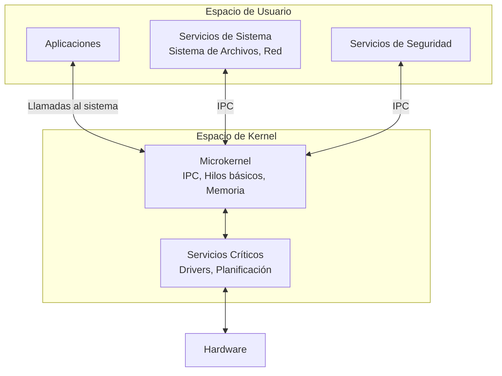

# Sistemas Operativos - Introducción

## 1.4 Elementos que conforman un sistema operativo; estructuras de los sistemas operativos.

---

Un sistema operativo está compuesto por varios elementos interrelacionados que trabajan conjuntamente para gestionar los recursos del sistema. Los principales elementos son:

#### 1. Núcleo (Kernel)

Es el componente central del sistema operativo que reside permanentemente en memoria. Se encarga de:

- Gestión de procesos y planificación de la CPU
- Gestión de memoria
- Comunicación entre procesos
- Control de dispositivos de E/S
- Gestión del sistema de archivos

#### 2. Gestor de Procesos

Controla la creación, planificación y terminación de procesos. Mantiene:

- Tabla de procesos (Process Control Block - PCB)
- Algoritmos de planificación
- Mecanismos de comunicación entre procesos (IPC)

#### 3. Gestor de Memoria

Administra la memoria principal y secundaria:

- Asignación y liberación de memoria
- Mecanismos de protección
- Memoria virtual y paginación
- Algoritmos de reemplazo de páginas

#### 4. Sistema de Archivos

Organiza y gestiona el almacenamiento persistente:

- Estructura de directorios
- Operaciones sobre archivos (crear, leer, escribir, eliminar)
- Control de acceso y permisos
- Gestión de espacio libre

#### 5. Gestor de Dispositivos

Controla todos los dispositivos de entrada/salida:

- Controladores de dispositivos (drivers)
- Buffering y caching
- Planificación de E/S

#### 6. Sistema de Protección y Seguridad

Garantiza la confidencialidad, integridad y disponibilidad:

- Mecanismos de autenticación
- Control de acceso
- Cifrado de datos
- Auditoría del sistema

#### 7. Interfaces

Proporcionan medios para interactuar con el sistema:

- Interfaz de usuario (CLI, GUI)
- Llamadas al sistema (system calls)

### Estructuras de los Sistemas Operativos

#### 1. Estructura Monolítica

Es la estructura más antigua y simple donde todo el sistema operativo funciona como un único programa en modo kernel.

**Características:**

- Todos los componentes están integrados en un único gran programa
- Comunicación directa entre módulos mediante llamadas a funciones
- Alta eficiencia pero difícil de mantener y extender

```c
// Ejemplo conceptual de estructura monolítica
void kernel_main() {
    init_hardware();
    init_memory_manager();
    init_process_manager();
    init_file_system();

    while(1) {
        handle_interrupts();
        schedule_processes();
        // ... todas las funciones del SO
    }
}
```

#### 2. Estructura por Capas (Layered)

Organiza el sistema operativo en niveles, donde cada capa solo utiliza servicios de las capes inferiores.

**Ventajas:**

- Mayor modularidad
- Facilita el debugging y mantenimiento
- Mejor abstracción

**Desventajas:**

- Menor eficiencia por las múltiples interfaces
- Dificultad para definir las capas adecuadamente



#### 3. Microkernel

Minimiza la cantidad de código que se ejecuta en modo kernel, moviendo la mayoría de servicios a modo usuario.

**Características:**

- Kernel pequeño con funciones esenciales
- Servicios como sistemas de archivos se ejecutan como procesos en espacio de usuario
- Mayor estabilidad y seguridad
- Comunicación mediante paso de mensajes

**Servicios típicos en microkernel:**

- Gestión básica de procesos e hilos
- Comunicación entre procesos (IPC)
- Gestión de memoria de bajo nivel

#### 4. Estructura Híbrida

Combina aspectos de diferentes estructuras, típicamente un micronúcleo con algunos servicios en espacio kernel por razones de rendimiento.

**Ejemplos:**

- Windows NT utiliza una estructura híbrida
- macOS X combina micronúcleo Mach con servicios BSD

#### 5. Máquinas Virtuales

Permite ejecutar múltiples sistemas operativos simultáneamente sobre el mismo hardware físico.

**Componentes:**

- Hypervisor (VMM - Virtual Machine Monitor)
- Sistema operativo huésped (guest OS)
- Sistema operativo anfitrión (host OS, en Type 2)

### Comparativa de Estructuras

| Estructura             | Ventajas                                | Desventajas                         | Ejemplos                |
| ---------------------- | --------------------------------------- | ----------------------------------- | ----------------------- |
| **Monolítica**         | Alto rendimiento, eficiencia            | Poco modular, difícil de mantener   | UNIX tradicional, Linux |
| **Por Capas**          | Modular, fácil de depurar               | Overhead por capas, menos eficiente | THE OS, OS/2            |
| **Microkernel**        | Estable, seguro, extensible             | Overhead por IPC, menos eficiente   | Minix, QNX, Mach        |
| **Híbrida**            | Balance entre rendimiento y modularidad | Complejidad de diseño               | Windows NT, macOS X     |
| **Máquinas Virtuales** | Aislamiento completo, flexibilidad      | Alto overhead de recursos           | VMware, VirtualBox      |

### Ejercicios Propuestos

1. **Análisis comparativo:** Compara las estructuras monolítica y de microkernel en términos de rendimiento, seguridad y mantenibilidad. Justifica qué estructura sería más adecuada para: a) un sistema embebido crítico, b) un servidor de alto rendimiento.

2. **Diseño de capas:** Propón una estructura por capas para un sistema operativo moderno, definiendo al menos 6 capas y describiendo las responsabilidades de cada una.

3. **Comunicación en microkernel:** Explica cómo se implementaría la comunicación entre un proceso de usuario y el servicio de sistema de archivos en una arquitectura de microkernel. Incluye un diagrama de secuencia.

4. **Problema de diseño:** Identifica qué elementos del sistema operativo deben estar necesariamente en el kernel y cuáles podrían moverse a espacio de usuario en una arquitectura híbrida.

### Diagrama de Estructura Híbrida



### Referencias

#### Bibliografía Básica

1. Tanenbaum, A. S. (2007). _Modern Operating Systems_ (3rd ed.). Prentice Hall. (Capítulos 1.5 - 1.7)
2. Silberschatz, A., Galvin, P. B., & Gagne, G. (2008). _Operating Systems Concepts_ (8th ed.). John Wiley and Sons. (Capítulos 2.1 - 2.9)
3. Tanenbaum, A. S., & Woodhull, A. S. (2006). _Operating Systems: Design and Implementation_ (3rd ed.). Prentice Hall. (Capítulos 1, 2)
4. Stallings, W. (2011). _Operating Systems: Internals and Design Principles_ (7th ed.). Prentice Hall. (Capítulos 2.1 - 2.6)

#### Bibliografía Complementaria

1. Bach, M. (1986). _The Design of the UNIX Operating System_. Prentice Hall. (Capítulo 1)
2. Bovet, D. P., & Cesati, M. (2000). _Understanding the Linux Kernel_. O'Reilly. (Capítulo 1)
3. Silberschatz, A., Galvin, P. B., & Gagne, G. (2009). _Operating System Concepts with Java_ (8th ed.). John Wiley and Sons. (Capítulos 2.1 - 2.8)
