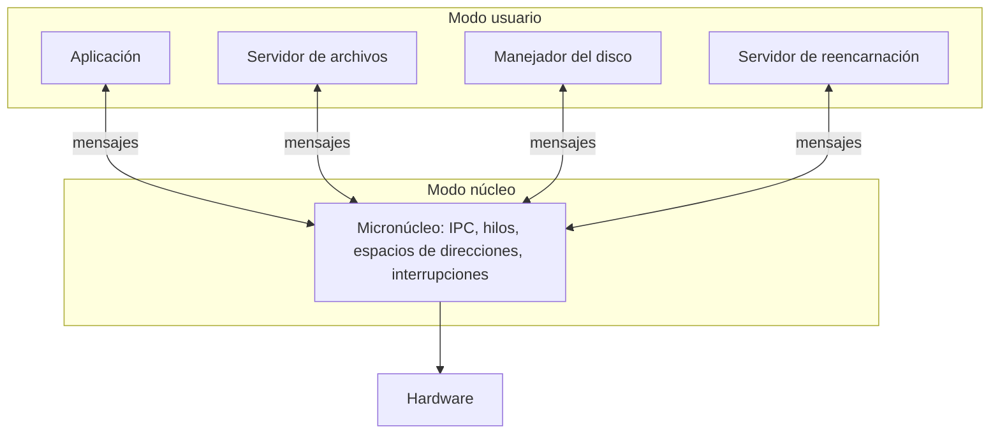
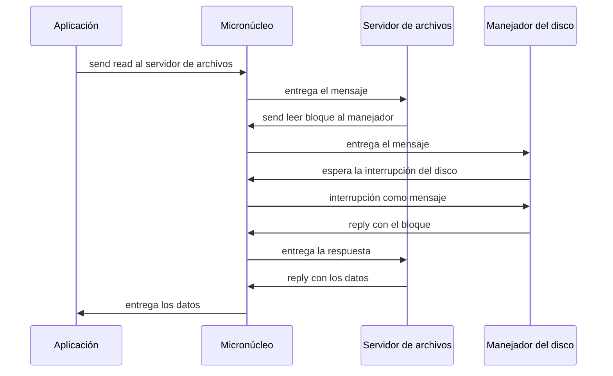

# Sistemas Operativos - Introducción

## 1.4 Elementos que conforman un sistema operativo; estructuras de los sistemas operativos.

---

Un sistema operativo moderno tiene decenas de millones de líneas de código: Linux supera los 35 millones. Cómo se divide ese código en componentes, y cuáles de ellos se ejecutan con privilegios, determina su rendimiento, su confiabilidad, su seguridad y la facilidad para mantenerlo. Este tema presenta los elementos de un sistema operativo y las estructuras con que se organizan, monolítica, por capas, micronúcleo, modular e híbrida, con sus compromisos y ejemplos reales.

### Elementos

- **Núcleo:** la parte que se ejecuta en modo privilegiado y reside siempre en memoria; atiende las interrupciones, las excepciones y las llamadas al sistema.
- **Administrador de procesos:** crea y termina procesos e hilos, los planifica y mantiene sus **bloques de control**, con su estado, registros y recursos, y ofrece la comunicación y la sincronización entre ellos.
- **Administrador de memoria:** asigna y protege la memoria, implementa la memoria virtual y el reemplazo de páginas.
- **Sistema de archivos:** organiza los datos persistentes en archivos y directorios, con permisos y administración del espacio libre.
- **Subsistema de E/S:** manejadores de dispositivos, buffers, cachés y planificación de la E/S.
- **Protección y seguridad:** autenticación, control de acceso y auditoría.
- **Interfaces:** las llamadas al sistema y las bibliotecas que las envuelven, como la biblioteca de C, y las interfaces de usuario, el intérprete de comandos y el entorno gráfico.

### Estructura monolítica

Todo el sistema operativo es un solo programa que se ejecuta en modo núcleo, en un mismo espacio de direcciones, y sus partes se comunican con llamadas a funciones. Es la estructura del UNIX original y de Linux. Su ventaja es la **eficiencia**: no hay cruces de modo ni mensajes entre componentes. Su desventaja es que cualquier error, en particular en un manejador de dispositivos, puede corromper o detener todo el sistema, y que es difícil de verificar. Los manejadores son la mayor parte del código y la principal fuente de errores: Chou y otros (2001) encontraron en Linux tasas de errores hasta siete veces mayores en los manejadores que en el resto del núcleo. Linux es **modular**: carga y descarga módulos, como manejadores y sistemas de archivos, mientras funciona, pero los módulos se ejecutan en modo núcleo con los mismos privilegios.

### Estructura por capas

El sistema se divide en niveles, y cada uno usa solo los servicios de los inferiores, lo que permite construirlo y verificarlo nivel por nivel. El sistema THE de Dijkstra (1968) tenía 6: asignación del procesador y multiprogramación, memoria, consola del operador, E/S, programas de usuario y el operador. Su dificultad es definir las capas, porque las dependencias reales no son lineales: el administrador de memoria necesita E/S para paginar, y la E/S necesita memoria para sus buffers; además, cada capa agrega una llamada. Hoy se usa en forma relajada, como en la pila de red.

### Micronúcleo

El **micronúcleo** deja en modo núcleo solo lo indispensable, el manejo de interrupciones, los espacios de direcciones, los hilos y el **paso de mensajes**, y ejecuta los demás servicios, sistemas de archivos, manejadores y red, como **servidores** en modo usuario. Un error en un servidor solo lo afecta a él, que puede reiniciarse, y el núcleo es lo bastante pequeño para verificarlo formalmente: **seL4**, de unas 10 000 líneas de C, tiene una demostración de corrección funcional (Klein y otros, 2009). Su costo es el **IPC**: cada servicio requiere mensajes, cruces de modo y cambios de contexto. Los primeros, como Mach, eran lentos; Liedtke (1995) mostró con L4 que un IPC bien diseñado puede ser casi tan rápido como una llamada al sistema. Ejemplos: MINIX 3, QNX, usado en automóviles, seL4 y el núcleo Zircon de Fuchsia.

### Estructuras híbridas

La mayoría de los sistemas comerciales combinan ideas. **Windows NT** se diseñó con un núcleo pequeño, un ejecutivo de servicios y subsistemas en modo usuario, pero por rendimiento ejecuta en modo núcleo el ejecutivo, los manejadores y, desde NT 4.0, los gráficos. **macOS** e iOS usan **XNU**, que combina Mach con partes de FreeBSD, todo en modo núcleo. Otras organizaciones son los **exonúcleos**, que exportan el hardware casi directamente a bibliotecas en modo usuario, y los **unikernels**, que compilan una aplicación con solo las partes del sistema que necesita, en una imagen para una máquina virtual.

| Estructura | Ventajas | Desventajas | Ejemplos |
| ---------- | -------- | ----------- | -------- |
| Monolítica, modular | rendimiento, comunicación directa | un error afecta a todo, difícil de verificar | UNIX, Linux, FreeBSD |
| Por capas | construcción y verificación por niveles | capas difíciles de definir, sobrecarga | THE, Multics en anillos |
| Micronúcleo | aislamiento de fallas, seguridad, verificable | costo del IPC | MINIX 3, QNX, seL4 |
| Híbrida | compromiso entre las anteriores | complejidad, aislamiento parcial | Windows NT, XNU |



### Implementación en Python

El programa modela la misma llamada `read` en un núcleo monolítico y en un micronúcleo, contando los cruces de modo, los cambios de contexto, los mensajes y las copias, y simula una falla del manejador del disco en ambos, con un servidor de reencarnación como el de MINIX 3. También clasifica los componentes según si deben estar en el núcleo.

```python
from collections import Counter

# ---------- Un núcleo monolítico y un micronúcleo de juguete, con la misma operación read() ----------
class Monolitico:
    def __init__(self): self.c = Counter(); self.vivo = True
    def read(self, archivo, n, falla_driver=False):
        self.c["cambio a modo núcleo"] += 1                     # trampa de la llamada al sistema
        self.c["llamada a función"] += 3                        # VFS → sistema de archivos → manejador del disco
        if falla_driver: self.vivo = False; return "pánico del núcleo: todo el sistema cae"
        self.c["copia de datos"] += 1                           # del caché del núcleo al buffer del usuario
        self.c["regreso a modo usuario"] += 1
        return f"{n} bytes"
class Micronucleo:
    def __init__(self): self.c = Counter(); self.servidores = {"FS": "vivo", "disco": "vivo"}; self.reinicios = 0
    def ipc(self, de, a):                                       # enviar un mensaje: dos cruces de modo y un cambio de contexto
        self.c["cambio a modo núcleo"] += 1; self.c["regreso a modo usuario"] += 1
        self.c["cambio de contexto"] += 1; self.c["mensaje"] += 1
    def read(self, archivo, n, falla_driver=False):
        self.ipc("app", "FS"); self.ipc("FS", "disco")          # petición: aplicación → FS → manejador del disco
        if falla_driver:
            self.servidores["disco"] = "reiniciado"; self.reinicios += 1      # el servidor de reencarnación lo reinicia
            self.ipc("reencarnación", "disco"); self.ipc("FS", "disco")      # el FS repite la petición
        self.ipc("disco", "FS"); self.ipc("FS", "app")          # respuestas
        self.c["copia de datos"] += 2                           # disco → FS → aplicación (o una concesión de memoria compartida)
        return f"{n} bytes"
m, u = Monolitico(), Micronucleo()
print("ejercicio 3: una llamada read(archivo, 4096)")
for nombre, k in (("monolítico", m), ("micronúcleo", u)):
    r = k.read("datos.txt", 4096); print(f"   {nombre:11}: {r}; {dict(k.c)}")
print("ejercicio 1: falla en el manejador del disco durante una lectura")
print(f"   monolítico : {Monolitico().read('datos.txt', 4096, falla_driver=True)}")
u2 = Micronucleo(); r = u2.read("datos.txt", 4096, falla_driver=True)
print(f"   micronúcleo: {r} tras {u2.reinicios} reinicio del servidor del disco; mensajes {u2.c['mensaje']} en lugar de 4")

# ---------- Ejercicio 4: qué debe estar en el núcleo ----------
COMPONENTES = {"manejo de interrupciones y excepciones": "núcleo", "cambio de contexto y despacho": "núcleo",
               "tablas de páginas y MMU": "núcleo", "IPC básico": "núcleo", "control de acceso a la memoria física y la E/S": "núcleo",
               "política de planificación": "usuario posible", "sistemas de archivos": "usuario posible", "pila de red": "usuario posible",
               "manejadores de dispositivos": "usuario posible", "paginación a disco, política de reemplazo": "usuario posible",
               "interfaz gráfica": "usuario", "intérprete de comandos": "usuario"}
for lugar in ("núcleo", "usuario posible", "usuario"):
    print(f"ejercicio 4: {lugar:15}: {', '.join(k for k, v in COMPONENTES.items() if v == lugar)}")
```

Salida:

```text
ejercicio 3: una llamada read(archivo, 4096)
   monolítico : 4096 bytes; {'cambio a modo núcleo': 1, 'llamada a función': 3, 'copia de datos': 1, 'regreso a modo usuario': 1}
   micronúcleo: 4096 bytes; {'cambio a modo núcleo': 4, 'regreso a modo usuario': 4, 'cambio de contexto': 4, 'mensaje': 4, 'copia de datos': 2}
ejercicio 1: falla en el manejador del disco durante una lectura
   monolítico : pánico del núcleo: todo el sistema cae
   micronúcleo: 4096 bytes tras 1 reinicio del servidor del disco; mensajes 6 en lugar de 4
ejercicio 4: núcleo         : manejo de interrupciones y excepciones, cambio de contexto y despacho, tablas de páginas y MMU, IPC básico, control de acceso a la memoria física y la E/S
ejercicio 4: usuario posible: política de planificación, sistemas de archivos, pila de red, manejadores de dispositivos, paginación a disco, política de reemplazo
ejercicio 4: usuario        : interfaz gráfica, intérprete de comandos
```

### Ejercicios Propuestos

1. **Comparación.** Compara las estructuras monolítica y de micronúcleo en rendimiento, seguridad y mantenibilidad. ¿Cuál sería más adecuada para un sistema embebido crítico y cuál para un servidor de alto rendimiento?

2. **Diseño por capas.** Propón una estructura por capas para un sistema operativo moderno, con al menos 6 capas y las responsabilidades de cada una.

3. **Comunicación en un micronúcleo.** Explica cómo se comunica un proceso de usuario con el servicio de archivos en un micronúcleo, con un diagrama de secuencia.

4. **Diseño.** ¿Qué elementos del sistema operativo deben estar necesariamente en el núcleo y cuáles podrían moverse a espacio de usuario en una arquitectura híbrida?

### Soluciones

**Ejercicio 1.** En **rendimiento**, el monolítico resuelve una lectura con un cruce de modo de ida y vuelta y llamadas a funciones, y el micronúcleo con 4 mensajes, 4 cruces de ida y vuelta, 4 cambios de contexto y una copia adicional, como muestra el modelo; con IPC optimizado, la diferencia en aplicaciones reales es de unos pocos por ciento, pero existe. En **seguridad** y **confiabilidad** gana el micronúcleo: menos código privilegiado significa menos superficie de ataque, y una falla en un manejador no tumba el sistema: en la simulación, el monolítico entra en pánico, y el micronúcleo reinicia el manejador y completa la lectura con 2 mensajes adicionales. En **mantenibilidad**, el micronúcleo separa los componentes con interfaces explícitas, aunque depurar un sistema de servidores que se comunican por mensajes tiene su propia dificultad. Para un **sistema embebido crítico**, como el control de un vehículo o un equipo médico, conviene un micronúcleo, como QNX o seL4: el aislamiento y la posibilidad de certificar o verificar el núcleo valen más que unos microsegundos. Para un **servidor de alto rendimiento**, un monolítico como Linux, con su ecosistema de manejadores y su E/S optimizada, aunque hoy también se aíslan las cargas con máquinas virtuales y contenedores.

**Ejercicio 2.** Una propuesta, de abajo arriba:

| Capa | Nombre | Responsabilidades |
| ---- | ------ | ----------------- |
| 0 | Abstracción del hardware | interrupciones, temporizador, arranque, diferencias entre arquitecturas |
| 1 | Planificación y sincronización | hilos, cambio de contexto, despacho, cerrojos y semáforos |
| 2 | Memoria | marcos físicos, tablas de páginas, memoria virtual de los espacios de direcciones |
| 3 | E/S | manejadores de dispositivos, interrupciones de dispositivos, buffers, planificación del disco |
| 4 | Archivos y red | sistemas de archivos sobre los dispositivos de bloques, pila TCP/IP sobre la tarjeta de red |
| 5 | Procesos y seguridad | creación de procesos, usuarios, permisos, llamadas al sistema |
| 6 | Servicios e interfaces | intérprete de comandos, entorno gráfico, demonios del sistema |

La dependencia circular entre la capa 2 y la 3, porque la memoria virtual necesita el disco para paginar, se rompe dando a la capa 2 una interfaz mínima de bloques de la capa 3, o con un manejador de intercambio especial por debajo: es exactamente la dificultad que limitó a los sistemas estrictamente por capas.

**Ejercicio 3.** La aplicación llama a `read` en su biblioteca, que construye un mensaje con la operación, el descriptor y el tamaño y lo envía al servidor de archivos con una llamada al micronúcleo; el núcleo copia o mapea el mensaje y despierta al servidor. El servidor busca el bloque en su caché; si no está, envía un mensaje al manejador del disco, que programa el controlador y espera la interrupción, que el núcleo le entrega como mensaje. La respuesta recorre el camino inverso, y los datos se copian o se transfieren mediante una región de memoria compartida concedida por la aplicación.



**Ejercicio 4.** Deben estar en el núcleo los mecanismos que requieren el modo privilegiado o que protegen a todos los demás: el manejo de interrupciones y excepciones, el cambio de contexto y el despacho, las tablas de páginas y la MMU, el IPC básico y el control de quién accede a qué memoria física y a qué puertos de E/S. Pueden moverse a espacio de usuario las **políticas** y los servicios: la política de planificación, que el núcleo consulta; los sistemas de archivos, como FUSE en Linux; la pila de red, como DPDK; los manejadores de dispositivos, como los manejadores en modo usuario de Windows, UMDF, y los de MINIX 3, y la política de paginación, como en Mach con sus paginadores externos. La interfaz gráfica y el intérprete de comandos ya son procesos de usuario en casi todos los sistemas. Es la separación de mecanismo y política del tema 1.1 aplicada a la estructura: el núcleo ofrece mecanismos, y los servidores, políticas.

El material original escribía "capes" por "capas", y daba a OS/2 como ejemplo de estructura por capas, aunque no se le describe así en la literatura.

### Referencias

1. Tanenbaum, A. S., and Bos, H., _Modern Operating Systems_. 5a ed., Pearson, 2023. Capítulo 1.
2. Dijkstra, E. W., The structure of the "THE"-multiprogramming system. _Communications of the ACM_ 11(5), 1968.
3. Liedtke, J., On micro-kernel construction. _SOSP_, 1995.
4. Klein, G., et al., seL4: formal verification of an OS kernel. _SOSP_, 2009.
5. Herder, J. N., Bos, H., Gras, B., Homburg, P., and Tanenbaum, A. S., MINIX 3: a highly reliable, self-repairing operating system. _ACM SIGOPS Operating Systems Review_ 40(3), 2006.
6. Chou, A., Yang, J., Chelf, B., Hallem, S., and Engler, D., An empirical study of operating systems errors. _SOSP_, 2001.
7. Engler, D. R., Kaashoek, M. F., and O'Toole, J., Exokernel: an operating system architecture for application-level resource management. _SOSP_, 1995.
