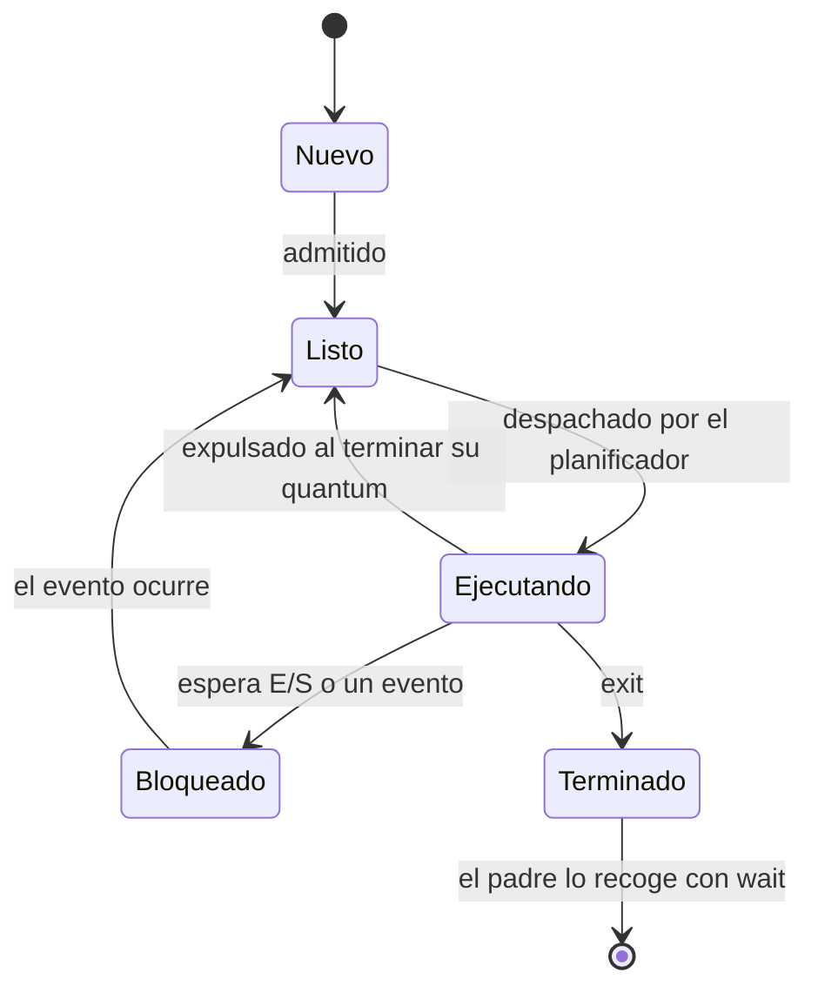
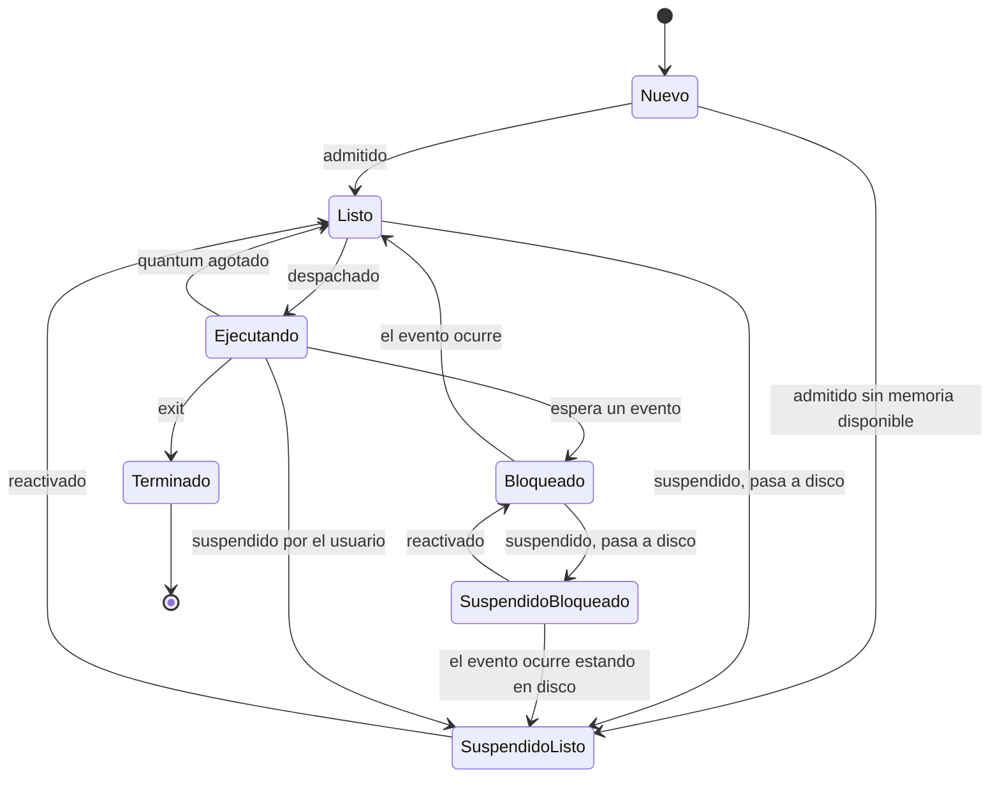

# Sistemas Operativos - Programación

## 2.1 Uso de los servicios de un sistema operativos; API; creación de procesos; estados de los procesos.

---

Un programa no puede leer un archivo, abrir una conexión de red ni crear otro proceso por sí mismo: el hardware solo permite esas operaciones en modo núcleo. Para obtenerlas, debe **pedírselas** al sistema operativo mediante las **llamadas al sistema**. Este tema presenta el mecanismo de las llamadas al sistema, su relación con las API de las bibliotecas, la creación de procesos en UNIX con `fork`, `exec` y `wait`, y el ciclo de vida de un proceso con sus estados, con programas en C compilados y ejecutados.

### Llamadas al sistema

Una llamada al sistema es una transferencia controlada de modo usuario a modo núcleo:

1. el programa coloca el **número** de la llamada y sus argumentos en registros; en Linux para x86-64, el número va en `rax` y los argumentos en `rdi`, `rsi`, `rdx`, `r10`, `r8` y `r9`;
2. ejecuta una instrucción de **trampa**: `syscall` en x86-64, `svc` en ARM, o `int 0x80` en el Linux de 32 bits;
3. el procesador cambia a modo núcleo y salta a un punto de entrada fijo, que usa el número como índice en la **tabla de llamadas al sistema**;
4. el núcleo **valida** los argumentos, porque no puede confiar en el programa: un puntero que apunte a memoria del núcleo debe rechazarse;
5. ejecuta el servicio y regresa a modo usuario con el resultado en `rax`; un valor negativo indica un error, que la biblioteca convierte en $-1$ y guarda en `errno`.

Linux tiene unas 450 llamadas al sistema. Algunas muy frecuentes y que solo leen datos, como `gettimeofday`, se atienden sin cambiar de modo mediante el **vDSO**, una página del núcleo mapeada en cada proceso.

### API y llamadas al sistema

Una **API** es la interfaz que una biblioteca ofrece a los programas; no es lo mismo que una llamada al sistema. La biblioteca de C envuelve cada llamada en una función, `read` o `fork`, y agrega funciones de más alto nivel que pueden usar varias llamadas o ninguna: `printf` da formato en un **buffer** de la biblioteca y solo llama a `write` cuando el buffer se llena, al encontrar un salto de línea si la salida es una terminal, o al terminar el programa; `strlen` no hace ninguna llamada. **POSIX** estandariza la API de los sistemas tipo UNIX, y la **API Win32** la de Windows, cuyas llamadas al sistema reales, de `ntdll.dll`, no están documentadas y cambian entre versiones. Programar contra la API, y no contra las llamadas directas, da portabilidad.

### Creación de procesos: fork, exec y wait

Un **proceso** es un programa en ejecución, con su espacio de direcciones, código, datos, montículo y pila, su estado de CPU y sus recursos, descritos por el núcleo en el **bloque de control del proceso**. En UNIX se crea en dos pasos:

- **`fork()`** duplica al proceso que la llama. Regresa **dos veces**: en el padre devuelve el PID del hijo, y en el hijo devuelve 0; con $-1,$ indica un error. El hijo hereda una copia del espacio de direcciones, que los sistemas modernos comparten con **copia al escribir**: las páginas se duplican solo cuando alguno las modifica. También hereda los descriptores de archivo abiertos y los buffers de la biblioteca de C que no se hayan vaciado.
- **`exec()`**, en sus variantes `execl`, `execvp` y otras, reemplaza el programa del proceso actual por otro, conservando el PID y los descriptores abiertos; no regresa si tiene éxito.
- **`wait()`** y **`waitpid()`** bloquean al padre hasta que un hijo termine y recogen su código de salida.

Separar la creación de la carga permite que el hijo prepare su entorno antes de `exec`, por ejemplo redirigir su salida a un archivo, lo que hace el intérprete de comandos con `>`. Windows lo hace en un solo paso con `CreateProcess`, y POSIX ofrece `posix_spawn`.

```c
pid_t pid = fork();
if (pid < 0) { perror("fork"); exit(1); }
if (pid == 0) {                                   /* hijo */
    execlp("ls", "ls", "-l", (char *)NULL);       /* execlp busca "ls" en el PATH */
    perror("execlp"); _exit(127);                 /* solo se llega aquí si exec falló */
}
int estado; waitpid(pid, &estado, 0);             /* padre */
printf("el hijo terminó con %d\n", WEXITSTATUS(estado));
```

El orden en que el padre y el hijo escriben no está garantizado: depende del planificador.

### Estados de un proceso



- **Nuevo:** el núcleo está creando sus estructuras.
- **Listo:** tiene todo lo que necesita excepto la CPU, y espera en la cola de listos.
- **Ejecutando:** ocupa una CPU; hay a lo más un proceso en este estado por núcleo de procesador.
- **Bloqueado:** espera un evento, como el fin de una E/S o una señal, y no es elegible aunque haya CPU libre.
- **Terminado o zombi:** ya terminó, pero conserva su entrada en la tabla de procesos con su código de salida hasta que el padre llama a `wait`. Si el padre termina antes, el hijo es adoptado por `init` o por un proceso recolector, que lo recoge.

En Linux, el estado aparece en `/proc/PID/stat` y en la columna `STAT` de `ps`: R para ejecutando o listo, S y D para bloqueado, interrumpible o no, T para detenido y Z para zombi.

### Implementación en Python

El programa compila con gcc y ejecuta tres programas en C: el del ejercicio 1, con y sin buffer en la salida; uno que usa `mkdir`, `chmod` y `alarm` para el ejercicio 3, y el padre con dos hijos del ejercicio 4, que lee el estado de cada hijo en `/proc` antes y después de recogerlo. Como los PID cambian en cada ejecución, el programa reporta conteos y no los PID.

```python
import os, re, subprocess, tempfile
from collections import Counter

DIR = tempfile.mkdtemp()
def compila(nombre, fuente):
    c = os.path.join(DIR, nombre + ".c"); b = os.path.join(DIR, nombre)
    open(c, "w").write(fuente); subprocess.run(["gcc", "-O0", "-o", b, c], check=True); return b

# ---------- Ejercicio 1: fork() en un ciclo, y el buffer de printf ----------
EJ1 = r'''
#include <stdio.h>
#include <unistd.h>
int main(int argc, char **argv) {
    if (argc > 1) setvbuf(stdout, NULL, _IONBF, 0);      /* sin buffer: cada printf es un write() inmediato */
    int i;
    for (i = 0; i < 2; i++) {
        fork();
        printf("PID: %d, i: %d\n", getpid(), i);
    }
    return 0;
}'''
b = compila("ej1", EJ1)
for etiqueta, args in (("salida a una tubería, con buffer completo", []), ("sin buffer, como en una terminal", ["x"])):
    out = subprocess.run([b] + args, capture_output=True, text=True).stdout.splitlines()
    pids = Counter(re.search(r"PID: (\d+)", l).group(1) for l in out); por_i = Counter(l.split("i: ")[1] for l in out)
    print(f"ejercicio 1, {etiqueta}: {len(out)} líneas, {len(pids)} PID distintos; líneas por valor de i: {dict(sorted(por_i.items()))}")

# ---------- Ejercicio 3: mkdir, chmod y alarm ----------
EJ3 = r'''
#include <stdio.h>
#include <signal.h>
#include <sys/stat.h>
#include <unistd.h>
static volatile sig_atomic_t llego = 0;
static void manejador(int s) { llego = s; }
int main(void) {
    if (mkdir("datos", 0755) != 0) { perror("mkdir"); return 1; }      /* a) crear un directorio */
    if (chmod("datos", 0750) != 0) { perror("chmod"); return 1; }      /* b) cambiar permisos */
    struct stat st; stat("datos", &st);
    printf("directorio creado, permisos %o\n", st.st_mode & 0777);
    signal(SIGALRM, manejador);
    alarm(1);                                                          /* c) SIGALRM en 1 segundo */
    pause();                                                           /* duerme hasta recibir una señal */
    printf("señal recibida: %d (SIGALRM = %d)\n", (int)llego, SIGALRM);
    return rmdir("datos");
}'''
b = compila("ej3", EJ3)
print("ejercicio 3:", " | ".join(subprocess.run([b], capture_output=True, text=True, cwd=DIR).stdout.splitlines()))

# ---------- Ejercicio 4: el padre espera a sus dos hijos; estados zombi ----------
EJ4 = r'''
#include <stdio.h>
#include <stdlib.h>
#include <string.h>
#include <sys/wait.h>
#include <unistd.h>
static char estado(pid_t p) {                       /* el tercer campo de /proc/PID/stat es el estado */
    char ruta[64], buf[256]; snprintf(ruta, sizeof ruta, "/proc/%d/stat", p);
    FILE *f = fopen(ruta, "r"); if (!f) return '-';
    fgets(buf, sizeof buf, f); fclose(f); return strrchr(buf, ')')[2];
}
int main(void) {
    pid_t hijos[2]; int codigos[2] = {3, 5};
    for (int k = 0; k < 2; k++) {
        hijos[k] = fork();
        if (hijos[k] < 0) { perror("fork"); return 1; }
        if (hijos[k] == 0) { usleep(100000 * (2 - k)); exit(codigos[k]); }   /* el hijo 1 tarda 0.2 s, el hijo 2 0.1 s */
    }
    usleep(50000);
    printf("a los 0.05 s: hijo 1 en estado %c, hijo 2 en estado %c\n", estado(hijos[0]), estado(hijos[1]));
    usleep(100000);
    printf("a los 0.15 s: hijo 1 en estado %c, hijo 2 en estado %c\n", estado(hijos[0]), estado(hijos[1]));
    int recogidos[2] = {0, 0};
    for (int n = 0; n < 2; n++) {                   /* wait() dos veces: un hijo por llamada, en el orden en que terminan */
        int st; pid_t p = wait(&st);
        int k = (p == hijos[0]) ? 0 : 1;
        recogidos[k] = WIFEXITED(st) ? WEXITSTATUS(st) : -1;
        printf("wait número %d recogió al hijo %d, código %d\n", n + 1, k + 1, recogidos[k]);
    }
    printf("tras los dos wait: hijo 1 en estado %c, hijo 2 en estado %c; wait otra vez devuelve %d\n",
           estado(hijos[0]), estado(hijos[1]), (int)wait(NULL));
    return 0;
}'''
b = compila("ej4", EJ4)
for linea in subprocess.run([b], capture_output=True, text=True).stdout.splitlines(): print("ejercicio 4:", linea)
```

Salida:

```text
ejercicio 1, salida a una tubería, con buffer completo: 8 líneas, 4 PID distintos; líneas por valor de i: {'0': 4, '1': 4}
ejercicio 1, sin buffer, como en una terminal: 6 líneas, 4 PID distintos; líneas por valor de i: {'0': 2, '1': 4}
ejercicio 3: directorio creado, permisos 750 | señal recibida: 14 (SIGALRM = 14)
ejercicio 4: a los 0.05 s: hijo 1 en estado S, hijo 2 en estado S
ejercicio 4: a los 0.15 s: hijo 1 en estado S, hijo 2 en estado Z
ejercicio 4: wait número 1 recogió al hijo 2, código 5
ejercicio 4: wait número 2 recogió al hijo 1, código 3
ejercicio 4: tras los dos wait: hijo 1 en estado -, hijo 2 en estado -; wait otra vez devuelve -1
```

### Ejercicios Propuestos

1. **Análisis de código.** ¿Cuál es la salida exacta del siguiente programa? Justifícala paso a paso.

    ```c
    #include <stdio.h>
    #include <unistd.h>
    int main() {
        int i;
        for (i = 0; i < 2; i++) {
            fork();
            printf("PID: %d, i: %d\n", getpid(), i);
        }
        return 0;
    }
    ```

2. **Diagrama de estados.** Extiende el diagrama de estados con los estados **suspendido listo**, un proceso en memoria secundaria listo para ejecutarse, y **suspendido bloqueado**, en memoria secundaria y esperando un evento, con sus transiciones.

3. **Llamadas al sistema.** ¿Qué llamadas al sistema de UNIX se usan para crear un directorio, cambiar los permisos de un archivo y programar una alarma que envíe una señal al proceso después de cierto número de segundos?

4. **Sincronización.** Un proceso padre crea dos hijos y debe esperar a que ambos terminen antes de terminar él mismo. Modifica el ejemplo de `fork` y `wait` para lograrlo.

### Soluciones

**Ejercicio 1.** En la iteración $i = 0,$ el proceso original hace `fork` y quedan 2 procesos, que imprimen cada uno una línea con $i = 0.$ En la iteración $i = 1,$ cada uno hace `fork` y quedan 4, que imprimen cada uno una línea con $i = 1.$ Si cada `printf` se escribe de inmediato, la salida tiene **6 líneas**, 2 con $i = 0$ y 4 con $i = 1,$ de 4 procesos distintos, y su orden no está determinado: depende de cómo el planificador intercale los procesos, de modo que no hay una "salida exacta" única. Pero la salida a una terminal tiene buffer de línea, y a un archivo o una tubería, buffer **completo**: los `printf` se acumulan en un buffer de la biblioteca, y el `fork` de la segunda iteración **copia el buffer** con la línea de $i = 0$ aún sin escribir. Al terminar, cada uno de los 4 procesos vacía su copia, y la salida tiene **8 líneas**, 4 con $i = 0.$ El programa lo confirma: 8 líneas a una tubería y 6 sin buffer. Por eso hay que llamar a `fflush(stdout)` antes de `fork`.

**Ejercicio 2.** La **suspensión** saca a un proceso de la memoria principal, por ejemplo cuando falta memoria o por orden del usuario, y la **reactivación** lo trae de vuelta.



La transición clave es de **suspendido bloqueado** a **suspendido listo**: el evento puede ocurrir mientras el proceso está en disco, y entonces no hace falta traerlo a memoria hasta que vaya a ejecutarse. El sistema prefiere suspender procesos bloqueados, que de todos modos no usarían la CPU, y reactivar procesos suspendidos listos. Es el modelo de siete estados de Stallings.

**Ejercicio 3.** Las llamadas son `mkdir(ruta, modo)` para crear un directorio, `chmod(ruta, modo)`, o `fchmod` con un descriptor, para cambiar los permisos, y `alarm(segundos)`, que envía `SIGALRM` al proceso al vencer, o `setitimer` y `timer_create` para resoluciones menores que un segundo. El programa crea el directorio, cambia sus permisos a 750, los verifica con `stat`, instala un manejador de `SIGALRM`, programa la alarma a 1 s y se suspende con `pause` hasta recibirla. Sin un manejador, la acción predeterminada de `SIGALRM` es terminar el proceso. El modo efectivo de `mkdir` es el pedido menos los bits de la `umask` del proceso.

**Ejercicio 4.** El padre crea los dos hijos en un ciclo, y cada hijo termina con `exit` y un código propio; el padre llama a `wait` dos veces, una por hijo, e identifica a cada uno por el PID que devuelve. `wait` recoge a los hijos en el orden en que **terminan**, no en el que se crearon: en el programa, el hijo 2 tarda 0.1 s y el hijo 1, 0.2 s, y el primer `wait` recoge al hijo 2. Para esperarlos en un orden fijo se usa `waitpid` con cada PID. El programa también muestra los estados: a los 0.05 s ambos hijos duermen, S; a los 0.15 s el hijo 2 ya terminó pero nadie lo ha recogido, y es un **zombi**, Z; después de los dos `wait` ya no existen, y un tercer `wait` devuelve $-1$ con `errno` igual a `ECHILD`, porque no quedan hijos.

El material original llamaba "retorno diferido" a la propiedad de `fork` de regresar dos veces, y su diagrama de estados usaba el pseudoestado `fork` de los diagramas de estados de UML, que representa concurrencia, entre los estados listo y ejecutando. Su salida esperada del ejemplo de `fork` y `exec` suponía que el padre imprime primero, lo que no está garantizado.

### Referencias

1. Kerrisk, M., _The Linux Programming Interface_. No Starch Press, 2010. Capítulos 3, 24 a 28.
2. Silberschatz, A., Galvin, P. B., and Gagne, G., _Operating System Concepts_. 10a ed., Wiley, 2018. Capítulos 2 y 3.
3. Stallings, W., _Operating Systems: Internals and Design Principles_. 9a ed., Pearson, 2018. Capítulo 3.
4. Stevens, W. R., and Rago, S. A., _Advanced Programming in the UNIX Environment_. 3a ed., Addison-Wesley, 2013. Capítulo 8.
5. Baumann, A., Appavoo, J., Krieger, O., and Roscoe, T., A fork() in the road. _HotOS_, 2019.
6. The Open Group, _POSIX.1-2017, IEEE Std 1003.1_.
