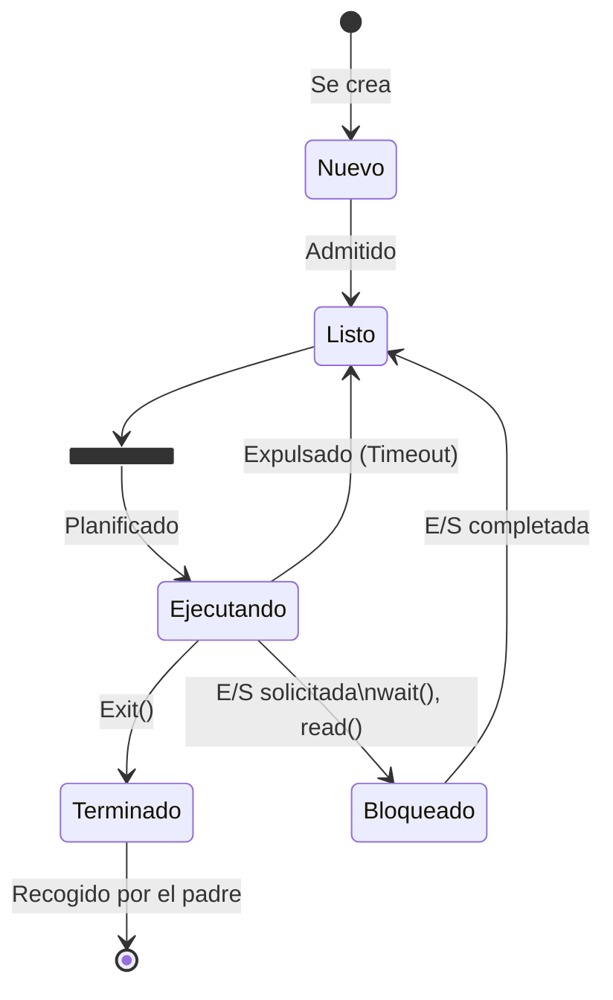

# Sistemas Operativos - Programación

## 2.1 Uso de los servicios de un sistema operativos; API; creación de procesos; estados de los procesos.

---

Un Sistema Operativo (SO) proporciona un conjunto de servicios y abstracciones para que las aplicaciones puedan utilizar el hardware de manera eficiente, controlada y segura. Programar utilizando estos servicios es fundamental para desarrollar software que interactúe directamente con el SO.

### Uso de los Servicios de un Sistema Operativo

Los programas de usuario acceden a los servicios del núcleo (kernel) del SO a través de un conjunto bien definido de interfaces. Dado que el código del kernel se ejecuta en un modo privilegiado (modo kernel) y el código de usuario en un modo restringido (modo usuario), se requiere un mecanismo seguro para realizar esta transición.

#### Llamadas al Sistema (System Calls)

Las **llamadas al sistema** son el punto de entrada principal para que un proceso solicite un servicio al sistema operativo. Constituyen la interfaz entre el proceso y el SO.

**Analogía:** Imagina una biblioteca. Tú (el proceso de usuario) no puedes entrar a la bodega restringida (modo kernel) a buscar un libro. En su lugar, le pides al bibliotecario (llamada al sistema) que lo haga por ti.

**¿Cómo funcionan?**

1. El programa carga los argumentos de la llamada al sistema en registros de la CPU o en la pila.
2. Se ejecuta una instrucción especial de software (e.g., `int 0x80` en x86 Linux, `syscall` en x86_64, `svc` en ARM) que provoca una **trampa** (trap).
3. El hardware cambia a modo kernel y salta a un vector de interrupciones predefinido, que apunta al código del manejador de trampas del SO.
4. El SO verifica los parámetros, ejecuta la operación solicitada en modo kernel.
5. Al finalizar, el SO devuelve el control al proceso de usuario, junto con cualquier código de resultado, y se restaura el modo usuario.

#### API (Interfaz de Programación de Aplicaciones)

Una **API** es un conjunto de funciones, definiciones de estructuras de datos y protocolos que proporciona una biblioteca para ser utilizada por el software. No son sinónimas de las llamadas al sistema, aunque a menudo están relacionadas.

- **Llamadas al Sistema:** Interfaz de bajo nivel entre el proceso y el kernel.
- **API:** Interfaz de más alto nivel, a menudo proporcionada por una biblioteca (como la biblioteca estándar de C, `libc`). Una función de la API _puede_ encapsular una o más llamadas al sistema.

**Ejemplo:** La función `printf()` de la API de C. Internamente, `printf()` formatea la cadena de salida y finalmente realiza una llamada al sistema `write()` para enviar los bytes al descriptor de archivo estándar (stdout).

```c
#include <stdio.h>  // Incluye la API estándar de C

int main() {
    // 'printf' es una función de la API de C.
    // Para escribir en pantalla, eventualmente invocará la llamada al sistema 'write'
    printf("Hola, mundo!\n");
    return 0;
}
```

### Creación de Procesos

Un **proceso** es un programa en ejecución. Incluye el código ejecutable, los datos, la pila, el contador de programa (PC) y otra información de control (Process Control Block - PCB).

#### Mecanismo de Creación: `fork()` y `exec()`

En sistemas Unix-like (Linux, macOS), la creación de un nuevo proceso es un proceso de dos pasos que involucra dos llamadas al sistema principales.

##### 1. `fork()`

La llamada al sistema `fork()` crea un nuevo proceso duplicando el proceso que la llama. El proceso que llama se denomina **proceso padre**, y el nuevo proceso se denomina **proceso hijo**.

**Características clave:**

- **Retorno diferido:** `fork()` retorna **dos veces**: una en el padre y otra en el hijo.
- **En el proceso padre:** `fork()` retorna el **PID (Process ID)** del hijo recién creado.
- **En el proceso hijo:** `fork()` retorna **0**.
- El hijo es un **duplicado** del padre: tiene una copia del espacio de direcciones, descriptores de archivos abiertos, etc. (Copy-On-Write en sistemas modernos).

##### 2. Familia de funciones `exec()`

La familia de funciones `exec()` (e.g., `execl()`, `execvp()`) **carga** y **ejecuta** un nuevo programa en el contexto del proceso actual que la llama. Reemplaza el segmento de texto, datos, pila y montón del proceso actual con los del nuevo programa.

**Características clave:**

- **No retorna** a menos que ocurra un error.
- El **PID del proceso no cambia**.
- Combinar `fork()` y `exec()` es el método estándar para iniciar un programa nuevo.

```c
#include <stdio.h>
#include <unistd.h> // API para llamadas al sistema POSIX (fork, exec, getpid)
#include <sys/wait.h>

int main() {
    pid_t pid; // Tipo de dato para almacenar un PID

    // Crear un nuevo proceso
    pid = fork(); // Llamada al sistema fork()

    if (pid < 0) {
        // Error al hacer fork
        fprintf(stderr, "Fork falló\n");
        return 1;
    } else if (pid == 0) {
        // Código ejecutado solo por el proceso HIJO
        printf("Soy el hijo. Mi PID es %d. El PID de mi padre es %d.\n", getpid(), getppid());
        // Reemplazar la imagen del proceso hijo con el comando 'ls'
        execlp("/bin/ls", "ls", "-l", NULL); // Llamada al sistema exec()
        // Si exec retorna, hubo un error
        perror("execlp");
        return 1;
    } else {
        // Código ejecutado solo por el proceso PADRE
        printf("Soy el padre. Mi PID es %d. El PID de mi hijo es %d.\n", getpid(), pid);
        // Esperar a que el proceso hijo termine
        wait(NULL); // Llamada al sistema wait()
        printf("Mi hijo ha terminado.\n");
    }
    return 0;
}
```

_Salida esperada (los PIDs variarán):_

```
Soy el padre. Mi PID es 1234. El PID de mi hijo es 1235.
Soy el hijo. Mi PID es 1235. El PID de mi padre es 1234.
[La salida del comando 'ls -l' aparecerá aquí]
Mi hijo ha terminado.
```

### Estados de un Proceso

Durante su vida, un proceso pasa por una serie de estados discretos. El conjunto de estados y las transiciones entre ellos se modelan en un **Diagrama de Estados de Procesos**.



#### Descripción de los Estados

1.  **Nuevo (New):** El proceso acaba de ser creado (se llamó a `fork()`), pero aún no ha sido admitido en el grupo de procesos listos para ejecutar. El SO está inicializando sus estructuras de datos (PCB).
2.  **Listo (Ready):** El proceso está cargado en memoria principal y tiene todos los recursos que necesita, **excepto la CPU**. Está esperando a que el planificador (scheduler) lo seleccione para ejecutarse.
3.  **Ejecutando (Running):** Las instrucciones del proceso están siendo ejecutadas por la CPU. Solo un proceso (en un sistema mononucleo) puede estar en este estado por cada núcleo de CPU en un instante dado.
4.  **Bloqueado (Waiting/Blocked):** El proceso no puede ejecutarse porque está esperando que ocurra un evento externo (e.g., que termine una operación de E/S, que llegue una señal, que se libere un recurso). Mientras está en este estado, **no es elegible** para ser planificado, incluso si la CPU está libre.
5.  **Terminado (Exit/Zombie):** El proceso ha finalizado su ejecución (por una llamada a `exit()` o al recibir una señal), pero aún tiene una entrada en la tabla de procesos. Permite que el proceso padre lea su estado de finalización (código de retorno) mediante la llamada al sistema `wait()`. Una vez leído, el proceso desaparece completamente.

### Ejercicios Propuestos

1.  **Análisis de Código:** Dado el siguiente código, ¿cuál sería la salida exacta? Justifica tu respuesta paso a paso.

    ```c
    #include <stdio.h>
    #include <unistd.h>
    int main() {
        int i;
        for (i = 0; i < 2; i++) {
            fork();
            printf("PID: %d, i: %d\n", getpid(), i);
        }
        return 0;
    }
    ```

2.  **Diseño de un Diagrama de Estados:** Extiende el diagrama de estados de procesos presentado para incluir el estado **Suspendido Listo** (proceso en memoria secundaria, listo para ejecutar) y **Suspendido Bloqueado** (proceso en memoria secundaria, esperando un evento). Dibuja las transiciones entre estos nuevos estados y los estados tradicionales.

3.  **Identificación de Llamadas al Sistema:** Investiga y escribe qué llamadas al sistema de Unix/Linux se utilizarían para realizar las siguientes operaciones:
    a) Crear un nuevo directorio.
    b) Cambiar los permisos de un archivo.
    c) Establecer un temporizador (alarma) para que el proceso reciba una señal después de un número determinado de segundos.

4.  **Problema de Sincronización:** Un proceso padre crea dos procesos hijos. El padre debe esperar a que ambos hijos terminen antes de finalizar él mismo. Modifica el ejemplo de código de `fork()`/`wait()` para lograr este comportamiento. (Pista: necesitarás llamar a `wait()` dos veces).

### Referencias

#### Bibliografía Básica

1.  Tanenbaum, A. S., _Modern Operating Systems_, 3rd ed., Prentice Hall, 2007. (Capítulo 2 - Processes and Threads)
2.  Silberschatz, A., Galvin, P. B., Gagne, G., _Operating Systems Concepts_, 8th ed., John Wiley and sons, 2008. (Capítulo 3 - Processes)
3.  Stallings, W., _Operating Systems: Internals and Design Principles_, 7th ed., Prentice Hall, 2011 (Capítulo 3 - Process Description and Control)

#### Bibliografía Complementaria

1.  Bach, M., _The Design of the UNIX Operating System_, Prentice Hall, 1986. (Capítulo 7 - Process Control)
2.  Bovet, D. P., Cesati, M., _Understanding the Linux Kernel_, O'Reilly, 2000. (Capítulo 3 - Processes)

#### Recursos en Línea

- Páginas del manual de Linux (`man 2 fork`, `man 2 exec`, `man 2 wait`). La sección 2 cubre las llamadas al sistema.
- The Linux `syscall` reference: https://filippo.io/linux-syscall-table/
