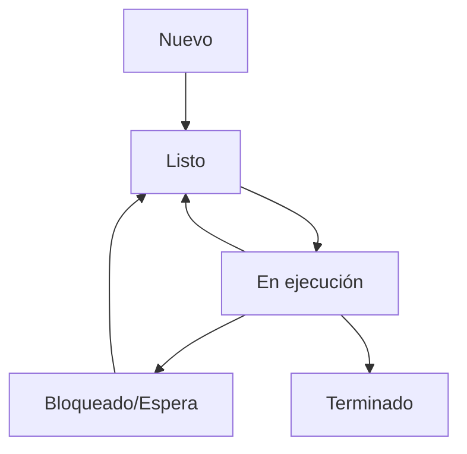
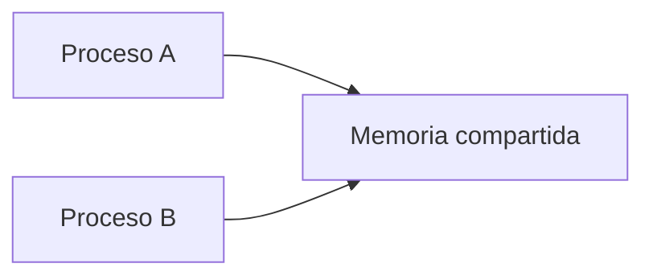

# Sistemas Operativos - Procesos

## 3.1 Ejecución de procesos; procesos concurrentes; comunicación entre procesos; problemas de manejo de procesos; despacho de procesos.

---

Un proceso es un concepto fundamental en los sistemas operativos. Según Silberschatz et al. (2008), un proceso es un programa en ejecución. Esta guía cubre los aspectos esenciales de la ejecución, concurrencia, comunicación y manejo de procesos.

### Definición de Proceso

Un proceso es una instancia de un programa en ejecución que incluye:

- El código del programa (text section)
- El contador de programa (PC) y registros de la CPU
- La pila (stack) y el montículo (heap)
- La sección de datos

### Estados de un Proceso



### Ejecución de Procesos

#### Cambio de Contexto

El cambio de contexto es el mecanismo mediante el cual el sistema operativo guarda el estado de un proceso y carga el estado de otro. El tiempo de cambio de contexto es crítico para el rendimiento del sistema.

$$ T_{cambio contexto} = T_{guardar estado} + T_{cargar estado} $$

#### Creación de Procesos

Los procesos se crean mediante llamadas al sistema como:

- `fork()` en sistemas Unix: crea una copia del proceso actual
- `exec()`: reemplaza el espacio de memoria del proceso
- `CreateProcess()` en Windows

**Ejemplo en C:**

```c
#include <stdio.h>
#include <unistd.h>

int main() {
    pid_t pid = fork();

    if (pid == 0) {
        // Proceso hijo
        printf("Soy el proceso hijo, PID: %d\n", getpid());
    } else {
        // Proceso padre
        printf("Soy el proceso padre, PID: %d, Hijo PID: %d\n", getpid(), pid);
    }

    return 0;
}
```

### Procesos Concurrentes

La concurrencia ocurre cuando múltiples procesos progresan simultáneamente en el tiempo, aunque no necesariamente se ejecuten al mismo instante (en sistemas monoprocesador).

#### Problemas de la Concurrencia

1. **Condición de carrera**: Resultado depende del orden de ejecución
2. **Sección crítica**: Parte de código que accede a recursos compartidos

#### Soluciones a la Sección Crítica

##### Algoritmo de Peterson

```c
#define FALSE 0
#define TRUE 1
#define N 2  // número de procesos

int turno;
int interesado[N];

void entrar_region(int proceso) {
    int otro = 1 - proceso;
    interesado[proceso] = TRUE;
    turno = proceso;
    while (turno == proceso && interesado[otro] == TRUE);
}

void salir_region(int proceso) {
    interesado[proceso] = FALSE;
}
```

##### Semáforos

Propuestos por Dijkstra, los semáforos son variables enteras no negativas que se manipulan con dos operaciones atómicas:

- `wait(S)`: (también llamada P)

  ```pseudocode
  while S <= 0 do no-op;
  S = S - 1;
  ```

- `signal(S)`: (también llamada V)
  ```pseudocode
  S = S + 1;
  ```

**Implementación con espera activa:**

```c
typedef struct {
    int valor;
} semaforo;

void wait(semaforo *S) {
    while (S->valor <= 0);
    S->valor--;
}

void signal(semaforo *S) {
    S->valor++;
}
```

### Comunicación entre Procesos (IPC)

#### Memoria Compartida



**Ejemplo en C:**

```c
#include <stdio.h>
#include <stdlib.h>
#include <unistd.h>
#include <sys/shm.h>
#include <sys/wait.h>

#define SHM_SIZE 1024

int main() {
    int shm_id;
    int *shared_var;

    // Crear segmento de memoria compartida
    shm_id = shmget(IPC_PRIVATE, SHM_SIZE, IPC_CREAT | 0666);

    if (fork() == 0) {
        // Proceso hijo
        shared_var = (int*) shmat(shm_id, NULL, 0);
        *shared_var = 42;
        printf("Hijo: Valor escrito %d\n", *shared_var);
        shmdt(shared_var);
        exit(0);
    } else {
        // Proceso padre
        wait(NULL);
        shared_var = (int*) shmat(shm_id, NULL, 0);
        printf("Padre: Valor leído %d\n", *shared_var);
        shmdt(shared_var);
        shmctl(shm_id, IPC_RMID, NULL);
    }

    return 0;
}
```

#### Paso de Mensajes

##### Con canalización (pipes)

```c
#include <stdio.h>
#include <unistd.h>
#include <string.h>

int main() {
    int fd[2];
    char mensaje[] = "Hola proceso hijo";
    char buffer[100];

    pipe(fd);

    if (fork() == 0) {
        // Proceso hijo: lee del pipe
        close(fd[1]);  // cerrar extremo de escritura
        read(fd[0], buffer, sizeof(buffer));
        printf("Hijo recibió: %s\n", buffer);
        close(fd[0]);
    } else {
        // Proceso padre: escribe en el pipe
        close(fd[0]);  // cerrar extremo de lectura
        write(fd[1], mensaje, strlen(mensaje)+1);
        close(fd[1]);
    }

    return 0;
}
```

### Problemas Clásicos de Manejo de Procesos

#### Problema de los Productores-Consumidores

```c
#define N 100  // tamaño del búfer
typedef int semaphore;

semaphore mutex = 1;     // controla el acceso a la región crítica
semaphore empty = N;     // cuenta espacios vacíos
semaphore full = 0;      // cuenta espacios llenos

void productor() {
    int item;
    while (TRUE) {
        item = producir_item();
        wait(empty);
        wait(mutex);
        insertar_item(item);
        signal(mutex);
        signal(full);
    }
}

void consumidor() {
    int item;
    while (TRUE) {
        wait(full);
        wait(mutex);
        item = quitar_item();
        signal(mutex);
        signal(empty);
        consumir_item(item);
    }
}
```

#### Problema de los Filósofos

Solución con semáforos:

```c
#define N 5  // número de filósofos
#define IZQUIERDA (i + N - 1) % N
#define DERECHA (i + 1) % N

#define PENSANDO 0
#define HAMBRIENTO 1
#define COMIENDO 2

int estado[N];
semaphore s[N];
semaphore mutex = 1;

void filosofo(int i) {
    while (TRUE) {
        pensar();
        tomar_tenedores(i);
        comer();
        soltar_tenedores(i);
    }
}

void tomar_tenedores(int i) {
    wait(mutex);
    estado[i] = HAMBRIENTO;
    probar(i);
    signal(mutex);
    wait(s[i]);
}

void soltar_tenedores(int i) {
    wait(mutex);
    estado[i] = PENSANDO;
    probar(IZQUIERDA);
    probar(DERECHA);
    signal(mutex);
}

void probar(int i) {
    if (estado[i] == HAMBRIENTO &&
        estado[IZQUIERDA] != COMIENDO &&
        estado[DERECHA] != COMIENDO) {
        estado[i] = COMIENDO;
        signal(s[i]);
    }
}
```

### Despacho de Procesos

#### Planificación de CPU

El despachador (dispatcher) es el módulo que da control de la CPU al proceso seleccionado por el planificador a corto plazo.

$$ T_{despacho} = T_{cambio contexto} + T_{cambio usuario} + T_{inicio usuario} $$

#### Algoritmos de Planificación

##### First-Come, First-Served (FCFS)

Ejemplo con tiempos de llegada 0 y ráfagas: P1=24, P2=3, P3=3

| Proceso | Ráfaga | Tiempo Espera | Tiempo Retorno |
| ------- | ------ | ------------- | -------------- |
| P1      | 24     | 0             | 24             |
| P2      | 3      | 24            | 27             |
| P3      | 3      | 27            | 30             |

Tiempo de espera promedio: $(0 + 24 + 27)/3 = 17$
Tiempo de retorno promedio: $(24 + 27 + 30)/3 = 27$

##### Shortest-Job-First (SJF)

Ejemplo con mismos procesos pero ordenados: P2=3, P3=3, P1=24

| Proceso | Ráfaga | Tiempo Espera | Tiempo Retorno |
| ------- | ------ | ------------- | -------------- |
| P2      | 3      | 0             | 3              |
| P3      | 3      | 3             | 6              |
| P1      | 24     | 6             | 30             |

Tiempo de espera promedio: $(0 + 3 + 6)/3 = 3$
Tiempo de retorno promedio: $(3 + 6 + 30)/3 = 13$

##### Round Robin (RR)

Con quantum = 4 y procesos: P1=24, P2=3, P3=3

| Tiempo | Proceso | Ráfaga restante |
| ------ | ------- | --------------- |
| 0-4    | P1      | 20              |
| 4-7    | P2      | 0 (termina)     |
| 7-10   | P3      | 0 (termina)     |
| 10-30  | P1      | 0 (termina)     |

Tiempo de espera: P1=6, P2=4, P3=7 → Promedio: 5.67
Tiempo de retorno: P1=30, P2=7, P3=10 → Promedio: 15.67

### Ejercicios Propuestos

1. **Ejercicio de creación de procesos**: Escribe un programa que cree 3 procesos hijos. Cada hijo debe imprimir su PID y el PID de su padre, luego terminar. El padre debe esperar a que todos los hijos terminen.

2. **Ejercicio de comunicación**: Implementa el problema productor-consumidor usando memoria compartida y semáforos. El productor genera números del 1 al 100, el consumidor los imprime.

3. **Ejercicio de planificación**: Dados los siguientes procesos con sus tiempos de llegada y ráfagas:
   - P1: llegada=0, ráfaga=8
   - P2: llegada=1, ráfaga=4
   - P3: llegada=2, ráfaga=9
   - P4: llegada=3, ráfaga=5

   Calcula los tiempos de espera y retorno para:
   a) FCFS
   b) SJF (no expropiativo)
   c) Round Robin con quantum=4

4. **Ejercicio de sincronización**: Implementa una solución al problema de los lectores-escritores que priorice a los escritores. Usa semáforos para sincronización.

### Referencias

#### Bibliografía Básica

1. Tanenbaum, A. S. (2007). Modern Operating Systems (3rd ed.). Prentice Hall.
2. Silberschatz, A., Galvin, P. B., & Gagne, G. (2008). Operating Systems Concepts (8th ed.). John Wiley and Sons.
3. Tanenbaum, A. S., & Woodhull, A. S. (2006). Operating Systems: Design and Implementation (3rd ed.). Prentice Hall.
4. Bic, L., & Shaw, A. (2003). Operating Systems Principles. Pearson Education.
5. Stallings, W. (2011). Operating Systems: Internals and Design Principles (7th ed.). Prentice Hall.

#### Bibliografía Complementaria

1. Bach, M. (1986). The Design of the UNIX Operating System. Prentice Hall.
2. Bovet, D. P., & Cesati, M. (2000). Understanding the Linux Kernel. O'Reilly.
3. Silberschatz, A., Galvin, P. B., & Gagne, G. (2009). Operating System Concepts with Java (8th ed.). John Wiley and Sons.

### Conclusión

La gestión de procesos es fundamental en los sistemas operativos. Comprender la ejecución, concurrencia, comunicación y planificación de procesos permite diseñar sistemas eficientes y resolver problemas de sincronización críticos. Los conceptos presentados forman la base para el estudio avanzado de sistemas operativos.
