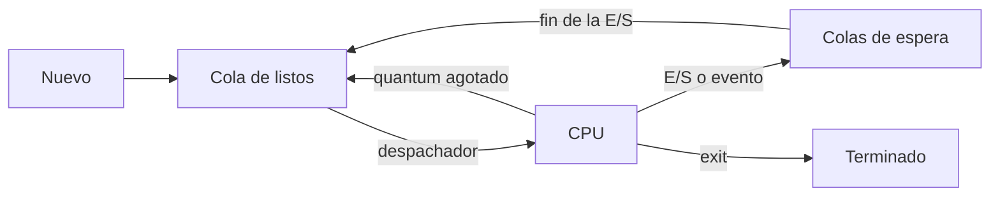

# Sistemas Operativos - Procesos

## 3.1 Ejecución de procesos; procesos concurrentes; comunicación entre procesos; problemas de manejo de procesos; despacho de procesos.

---

El proceso es la abstracción central de un sistema operativo: un programa en ejecución con su propio espacio de direcciones, su estado de CPU y sus recursos. Sobre una sola CPU, el sistema da la ilusión de que muchos procesos avanzan a la vez alternándolos rápidamente; sobre varias, los ejecuta en paralelo de verdad. En ambos casos, los procesos que cooperan necesitan **comunicarse** y **sincronizarse**, y hacerlo mal produce errores que dependen del azar de la planificación y son muy difíciles de reproducir. Este tema presenta la ejecución de procesos y el cambio de contexto, la concurrencia y la sección crítica, los mecanismos de comunicación, los problemas clásicos de sincronización y el despacho con los algoritmos básicos de planificación.

### Ejecución de procesos y cambio de contexto

El núcleo describe cada proceso con su **bloque de control** (PCB): identificador, estado, registros guardados, información de memoria, archivos abiertos, prioridad y estadísticas. Los procesos listos esperan en la **cola de listos**, y los bloqueados en colas de dispositivos o eventos. Cuando el núcleo quita la CPU a un proceso, por una interrupción del temporizador, una llamada al sistema que bloquea o una interrupción de E/S, hace un **cambio de contexto**: guarda los registros del proceso en su PCB, elige otro con el planificador, carga sus registros y su espacio de direcciones, y regresa a modo usuario. El cambio de contexto es tiempo perdido para el trabajo útil: unos pocos microsegundos directos, más el costo indirecto de enfriar las cachés y el TLB. Un **hilo** es una unidad de ejecución dentro de un proceso, que comparte su memoria y archivos pero tiene sus propios registros y pila; cambiar entre hilos del mismo proceso es más barato porque no cambia el espacio de direcciones.

### Concurrencia y sección crítica

Cuando dos procesos o hilos comparten datos, el resultado puede depender del intercalado: es una **condición de carrera**. La parte del código que accede a los datos compartidos es la **sección crítica**, y una solución debe garantizar exclusión mutua, progreso y espera acotada (tema 1.3).

El **algoritmo de Peterson** (1981) resuelve el problema para dos procesos solo con variables compartidas: cada proceso marca su interés y cede el turno, y espera solo si el otro está interesado y el turno es suyo.

```c
volatile int interesado[2], turno;
void entrar(int yo) {
    int otro = 1 - yo;
    interesado[yo] = 1; turno = yo;
    __sync_synchronize();                      /* barrera de memoria: sin ella falla en procesadores modernos */
    while (turno == yo && interesado[otro]) ;  /* espera activa */
}
void salir(int yo) { interesado[yo] = 0; }
```

Es correcto en el modelo de memoria secuencialmente consistente que supone, pero los procesadores y compiladores actuales **reordenan** las escrituras y lecturas, y sin la barrera de memoria dos hilos pueden entrar a la vez. Por eso, en la práctica, la exclusión mutua se implementa con instrucciones atómicas del hardware, *test-and-set* o *compare-and-swap*, y con las primitivas del sistema.

Un **semáforo** de Dijkstra es un contador con dos operaciones **atómicas**: `wait` o P lo decrementa, y si queda negativo **bloquea** al proceso en la cola del semáforo; `signal` o V lo incrementa y, si hay procesos bloqueados, despierta a uno. La versión con espera activa, `while (S <= 0); S--`, no es correcta si no es atómica: dos procesos pueden ver $S = 1$ y decrementarlo ambos, y además desperdicia CPU. La implementación real deshabilita las interrupciones en un monoprocesador, o usa un cerrojo de giro con una instrucción atómica en un multiprocesador, solo durante las pocas instrucciones de la operación.

### Comunicación entre procesos

- **Memoria compartida:** una región mapeada en los espacios de direcciones de varios procesos, con `shmget` y `shmat` de System V, o `shm_open` y `mmap` de POSIX. Es la forma más rápida, porque después de crearla no hay intervención del núcleo, pero la sincronización es responsabilidad de los procesos, con semáforos en la propia región.
- **Paso de mensajes:** el núcleo transfiere los datos. Las **tuberías** de `pipe` son un canal de bytes unidireccional entre procesos emparentados, y las **FIFO** con nombre, entre cualesquiera; las **colas de mensajes** conservan los límites de cada mensaje; los **sockets** comunican procesos en la misma máquina o en la red. El envío y la recepción pueden ser bloqueantes, sincrónicos, o no bloqueantes.
- **Señales:** notificaciones asíncronas sin datos, como `SIGTERM` o `SIGCHLD`.

Una tubería cerrada en un extremo comunica el fin de los datos: `read` devuelve 0 cuando todos los descriptores de escritura están cerrados, por eso cada proceso debe cerrar el extremo que no usa.

### Problemas clásicos

- **Productor-consumidor con buffer limitado:** con los semáforos `vacios`, `llenos` y `mutex` del tema 1.3; el orden de los `wait` importa, porque tomar el `mutex` antes de esperar un lugar libre puede causar un interbloqueo.
- **Cena de los filósofos** (Dijkstra, 1965): cinco filósofos alrededor de una mesa con un tenedor entre cada dos; si todos toman el izquierdo a la vez, se interbloquean. La solución de Tanenbaum, con un estado por filósofo y un semáforo por filósofo, solo permite comer si ningún vecino come; otras soluciones son que un filósofo tome los tenedores en orden inverso, o limitar a cuatro los que se sientan.
- **Lectores y escritores** (Courtois, Heymans y Parnas, 1971): varios lectores pueden acceder a la vez, pero un escritor necesita acceso exclusivo. La primera solución da prioridad a los lectores, y un flujo continuo de lectores puede dejar sin escribir a los escritores; la segunda da prioridad a los escritores, con el riesgo inverso.

### Despacho y planificación

El **planificador** de corto plazo elige el siguiente proceso de la cola de listos, y el **despachador** le da la CPU: cambia el contexto, pasa a modo usuario y salta a la instrucción donde el proceso se quedó. El tiempo que tarda es la **latencia de despacho**. Los criterios de planificación son el uso de la CPU, el rendimiento, el **tiempo de retorno**, desde la llegada hasta el fin; el **tiempo de espera** en la cola de listos, y el **tiempo de respuesta**, hasta la primera ejecución.

- **FCFS:** en orden de llegada, sin expropiación. Simple, pero un proceso largo al frente retrasa a todos, el **efecto convoy**.
- **SJF:** el de ráfaga más corta primero. Minimiza el tiempo de espera promedio: si en un orden un trabajo largo precede a uno corto, intercambiarlos reduce la espera del corto más de lo que aumenta la del largo. Requiere conocer las ráfagas, que se estiman con un promedio exponencial de las anteriores. Su versión expropiativa es SRTF.
- **Round Robin:** FCFS con un **quantum**; al agotarlo, el proceso vuelve al final de la cola. Da buen tiempo de respuesta; con un quantum muy grande se vuelve FCFS, y con uno muy pequeño el costo de los cambios de contexto domina.

En el ejemplo clásico con ráfagas de 24, 3 y 3 que llegan en 0, FCFS da una espera promedio de 17, SJF de 3 y Round Robin con quantum 4 de 5.67.



### Implementación en Python

El programa compila y ejecuta dos programas en C, el de los tres hijos del ejercicio 1 y un productor-consumidor entre dos **procesos** con memoria compartida de `mmap` y semáforos POSIX compartidos para el ejercicio 2, y verifica sus resultados con propiedades que no dependen del orden de ejecución. Calcula las tres planificaciones del ejercicio 3 y, para el ejercicio 4, implementa los lectores y escritores con prioridad a los escritores con hilos de Python, con una prueba de carga y un guion que muestra la prioridad.

```python
import os, re, subprocess, tempfile, threading, time
from collections import deque

DIR = tempfile.mkdtemp()
def compila_y_corre(nombre, fuente):
    c, b = os.path.join(DIR, nombre + ".c"), os.path.join(DIR, nombre)
    open(c, "w").write(fuente); subprocess.run(["gcc", "-O2", "-pthread", "-o", b, c], check=True)
    return subprocess.run([b], capture_output=True, text=True).stdout.splitlines()

# ---------- Ejercicio 1: tres hijos ----------
EJ1 = r'''
#include <stdio.h>
#include <stdlib.h>
#include <sys/wait.h>
#include <unistd.h>
int main(void) {
    printf("padre %d\n", (int)getpid()); fflush(stdout);           /* vaciar el buffer antes de fork */
    for (int k = 0; k < 3; k++) {
        pid_t p = fork();
        if (p < 0) { perror("fork"); exit(1); }
        if (p == 0) { printf("hijo %d: PID %d, padre %d\n", k + 1, (int)getpid(), (int)getppid()); exit(0); }
    }
    int n = 0; while (wait(NULL) > 0) n++;                          /* espera a todos */
    printf("el padre recogió %d hijos\n", n);
    return 0;
}'''
out = compila_y_corre("ej1", EJ1); padre = out[0].split()[1]
hijos = sorted(l for l in out if l.startswith("hijo"))
print(f"ejercicio 1: {len(hijos)} hijos; todos reportan como padre al proceso original: {all(l.endswith('padre ' + padre) for l in hijos)}; "
      f"PID distintos: {len({l.split()[3] for l in hijos})}; última línea: {out[-1]!r}")

# ---------- Ejercicio 2: productor-consumidor entre procesos con memoria compartida y semáforos POSIX ----------
EJ2 = r'''
#include <semaphore.h>
#include <stdio.h>
#include <stdlib.h>
#include <sys/mman.h>
#include <sys/wait.h>
#include <unistd.h>
#define N 8
struct compartido { int buf[N]; int entra, sale; sem_t vacios, llenos, mutex; };
int main(void) {
    struct compartido *c = mmap(NULL, sizeof *c, PROT_READ | PROT_WRITE, MAP_SHARED | MAP_ANONYMOUS, -1, 0);
    c->entra = c->sale = 0;
    sem_init(&c->vacios, 1, N); sem_init(&c->llenos, 1, 0); sem_init(&c->mutex, 1, 1);   /* 1: compartidos entre procesos */
    if (fork() == 0) {                                   /* productor */
        for (int x = 1; x <= 100; x++) {
            sem_wait(&c->vacios); sem_wait(&c->mutex);
            c->buf[c->entra] = x; c->entra = (c->entra + 1) % N;
            sem_post(&c->mutex); sem_post(&c->llenos);
        }
        exit(0);
    }
    long suma = 0; int previo = 0, en_orden = 1;        /* consumidor, en el padre */
    for (int k = 0; k < 100; k++) {
        sem_wait(&c->llenos); sem_wait(&c->mutex);
        int x = c->buf[c->sale]; c->sale = (c->sale + 1) % N;
        sem_post(&c->mutex); sem_post(&c->vacios);
        if (k < 5 || k >= 97) printf("%d ", x);
        if (k == 5) printf("... ");
        en_orden &= (x == previo + 1); previo = x; suma += x;
    }
    wait(NULL);
    printf("\nconsumidos 100, suma %ld, en orden %d\n", suma, en_orden);
    return 0;
}'''
print("ejercicio 2:", " | ".join(compila_y_corre("ej2", EJ2)))

# ---------- Ejercicio 3: FCFS, SJF no expropiativo y Round Robin ----------
PROC = [("P1", 0, 8), ("P2", 1, 4), ("P3", 2, 9), ("P4", 3, 5)]
def no_expropiativo(procs, clave):
    t, pend, gantt, fin = 0, sorted(procs, key=lambda p: p[1]), [], {}
    while pend:
        listos = [p for p in pend if p[1] <= t] or [min(pend, key=lambda p: p[1])]
        n, l, d = min(listos, key=clave); pend.remove((n, l, d)); t = max(t, l)
        gantt.append((n, t, t + d)); t += d; fin[n] = t
    return fin, gantt
def rr(procs, q):
    t, cola, resto, fin, gantt, i = 0, deque(), {n: d for n, _, d in procs}, {}, [], 0
    procs = sorted(procs, key=lambda p: p[1])
    while len(fin) < len(procs):
        while i < len(procs) and procs[i][1] <= t: cola.append(procs[i][0]); i += 1
        if not cola: t = procs[i][1]; continue
        n = cola.popleft(); usa = min(q, resto[n]); gantt.append((n, t, t + usa)); t += usa; resto[n] -= usa
        while i < len(procs) and procs[i][1] <= t: cola.append(procs[i][0]); i += 1
        if resto[n]: cola.append(n)
        else: fin[n] = t
    return fin, gantt
for nombre, (fin, gantt) in (("FCFS", no_expropiativo(PROC, lambda p: p[1])), ("SJF", no_expropiativo(PROC, lambda p: (p[2], p[1]))), ("RR q=4", rr(PROC, 4))):
    ret = {n: fin[n] - l for n, l, _ in PROC}; esp = {n: ret[n] - d for n, _, d in PROC}
    print(f"ejercicio 3: {nombre:6}: " + " ".join(f"[{n} {a}-{b}]" for n, a, b in gantt) +
          f" | espera {list(esp.values())} promedio {sum(esp.values()) / 4:.2f} | retorno {list(ret.values())} promedio {sum(ret.values()) / 4:.2f}")

# ---------- Ejercicio 4: lectores y escritores con prioridad a los escritores ----------
class LectoresEscritores:                                # segunda solución de Courtois, Heymans y Parnas (1971)
    def __init__(self):
        self.mutex_l, self.mutex_e, self.mutex_3 = threading.Semaphore(1), threading.Semaphore(1), threading.Semaphore(1)
        self.intento, self.recurso = threading.Semaphore(1), threading.Semaphore(1)
        self.lectores = self.escritores = 0
    def entra_lector(self):
        self.mutex_3.acquire(); self.intento.acquire(); self.mutex_l.acquire()      # un escritor en espera cierra "intento"
        self.lectores += 1
        if self.lectores == 1: self.recurso.acquire()
        self.mutex_l.release(); self.intento.release(); self.mutex_3.release()
    def sale_lector(self):
        self.mutex_l.acquire(); self.lectores -= 1
        if self.lectores == 0: self.recurso.release()
        self.mutex_l.release()
    def entra_escritor(self):
        self.mutex_e.acquire(); self.escritores += 1
        if self.escritores == 1: self.intento.acquire()                              # el primer escritor bloquea a los lectores nuevos
        self.mutex_e.release(); self.recurso.acquire()
    def sale_escritor(self):
        self.recurso.release(); self.mutex_e.acquire(); self.escritores -= 1
        if self.escritores == 0: self.intento.release()
        self.mutex_e.release()
le = LectoresEscritores(); registro = threading.Lock(); dentro = {"L": 0, "E": 0}; violaciones = [0]
def lector(n):
    for _ in range(n):
        le.entra_lector()
        with registro:
            dentro["L"] += 1; violaciones[0] += dentro["E"] > 0
        time.sleep(0.0005)
        with registro: dentro["L"] -= 1
        le.sale_lector()
def escritor(n):
    for _ in range(n):
        le.entra_escritor()
        with registro:
            dentro["E"] += 1; violaciones[0] += dentro["E"] > 1 or dentro["L"] > 0
        time.sleep(0.001)
        with registro: dentro["E"] -= 1
        le.sale_escritor()
hilos = [threading.Thread(target=lector, args=(60,)) for _ in range(6)] + [threading.Thread(target=escritor, args=(20,)) for _ in range(2)]
for h in hilos: h.start()
for h in hilos: h.join()
print(f"ejercicio 4: 6 lectores × 60 lecturas y 2 escritores × 20 escrituras: violaciones de la exclusión {violaciones[0]}; "
      f"al final no queda nadie dentro: {dentro == {'L': 0, 'E': 0}}")
orden = []; le2 = LectoresEscritores()
def actor(nombre, tipo, espera, dura):
    time.sleep(espera)
    (le2.entra_lector if tipo == "L" else le2.entra_escritor)(); orden.append(f"entra {nombre}")
    time.sleep(dura); orden.append(f"sale {nombre}")
    (le2.sale_lector if tipo == "L" else le2.sale_escritor)()
guion = [("L1", "L", 0.00, 0.20), ("E1", "E", 0.05, 0.10), ("L2", "L", 0.10, 0.05)]   # L2 llega mientras E1 espera a que L1 salga
hs = [threading.Thread(target=actor, args=a) for a in guion]
for h in hs: h.start()
for h in hs: h.join()
print("   L1 lee; llega E1 y espera; llega L2:", " → ".join(orden), "(L2 no se adelanta al escritor)")
```

Salida:

```text
ejercicio 1: 3 hijos; todos reportan como padre al proceso original: True; PID distintos: 3; última línea: 'el padre recogió 3 hijos'
ejercicio 2: 1 2 3 4 5 ... 98 99 100  | consumidos 100, suma 5050, en orden 1
ejercicio 3: FCFS  : [P1 0-8] [P2 8-12] [P3 12-21] [P4 21-26] | espera [0, 7, 10, 18] promedio 8.75 | retorno [8, 11, 19, 23] promedio 15.25
ejercicio 3: SJF   : [P1 0-8] [P2 8-12] [P4 12-17] [P3 17-26] | espera [0, 7, 15, 9] promedio 7.75 | retorno [8, 11, 24, 14] promedio 14.25
ejercicio 3: RR q=4: [P1 0-4] [P2 4-8] [P3 8-12] [P4 12-16] [P1 16-20] [P3 20-24] [P4 24-25] [P3 25-26] | espera [12, 3, 15, 17] promedio 11.75 | retorno [20, 7, 24, 22] promedio 18.25
ejercicio 4: 6 lectores × 60 lecturas y 2 escritores × 20 escrituras: violaciones de la exclusión 0; al final no queda nadie dentro: True
   L1 lee; llega E1 y espera; llega L2: entra L1 → sale L1 → entra E1 → sale E1 → entra L2 → sale L2 (L2 no se adelanta al escritor)
```

### Ejercicios Propuestos

1. **Creación de procesos.** Escribe un programa que cree 3 procesos hijos; cada hijo imprime su PID y el de su padre y termina, y el padre espera a que todos terminen.

2. **Comunicación.** Implementa el productor-consumidor con memoria compartida y semáforos: el productor genera los números del 1 al 100 y el consumidor los imprime.

3. **Planificación.** Para P1, que llega en 0 con ráfaga 8; P2, en 1 con ráfaga 4; P3, en 2 con ráfaga 9, y P4, en 3 con ráfaga 5, calcula los tiempos de espera y de retorno con FCFS, SJF no expropiativo y Round Robin con quantum 4.

4. **Sincronización.** Implementa con semáforos una solución al problema de los lectores y escritores que dé prioridad a los escritores.

### Soluciones

**Ejercicio 1.** El padre hace `fflush(stdout)` antes de crear a los hijos, para que su buffer no se duplique (tema 2.1), y crea los 3 en un ciclo; cada hijo imprime con `getpid` y `getppid` y termina con `exit`, para no continuar el ciclo y crear nietos, el error más común en este ejercicio. El padre llama a `wait` hasta que devuelve $-1,$ es decir, hasta que no quedan hijos. El programa verifica que hay 3 hijos con PID distintos y que todos reportan como padre al proceso original. El orden de las líneas de los hijos varía entre ejecuciones.

**Ejercicio 2.** La estructura compartida, creada con `mmap` con `MAP_SHARED | MAP_ANONYMOUS` antes de `fork`, contiene el buffer circular de 8 lugares, los índices de entrada y salida, y los tres semáforos, inicializados con `sem_init` con el segundo argumento en 1 para que funcionen entre procesos. El productor, el hijo, genera los números del 1 al 100 con `wait(vacios)`, `wait(mutex)`, insertar, `post(mutex)`, `post(llenos)`; el consumidor, el padre, hace lo simétrico. El consumidor recibe los 100 números en orden, con suma 5 050: el buffer circular con un solo productor y un solo consumidor conserva el orden. Con System V, la región se crea con `shmget` y `shmat`, como en el ejemplo del material original, y los semáforos con `semget`.

**Ejercicio 3.** Los resultados del programa:

| Algoritmo | Orden de ejecución | Espera P1, P2, P3, P4 | Espera promedio | Retorno promedio |
| --------- | ------------------ | --------------------- | --------------- | ---------------- |
| FCFS | P1 0-8, P2 8-12, P3 12-21, P4 21-26 | 0, 7, 10, 18 | 8.75 | 15.25 |
| SJF | P1 0-8, P2 8-12, P4 12-17, P3 17-26 | 0, 7, 15, 9 | 7.75 | 14.25 |
| RR, q = 4 | P1, P2, P3, P4, P1, P3, P4, P3 | 12, 3, 15, 17 | 11.75 | 18.25 |

En SJF, en el instante 0 solo ha llegado P1, que se ejecuta completo por no ser expropiativo; en 8 elige la ráfaga más corta entre las que esperan, P2 con 4, después P4 con 5 y al final P3 con 9. Es el mejor promedio de espera de los tres, como garantiza su optimalidad entre los no expropiativos. Round Robin es el peor en promedio, porque los procesos son largos en relación con el quantum, pero tiene el mejor tiempo de respuesta: todos empiezan a más tardar en el instante 12.

**Ejercicio 4.** La solución usa cinco semáforos: `recurso`, que tienen el escritor o el grupo de lectores; `intento`, que el primer escritor que llega cierra para que **ningún lector nuevo** pueda empezar; `mutex_l` y `mutex_e`, que protegen los contadores de lectores y escritores, y `mutex_3`, que hace que los lectores esperen de uno en uno en `intento`, para que un escritor no tenga que competir con una fila de lectores. El último escritor en salir reabre `intento`. En la prueba de carga, con 6 lectores y 2 escritores, no hay ninguna violación: nunca hay un escritor junto con otro o con lectores. El guion muestra la prioridad: L1 está leyendo, llega E1 y espera, y L2, que llega después, no entra aunque solo haya lectores dentro: entra E1 en cuanto sale L1, y L2 después. Con flujos continuos de escritores, esta solución puede dejar sin leer a los lectores; la solución justa usa una cola común en orden de llegada.

El material original definía los semáforos como enteros no negativos con una implementación de espera activa, `while (S->valor <= 0); S->valor--;`, que no es atómica y permite que dos procesos pasen a la vez; y daba el algoritmo de Peterson en C sin barreras de memoria, que en los procesadores actuales no garantiza la exclusión mutua. Su ecuación del tiempo de despacho sumaba términos sin definir.

### Referencias

1. Silberschatz, A., Galvin, P. B., and Gagne, G., _Operating System Concepts_. 10a ed., Wiley, 2018. Capítulos 3 a 7.
2. Tanenbaum, A. S., and Bos, H., _Modern Operating Systems_. 5a ed., Pearson, 2023. Capítulo 2.
3. Courtois, P. J., Heymans, F., and Parnas, D. L., Concurrent control with readers and writers. _Communications of the ACM_ 14(10), 1971.
4. Peterson, G. L., Myths about the mutual exclusion problem. _Information Processing Letters_ 12(3), 1981.
5. Dijkstra, E. W., Hierarchical ordering of sequential processes. _Acta Informatica_ 1, 1971.
6. Downey, A. B., _The Little Book of Semaphores_. Green Tea Press, 2016.
7. Kerrisk, M., _The Linux Programming Interface_. No Starch Press, 2010. Capítulos 44 a 54.
