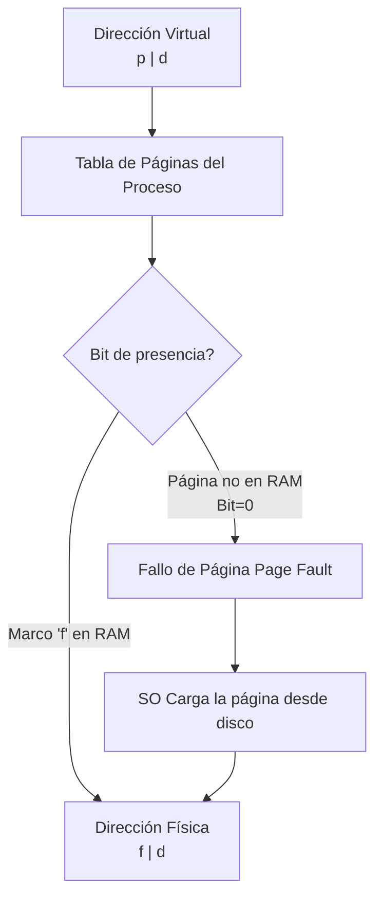

# Sistemas Operativos - Manejo de memoria

## 4.1 Utilización de la memoria; intercambio de bloques de memoria; memoria virtual; paginación y segmentación.

---

La gestión de la memoria es uno de los servicios más críticos que proporciona un Sistema Operativo (SO). Su objetivo principal es administrar de manera eficiente la memoria principal (RAM), un recurso volátil, escaso y compartido entre múltiples procesos. Una gestión eficaz impacta directamente en el rendimiento del sistema, la protección entre procesos y la facilidad de programación.

### Utilización de la Memoria

Se refiere a cómo el SO organiza y lleva un registro de las porciones de memoria que están libres y las que están ocupadas. El objetivo es maximizar la utilización de la memoria física disponible y minimizar el tiempo de respuesta.

#### Funciones Principales:

1.  **Registro:** Llevar un registro de las partes de memoria que están en uso y las que no.
2.  **Asignación:** Asignar espacio de memoria a los procesos cuando lo solicitan.
3.  **Liberación:** Liberar espacio de memoria cuando un proceso termina o la devuelve explícitamente.

#### Estructuras de Datos Comunes:

- **Mapas de bits:** La memoria se divide en unidades de asignación. Un mapa de bits es un vector donde cada bit representa el estado (libre/ocupado) de una unidad.
- **Listas enlazadas:** Una lista enlazada donde cada nodo representa una región de memoria (hueco o proceso), indicando su dirección base, tamaño y estado.

### Intercambio de Bloques de Memoria (Swapping)

Es una técnica donde un proceso puede ser sacado temporalmente de la memoria principal (swapped-out) y guardado en un almacenamiento secundario (disco, área de intercambio o "swap space"), para luego ser reintroducido en memoria (swapped-in) y continuar su ejecución.

**Objetivo:** Permitir la multiprogramación y la ejecución de procesos cuyo tamaño total excede la memoria física disponible.

**Problema:** El intercambio es costoso en términos de tiempo, debido a la alta latencia del disco. El tiempo de transferencia es directamente proporcional a la cantidad de memoria intercambiada.

**Fórmula de Tiempo de Transferencia:**
Si la tasa de transferencia del disco es $T$ MB/s y se intercambian $S$ MB, el tiempo de transferencia es:

$$Tiempo_{transferencia} = \frac{S}{T}$$

Este tiempo suele dominar el tiempo total de intercambio.

### Memoria Virtual

Es una técnica que abstrae la memoria principal, permitiendo a los programadores y procesos ver una memoria lógica (virtual) mucho más grande que la memoria física real. Separa las direcciones de memoria utilizadas por un proceso (direcciones virtuales) de las direcciones reales de la RAM (direcciones físicas).

**Ventajas:**

- Libera a los programas de la preocupación de gestionar la memoria física compartida.
- Permite que los procesos sean más grandes que la memoria física.
- Proporciona protección, ya que un proceso no puede acceder a la memoria virtual de otro.

**Implementación:** Se logra mediante técnicas de **paginación** y **segmentación**, a menudo combinadas.

### Paginación

La memoria física se divide en marcos de página de tamaño fijo. La memoria lógica (de un proceso) se divide en páginas del mismo tamaño. El SO mantiene una **Tabla de Páginas (TP)** por cada proceso, que traduce direcciones virtuales (página) a direcciones físicas (marco).

#### Traducción de Direcciones

Una dirección virtual se divide en:

- **Número de página (p):** Índice en la tabla de páginas.
- **Desplazamiento (d):** Posición dentro de la página/marco.

La dirección física se compone de:

- **Número de marco (f):** Obtenido de la tabla de páginas.
- **Desplazamiento (d):** El mismo que en la dirección virtual.

**Ejemplo con direcciones de 16 bits y tamaño de página de 1KB (1024 bytes):**

- El desplazamiento (d) requiere 10 bits $(2^{10} = 1024)$.
- El número de página (p) requiere 6 bits (16 - 10 = 6).

Si la TP indica que la página 3 reside en el marco 7, la traducción es:

- Dirección virtual: `0x0BCA` (hex) -> `0000 1011 1100 1010` (bin)
  - p = `000010` (bin) = 2 (dec)
  - d = `1111001010` (bin) = 970 (dec)
- Suponiendo que la TP en la entrada 2 contiene el marco 7:
  - Dirección física = (marco 7) + d = (7 * 1024) + 970 = `7168 + 970 = 8138`

#### Diagrama de Traducción de Direcciones (Paginación)

#### Memoria Virtual Paginada y Fallos de Página

Cuando un proceso referencia una página que no está en la memoria física (bit de presencia/residencia en la TP es 0), se genera una **interrupción de fallo de página (page fault)**. El SO debe:

1.  Encontrar un marco libre en RAM.
2.  Si no hay marcos libres, seleccionar una **víctima** usando un algoritmo de reemplazo de páginas (e.g., LRU).
3.  Si la página víctima está sucia (modificada), escribirla en disco.
4.  Leer la página solicitada del disco y colocarla en el marco liberado.
5.  Actualizar la tabla de páginas (y la TLB).
6.  Reanudar la instrucción que causó el fallo.

#### Algoritmos de Reemplazo de Páginas

- **Óptimo (OPT):** Reemplaza la página que no se usará por el mayor tiempo en el futuro. Es imposible de implementar pero se usa como benchmark.
- **Least Recently Used (LRU):** Reemplaza la página que no ha sido usada durante más tiempo. Es muy efectivo pero costoso de implementar exactamente.
- **First-In, First-Out (FIFO):** Reemplaza la página que lleva más tiempo en memoria. Simple pero puede tener mal comportamiento (poco eficiente).
- **Second Chance / Reloj:** Una mejora de FIFO que evita reemplazar páginas que han sido referenciadas recientemente.

### Segmentación

La memoria lógica de un proceso se divide en **segmentos** de tamaño variable que corresponden a unidades lógicas (e.g., código, datos, pila, heap). Cada segmento tiene un nombre, una longitud y un conjunto de permisos.

Cada dirección virtual se compone de:

- **Número de segmento (s):** Índice en la tabla de segmentos.
- **Desplazamiento (d):** Posición dentro del segmento.

La **Tabla de Segmentos (TS)** de cada proceso almacena la **dirección física base** y el **límite** (tamaño) de cada segmento. Antes de calcular la dirección física, el SO debe verificar que el desplazamiento `d` sea menor que el límite del segmento `s`, proporcionando así protección.

**Ventaja:** Refleja la visión lógica del programador, facilitando la compartición y protección (e.g., se puede compartir solo el segmento de código de una biblioteca).

**Desventaja:** Puede causar **fragmentación externa** (huecos entre segmentos en la memoria física).

### Segmentación con Paginación (Combinación)

Sistemas modernos (como x86-64) combinan ambas técnicas. La memoria se segmenta lógicamente, y cada segmento a su vez se pagina.

- La **dirección virtual** se compone de: (selector de segmento, dirección lineal).
- El **selector de segmento** indexa la Tabla de Segmentos, que devuelve la dirección lineal base de ese segmento.
- La **dirección lineal** (suma de la base del segmento y el offset) se divide en número de página y desplazamiento.
- La **paginación** se encarga de traducir esta dirección lineal a una dirección física.

Esto ofrece las ventajas de la segmentación (organización lógica y protección) sin su principal desventaja (fragmentación externa), ya que la paginación elimina este problema.

### Ejercicios Propuestos

1.  **Cálculo de Direcciones:** Un sistema tiene un espacio de direcciones virtuales de 32 bits y un tamaño de página de 4KB. Una dirección virtual es `0x0012F8A4`.
    - ¿Cuál es el número de página virtual y el desplazamiento?
    - Si la entrada correspondiente en la tabla de páginas contiene el valor `0x000ABC01`, ¿cuál es la dirección física? (Supón que los marcos son del mismo tamaño que las páginas y que el valor de la TP es el número de marco físico).

2.  **Análisis de Algoritmos de Reemplazo:** Dada la siguiente secuencia de referencias a páginas: `1, 2, 3, 4, 1, 2, 5, 1, 2, 3, 4, 5`.
    - ¿Cuántos fallos de página ocurren para los algoritmos FIFO, LRU y Óptimo, asumiendo 3 marcos de página inicialmente vacíos?
    - Grafica el contenido de los marcos para cada algoritmo paso a paso.

3.  **Ventajas y Desventajas:** Explica en tus propias palabras la diferencia principal entre la fragmentación interna (asociada a la paginación) y la externa (asociada a la segmentación). Da un ejemplo numérico de cada una.

### Referencias

#### Bibliografía Básica

1.  Tanenbaum, A. S. (2007). _Modern Operating Systems_ (3rd ed.). Prentice Hall. (Capítulo 3: Memory Management).
2.  Silberschatz, A., Galvin, P. B., & Gagne, G. (2008). _Operating Systems Concepts_ (8th ed.). John Wiley and Sons. (Capítulo 8: Main Memory, Capítulo 9: Virtual Memory).
3.  Stallings, W. (2011). _Operating Systems: Internals and Design Principles_ (7th ed.). Prentice Hall. (Parte Tres: Memory Management).

#### Bibliografía Complementaria

2.  Bovet, D. P., & Cesati, M. (2000). _Understanding the Linux Kernel_. O'Reilly. (Capítulo 2: Memory Addressing, Capítulo 8: Memory Management).
