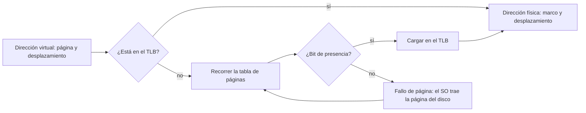

# Sistemas Operativos - Manejo de memoria

## 4.1 Utilización de la memoria; intercambio de bloques de memoria; memoria virtual; paginación y segmentación.

---

La memoria principal es el único almacenamiento al que la CPU accede directamente, y todo proceso debe estar, al menos en parte, en ella para ejecutarse. El administrador de memoria del sistema operativo decide qué partes de qué procesos ocupan la memoria, traduce las direcciones que usan los programas a direcciones físicas con ayuda del hardware, protege a cada proceso de los demás y crea la ilusión de una memoria más grande que la física. Este tema presenta el registro de la memoria libre, el intercambio, la paginación con sus tablas y su TLB, la memoria virtual con los fallos de página y el reemplazo, y la segmentación.

### Registro de la memoria

Con particiones de tamaño variable, el sistema debe saber qué regiones están libres. Un **mapa de bits** dedica un bit a cada unidad de asignación, por ejemplo 4 KiB: es compacto, pero encontrar $k$ unidades libres consecutivas requiere recorrerlo. Una **lista enlazada** de huecos y procesos, ordenada por dirección, permite unir huecos vecinos al liberar y buscar con primer, mejor o peor ajuste (tema 1.3). El sistema de **compañeros** (*buddy*) asigna bloques de potencias de 2, y une al liberar un bloque con su compañero si también está libre; Linux lo usa para los marcos físicos.

### Intercambio

El **intercambio** (*swapping*) saca un proceso completo de la memoria a un área del disco y lo trae de vuelta después, para que quepan más procesos de los que permite la memoria. Su costo es el tiempo de transferencia, $S/T$ para $S$ megabytes a $T$ MB/s, más la latencia del dispositivo, en cada dirección: sacar 100 MB a 50 MB/s, con un disco duro, tarda unos 2 s. Por eso los sistemas actuales no intercambian procesos completos sino páginas individuales, con la memoria virtual paginada.

### Paginación

La memoria física se divide en **marcos** de tamaño fijo, una potencia de 2, y el espacio de direcciones de cada proceso en **páginas** del mismo tamaño. Una dirección virtual de $m$ bits con páginas de $2^n$ bytes se divide en un **número de página**, los $m - n$ bits altos, y un **desplazamiento**, los $n$ bajos. La **tabla de páginas** del proceso da el marco de cada página, y la dirección física es el marco seguido del mismo desplazamiento:

$$\text{física} = \text{marco}(p) \cdot 2^n + d$$

Cada entrada tiene además bits de **presencia**, **protección**, lectura, escritura y ejecución, **referencia** y **modificación**, que usan el hardware y el sistema. La paginación elimina la fragmentación externa, porque cualquier marco sirve para cualquier página, a cambio de **fragmentación interna**: la última página de cada región se desperdicia en parte, en promedio media página.

Una tabla de un solo nivel para 32 bits y páginas de 4 KiB tiene $2^{20}$ entradas, 4 MiB por proceso, aunque el proceso use poco. Las **tablas multinivel** paginan la propia tabla: con dos niveles de 10 bits, solo existen las tablas de segundo nivel de las regiones usadas. x86-64 usa 4 niveles de 9 bits para 48 bits de dirección, o 5 para 57. Las **tablas invertidas** tienen una entrada por marco físico, con una búsqueda por dispersión.

### TLB

Cada acceso a memoria requeriría consultar primero la tabla, uno o más accesos adicionales. El **TLB** (*translation lookaside buffer*) es una caché asociativa de traducciones recientes, de decenas a miles de entradas, consultada en paralelo. Con una tasa de aciertos $\alpha,$ un TLB de $\varepsilon$ ns, una memoria de $m$ ns y $k$ niveles de tabla, el **tiempo efectivo de acceso** es

$$\text{TEA} = \alpha\,(\varepsilon + m) + (1 - \alpha)\,(\varepsilon + k\,m + m)$$

Gracias a la **localidad** de los programas, las tasas de acierto típicas superan el 99 %. Al cambiar de proceso, el TLB se vacía, o sus entradas se marcan con un identificador del espacio de direcciones, PCID en x86 o ASID en ARM.

### Memoria virtual

La **memoria virtual** separa el espacio de direcciones lógico de la memoria física y permite que un proceso se ejecute aunque solo parte de él esté en memoria. Con **paginación por demanda**, una página se carga solo cuando se usa. Si un proceso accede a una página con el bit de presencia en 0, el hardware genera un **fallo de página**, una trampa, y el sistema:

1. verifica que el acceso sea válido; si no, envía `SIGSEGV`;
2. busca un marco libre, o elige una **víctima** con el algoritmo de reemplazo, y la escribe en disco si fue modificada;
3. lee la página del disco al marco, bloqueando al proceso mientras tanto;
4. actualiza la tabla de páginas y reinicia la instrucción que falló.

Un fallo cuesta milisegundos con un disco duro y decenas de microsegundos con un SSD, de cien mil a cien veces más que un acceso a memoria, así que la tasa de fallos debe ser minúscula. Los algoritmos de reemplazo son el **óptimo** de Belady, que desaloja la página que se usará más tarde y solo sirve como referencia porque requiere conocer el futuro; **FIFO**, simple pero sujeto a la anomalía de Belady; **LRU**, la usada hace más tiempo, que aproxima bien al óptimo pero es caro de implementar exactamente, y el **reloj** o **segunda oportunidad**, que aproxima LRU con el bit de referencia. Si los procesos no tienen en memoria su **conjunto de trabajo**, las páginas que usan en un intervalo, el sistema pasa más tiempo paginando que ejecutando: es la **hiperpaginación** (*thrashing*).

### Segmentación

La **segmentación** divide el espacio de direcciones en **segmentos** de tamaño variable que corresponden a unidades lógicas, código, datos, pila y bibliotecas. Una dirección es un par (segmento, desplazamiento), y la **tabla de segmentos** da la **base** y el **límite** de cada uno: el hardware verifica que el desplazamiento sea menor que el límite, o genera una trampa, y suma la base. Facilita la protección y el uso compartido por unidades lógicas, pero produce **fragmentación externa**, porque los segmentos tienen tamaños distintos. El x86 de 32 bits combina ambas: la segmentación produce una dirección **lineal**, base del segmento más desplazamiento, que la paginación traduce a física. En el modo de 64 bits, la segmentación está prácticamente deshabilitada, con base 0 y sin límite, salvo los registros FS y GS, que se usan para los datos locales de cada hilo.



### Implementación en Python

El programa traduce direcciones con paginación, incluido el ejemplo del texto y el ejercicio 1 con dos interpretaciones de la entrada de la tabla; calcula el tamaño de las tablas de uno y dos niveles y el tiempo efectivo de acceso con TLB; simula FIFO, LRU y el óptimo paso a paso; calcula la fragmentación interna y externa, y traduce direcciones segmentadas con la verificación del límite.

```python
# ---------- Traducción de direcciones con paginación ----------
def traduce(dv, bits_desp, tabla):
    p, d = dv >> bits_desp, dv & ((1 << bits_desp) - 1)
    if p not in tabla: return p, d, None
    return p, d, (tabla[p] << bits_desp) | d
p, d, f = traduce(0x0BCA, 10, {2: 7})
print(f"ejemplo del texto: 0x0BCA con páginas de 1 KiB: página {p}, desplazamiento {d}, física {f} = {f:#06x}")

# ---------- Ejercicio 1 ----------
dv = 0x0012F8A4; p, d, _ = traduce(dv, 12, {})
print(f"ejercicio 1: {dv:#010x} con páginas de 4 KiB: página {p:#07x} = {p}, desplazamiento {d:#05x} = {d}")
pte = 0x000ABC01
print(f"   si la entrada entera es el número de marco: física = {pte:#x} · 4096 + {d:#x} = {(pte << 12) | d:#x}")
marco, banderas = pte >> 12, pte & 0xFFF
print(f"   si, como en x86, los 12 bits bajos son banderas: marco {marco:#x}, presente = {banderas & 1}, física = {(marco << 12) | d:#010x}")

# ---------- Tablas de páginas multinivel y TLB ----------
print(f"tabla de un nivel para 32 bits y páginas de 4 KiB: {2 ** 20:,} entradas × 4 bytes = {2 ** 20 * 4 // 2 ** 20} MiB por proceso")
print(f"con 2 niveles de 10 + 10 bits, un proceso que usa 8 MiB contiguos necesita 1 directorio + {8 * 2 ** 20 // (2 ** 10 * 4096)} tablas = {(1 + 2) * 4} KiB")
for acierto in (0.80, 0.98, 0.99):
    tea = acierto * (1 + 100) + (1 - acierto) * (1 + 4 * 100 + 100)       # TLB de 1 ns, memoria de 100 ns, 4 niveles
    print(f"   TLB con {acierto:.0%} de aciertos y tabla de 4 niveles: tiempo efectivo de acceso {tea:.1f} ns (sin TLB: {1 + 5 * 100} ns)")

# ---------- Ejercicio 2: reemplazo de páginas paso a paso ----------
cadena = [1, 2, 3, 4, 1, 2, 5, 1, 2, 3, 4, 5]
def simula(politica, marcos=3):
    m, llegada, uso, fallos, pasos = [], {}, {}, 0, []
    for t, p in enumerate(cadena):
        fallo = p not in m
        if fallo:
            fallos += 1
            if len(m) == marcos:
                if politica == "FIFO": v = min(m, key=lambda q: llegada[q])
                elif politica == "LRU": v = min(m, key=lambda q: uso[q])
                else: v = max(m, key=lambda q: cadena[t + 1:].index(q) if q in cadena[t + 1:] else 99)
                m[m.index(v)] = p
            else: m.append(p)
            llegada[p] = t
        uso[p] = t; pasos.append((p, list(m), fallo))
    return fallos, pasos
for pol in ("FIFO", "LRU", "óptimo"):
    fallos, pasos = simula(pol)
    print(f"ejercicio 2: {pol:6}: {fallos} fallos")
    print("   ref:    " + " ".join(f"{p:>3}" for p, _, _ in pasos))
    for k in range(3): print(f"   marco {k}: " + " ".join(f"{(m[k] if k < len(m) else '-'):>3}" for _, m, _ in pasos))
    print(("   fallo:  " + " ".join(f"{'F' if f else '':>3}" for _, _, f in pasos)).rstrip())
print(f"   FIFO con 4 marcos: {simula('FIFO', 4)[0]} fallos (anomalía de Belady); LRU con 4: {simula('LRU', 4)[0]}; óptimo con 4: {simula('óptimo', 4)[0]}")

# ---------- Ejercicio 3: fragmentación interna y externa ----------
tam, pag = 72_766, 2048
paginas = -(-tam // pag); interna = paginas * pag - tam
print(f"ejercicio 3: proceso de {tam:,} bytes con páginas de {pag}: {paginas} páginas, fragmentación interna {interna} bytes; promedio esperado ≈ media página")
huecos = [30, 16, 20]
print(f"   huecos libres de {huecos} KiB: {sum(huecos)} KiB libres, pero un segmento de 40 KiB no cabe en ninguno: fragmentación externa")

# ---------- Segmentación con verificación del límite ----------
SEG = {0: (1400, 1000), 1: (6300, 400), 2: (4300, 400), 3: (3200, 1100), 4: (4700, 1000)}   # base, límite (Silberschatz)
for s, dd in ((2, 53), (3, 852), (0, 1222)):
    base, lim = SEG[s]
    print(f"segmentación: segmento {s}, desplazamiento {dd}: " + (f"física {base + dd}" if dd < lim else f"trampa: {dd} ≥ límite {lim}"))

# ---------- Intercambio ----------
for mb, tasa, lat in ((100, 50, 8), (2048, 500, 0.1)):
    t = mb / tasa * 1000 + lat
    print(f"intercambio: {mb} MB a {tasa} MB/s con latencia de {lat} ms: {t:.0f} ms de salida, y otro tanto de entrada")
```

Salida:

```text
ejemplo del texto: 0x0BCA con páginas de 1 KiB: página 2, desplazamiento 970, física 8138 = 0x1fca
ejercicio 1: 0x0012f8a4 con páginas de 4 KiB: página 0x0012f = 303, desplazamiento 0x8a4 = 2212
   si la entrada entera es el número de marco: física = 0xabc01 · 4096 + 0x8a4 = 0xabc018a4
   si, como en x86, los 12 bits bajos son banderas: marco 0xab, presente = 1, física = 0x000ab8a4
tabla de un nivel para 32 bits y páginas de 4 KiB: 1,048,576 entradas × 4 bytes = 4 MiB por proceso
con 2 niveles de 10 + 10 bits, un proceso que usa 8 MiB contiguos necesita 1 directorio + 2 tablas = 12 KiB
   TLB con 80% de aciertos y tabla de 4 niveles: tiempo efectivo de acceso 181.0 ns (sin TLB: 501 ns)
   TLB con 98% de aciertos y tabla de 4 niveles: tiempo efectivo de acceso 109.0 ns (sin TLB: 501 ns)
   TLB con 99% de aciertos y tabla de 4 niveles: tiempo efectivo de acceso 105.0 ns (sin TLB: 501 ns)
ejercicio 2: FIFO  : 9 fallos
   ref:      1   2   3   4   1   2   5   1   2   3   4   5
   marco 0:   1   1   1   4   4   4   5   5   5   5   5   5
   marco 1:   -   2   2   2   1   1   1   1   1   3   3   3
   marco 2:   -   -   3   3   3   2   2   2   2   2   4   4
   fallo:    F   F   F   F   F   F   F           F   F
ejercicio 2: LRU   : 10 fallos
   ref:      1   2   3   4   1   2   5   1   2   3   4   5
   marco 0:   1   1   1   4   4   4   5   5   5   3   3   3
   marco 1:   -   2   2   2   1   1   1   1   1   1   4   4
   marco 2:   -   -   3   3   3   2   2   2   2   2   2   5
   fallo:    F   F   F   F   F   F   F           F   F   F
ejercicio 2: óptimo: 7 fallos
   ref:      1   2   3   4   1   2   5   1   2   3   4   5
   marco 0:   1   1   1   1   1   1   1   1   1   3   4   4
   marco 1:   -   2   2   2   2   2   2   2   2   2   2   2
   marco 2:   -   -   3   4   4   4   5   5   5   5   5   5
   fallo:    F   F   F   F           F           F   F
   FIFO con 4 marcos: 10 fallos (anomalía de Belady); LRU con 4: 8; óptimo con 4: 6
ejercicio 3: proceso de 72,766 bytes con páginas de 2048: 36 páginas, fragmentación interna 962 bytes; promedio esperado ≈ media página
   huecos libres de [30, 16, 20] KiB: 66 KiB libres, pero un segmento de 40 KiB no cabe en ninguno: fragmentación externa
segmentación: segmento 2, desplazamiento 53: física 4353
segmentación: segmento 3, desplazamiento 852: física 4052
segmentación: segmento 0, desplazamiento 1222: trampa: 1222 ≥ límite 1000
intercambio: 100 MB a 50 MB/s con latencia de 8 ms: 2008 ms de salida, y otro tanto de entrada
intercambio: 2048 MB a 500 MB/s con latencia de 0.1 ms: 4096 ms de salida, y otro tanto de entrada
```

### Ejercicios Propuestos

1. **Cálculo de direcciones.** Un sistema tiene direcciones virtuales de 32 bits y páginas de 4 KB. Para la dirección virtual `0x0012F8A4`, ¿cuáles son el número de página y el desplazamiento? Si la entrada de la tabla de páginas contiene `0x000ABC01`, ¿cuál es la dirección física, suponiendo que el valor de la tabla es el número de marco?

2. **Reemplazo de páginas.** Para la secuencia de referencias 1, 2, 3, 4, 1, 2, 5, 1, 2, 3, 4, 5, ¿cuántos fallos de página ocurren con FIFO, LRU y el óptimo con 3 marcos inicialmente vacíos? Muestra el contenido de los marcos paso a paso.

3. **Fragmentación.** Explica la diferencia entre la fragmentación interna, asociada a la paginación, y la externa, asociada a la segmentación, con un ejemplo numérico de cada una.

### Soluciones

**Ejercicio 1.** Con páginas de $4\,\text{KiB} = 2^{12}$ bytes, los 12 bits bajos, los 3 dígitos hexadecimales finales, son el desplazamiento, y los 20 altos el número de página: página `0x0012F` = 303, desplazamiento `0x8A4` = 2 212. Si, como dice el enunciado, todo el valor `0x000ABC01` es el número de marco, la dirección física es `0x000ABC01` × 4 096 + `0x8A4` = `0xABC018A4`: el marco se recorre 12 bits a la izquierda y se le pega el desplazamiento. Pero el valor termina en 1, lo que sugiere el formato real de una entrada de x86 de 32 bits, en el que los 12 bits bajos son banderas, con el bit 0 de presencia, y los 20 altos el marco: entonces el marco es `0xAB`, la página está presente y la dirección física es `0x000AB8A4`. En un examen conviene indicar qué interpretación se usa.

**Ejercicio 2.** Los marcos, columna por columna, y los fallos marcados con F están en la salida del programa. **FIFO** causa 9 fallos: tras cargar 1, 2 y 3, cada página nueva desaloja a la más antigua, y las referencias 1 y 2 de las posiciones 8 y 9 aciertan. **LRU** causa 10: en esta secuencia, que repite un ciclo de 5 páginas con 3 marcos, siempre desaloja a la que se pedirá pronto. El **óptimo** causa 7: al llegar el 4 desaloja al 3, que no se vuelve a usar hasta mucho después, y al llegar el 5 desaloja al 4. La misma cadena con 4 marcos muestra la **anomalía de Belady**: FIFO causa 10 fallos, más que con 3, mientras que LRU baja a 8 y el óptimo a 6. LRU y el óptimo son **algoritmos de pila**, en los que el conjunto de páginas en memoria con $k$ marcos siempre está contenido en el de $k + 1,$ y no pueden sufrir la anomalía.

**Ejercicio 3.** La **fragmentación interna** es espacio desperdiciado **dentro** de una unidad asignada, porque la unidad es más grande que lo pedido. Un proceso de 72 766 bytes con páginas de 2 048 bytes necesita 36 páginas, 73 728 bytes, y desperdicia 962 bytes en la última; en promedio se pierde media página por región, lo que favorece páginas pequeñas, aunque estas agrandan las tablas. La **fragmentación externa** es espacio libre **entre** las unidades asignadas, dividido en huecos demasiado pequeños: con huecos de 30, 16 y 20 KiB hay 66 KiB libres, pero un segmento de 40 KiB no cabe en ninguno. La paginación elimina la externa porque cualquier marco libre sirve; la segmentación, sin paginación, la sufre, y se combate con compactación o con mejores políticas de colocación.

El material original anunciaba que la página 3 estaba en el marco 7, pero luego calculaba con la página 2, que es la que corresponde a `0x0BCA`; y afirmaba que x86-64 combina segmentación y paginación, cuando eso describe al x86 de 32 bits; también describía la dirección virtual segmentada como un selector con una dirección lineal, cuando es un selector con un desplazamiento, y la dirección lineal es el resultado.

### Referencias

1. Silberschatz, A., Galvin, P. B., and Gagne, G., _Operating System Concepts_. 10a ed., Wiley, 2018. Capítulos 9 y 10.
2. Tanenbaum, A. S., and Bos, H., _Modern Operating Systems_. 5a ed., Pearson, 2023. Capítulo 3.
3. Arpaci-Dusseau, R. H., and Arpaci-Dusseau, A. C., _Operating Systems: Three Easy Pieces_. 2023. Capítulos 13 a 23.
4. Belady, L. A., A study of replacement algorithms for a virtual-storage computer. _IBM Systems Journal_ 5(2), 1966.
5. Denning, P. J., The working set model for program behavior. _Communications of the ACM_ 11(5), 1968.
6. Intel, _Intel 64 and IA-32 Architectures Software Developer's Manual_, vol. 3A, capítulos 3 y 4.
