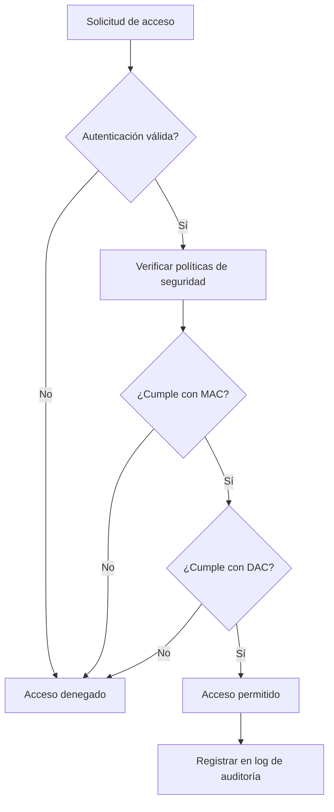

# Sistemas Operativos - Seguridad

## 5.1 Políticas y mecanismos; sistemas seguros; mecanismos de protección.

---

### Introducción a la seguridad en sistemas operativos

La seguridad en sistemas operativos se refiere a las técnicas y mecanismos que protegen los recursos del sistema contra accesos no autorizados, daños maliciosos y garantizan la confidencialidad, integridad y disponibilidad de la información.

### Conceptos fundamentales

#### Políticas de seguridad vs. Mecanismos de seguridad

**Política de seguridad**: Define qué acciones están permitidas y qué acciones están prohibidas en el sistema. Establece las reglas que determinan cómo se gestiona el acceso a los recursos.

**Mecanismo de seguridad**: Son las implementaciones técnicas que ejecutan y hacen cumplir las políticas de seguridad. Incluyen hardware y software.

La distinción clave es:

- **Política**: Qué se debe proteger (decisiones de diseño)
- **Mecanismo**: Cómo se protege (implementación técnica)

### Principios de diseño para sistemas seguros

#### Principio de mínimo privilegio

Cada usuario y proceso debe tener solo los privilegios necesarios para realizar sus tareas específicas.

#### Principio de mediación completa

Cada acceso a cada objeto debe ser verificado para autorización.

#### Principio de diseño abierto

La seguridad no debe depender del secreto del diseño o implementación.

### Modelos formales de seguridad

#### Modelo de Bell-LaPadula

Modelo de seguridad multinivel que se enfoca en la confidencialidad:

- **Propiedad simple (ss-property)**: No lectura hacia arriba
  Un sujeto con nivel de seguridad S puede leer un objeto con nivel de seguridad O solo si S ≥ O

- **Propiedad estrella (\*-property)**: No escritura hacia abajo
  Un sujeto con nivel de seguridad S puede escribir un objeto con nivel de seguridad O solo si S ≤ O

#### Modelo Biba

Modelo que se enfoca en la integridad:

- **Propiedad simple de integridad**: No lectura hacia abajo
- **Propiedad estrella de integridad**: No escritura hacia arriba

### Mecanismos de protección

#### Control de acceso discrecional (DAC)

Permite a los propietarios de objetos decidir quién puede acceder a sus recursos.

Matriz de acceso:

|           | Archivo A | Archivo B | Impresora |
| --------- | --------- | --------- | --------- |
| Usuario 1 | Lectura   | -         | Escritura |
| Usuario 2 | Escritura | Lectura   | -         |
| Usuario 3 | -         | Escritura | Lectura   |

#### Control de acceso obligatorio (MAC)

El sistema impone políticas de acceso basadas en etiquetas de seguridad.

### Implementación de mecanismos de protección

#### Listas de control de acceso (ACL)

Estructura que especifica qué usuarios tienen acceso a un objeto y qué operaciones pueden realizar.

```c
// Estructura simplificada de una ACL
struct acl_entry {
    uid_t user_id;
    permission_t permissions;
    struct acl_entry *next;
};

struct object {
    char *name;
    struct acl_entry *acl;
    // otros campos...
};
```

#### Capacidades

Tokens que otorgan derechos de acceso a poseedores específicos.

```python
# Ejemplo simplificado de capacidades en Python
class Capability:
    def __init__(self, object_id, permissions):
        self.object_id = object_id
        self.permissions = permissions
        self.token = self._generate_token()

    def _generate_token(self):
        import hashlib
        import os
        return hashlib.sha256(os.urandom(32)).hexdigest()

# Uso de capacidades
file_capability = Capability("file123", ["read", "write"])
```

### Autenticación y autorización

#### Autenticación

Verificación de la identidad de un usuario o proceso.

$$ P(A|B) = \frac{P(B|A) \cdot P(A)}{P(B)} $$

Donde en contexto de seguridad, podríamos considerar la probabilidad de que una identidad sea auténtica dado cierta evidencia.

#### Funciones hash para contraseñas

$$ hash(password + salt) = digest $$

Ejemplo con SHA-256:

```python
import hashlib
import os

def hash_password(password):
    salt = os.urandom(32)
    digest = hashlib.pbkdf2_hmac('sha256', password.encode(), salt, 100000)
    return salt + digest

def verify_password(stored, password):
    salt = stored[:32]
    stored_digest = stored[32:]
    new_digest = hashlib.pbkdf2_hmac('sha256', password.encode(), salt, 100000)
    return new_digest == stored_digest
```

### Sistemas seguros

#### Características de sistemas operativos seguros

1. **Autenticación robusta**
2. **Control de acceso granular**
3. **Auditoría y logging**
4. **Protección de memoria**
5. **Aislamiento de procesos**
6. **Comunicaciones seguras**

#### Niveles de seguridad (TCSEC - Orange Book)

- **D**: Protección mínima
- **C**: Protección discrecional (C1, C2)
- **B**: Protección obligatoria (B1, B2, B3)
- **A**: Verificación formal (A1)

### Diagrama de flujo de control de acceso



### Ejemplos prácticos

#### Ejemplo 1: Implementación de ACL en Linux

```bash
# Ver permisos de archivo
ls -l archivo.txt
# -rw-r--r-- 1 usuario grupo 1024 Jun 12 10:30 archivo.txt

# Cambiar permisos
chmod 755 script.sh
chown usuario:grupo archivo.txt

# ACL extendida
setfacl -m u:nuevousuario:rwx archivo.txt
getfacl archivo.txt
```

#### Ejemplo 2: Política de seguridad en Windows

Windows implementa both DAC y MAC a través de:

- Listas de control de acceso (ACL)
- Tokens de acceso
- Privilegios de usuario
- Políticas de grupo

### Ejercicios propuestos

#### Ejercicio 1: Análisis de políticas

Analice el siguiente escenario y proponga una política de seguridad adecuada:

"Una empresa tiene tres departamentos: Finanzas, RH y Ventas. Los archivos de Finanzas solo deben ser accesibles por personal de Finanzas, excepto los reportes mensuales que pueden ser leídos por gerentes de todos los departamentos."

#### Ejercicio 2: Implementación de mecanismos

Diseñe un sistema de capacidades para un sistema de archivos donde:

- Cada usuario puede tener diferentes niveles de acceso a diferentes archivos
- Las capacidades deben ser verificables pero no falsificables
- El sistema debe poder revocar capacidades

#### Ejercicio 3: Modelo formal

Modele el siguiente requisito de seguridad usando Bell-LaPadula:

"En una organización militar, los documentos clasificados como 'Secreto' no pueden ser leídos por personal con clearance 'Confidencial', pero el personal con clearance 'Secreto' puede escribir en documentos 'Confidencial'."

### Caso de estudio: SELinux

Security-Enhanced Linux implementa MAC en el kernel Linux:

- **Políticas basadas en tipos**: Cada objeto tiene un tipo de seguridad
- **Contextos de seguridad**: Usuarios, roles y tipos
- **Políticas estrictas**: Define transiciones permitidas

```bash
# Ver contexto de seguridad de un proceso
ps -Z

# Ver contexto de seguridad de un archivo
ls -Z

# Cambiar contexto de seguridad
chcon -t httpd_sys_content_t /var/www/html/index.html
```

### Referencias

#### Bibliografía básica

1. Tanenbaum, A. S., Modern Operating Systems, 3rd ed., Prentice Hall, 2007. (Capítulos 1, 5, 9)
2. Silberschatz, A., Galvin, P. B., Gagne, G., Operating Systems Concepts, 8th ed., John Wiley and sons, 2008. (Capítulo 14)
3. Stallings, W., Operating Systems: Internals and Design Principles, 7th ed., Prentice Hall, 2011 (Capítulo 15)

#### Bibliografía complementaria

1. Bach, M., The Design of the UNIX Operating System, Prentice Hall, 1986. (Capítulos 2, 7)
2. Bovet, D. P., Cesati, M., Understanding the Linux Kernel, O'Reilly, 2000. (Capítulos 1, 20)

### Recursos adicionales

- **Herramientas de auditoría**: auditd, Lynis, OpenSCAP
- **Frameworks de seguridad**: SELinux, AppArmor, Tomoyo
- **Estándares**: Common Criteria, ISO/IEC 27001
